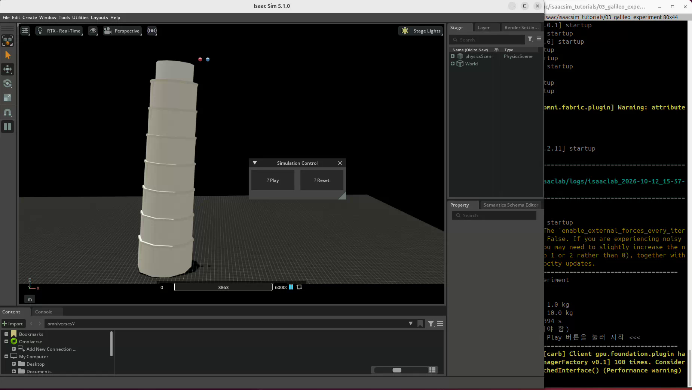
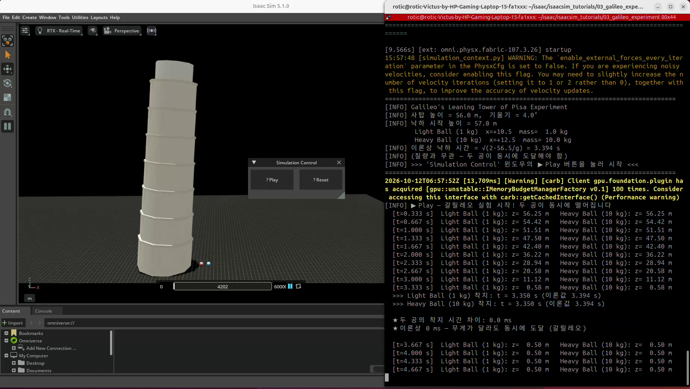

# 03. 갈릴레오 자유낙하 실험

실습일: 2026-10-12

## 실험 목적

질량이 다른 두 공을 같은 높이에서 동시에 떨어뜨려 낙하 시간을 비교한다.
공기 저항을 모델링하지 않은 조건에서 질량에 관계없이 같은 중력 가속도로 떨어지는지 확인한다.

## 참고 자료와 실행 방법

- 강좌: PinkLAB 「강좌 03 - 03_galileo_experiment」
- [이 저장소에서 실습 코드 보기](03_galileo_experiment.py)
- 코드 출처: [PinkWink 원본 튜토리얼](https://github.com/PinkWink/isaacsim_tutorials/blob/14f85fc6edece7cbb1faa50aa9fe3adef205e87a/03_galileo_experiment/03_galileo_experiment.py)
- 확인한 원본 저장소 커밋: `14f85fc6edece7cbb1faa50aa9fe3adef205e87a`
  - 위 버전의 코드를 수정 없이 이 폴더에 포함했다.

아래 명령으로 실행한다. 저장소 경로는 실제 위치에 맞게 조정한다.

```bash
cd <physical-ai-training 저장소 경로>/03-galileo
python 03_galileo_experiment.py
```

앱 실행 후 `Simulation Control`의 Play 버튼으로 낙하를 시작하고 Reset 버튼으로 초기화한다.

## 실험 조건

강의 자료와 화면 출력에서 확인한 조건이다.

| 항목 | 값 |
|---|---|
| 가벼운 공 | 빨간색, 1 kg |
| 무거운 공 | 파란색, 10 kg |
| 공 반지름 | 0.5 m |
| 공 중심의 시작 높이 | 57.0 m |
| 지면 접촉까지의 이론적 낙하 거리 | 56.5 m |
| 중력 가속도 크기 | 9.81 m/s² |
| 물리 시간 간격 | 1/60 s (강의 코드 기준) |
| 사탑 | 높이 56 m, 기울기 4° |
| 공기 저항 | 모델링하지 않음 |

이론적 낙하 시간은 `t = sqrt(2h/g)`로 계산하면 약 **3.394초**이다.

## 결과물

### 시작 장면

<p align="center">
  
</p>

### 녹화 영상

[원본 화면 녹화 보기 / 다운로드 (WebM, 약 7.2초)](videos/galileo-experiment.webm)

파일의 실습 녹화 시각은 2026-10-12 15:58:58이다. 아래 이미지는 이 영상에서 추출했다.

### 착지 결과

<p align="center">
  
</p>

| 기록 | 1 kg 공 착지 시간 | 10 kg 공 착지 시간 | 시간 차이 |
|---|---|---|---|
| 저장된 녹화 영상 | 3.350 s | 3.350 s | 0.0 ms |
| 대화에 첨부한 별도 결과 사진 | 3.367 s | 3.367 s | 0.0 ms |

별도 결과 사진의 원본 이미지 파일은 이 폴더에 포함하지 않았으며, 표에는 해당 화면에서 읽은 값을 기록했다.
두 기록의 절대 착지 시간은 다르지만 각 기록 안에서 두 공의 시간 차이는 모두 0.0 ms였다.
두 기록 사이의 차이가 발생한 정확한 원인은 확인하지 않았다.

이는 시뮬레이션의 시간 간격과 착지 판정 기준에서 두 공이 같은 시점에 도착한 것으로 측정됐다는 뜻이다.
연속 시간에서 무한한 정밀도로 측정한 결과를 의미하지는 않는다.
강의 코드의 착지 판정은 공 중심 높이가 반지름에 0.02 m를 더한 기준 이하인지 확인하는 방식이다.
이론값과 측정값을 비교할 때는 물리 시간 간격, 수치 계산, 착지 판정 기준을 함께 고려해야 한다.

## 이번 실습에서 배운 점

- 코드로 원기둥과 구를 생성하고 위치·크기·색을 지정해 장면을 구성할 수 있다.
- 강체, 질량, 충돌 속성을 적용하면 물체가 중력에 의해 떨어지고 지면과 충돌한다.
- 실행·초기화 UI를 만들고 시뮬레이션 진행을 제어할 수 있다.
- 물체의 위치를 읽고 착지 시점을 기록하면 단순 시각화를 넘어 실험 결과를 비교할 수 있다.
- 공기 저항이 없는 자유낙하에서는 `F = mg`, `a = F/m = g`이므로 질량이 달라도 가속도는 같다.

## 느낀 점과 앞으로 확인할 내용

Unity나 Unreal처럼 3D 객체를 배치하고 물리 속성을 설정하는 방식과 비슷하다고 느꼈다.
코드로 사탑과 공을 만들고 중력과 충돌을 적용하는 모습을 보면서, 직접 생각한 환경을 구성할 수 있다는 점을 알게 되었다.

이 방식을 확장하면 작업대, 제조 설비, 로봇 등을 배치하고 동작을 시험할 수 있을 것 같다.
Unity에서 디지털 트윈을 다뤘던 경험과 연결해 다음 내용을 더 알아보고 싶다.

- 직접 만든 환경에 로봇 모델을 넣고 관절과 구동기를 제어하는 방법
- 카메라·LiDAR·접촉 센서로 데이터를 얻는 방법
- 로봇팔의 집기·놓기 동작을 작은 제조 셀로 확장하는 방법
- 실제 설비 데이터를 연결하고 시뮬레이션 결과를 실측과 비교하는 방법

Unity는 범용 앱·시각화 개발에 활용하기 좋고, Isaac Sim은 로봇·센서·ROS 2 관련 도구를 제공한다.
강화학습 환경은 Isaac Lab을 활용해 구성할 수 있다.
제조 설비에 적용할 때는 형상뿐 아니라 질량·관성·마찰·제어 조건을 맞추고 실제 데이터로 검증해야 한다.

다음 학습은 04번 시뮬레이션 루프 → 05번 로봇 배치 → 06번 관절 제어 → 07번 장면 구성으로 이어갈 예정이다.
