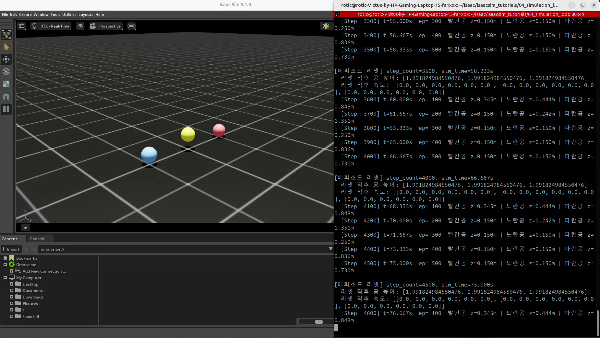
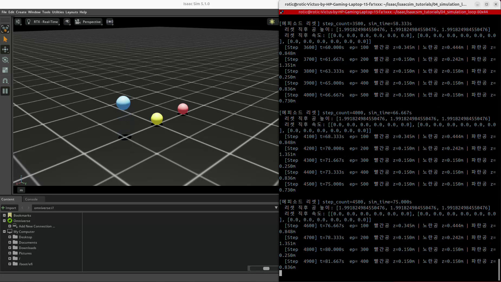

# 04. 시뮬레이션 루프와 탄성 비교 실험

실습일: 2026-10-12

## 실험 목적

같은 높이에서 서로 다른 반발 계수(restitution)를 가진 세 공을 떨어뜨려 튀는 정도를 비교한다.
물리 시간 간격, 시뮬레이션 루프, 위치 측정과 에피소드 리셋을 익힌다.
원본 강의 코드로 발생한 리셋 문제를 수정하고, 공들이 반복해서 낙하하는 결과를 기록했다.

## 코드와 실행 방법

- [수정된 실습 코드](04_simulation_loop.py)
- 출처: PinkLAB 「강좌 04 - 04_simulation_loop 탄성 실험」
- [PinkWink 원본 튜토리얼](https://github.com/PinkWink/isaacsim_tutorials/tree/main/04_simulation_loop)
- 이 폴더의 Python 파일은 실습에서 정상 동작을 확인한 수정본을 그대로 저장했다. 비교를 위해 주석 처리한 기존 리셋 코드도 포함한다.

아래 명령으로 실행한다. 저장소 경로는 실제 위치에 맞게 조정한다.

```bash
cd <physical-ai-training 저장소 경로>/04-simulation-loop
python 04_simulation_loop.py
```

GUI 없이 실행하려면 마지막 명령에 `--headless`를 추가한다.

## 실험 조건

| 항목 | 설정 |
|---|---|
| 공 중심의 생성 높이 | 2.0 m |
| 공 반지름 | 0.15 m |
| 질량 | 세 공 모두 1.0 kg |
| 빨간공 | x = -1.0 m, restitution = 0.2 |
| 노란공 | x = 0.0 m, restitution = 0.5 |
| 파란공 | x = +1.0 m, restitution = 0.9 |
| 바닥 restitution | 1.0 |
| 공의 정지·동마찰 계수 | 각각 0.5 |
| 물리 시간 간격 | 1/60 s |
| 위치 출력 | 100 step마다 |
| 에피소드 리셋 | 500 step마다, 시뮬레이션 시간 약 8.333초 |

공에 입력한 restitution과 접촉에 사용되는 유효 반발 계수는 구분해야 한다.
접촉 결과에는 바닥 재질과 재질 결합 방식도 영향을 준다.
average 결합이라면 공과 바닥 값의 평균이므로, 바닥이 1.0이라고 해서 공의 입력값이 그대로 적용되는 것은 아니다.
이 실습에서는 동일한 바닥에서 공의 설정값에 따른 반동 차이를 비교했다.

## 결과물

### 반동 비교



세 공의 반동이 다르고, 반발 계수가 큰 파란공은 더 오래 튀는 모습을 관찰했다.
공이 점점 정지하는 동작과 별개로, 에피소드 리셋 후에는 다시 위쪽에서 낙하해야 한다.

### 원본 녹화 영상

[화면 녹화 보기 / 다운로드 (WebM, 약 11초)](videos/restitution-reset.webm)

원본 파일명: `Screencast from 2026-10-12 17-18-47.webm`.
문서의 두 이미지는 이 영상에서 추출했다. 영상에는 이미 실행 중인 실험의 반복 리셋 구간이 담겨 있다.

### 리셋 성공 확인



영상의 터미널에서 확인한 리셋 예시는 다음과 같다.

| 전체 step | 누적 시뮬레이션 시간 | 리셋 결과 |
|---|---|---|
| 3500 | 58.333 s | 세 공의 높이 약 1.9918 m, 선속도·각속도 0 |
| 4000 | 66.667 s | 같은 초기 상태로 복원 |
| 4500 | 75.000 s | 같은 초기 상태로 복원 |
| 5000 | 83.333 s | 같은 초기 상태로 복원 |

영상에서는 리셋 이후 다시 낙하·반동이 반복되고, 다음 에피소드의 위치 출력도 반복되는 것을 확인할 수 있다.
시뮬레이션의 누적 시간과 영상의 실제 재생 시간은 서로 다르다.

## 강체 초기화 방식

### 1. XformPrimView 대신 RigidPrim 사용

물리 강체의 자세와 속도를 다루기 위해 `RigidPrim`을 사용한다.

```python
from isaacsim.core.prims import RigidPrim

balls_view = RigidPrim(
    prim_paths_expr=BALL_PATTERN,
    name="balls_view",
)
balls_view.initialize()
```

### 2. 실제 초기 자세를 View 순서대로 저장

초기 위치를 별도 리스트로 만들던 부분을, View에서 읽은 위치·방향을 복사하는 방식으로 바꿨다.
View 내부의 공 순서와 복원할 상태의 순서가 일치하도록 한다.

```python
initial_positions, initial_orientations = balls_view.get_world_poses()
reset_positions = initial_positions.clone()
reset_orientations = initial_orientations.clone()
reset_velocities = torch.zeros_like(balls_view.get_velocities())
```

이 코드는 `sim.reset()` 이후 읽은 상태를 초기 상태로 사용한다.
실제 로그에서 저장·복원된 높이는 세 공 모두 약 **1.9918249846 m**였다.
따라서 생성 시 지정한 2.0 m와 복원 높이를 구분한다.
정확히 2.0 m로 복원하려면 저장한 `reset_positions`의 z 값을 명시적으로 바꿔야 하지만,
이번 결과물에는 실습에서 확인한 코드를 그대로 남겼다.

### 3. 위치·방향과 속도를 함께 초기화

위치를 바꾸는 것만으로 선속도와 각속도가 자동으로 0이 되지는 않는다.
이전 낙하·반동·회전의 영향을 제거하기 위해 속도도 별도로 초기화했다.

```python
balls_view.set_world_poses(
    positions=reset_positions,
    orientations=reset_orientations,
)
balls_view.set_velocities(reset_velocities)
episode_step = 0
```

### 4. 실제 상태를 읽어 리셋 결과 확인

고정된 성공 문구 대신, 설정 직후 위치와 속도를 다시 읽어 출력하도록 수정했다.

```python
restored_positions, _ = balls_view.get_world_poses()
restored_velocities = balls_view.get_velocities()
```

영상에서 세 공의 높이 복원과 속도 0을 확인했고, 실습 PC에서 반복 낙하도 정상 동작했다.

## 배운 점

- `sim.step()`은 물리 시간을 진행하고, `dt`와 step 수로 시뮬레이션 시간을 계산할 수 있다.
- `step_count`는 전체 실행 횟수이고, `episode_step`은 리셋할 때 0으로 돌아가는 에피소드 내부 카운터다.
- 엔진 초기화와 에피소드의 객체 상태 복원은 구분해야 한다.
- 물리 객체를 리셋할 때는 위치·방향뿐 아니라 선속도·각속도도 고려해야 한다.
- 장면의 변환 정보를 바꾸는 API와 실행 중인 강체를 제어하는 API를 구분해야 한다.
- 성공 메시지 출력만으로 완료를 판단하지 않고, 실제 상태와 다음 동작을 함께 확인해야 한다.
- 제조 설비나 로봇의 반복 실험도 초기 상태를 일관되게 복원해야 결과를 비교할 수 있다.
