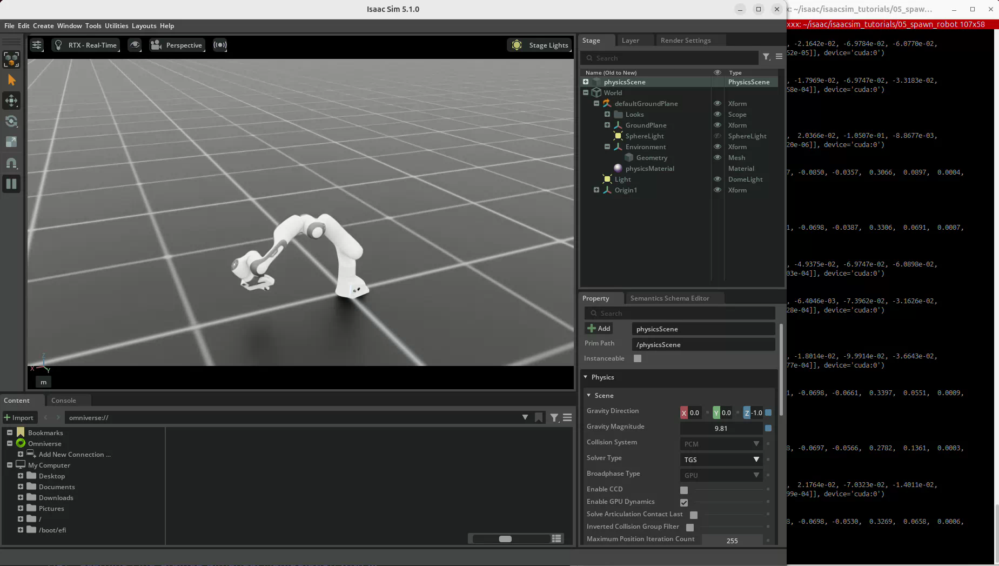
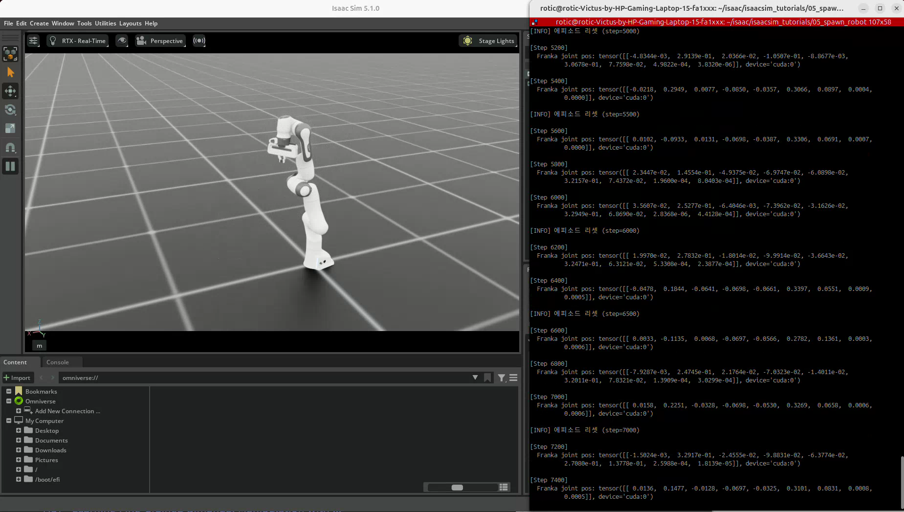

# 05. Franka Panda 로봇 아티큘레이션 스폰

실습일: 2026-10-13

## 실습 목적

사전 정의된 Franka Panda 설정을 사용해 로봇을 장면에 배치한다.
관절에 랜덤 effort 명령을 적용하고, 관절 상태를 읽으며 주기적으로 기본 자세로 리셋한다.
공 하나의 강체 상태를 다룬 04번에서 여러 링크와 관절로 연결된 로봇을 다루는 단계로 넘어간다.

## 코드와 실행 방법

- [이 저장소에서 실습 코드 보기](05_spawn_robot.py)
- 출처: PinkLAB 「강좌 05 - 05_spawn_robot」
- [PinkWink 원본 튜토리얼](https://github.com/PinkWink/isaacsim_tutorials/tree/main/05_spawn_robot)
- 첨부한 실습 코드를 수정 없이 이 폴더에 저장했다.
- PC 사양과 실행 환경: [메인 README의 공통 실습 환경](../README.md#공통-실습-환경)

공통 실행 준비로 가상환경을 활성화한 뒤 아래 명령을 실행한다. 로봇 에셋을 사용할 수 있어야 하며, 설치 경로는 실제 PC에 맞게 조정한다.

```bash
cd <physical-ai-training 저장소 경로>/05-spawn-robot
python 05_spawn_robot.py
```

GUI 없이 실행하려면 `--headless`를 추가한다.

## 실습 구성

| 항목 | 설정 |
|---|---|
| 로봇 | Franka Panda |
| 관절 구성 | 로봇팔 7개 + 그리퍼 핑거 2개 |
| 사전 정의 설정 | `FRANKA_PANDA_CFG` |
| 로봇 배치 경로 | `/World/Origin1/Robot` |
| 장면 | 바닥, 돔 조명, 로봇 |
| 물리 시간 간격 | 1/60 s |
| 관절 입력 | 매 step `torch.randn_like(joint_pos) * 5.0` |
| 상태 출력 | 200 step마다 `franka.data.joint_pos` |
| 에피소드 리셋 | 시작 시 step 0, 이후 500 step마다 |

500 step은 시뮬레이션 시간 약 8.333초에 해당한다. 실제 경과 시간과 반드시 같지는 않다.
랜덤 입력의 배율 5.0은 정규분포의 표준편차를 조절하는 값이며, 입력이 ±5로 제한된다는 뜻은 아니다.
회전 관절의 effort는 토크이고 직선 관절의 effort는 힘이다.
실제 움직임에는 사전 정의된 구동기의 설정과 제한도 영향을 준다.

## 결과물

### 로봇 배치



바닥 위에 로봇이 배치되고, 랜덤 관절 입력에 따라 자세가 변하는 모습을 관찰했다.

### 원본 녹화 영상

[화면 녹화 보기 / 다운로드 (WebM, 약 11.5초)](videos/franka-spawn.webm)

원본 파일명: `Screencast from 2026-10-13 10-12-13.webm`.
문서의 두 이미지는 이 영상에서 추출했다. 녹화는 이미 실행 중인 실습의 일부 구간이다.

### 관절 상태와 반복 리셋



첨부 사진에서는 step 2000, 2500, 3000, 3500, 4000의 리셋 로그가 보인다.
저장한 영상에서도 step 5000, 5500, 6000, 6500, 7000 등의 리셋 로그와 관절 상태 출력을 확인할 수 있다.
사진과 영상은 서로 다른 실행 구간이며, 위 이미지 파일은 영상에서 추출한 장면이다.

- 화면에서 로봇의 자세가 변한다.
- 터미널에는 9개 관절의 상태가 텐서로 출력되고 값이 달라진다.
- 500 step 간격으로 에피소드 리셋이 실행된다.

이 실습은 로봇 배치와 상태 제어를 확인하는 예제이다. 목표 위치 추종, 물체 집기 또는 강화학습을 수행하는 코드는 아니다.

## 코드의 핵심 흐름

### 1. 사전 정의 설정으로 로봇 생성

```python
franka_cfg = FRANKA_PANDA_CFG.copy()
franka_cfg.prim_path = "/World/Origin1/Robot"
franka = Articulation(cfg=franka_cfg)
```

`Articulation`은 관절로 연결된 링크들을 하나의 로봇으로 다룬다.
사전 정의 설정을 복사해 사용하므로 이번 실습에서는 URDF 변환이나 구동기 구성을 직접 작성하지 않았다.

### 2. 기본 상태로 에피소드 리셋

```python
root_state = franka.data.default_root_state.clone()
franka.write_root_pose_to_sim(root_state[:, :7])
franka.write_root_velocity_to_sim(root_state[:, 7:])

joint_pos = franka.data.default_joint_pos.clone()
joint_vel = franka.data.default_joint_vel.clone()
franka.write_joint_state_to_sim(joint_pos, joint_vel)
franka.reset()
```

04번에서 공의 자세와 속도를 함께 초기화했던 것처럼, 로봇도 루트의 자세·속도와 관절의 위치·속도를 함께 복원한다.
`franka.reset()`은 로봇의 내부 버퍼와 구동기 상태 등을 초기화하는 단계이며,
기본 자세를 물리 엔진에 쓰는 `write_*_to_sim()` 호출을 대신하지 않는다.

### 3. 명령 적용 → 물리 계산 → 상태 갱신

```python
efforts = torch.randn_like(franka.data.joint_pos) * 5.0
franka.set_joint_effort_target(efforts)
franka.write_data_to_sim()

sim.step()
franka.update(sim_dt)
```

`set_joint_effort_target()`으로 명령을 설정하고 `write_data_to_sim()`으로 물리 엔진에 반영한다.
그다음 `sim.step()`으로 시간을 진행하고 `update()`로 로봇의 상태 버퍼를 갱신한다.
`franka.data.joint_pos`로 각 관절의 현재 상태를 읽는다.
회전 관절 위치는 rad, 직선 관절 위치는 m 단위로 해석한다.

## 배운 점

- 로봇은 외형만 있는 3D 모델이 아니라 링크·관절·구동기·물리 속성을 가진 객체로 구성된다.
- 사전 정의된 설정을 활용하면 로봇을 빠르게 배치하고 제어 실험을 시작할 수 있다.
- 장면 경로인 `prim_path`와 Xform 좌표계로 로봇 배치 위치를 관리한다.
- 명령 설정, 물리 엔진 반영, 물리 계산, 상태 읽기를 구분해야 한다.
- 로봇의 반복 실험에서도 자세와 속도를 함께 초기화해야 한다.
- 제조 설비에 로봇을 배치하는 다음 단계에서는 랜덤 입력 대신 관절 목표나 작업 순서를 정의해야 한다.

## 검증 범위와 다음 단계

사용자가 제공한 코드·사진·영상에 근거해 결과를 정리했다.
저장소를 정리한 클라우드 환경에서는 코드 문법과 파일 무결성·문서 링크를 확인했으며, Isaac Sim을 새로 실행하지 않았다.

다음에는 06번의 관절 위치 제어로 목표값과 실제값을 비교하고, 07번의 장면 구성으로 여러 객체를 함께 관리하는 방법을 학습한다.
