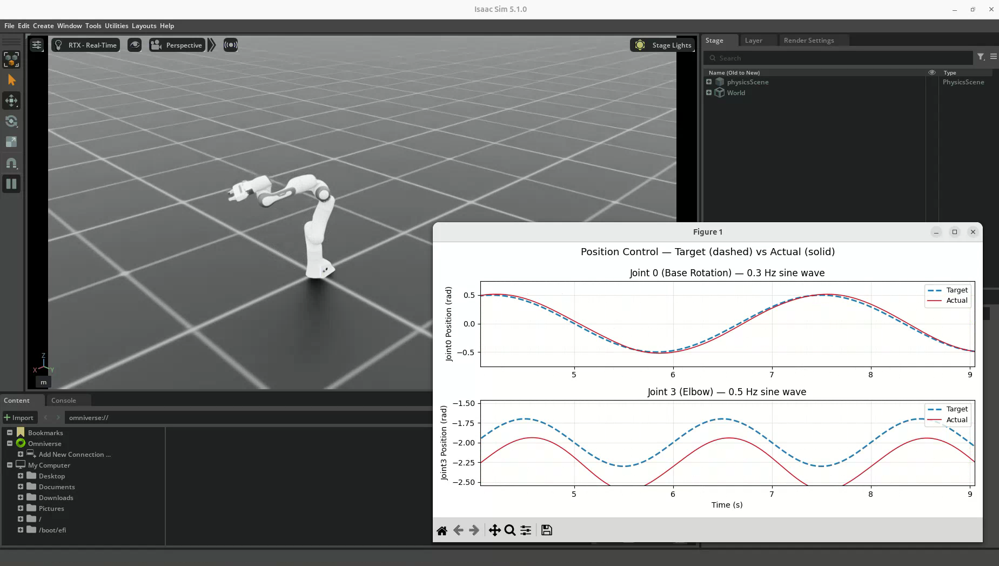
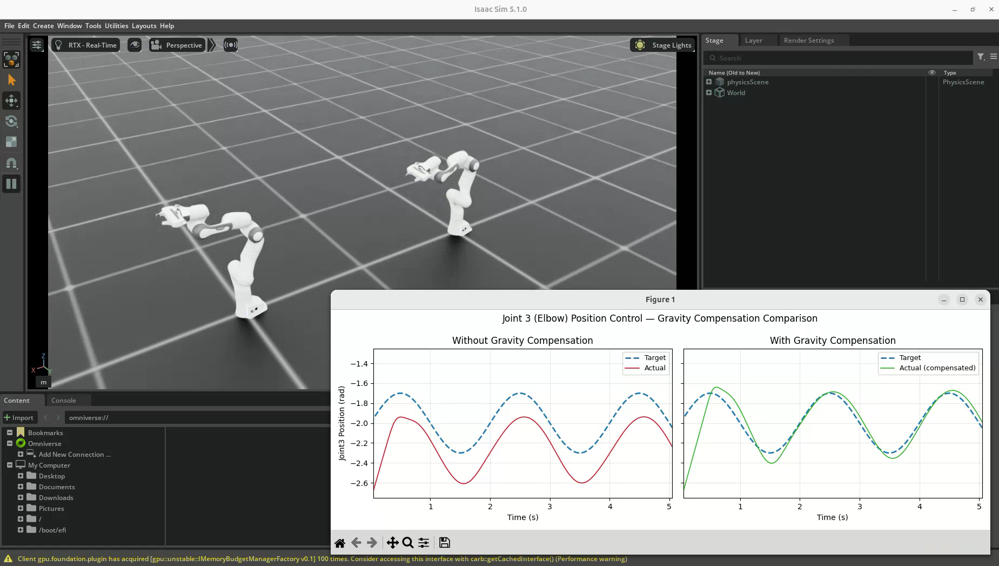
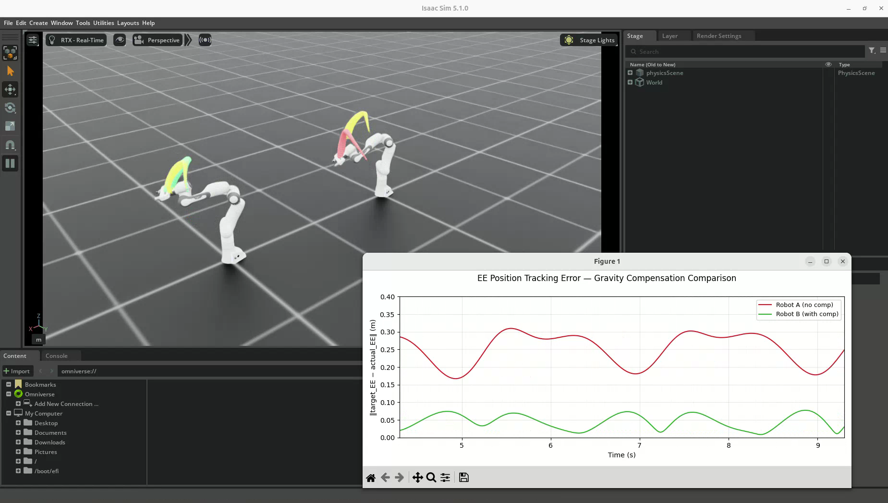
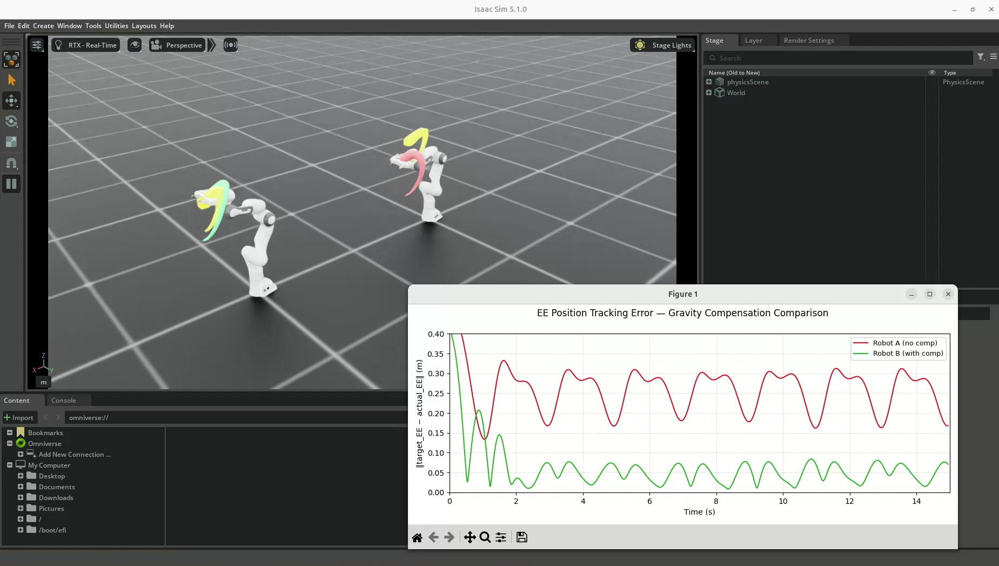

# 06. 관절 위치 제어 · 중력 보상 · 손끝 위치 시각화

실습일: 2026-10-13

Franka Panda 로봇팔에 사인파 목표 각도를 입력하고, 목표값과 실제값의 차이를 관찰했다.
기본 위치 제어 → 중력 보상 비교 → 손끝 위치 마커 비교의 세 단계로 진행했다.

## 실행 준비와 코드

- PC 사양·소프트웨어 환경·가상환경 활성화·그래프 표시 준비: [메인 README의 공통 실습 환경](../README.md#공통-실습-환경)
- 출처: PinkLAB 「강좌 06 - 06_robot_joint_control」
- [PinkWink 원본 튜토리얼](https://github.com/PinkWink/isaacsim_tutorials/tree/14f85fc6edece7cbb1faa50aa9fe3adef205e87a/06_robot_joint_control)
- 코드는 위 커밋의 세 예제를 수정 없이 포함했다. 실습 PC에서 실행한 코드의 커밋은 별도로 확인하지 않았다.
- 결과 이미지는 사용자가 제공한 영상에서 추출했다. 원본 저장소에 포함된 결과 이미지를 사용자 실습 결과로 사용하지 않았다.

공통 실행 준비 후 이 폴더로 이동한다.

```bash
cd <physical-ai-training 저장소 경로>/06-robot-joint-control
```

아래 세 파일은 하나씩 실행한다. 앞선 실행을 종료한 뒤 다음 파일을 실행한다.

| 실습 | 코드 | 실행 명령 |
|---|---|---|
| 1. 기본 관절 위치 제어 | [06_robot_joint_control.py](06_robot_joint_control.py) | `python 06_robot_joint_control.py` |
| 2. 중력 보상 비교 | [06_1_gravity_compensation.py](06_1_gravity_compensation.py) | `python 06_1_gravity_compensation.py` |
| 3. 손끝 위치 마커 | [06_2_ee_marker_visualization.py](06_2_ee_marker_visualization.py) | `python 06_2_ee_marker_visualization.py` |

## 실험 조건

| 항목 | 설정 |
|---|---|
| 대상 로봇 | Franka Panda |
| 제어 관절 | index 0: `panda_joint1` / index 3: `panda_joint4` |
| 베이스 목표 | 진폭 0.5 rad, 주파수 0.3 Hz의 사인파 |
| 팔꿈치 목표 | 중심 약 -2.0 rad, 진폭 0.3 rad, 주파수 0.5 Hz의 사인파 |
| 물리 시간 간격 | 1/60 s |
| 코드의 실행 길이 | 각 예제 시뮬레이션 시간 15초, 900 step |
| 그래프 | 실시간 최근 구간 표시, 종료 시 전체 구간 표시·파일 저장 |

관절 index는 0부터 시작한다. 녹화 영상의 재생 길이는 시작 시점과 실행 속도에 따라 시뮬레이션 시간과 다르다.

## 실습 1. 기본 관절 위치 제어

### 무엇을 했나

`set_joint_position_target()`으로 목표 각도를 설정하고,
`write_data_to_sim()` → `sim.step()` → `update()` 순서로 명령을 반영하고 상태를 갱신했다.
로봇에 설정된 구동기의 PD 제어가 목표와 실제 관절 상태의 차이에 대응한다.

### 결과

- 베이스 관절은 목표 사인파를 비교적 가깝게 따라간다.
- 팔꿈치 관절은 실제 각도가 목표보다 더 음수 쪽으로 치우쳐 있는 모습을 보인다.
- 위치 명령만으로 중력의 영향을 완전히 제거할 수 없음을 관찰했다.
- 영상의 그래프에서 목표는 파란 점선, 실제값은 빨간 실선이다.




[실습 1 원본 영상 보기 / 다운로드 — 약 20.8초](videos/01-position-control.webm)

원본 파일명: `Screencast from 2026-10-13 11-19-40.webm`.

## 실습 2. 중력 보상 적용 전후 비교

### 무엇을 추가했나

동일한 목표 각도를 받는 로봇 두 대를 배치했다.
Robot A는 위치 제어만 적용하고, Robot B는 PhysX에서 얻은 중력 보상 effort를 추가했다.
코드는 사용 가능한 중력 관련 API를 확인해 호출한다.

```python
robot_b.set_joint_position_target(target_pos_b)

if hasattr(robot_b.root_physx_view, "get_gravity_compensation_forces"):
    gravity_torques = robot_b.root_physx_view.get_gravity_compensation_forces()
else:
    gravity_torques = robot_b.root_physx_view.get_generalized_gravity_forces()

robot_b.set_joint_effort_target(gravity_torques)
robot_b.write_data_to_sim()
```

위 코드는 핵심 동작 발췌다. 전체 코드에는 API 지원 여부를 확인하는 조건도 포함되어 있다.
중력 보상은 중력을 끄는 것이 아니라, 중력의 영향을 상쇄하도록 입력을 추가하는 방식이다.

### 결과

- 왼쪽 그래프의 보상 없는 로봇은 팔꿈치 관절의 목표·실제값 차이가 지속된다.
- 오른쪽 그래프의 보상 적용 로봇은 초록 실선이 파란 목표 점선에 더 가깝다.
- 보상 후 오차가 줄지만, 초기 과도 응답과 남아 있는 추종 오차도 관찰된다.




[실습 2 원본 영상 보기 / 다운로드 — 약 29.9초](videos/02-gravity-compensation.webm)

원본 파일명: `Screencast from 2026-10-13 11-27-36.webm`.

## 실습 3. 손끝 위치 마커와 오차 비교

### 무엇을 추가했나

관절 각도의 차이를 로봇 손끝(End-Effector, EE)의 위치 차이로 확장해 관찰했다.
기준 바디는 `panda_hand`이다.

| 표시 | 의미 |
|---|---|
| 노란 큐브 | 목표 관절 각도에서 계산한 손끝 위치 |
| 빨간 구·궤적 | 중력 보상 없는 Robot A의 실제 손끝 위치 |
| 초록 구·궤적 | 중력 보상 적용 Robot B의 실제 손끝 위치 |
| 빨간 그래프 | Robot A의 목표·실제 손끝 위치 거리 |
| 초록 그래프 | Robot B의 목표·실제 손끝 위치 거리 |

목표 위치 계산에는 별도의 Ghost 로봇을 사용한다.
장면 위쪽에 둔 Ghost에 목표 관절 상태를 쓰고, 갱신된 손끝 위치에서 Ghost 배치 오프셋을 빼서 기준 위치를 만든다.
이 예제는 별도 수학적 FK 솔버 대신 시뮬레이터의 링크 상태를 활용한다.
마커의 과거 위치를 함께 표시해 손끝 궤적을 관찰한다.

### 결과

- 중력 보상 없는 로봇에서는 노란 목표 궤적과 빨간 실제 궤적의 차이가 크다.
- 보상 적용 로봇에서는 노란 목표 궤적과 초록 실제 궤적이 더 가깝다.
- EE 오차 그래프에서도 초기 과도 구간 이후 초록선이 빨간선보다 낮게 나타난다.
- 그래프의 오차 단위는 m이며, 보상 적용 후에도 오차가 완전히 0이 되는 것은 아니다.





[실습 3 원본 영상 보기 / 다운로드 — 약 20.1초](videos/03-ee-markers.webm)

원본 파일명: `Screencast from 2026-10-13 11-33-51.webm`.

## 배운 점

- 목표 각도를 지정하는 것과 실제 관절이 그 각도에 도달하는 것은 다르다.
- 위치 제어의 구동기 설정뿐 아니라 중력 등 외력도 추종 결과에 영향을 준다.
- 중력 보상은 별도 입력을 추가해 추종 오차를 줄이는 방법이다.
- 관절 오차는 손끝 위치 오차로 이어질 수 있으므로 두 관점에서 확인하는 것이 유용하다.
- 마커·궤적·그래프를 함께 보면 목표와 실제 동작을 더 쉽게 비교할 수 있다.
- 제조 설비의 집기·삽입 작업에서도 제어 명령뿐 아니라 실제 끝단 위치를 검증해야 한다.

## 실행 중 해결한 문제와 검증 범위

처음에는 그래프 창 생성 중 `tkinter`를 찾지 못해 제어 루프 이전에 종료됐다.
공통 의존성 문제와 설치 안내는 [메인 README](../README.md#공통-실습-환경)에 정리했다.
이후 제공된 세 영상에서는 그래프와 로봇 동작이 정상적으로 표시된다.

본 기록은 사용자의 영상과 강의·튜토리얼 코드를 비교해 작성했다.
정확한 평균 오차나 최대 오차는 원본 수치 로그가 없어 새로 계산하지 않았다.
클라우드에서는 코드 문법·파일 무결성·문서 링크를 확인했으며, Isaac Sim을 직접 실행하지 않았다.
