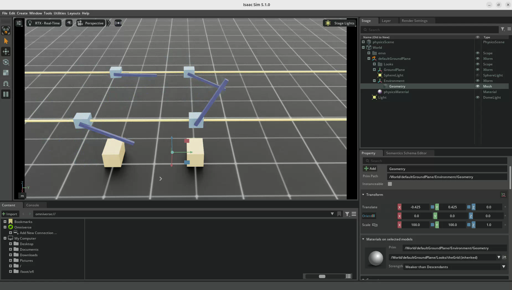
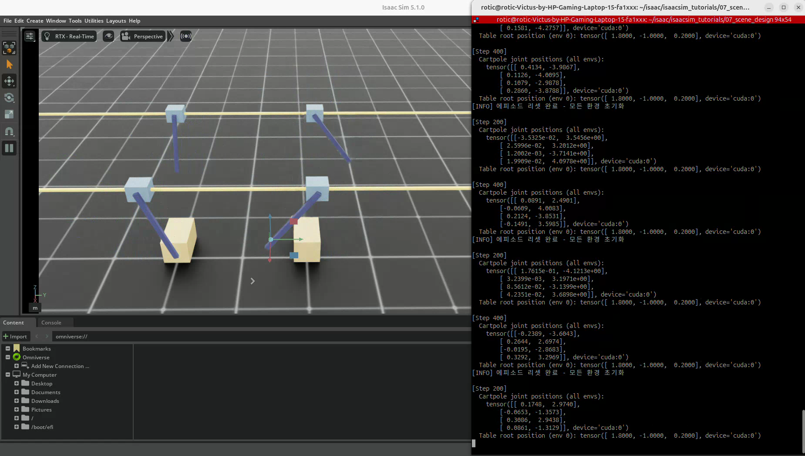
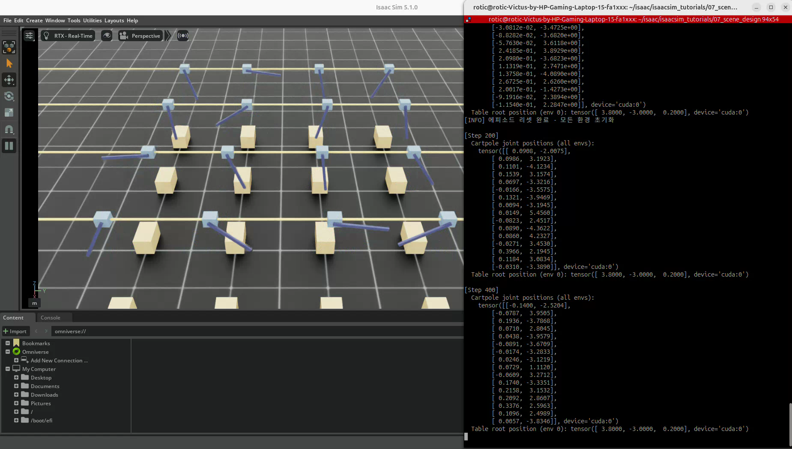
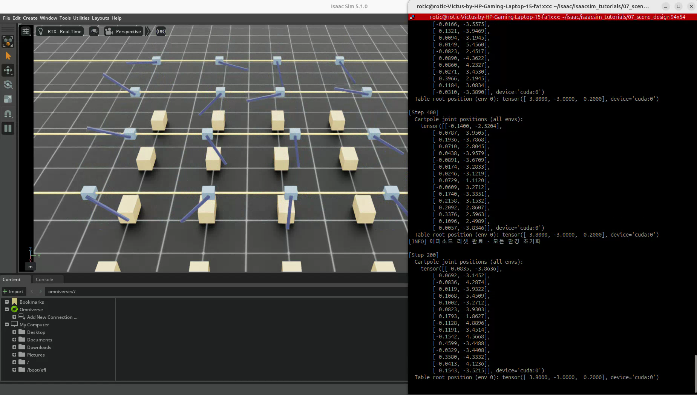

# 07. InteractiveScene으로 다중 환경 설계

실습일: 2026-10-13

## 이번 실습에서 흥미로웠던 점

여러 로봇을 실행하려면 모델을 하나씩 직접 복사해야 하는 줄 알았는데,
씬 구성을 한 번 정의한 뒤 실행 시 `--num_envs`를 바꾸는 것만으로 환경 개수를 늘릴 수 있다는 점이 흥미로웠다.

정확히는 **복제가 없어지는 것이 아니라, 환경의 복제·경로 생성·배치를 프레임워크가 자동으로 처리하는 것**이다.
이번 예제는 Cartpole과 테이블을 환경별로 배치하고, 바닥과 조명은 공유한다.

## 코드와 실행 방법

- [이 저장소에서 코드 보기](07_scene_design.py)
- 출처: PinkLAB 「강좌 07 - 07_scene_design」
- [원본 튜토리얼의 기준 버전](https://github.com/PinkWink/isaacsim_tutorials/blob/14f85fc6edece7cbb1faa50aa9fe3adef205e87a/07_scene_design/07_scene_design.py)
- 원본 코드를 수정 없이 포함했다.

이 폴더에서 실행한다.

```bash
cd <physical-ai-training 저장소 경로>/07-scene-design

# 기본값: 4개 환경
python 07_scene_design.py

# 앞선 실행을 종료한 뒤, 16개 환경으로 새로 실행
python 07_scene_design.py --num_envs 16
```

`--num_envs`는 프로그램을 시작할 때 지정하는 인자다. 실행 중인 장면의 개수를 실시간으로 변경하는 기능은 아니다.

## 환경 수와 자동 배치

환경 수는 실행 인자로 지정하고, `InteractiveScene`과 `GridCloner`가 환경 복제와 격자 배치를 처리한다.

| 설정 | 동작 |
|---|---|
| 기본 환경 수는 4개 | `parser.add_argument(..., default=4)` 확인 |
| `--num_envs 16`으로 16개 생성 | 인자를 `MySceneCfg(num_envs=args_cli.num_envs, ...)`에 전달하는 코드 확인. 두 번째 영상의 16행 관절 상태와 장면도 일치 |
| 환경 간격은 코드에서 2m로 설정 | `env_spacing=2.0` 확인. `InteractiveScene`이 해당 값을 `GridCloner(spacing=...)`에 전달 |
| 4개는 2×2, 16개는 4×4 | GridCloner의 행·열 계산과 두 영상에서 확인 |
| 64개는 8×8 | 격자 배치 코드에서 계산되는 결과 |
| 사용자가 모델을 하나씩 복사할 필요 없음 | 씬 설정과 클로너가 환경 복제를 처리함. 내부적으로는 환경 복제·물리 상태 인스턴스가 존재 |

핵심 설정은 다음 두 부분이다.

```python
parser.add_argument("--num_envs", type=int, default=4)

scene_cfg = MySceneCfg(
    num_envs=args_cli.num_envs,
    env_spacing=2.0,
)
scene = InteractiveScene(scene_cfg)
```

### env_spacing은 무엇의 간격인가?

**격자에서 인접한 환경 원점 사이의 x/y 방향 간격**이다.
환경의 외곽이나 모델 표면 사이에 반드시 2m의 빈 공간이 생긴다는 뜻은 아니다.
모델이 커지면 이 간격 안에서 서로 가까워지거나 겹칠 수 있으므로, 씬 크기에 맞게 간격을 정해야 한다.
환경 간 충돌 필터링은 간격과 별개의 설정이다.

| 환경 수 | 격자 | x/y 방향 원점 좌표값 — m |
|---|---|---|
| 4 | 2×2 | -1, +1 |
| 16 | 4×4 | -3, -1, +1, +3 |
| 64 | 8×8 | -7, -5, -3, -1, +1, +3, +5, +7 |

위 좌표는 이 예제의 평면 격자 배치와 `env_spacing=2.0`을 기준으로 계산한 값이다.
환경 수가 완전제곱수가 아니면 항상 꽉 찬 정사각형 격자가 되는 것은 아니다.

현재 스크립트는 `--env_spacing` 인자를 정의하지 않는다.
간격을 바꾸려면 코드의 `env_spacing=2.0` 값을 수정하거나 별도의 CLI 인자를 추가해야 한다.
환경 수가 늘면 계산량과 메모리 사용량도 증가한다.

## 실습 결과 1. 기본 4개 환경





- Cartpole 관절 상태가 4행으로 출력된다.
- 각 환경의 폴이 서로 다른 자세로 움직인다.
- 테이블은 환경별로 배치되며, 영상에서 시야에 들어오는 개수는 카메라 시점에 따라 달라질 수 있다.
- 반복 리셋 로그와 다시 변화하는 관절 상태를 확인할 수 있다.

[4개 환경 원본 영상 보기 / 다운로드 — 약 13.4초](videos/01-four-environments.webm)

원본 파일명: `Screencast from 2026-10-13 13-20-45.webm`.

## 실습 결과 2. 16개 환경





- 관절 상태 텐서가 16행으로 늘어난다.
- 여러 Cartpole·테이블이 격자에 배치되고 각 폴의 자세가 다르게 나타난다.
- 환경 수가 커져 카메라에 모든 객체가 완전히 들어오지 않을 수 있다. 화면에서 잘리는 것과 실제 생성 개수는 구분한다.

[16개 환경 원본 영상 보기 / 다운로드 — 약 14.8초](videos/02-sixteen-environments.webm)

원본 파일명: `Screencast from 2026-10-13 13-29-31.webm`.
결과 이미지는 두 원본 영상에서 추출했다.

## 핵심 개념 4가지

### 1. 선언적 씬 구성

`@configclass`와 `InteractiveSceneCfg`로 어떤 객체가 들어갈지 청사진을 정의한다.
사용자가 환경마다 동일한 생성 코드를 반복 작성하는 대신, 환경 수와 함께 씬 설정을 전달한다.

### 2. 환경별 경로와 전역 자산

```python
cartpole = CARTPOLE_CFG.replace(prim_path="{ENV_REGEX_NS}/Robot")
```

`{ENV_REGEX_NS}`는 환경을 매칭하는 네임스페이스로 해석된다.
실제 객체는 `/World/envs/env_0/Robot`, `/World/envs/env_1/Robot` 등의 경로에 배치된다.

| 객체 | 이 예제의 경로 | 구성 방식 |
|---|---|---|
| Cartpole | `{ENV_REGEX_NS}/Robot` | 환경별 배치 |
| 테이블 | `{ENV_REGEX_NS}/Table` | 환경별 배치 |
| 바닥 | `/World/defaultGroundPlane` | 전역 공유 |
| 돔 조명 | `/World/Light` | 전역 공유 |

### 3. env_origins로 리셋 위치를 월드 좌표에 맞추기

각 환경의 원점 좌표는 `scene.env_origins`에 저장된다.
환경 기준 기본 위치로 로봇을 복원할 때는 이 원점을 더한 뒤 월드 좌표를 받는 API에 전달한다.

```python
root_state = robot.data.default_root_state.clone()
root_state[:, :3] += scene.env_origins
robot.write_root_pose_to_sim(root_state[:, :7])
robot.write_root_velocity_to_sim(root_state[:, 7:])
```

오프셋을 빼먹으면 여러 로봇을 같은 월드 위치로 되돌릴 수 있다.
이 코드는 관절 위치·속도도 별도로 복원한다. `scene.reset()`은 내부 버퍼 초기화이며,
위치와 속도를 쓰는 `write_*_to_sim()` 호출을 대신하지 않는다.

### 4. write → step → update

```python
robot.set_joint_effort_target(efforts)
scene.write_data_to_sim()
sim.step()
scene.update(sim_dt)
```

관절 상태와 입력은 환경 수를 첫 차원으로 가진 텐서로 관리한다.
이 예제의 Cartpole 관절 상태는 `(num_envs, 2)` 형태이고, 각 환경에 다른 랜덤 effort를 생성한다.
회전 관절의 effort는 토크, 직선 관절의 effort는 힘으로 해석한다.
같은 환경 구성을 사용하더라도 상태와 입력은 환경별로 다를 수 있다.

## 배운 점

- 모델 수동 복사 대신 씬 설정과 실행 인자로 환경 수를 확장할 수 있다.
- 자동 격자 배치와 환경별 좌표계를 함께 이해해야 한다.
- 환경 수 증가와 각 환경의 제어·상태 관리는 별개의 개념이다.
- 이 예제는 병렬 환경과 랜덤 입력을 보여주며, 강화학습 정책을 실제 학습하는 코드는 아니다.
- 강의의 배치 설명은 코드·영상과 일치한다. 많은 환경에서의 속도는 별도 성능 측정이 필요하다.

## 참고 구현

- [Isaac Lab v2.3.2 — InteractiveScene](https://github.com/isaac-sim/IsaacLab/blob/v2.3.2/source/isaaclab/isaaclab/scene/interactive_scene.py): 환경 수·간격 전달, 복제와 환경별 경로 해석
- [Isaac Sim v5.1.0 — GridCloner](https://github.com/isaac-sim/IsaacSim/blob/v5.1.0/source/extensions/isaacsim.core.cloner/python/impl/grid_cloner.py): 행·열 수와 원점 좌표 계산
