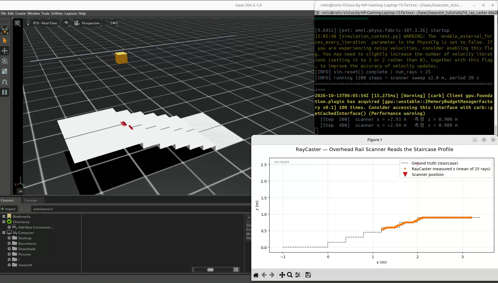
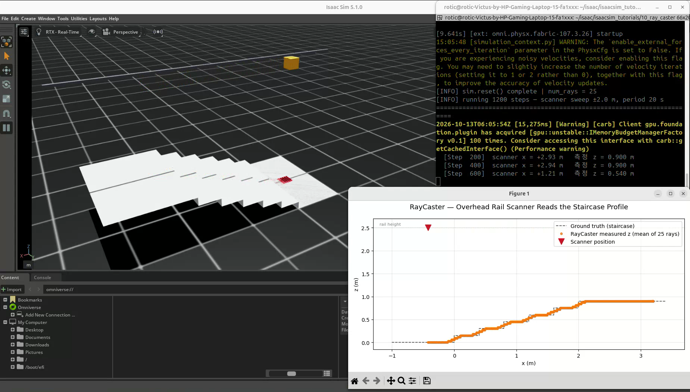
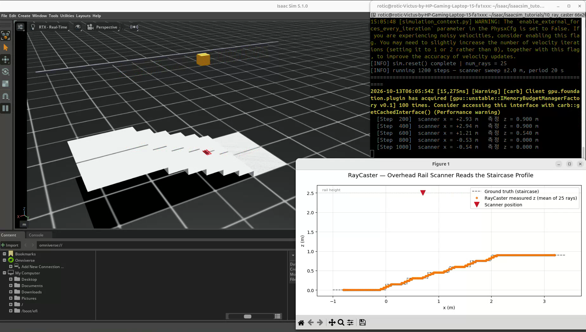

# 10. RayCaster로 계단 높이 단면 스캔

실습일: 2026-10-13

## 이번 실습의 핵심

공중 레일의 스캐너가 좌우로 왕복하면서 아래쪽 계단에 격자 형태의 광선을 쏜다.
광선이 계단에 닿은 위치를 읽고, 스캐너 위치별로 높이를 누적해 계단의 단면을 그래프로 그린다.

09번이 카메라의 RGB·Depth 영상을 읽는 실습이었다면,
이번에는 **메시와 광선의 교차 위치를 직접 계산해 지형 높이를 읽는 방법**을 배운다.

## 코드와 실행 방법

- [이 저장소에서 코드 보기](10_ray_caster.py)
- 출처: PinkLAB 「강좌 10 - 10_ray_caster」
- [원본 튜토리얼](https://github.com/PinkWink/isaacsim_tutorials/blob/14f85fc6edece7cbb1faa50aa9fe3adef205e87a/10_ray_caster/10_ray_caster.py)
- 위 버전의 코드를 수정 없이 포함했다.

```bash
cd <physical-ai-training 저장소 경로>/10-ray-caster

# 장면과 측정 그래프 함께 보기
python 10_ray_caster.py

# 메인 GUI 없이 실행
python 10_ray_caster.py --headless
```

RayCaster는 카메라 렌더링으로 이미지를 얻는 센서가 아니므로 이 예제에는 `--enable_cameras`가 필요하지 않다.

## 실습 구성

| 항목 | 설정 |
|---|---|
| 계단 수 | 6단 |
| 한 단 깊이 | x 방향 0.4 m |
| 한 단 높이 | 0.15 m |
| 계단 폭 | y 방향 2.0 m |
| 마지막 단 높이 | 0.9 m |
| 계단 앞·뒤 평지 | 각 1.0 m |
| 스캐너 높이 | z = 2.5 m |
| 왕복 중심·진폭 | x = 1.2 m, ±2.0 m |
| 스캐너 중심 이동 범위 | x = -0.8~3.2 m |
| 왕복 주기 | 시뮬레이션 시간 20초 |
| 물리 시간 간격 | 1/60초 |
| 실행 길이 | 1200 step |
| 광선 패턴 | 0.2 × 0.2 m 영역, 간격 0.05 m |
| 광선 수 | 5×5 = 25개 |
| 그래프 갱신 | 6 step마다 |

스캐너는 중심에서 출발해 오른쪽 → 왼쪽 → 중심으로 돌아온다.
계단 메시의 전체 x 범위는 -1.0~3.4 m이며, 스캐너 중심의 이동 범위와 구분한다.

## 실습 결과

### 스캐너와 계단 장면

<p align="center">
  
</p>

주황색 스캐너가 계단 위에서 이동하고, 장면에 광선 교차 위치의 디버그 표시가 나타난다.

### 높이 측정값 누적

<p align="center">
  
</p>

처음에는 측정한 구간에만 주황색 점이 나타나고,
스캐너가 이동하면서 낮은 평지부터 높은 계단까지 측정점이 쌓인다.

### 계단 단면 비교

<p align="center">
  
</p>

| 그래프 표시 | 의미 |
|---|---|
| 검정 점선 | 코드로 만든 계단의 기준 단면 |
| 주황색 점 | 해당 스캐너 위치에서 유효 광선의 교차점 z 평균 |
| 빨간 역삼각형 | 스캐너의 현재 x 위치와 높이 |
| 높이 2.5 m의 가로 점선 | 레일 높이 |

주황색 측정점이 계단 높이를 따라 분포하며, 단의 경계에서는 높이가 부드럽게 연결되는 모습이 보인다.
터미널에는 광선 수 25개와 스캐너 위치, 측정 높이가 출력된다.

[원본 녹화 영상 보기 / 다운로드 — 약 20.6초](videos/staircase-ray-scan.webm)

원본 파일명: `Screencast from 2026-10-13 15-06-03.webm`.
위 세 이미지는 이 영상에서 추출했다.

## 핵심 개념 1. 광선과 메시의 교차 계산

RayCaster는 발사 위치와 방향을 가진 광선이 대상 메시의 어느 지점에 닿는지 계산한다.
이 예제의 광선은 아래쪽으로 향하며, 계단은 정적인 대상 메시로 구성한다.
Isaac Lab의 RayCaster는 NVIDIA Warp를 사용해 광선과 삼각형 메시의 교차를 계산한다.

이 실습의 계단은 하나의 `UsdGeom.Mesh`로 만들고 각 면을 삼각형으로 나눈다.
기본 RayCaster의 대상 메시 제약과 메시 처리 방식에 맞춘 구성이다.
바닥과 공중 레일이 화면에 보이더라도, 측정 대상으로 지정한 메시만 교차 계산에 사용한다.

```python
ray_caster_cfg = RayCasterCfg(
    prim_path="/World/Scanner",
    mesh_prim_paths=["/World/Stairs"],
    pattern_cfg=patterns.GridPatternCfg(
        resolution=0.05,
        size=(0.2, 0.2),
    ),
    debug_vis=not args_cli.headless,
)
ray_caster = RayCaster(cfg=ray_caster_cfg)
```

`mesh_prim_paths`에는 계단 Mesh가 들어 있는 부모 경로를 지정한다.
`resolution`은 여기서 광선 시작점 사이의 격자 간격이고, `size`는 격자가 차지하는 영역이다.

## 핵심 개념 2. 교차점 좌표와 거리의 차이

측정 결과는 `ray_hits_w`로 읽는다.

```python
hits = ray_caster.data.ray_hits_w[0]
z = hits[:, 2]
```

`ray_hits_w`는 `(센서 수, 광선 수, 3)` 형태의 텐서이며, 마지막 차원은 월드 좌표 `(x, y, z)`다.
이 예제에서 첫 센서의 결과는 25×3이고, z 좌표를 읽어 계단의 월드 높이를 얻는다.

**교차점의 z 좌표는 센서에서 표면까지의 거리와 다르다.**
스캐너가 높이 2.5 m에서 수직 아래로 광선을 쏘는 경우,
교차점 높이가 0.9 m라면 스캐너 중심 높이 기준 수직 차이는 1.6 m다.

## 핵심 개념 3. 유효 광선만 평균 내기

```python
z = ray_caster.data.ray_hits_w[0, :, 2]
valid = z[torch.isfinite(z)]

if valid.numel() > 0:
    z_mean = valid.mean().item()
    measured_x.append(x)
    measured_z.append(z_mean)
```

대상에 닿지 않은 광선에는 무한대 값이 들어갈 수 있으므로, 유효한 값만 골라 평균을 계산한다.
그래프의 각 측정점은 **스캐너 중심 x 좌표 + 유효 교차점의 평균 높이**로 구성된다.

계단 경계에서는 25개 광선이 서로 다른 단에 닿을 수 있다.
이때 평균이 두 단 높이 사이에 위치해 경계가 완만하게 나타난다.
이 현상은 격자 영역과 평균 처리에 따른 효과이며, 실제 센서의 무작위 노이즈를 별도로 재현한 것은 아니다.

## 핵심 개념 4. 스캐너 이동과 센서 갱신

스캐너의 x 좌표를 사인파로 바꿔 왕복시킨다.

$$
x(t)=1.2+2.0\sin(2\pi t/20)
$$

```python
scanner.write_root_pose_to_sim(pose)
scanner.write_root_velocity_to_sim(zero_vel)

sim.step()
ray_caster.update(dt=sim_dt, force_recompute=True)
```

스캐너는 중력을 끈 동적 강체로 생성하고, 매 step 자세와 속도를 직접 지정한다.
코드 상단의 요약에는 kinematic이라는 표현이 있지만, 실제 설정은 `disable_gravity=True`인 강체다.
레일은 시각용이므로 모터 힘이나 레일 접촉으로 움직이는 주행 모델과 구분한다.
센서는 이동 후 갱신하고, 측정점을 누적해 matplotlib 이미지 대신 선·점 데이터로 표시한다.

## 09번 카메라와 비교

| 구분 | 카메라 RGB·Depth | 이번 RayCaster |
|---|---|---|
| 데이터 구성 | 이미지 픽셀 격자 | 지정한 광선 패턴 |
| 주요 출력 | 색상·깊이 영상 | 광선과 메시의 교차점 좌표 |
| 대상 표현 | 렌더링된 장면 | 설정한 대상 메시 |
| 이번 활용 | 물체의 외관·깊이 비교 | 계단 높이와 단면 읽기 |

레이캐스팅은 거리 센서나 LiDAR와 관련된 원리지만,
이 예제는 아래로 향하는 격자 광선 센서이며 회전형 LiDAR나 실제 센서의 모든 특성을 구현한 것은 아니다.

## 배운 점

- 가상 광선으로 지형 표면의 위치를 직접 측정할 수 있다.
- 센서의 출력 좌표계와 실제 거리의 의미를 구분해야 한다.
- 광선 배치 간격과 평균 처리 방식이 측정 결과에 영향을 준다.
- 센서가 움직이면 여러 위치의 데이터를 누적해 지형 단면을 만들 수 있다.
- 제조 설비에서는 형상·높이·장애물 확인 같은 센서 기반 기능을 시험하는 데 응용할 수 있다.
- 물리적으로 동작하는 이송 장치와 센서 위치를 코드로 지정하는 실험 모델은 구분해야 한다.
