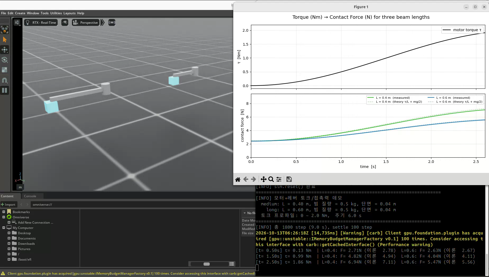
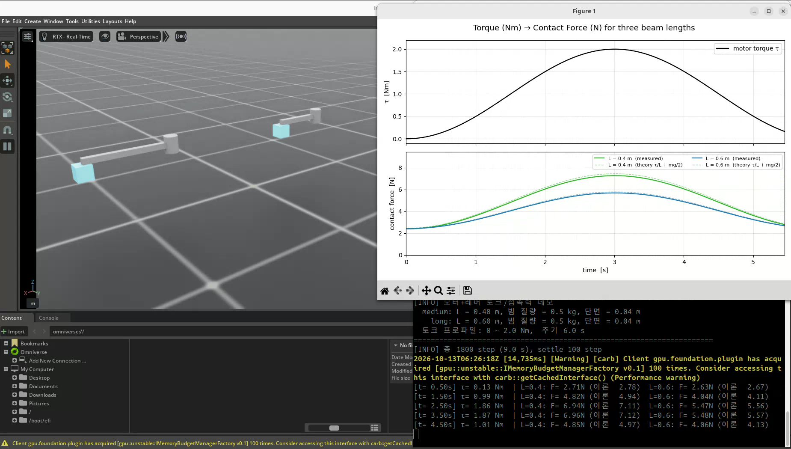
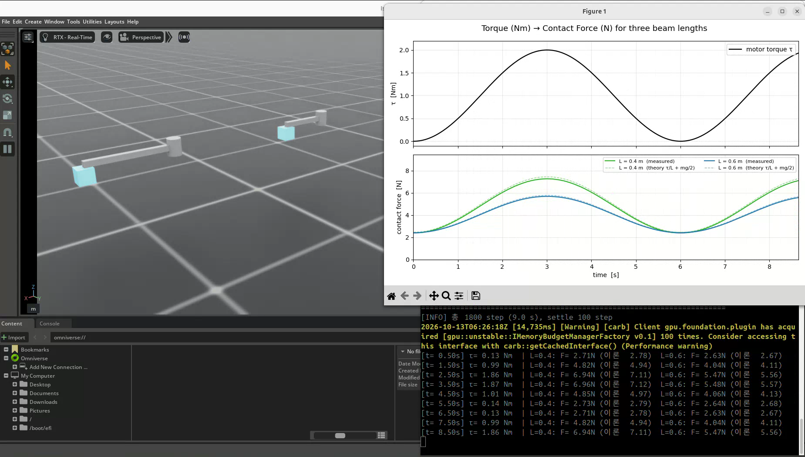

# 11. 토크·레버·접촉 힘 실험과 URDF

실습일: 2026-10-13

## 이번 실습의 핵심

길이가 다른 두 레버에 같은 모터 토크를 가하고, 레버가 받침대를 누를 때 발생하는 접촉 힘을 비교한다.
**같은 토크라면 짧은 레버가 더 큰 힘을 전달한다.** 이번에는 관절 위치 목표 대신 토크를 직접 입력하고, ContactSensor로 결과를 읽는다.

## 코드와 실행 방법

- [실습 코드](11_torque_lever_contact.py)
- 출처: PinkLAB 「강좌 11 - 11_torque_lever_contact」
- [원본 튜토리얼 및 모델](https://github.com/PinkWink/isaacsim_tutorials/tree/14f85fc6edece7cbb1faa50aa9fe3adef205e87a/11_contact_sensor)
- 위 버전의 코드와 두 레버의 URDF·USD 파일을 수정 없이 포함했다.

```bash
cd <physical-ai-training 저장소 경로>/11-torque-lever-contact
python 11_torque_lever_contact.py
```

실행하면 URDF를 생성해 USD로 변환하고, 두 레버와 받침대를 배치한 뒤 실시간 그래프를 표시한다.
종료 시 `11_torque_lever_result.png`가 실습 폴더에 저장된다.
카메라 센서 예제가 아니므로 `--enable_cameras`는 필요하지 않다.

## 실습 구성

| 항목 | 설정 |
|---|---|
| 레버 길이 | medium 0.4 m · long 0.6 m |
| 빔 질량 | 두 레버 모두 0.5 kg |
| 빔 단면 | 0.04 × 0.04 m |
| 회전축 | y축 · 베이스 고정 |
| 회전축 높이 | 0.5 m |
| 입력 토크 | 0~2 N·m · 주기 6초 |
| 물리 시간 간격 | 1/200초 |
| 초기 안정화 | 100 step · 시뮬레이션 시간 0.5초 |
| 측정 구간 | 1800 step · 시뮬레이션 시간 9초 |
| 측정 대상 | 각 빔 링크의 순접촉 힘 |

원본 코드 일부 주석과 그래프 제목에는 세 레버라는 표현이 남아 있지만,
실제 `LEVERS` 설정과 이번 결과에는 **0.4 m와 0.6 m 두 레버**가 사용된다.

## 실습 결과

### 두 레버와 받침대



회전축에 토크를 가하면 빔 끝이 받침대를 누른다. 받침대는 움직이지 않도록 구성한다.

### 레버 길이에 따른 힘 비교



| 그래프 | 의미 |
|---|---|
| 위쪽 검정 선 | 모터에 입력한 토크 · N·m |
| 아래쪽 초록 실선 | 0.4 m 레버의 측정 접촉 힘 · N |
| 아래쪽 파랑 실선 | 0.6 m 레버의 측정 접촉 힘 · N |
| 같은 색 점선 | 정적 평형식으로 계산한 이론값 |

### 토크 한 주기와 접촉 힘



영상에서 짧은 레버의 접촉 힘이 더 크게 나타나고, 두 곡선은 토크 변화에 따라 증가·감소한다.
실선은 이론 점선에 가깝지만 완전히 일치하지는 않는다.
예를 들어 영상의 t=2.50초 로그에는 0.4 m 레버가 6.94 N(이론 7.11 N),
0.6 m 레버가 5.47 N(이론 5.56 N)으로 표시된다.

[원본 녹화 영상 보기 / 다운로드 — 약 37.1초](videos/torque-lever-contact.webm)

원본 파일명: `Screencast from 2026-10-13 15-26-28.webm`.
위 이미지는 사용자가 제공한 영상에서 추출했다. 그래프의 시간축은 녹화 시간이 아닌 시뮬레이션 시간이다.

## 핵심 개념 1. 토크와 힘의 관계

토크는 힘과 회전축에서 힘의 작용선까지의 수직 거리의 곱이다.
수평 빔 끝에 수직 힘이 작용하는 이번 모델에서는 그 거리를 레버 길이 L로 근사한다.

균일한 빔의 무게는 중심 L/2에 작용하므로, 정적 평형식은 다음과 같다.

$$
\tau + mg\frac{L}{2} = FL
$$

$$
F = \frac{\tau}{L} + \frac{mg}{2}
$$

- `τ/L`: 모터 토크에 의한 접촉 힘의 기여.
- `mg/2`: 빔 자체의 무게에 의한 접촉 힘의 기여.

질량 0.5 kg, 중력 가속도 9.81 m/s²를 사용하면 중력 기여는 약 2.45 N이다.
입력 토크가 2 N·m일 때의 **이론값**은 다음과 같다.

| 레버 길이 | 모터 기여 τ/L | 총 접촉 힘 τ/L + mg/2 |
|---|---|---|
| 0.4 m | 5.00 N | 약 7.45 N |
| 0.6 m | 3.33 N | 약 5.79 N |

모터 기여만 비교하면 짧은 레버가 1.5배지만, 중력 항이 더해지므로 총 접촉 힘의 비율은 1.5배가 아니다.
이 식은 수평 빔·끝점 접촉·정적 평형을 가정한다.
실제 시뮬레이션에서는 접촉 위치와 면적, 미세한 움직임, 물리 계산 간격 등에 따라 차이가 생길 수 있다.

## 핵심 개념 2. 위치 제어 대신 토크 직접 입력

```python
ImplicitActuatorCfg(
    joint_names_expr=["motor_joint"],
    stiffness=0.0,
    damping=0.0,
    effort_limit=10.0,
)
```

위치·속도 오차에 반응하는 PD 구동 항을 끄고, 관절에 토크 목표를 직접 전달한다.
모든 레버에 같은 값을 입력한다.

```python
tau = TORQUE_AMPL * math.sin(math.pi * t / TORQUE_PERIOD) ** 2
tau_tensor = torch.tensor([[tau]], device=sim.device)

for arm in arms:
    arm["art"].set_joint_effort_target(tau_tensor)

scene.write_data_to_sim()
sim.step()
scene.update(sim_dt)
```

`sin²`를 사용하므로 입력은 항상 0 이상이며, 빔을 받침대 쪽으로 누르는 방향으로 작용한다.
PD 구동을 끄더라도 중력과 충돌은 계속 계산된다.

## 핵심 개념 3. ContactSensor로 힘 읽기

USD 스폰 설정의 `activate_contact_sensors=True`로 접촉 보고를 활성화하고,
각 `beam_link`에 `ContactSensorCfg`를 설정한다.

```python
f_vec = arm["sen"].data.net_forces_w[0, 0]
f_mag = torch.norm(f_vec).item()
```

`net_forces_w`는 `(환경 수, 센서 대상 강체 수, 3)` 형태의 월드 좌표계 순접촉 힘 벡터다.
이번 코드는 첫 환경의 빔에서 `(Fx, Fy, Fz)`를 읽고 벡터 크기를 그래프에 표시한다.
모터 토크를 읽는 값이 아니라 **충돌 접촉으로 빔에 작용하는 힘**이다.
중력은 접촉 힘 자체에 직접 합산되는 항이 아니라, 받침대의 반력에 영향을 준다.

별도의 접촉 상대 필터는 설정하지 않았으므로, 센서는 빔에 발생한 순접촉 힘을 읽는다.
이 장면의 주요 접촉 상대가 받침대인 것이며, 임의의 복잡한 설비에서 특정 부품 간 힘만 읽으려면 대상 구성을 추가로 고려해야 한다.

## URDF 간략 정리

**URDF(Unified Robot Description Format)는 로봇의 부품과 연결 구조를 기술하는 XML 파일이다.**
CAD에서 만든 외형에 더해 물리 시뮬레이션에 필요한 구조와 속성을 표현한다.

| 요소 | 담는 내용 | 이번 레버 예제 |
|---|---|---|
| `link` | 하나의 강체 부품 | `base_link`, `beam_link` |
| `visual` | 화면에 보이는 형상·색상 | 원통 베이스와 사각 빔 |
| `collision` | 충돌 계산용 형상 | 원통과 박스 |
| `inertial` | 질량·무게중심·관성 텐서 | 빔 질량 0.5 kg, 중심 L/2, 길이에 따른 관성 |
| `joint` | 부모·자식 링크 연결, 회전축·가동 범위 | y축 회전 `motor_joint`, 약 ±90° |

이번 모델은 기본 도형을 사용하므로 외부 CAD 메시 파일 없이 구성된다.
길이가 달라지면 무게중심 위치와 회전 관성도 함께 계산해 URDF에 기록한다.
단위는 길이 m, 질량 kg, 관절 각도 rad를 사용한다.

```text
URDF: 형상·질량·관성·관절 구조
  ↓ UrdfConverter
USD: Isaac Sim에서 사용할 장면·물리 자산
  ↓ Articulation + 제어 코드 + ContactSensor
PhysX 시뮬레이션 → 관절 상태·접촉 힘 읽기
```

URDF는 동작 순서나 제어 프로그램을 대신하지 않는다.
베이스 고정, 토크 입력, 센서 설정과 데이터 읽기는 변환 옵션 및 Python 코드에서 구성한다.

## 함께 포함한 모델 파일

- [0.4 m 레버 URDF](lever_assets/lever_medium.urdf)
- [0.6 m 레버 URDF](lever_assets/lever_long.urdf)
- [0.4 m 레버 USD](lever_assets/lever_medium.usd)
- [0.6 m 레버 USD](lever_assets/lever_long.usd)
- [USD 구성 레이어](lever_assets/configuration/): 두 레버 각각의 base·physics·robot·sensor 파일.

USD는 여러 레이어를 참조하므로 `lever_assets` 내부의 폴더 구조를 함께 유지한다.
실습 코드는 URDF를 실행 시 다시 작성하며, `force_usd_conversion=True`로 USD도 매번 다시 변환한다.
따라서 이 버전은 기존 USD가 있어도 변환을 강제한다.

## 배운 점

- 토크의 단위 N·m는 회전축에서의 거리와 전달 힘을 함께 나타낸다.
- 같은 모터 토크라도 레버 길이와 자체 무게에 따라 접촉 힘이 달라진다.
- 위치 제어와 토크 직접 입력은 서로 다른 제어 방식이다.
- ContactSensor를 통해 설비가 물체를 누르는 힘을 측정하는 실험을 구성할 수 있다.
- 로봇·설비 모델에는 외형뿐 아니라 충돌 형상, 질량, 관성, 관절 구조가 필요하다.
