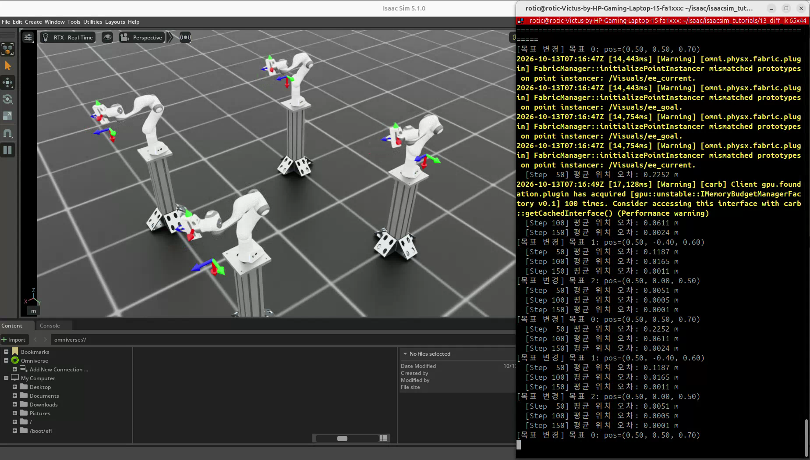
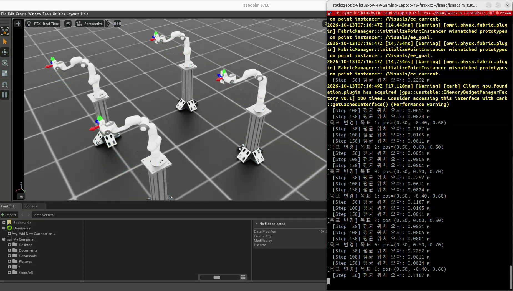
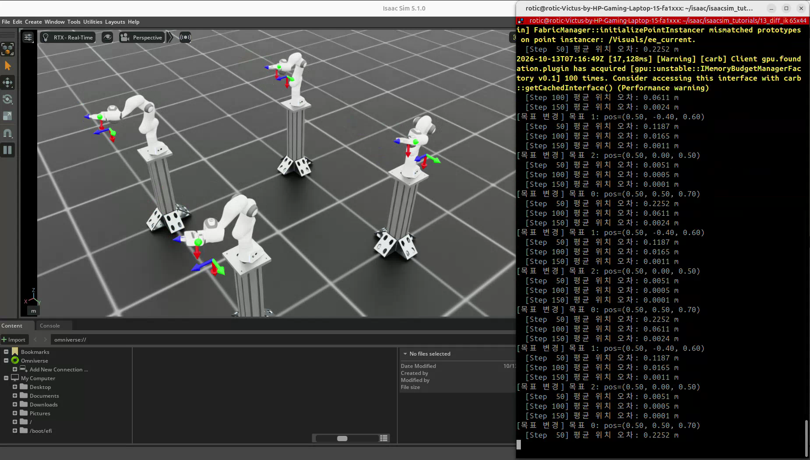

# 13. 미분 역기구학 — 목표 말단 포즈에서 관절 목표 계산

실습일: 2026-10-13

## 이번 실습의 핵심

**역기구학(IK, Inverse Kinematics)은 원하는 말단 위치·방향을 주고 이를 만족하는 관절 구성을 구하는 것이다.**
이번에는 Franka Panda의 `panda_hand` 목표 포즈를 정한 뒤,
Jacobian과 DLS(Damped Least Squares)를 이용한 미분 역기구학으로 관절 목표를 반복 계산한다.
12장이 관절 상태에서 말단 포즈를 관찰했다면, 13장은 말단 목표를 주고 관절을 움직인다.

## 코드와 실행 방법

- [실습 코드](13_diff_ik.py)
- 출처: PinkLAB 「강좌 13 - 13_diff_ik」
- [원본 코드](https://github.com/PinkWink/isaacsim_tutorials/blob/14f85fc6edece7cbb1faa50aa9fe3adef205e87a/13_diff_ik/13_diff_ik.py)
- 위 버전의 코드를 수정 없이 포함했다.

```bash
cd <physical-ai-training 저장소 경로>/13-differential-ik
python 13_diff_ik.py                 # 기본: 환경 4개
python 13_diff_ik.py --num_envs 8
python 13_diff_ik.py --headless
```

로봇과 스탠드는 Isaac Lab의 설정 및 NVIDIA 자산 경로에서 불러온다.
카메라 센서 예제가 아니므로 `--enable_cameras`는 필요하지 않다.

## 실습 구성

| 항목 | 설정 |
|---|---|
| 로봇 | Franka Panda · 고정 베이스 |
| 제어 대상 | 팔 관절 7개 · `panda_joint1~7` |
| 말단 프레임 | `panda_hand` |
| 기본 환경 수·간격 | 4개 · 환경 원점 간격 2.0 m |
| 목표 타입 | `pose` · 위치와 방향 |
| 목표 모드 | 절대 포즈 · 로봇 베이스 기준 |
| IK 방법 | DLS |
| 로봇 구동 | 높은 PD 게인 · 로봇 중력 비활성 |
| 물리 시간 간격 | 0.01초 |
| 목표 전환 | 150 step마다 · 시뮬레이션 시간 1.5초 |
| 위치 오차 출력 | 50 step마다 |

모든 환경에 동일한 로컬 목표를 입력한다. 목표 변경 시 관절 위치·속도를 기본 상태로 복원하고 IK 컨트롤러를 초기화한다.
따라서 세 목표 사이를 계속 이어서 움직이는 경로 계획 예제가 아니라, 각 목표를 홈 상태에서 다시 추종하는 실험이다.

| 목표 | 베이스 기준 위치 (x, y, z) · m | 방향 (qw, qx, qy, qz) |
|---|---|---|
| 0 | (0.5, 0.5, 0.7) | (0.707, 0, 0.707, 0) |
| 1 | (0.5, -0.4, 0.6) | (0.707, 0.707, 0, 0) |
| 2 | (0.5, 0, 0.5) | (0, 1, 0, 0) |

## 실습 결과

<p align="center">
  
</p>

현재 말단 프레임과 목표 프레임을 각각 표시하며, 추종이 진행되면 두 마커가 가까워진다.

<p align="center">
  
</p>

네 로봇은 서로 다른 환경 원점에 배치되지만 같은 베이스 기준 목표를 추종한다.

<p align="center">
  
</p>

영상에 반복해서 표시되는 평균 위치 오차는 다음과 같다. 단위는 m다.

| 목표 | 50 step | 100 step | 150 step |
|---|---|---|---|
| 0 | 0.2252 | 0.0611 | 0.0024 |
| 1 | 0.1187 | 0.0165 | 0.0011 |
| 2 | 0.0051 | 0.0005 | 0.0001 |

각 목표를 추종하면서 위치 오차가 줄어든다. 목표에 따라 수렴 속도가 다르므로 모든 목표가 같은 시간에 같은 오차에 도달한다고 해석하지 않는다.
이 로그는 환경별 위치 거리의 평균이며, 방향 오차나 각 환경의 최대 오차를 함께 측정한 값은 아니다.

[원본 영상 보기 / 다운로드 — 약 16.4초](videos/13_diff_ik.webm)

원본 파일명: `13.webm`. 위 세 이미지는 제공된 영상에서 추출했다.

## 핵심 개념 1. Jacobian과 미분 역기구학

Jacobian은 현재 관절 상태에서 관절의 작은 변화가 말단에 어떤 변화를 만드는지 표현한다.

$$
\Delta x \approx J(q)\Delta q
$$

포즈 제어에서 말단 변화는 위치 3개와 회전 변화 3개로 구성한다.
팔 관절 7개를 사용하는 이번 예제의 Jacobian은 환경별로 6×7이다.
목표 포즈 입력은 쿼터니언을 포함한 7개 값이지만, **제어에 사용하는 포즈 오차가 7차원이라는 뜻은 아니다.**
회전 오차는 3차원 회전 벡터로 표현한다.

미분 IK는 현재 포즈와 목표의 차이를 구하고 작은 관절 변화를 계산한다.
현재 상태가 바뀌면 Jacobian도 다시 읽어 계산을 반복한다.

## 핵심 개념 2. DLS와 특이점

$$
\Delta q = J^T(JJ^T+\lambda^2 I)^{-1}\Delta x
$$

$$
q_{des}=q_{current}+\Delta q
$$

특이점 근처에서는 특정 방향의 말단 움직임을 만들기 위해 매우 큰 관절 변화가 요구될 수 있다.
DLS는 감쇠 항 λ를 더해 이러한 변화를 완화한다.
감쇠는 안정성과 추종 정확도 사이의 조절 요소이며, 모든 목표의 수렴이나 충돌 회피를 보장하지 않는다.
이 코드에는 별도의 장애물 회피, 경로 계획, 성공 판정이 구현돼 있지 않다.

## 핵심 개념 3. 계산 결과와 실제 구동

```python
diff_ik_cfg = DifferentialIKControllerCfg(
    command_type="pose",
    use_relative_mode=False,
    ik_method="dls",
)
diff_ik_controller.set_command(ik_commands)

joint_pos_des = diff_ik_controller.compute(
    ee_pos_b, ee_quat_b, jacobian, joint_pos
)
robot.set_joint_position_target(
    joint_pos_des, joint_ids=robot_entity_cfg.joint_ids
)
```

IK는 목표 관절 위치를 계산한다. PD 구동기가 실제 관절을 그 목표 쪽으로 움직이고,
물리 진행 후 실제 상태를 갱신해 다음 IK 계산에 사용한다.
IK 계산과 관절을 구동하는 제어의 역할을 구분한다.

## 핵심 개념 4. 포즈와 Jacobian의 좌표계

```python
ee_pos_b, ee_quat_b = subtract_frame_transforms(
    root_pose_w[:, :3], root_pose_w[:, 3:7],
    ee_pose_w[:, :3], ee_pose_w[:, 3:7],
)
```

월드 기준 말단 포즈를 로봇 베이스 기준으로 변환해 목표와 비교한다.
Jacobian의 선속도·각속도 성분도 포즈 오차와 같은 좌표계로 해석해야 한다.
이 예제는 베이스 축이 월드 축과 정렬되어 있으며, 다른 회전으로 배치한 로봇에 재사용할 때는 Jacobian의 표현 좌표계도 맞춰야 한다.

고정 베이스 로봇에서는 PhysX Jacobian에 루트 바디 행이 포함되지 않으므로 `body_id - 1`로 말단 행을 선택한다.
팔 관절 열만 추출해 6×7 행렬을 사용한다.
이동 베이스 로봇은 행뿐 아니라 베이스 자유도에 따른 열 구성도 달라질 수 있다.

목표 마커는 이 장면에서 `목표 위치 + env_origins`로 표시한다.
일반적인 베이스 회전·오프셋이 있는 경우에는 위치와 방향을 모두 월드로 변환해야 한다.

## 배운 점

- 손끝 목표 포즈를 입력하면 IK가 관절 위치 목표를 계산할 수 있다.
- 미분 IK는 한 번에 완성된 해를 구하기보다 현재 상태에서 반복적으로 접근한다.
- DLS는 특이점 근처의 과도한 관절 변화를 완화한다.
- 위치 오차만 줄었다고 방향과 충돌 조건까지 만족했다고 볼 수는 없다.
- 다음 실습에서는 이 IK에 작업 순서와 그리퍼 제어를 결합한다.

[공통 개념 — 역기구학·Jacobian·DLS](../learning-notes/inverse-kinematics/README.md) ·
[14번 Pick & Place](../14-pick-and-place/README.md)
