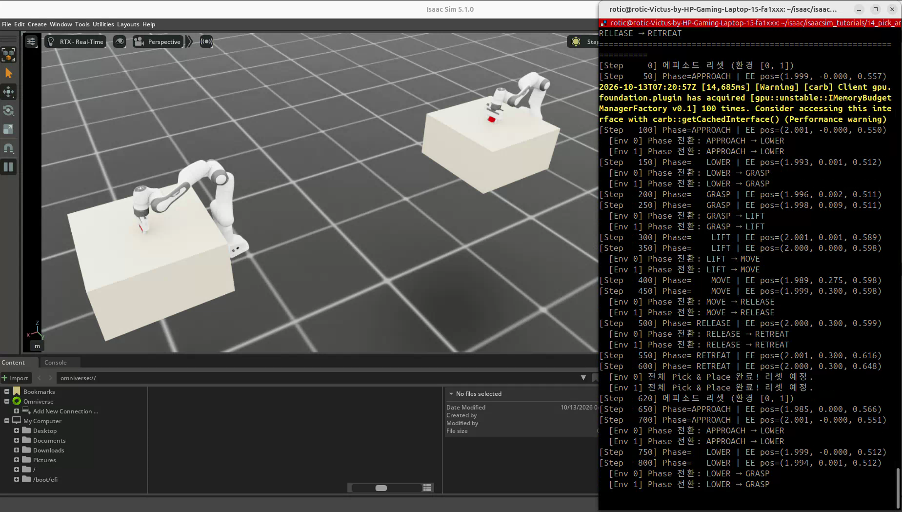
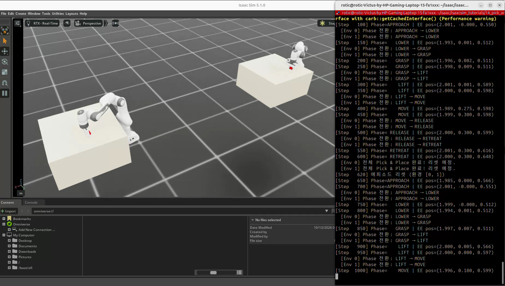
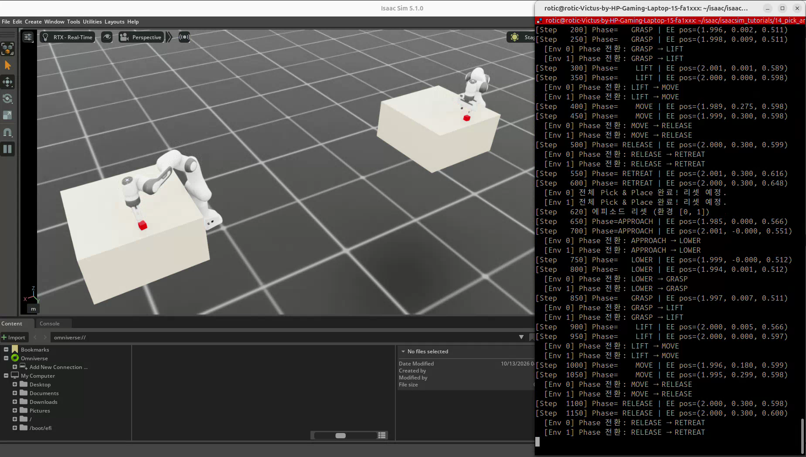
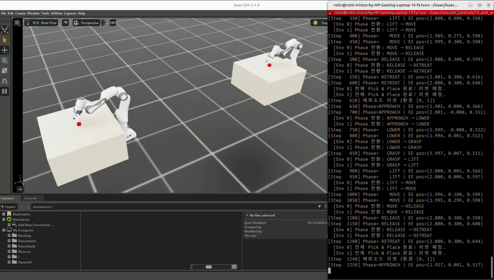

# 14. IK + 상태 머신으로 Pick & Place 구성

실습일: 2026-10-13

## 이번 실습의 핵심

**IK는 손끝을 어디로 보낼지 계산하고, 상태 머신은 언제 이동하고 잡고 놓을지 정한다.**
Franka Panda, 테이블과 빨간 큐브를 배치하고,
미분 IK로 팔을 제어하면서 그리퍼 관절 목표를 열림·닫힘으로 바꾸는 7단계 작업을 반복한다.

## 코드와 실행 방법

- [실습 코드](14_pick_and_place.py)
- 출처: PinkLAB 「강좌 14 - 14_pick_and_place」
- [원본 코드](https://github.com/PinkWink/isaacsim_tutorials/blob/14f85fc6edece7cbb1faa50aa9fe3adef205e87a/14_pick_and_place/14_pick_and_place.py)
- 위 버전의 코드를 수정 없이 포함했다.

```bash
cd <physical-ai-training 저장소 경로>/14-pick-and-place
python 14_pick_and_place.py                 # 기본: 환경 2개
python 14_pick_and_place.py --num_envs 4
python 14_pick_and_place.py --headless
```

Franka는 Isaac Lab의 로봇 설정에서 불러온다. 테이블과 큐브는 코드의 박스 형상으로 생성한다.
카메라 센서 예제가 아니므로 `--enable_cameras`는 필요하지 않다.

## 실습 구성

| 항목 | 설정 |
|---|---|
| 기본 환경 수·간격 | 2개 · 환경 원점 간격 3.0 m |
| 로봇 | Franka Panda · 높은 PD 게인, 로봇 중력 비활성 |
| 팔 제어 | `panda_hand` 목표 포즈 → DLS 미분 IK → 팔 관절 위치 목표 |
| 그리퍼 제어 | 두 finger 관절의 위치 목표 |
| 테이블 | 0.8 × 0.8 × 0.4 m · 상면 z=0.4 m |
| 큐브 | 한 변 0.04 m · 질량 0.1 kg · 중력과 충돌 적용 |
| 큐브 초기 중심 | 환경 기준 (0.5, 0, 0.42) m |
| 이동 목적 | y 방향으로 0.3 m 이동 |
| 말단 방향 | `(qw, qx, qy, qz) = (0, 1, 0, 0)` |
| 물리 시간 간격 | 0.01초 |
| 순환 길이 | 620 step · 시뮬레이션 시간 6.2초 |

로봇의 중력 비활성 설정과 큐브의 중력 설정은 별개다.
큐브는 동적 강체이며, 집기는 핑거와의 물리 접촉으로 이루어지도록 구성한다.
큐브를 손에 고정하거나 매 step 큐브를 손 위치로 이동시키는 부착 코드는 없다.

## 7단계 상태 머신

<p align="center">
  
</p>
<p align="center"><sub>그림 18. Pick & Place의 7단계 상태 전이</sub></p>

후퇴 이후 로봇·큐브를 리셋하고 APPROACH부터 다시 진행한다.

아래 값은 **`panda_hand` 목표**이며 큐브 중심이나 실제 TCP 좌표와 동일한 것으로 가정하면 안 된다.
이 장면에서는 환경 축과 베이스 축이 정렬되어 있다.

| 단계 | 말단 목표 (x, y, z) · m | finger 목표 · m | 시간 |
|---|---|---|---|
| APPROACH | (0.5, 0, 0.55) | 0.04 · 열림 | 120 step · 1.2초 |
| LOWER | (0.5, 0, 0.42) | 0.04 · 열림 | 80 step · 0.8초 |
| GRASP | (0.5, 0, 0.42) | 0 · 닫기 | 60 step · 0.6초 |
| LIFT | (0.5, 0, 0.60) | 0 · 닫힘 유지 | 100 step · 1.0초 |
| MOVE | (0.5, 0.3, 0.60) | 0 · 닫힘 유지 | 120 step · 1.2초 |
| RELEASE | (0.5, 0.3, 0.60) | 0.04 · 열기 | 60 step · 0.6초 |
| RETREAT | (0.5, 0.3, 0.65) | 0.04 · 열림 | 80 step · 0.8초 |

`0.04`는 각 핑거의 직선 관절 위치 목표다. 그리퍼 전체 벌림 폭이나 힘 0.04 N을 의미하지 않는다.
닫기 목표가 0이어도 물체와 접촉하면 실제 핑거가 목표까지 닫히지 않을 수 있다.
RELEASE 단계는 높이 0.60 m에서 그리퍼를 열며, 테이블까지 다시 내려놓는 별도 단계는 없다.

## 실습 결과

<p align="center">
  
</p>

<p align="center">
  
</p>

<p align="center">
  
</p>

<p align="center">
  
</p>

영상에는 두 환경에서 팔과 그리퍼가 동작하고, 빨간 큐브 위치가 바뀌는 모습이 나타난다.
터미널에서 7단계 순환과 `Step 620`의 에피소드 리셋을 확인할 수 있다.
환경별 상태를 따로 저장하지만, 이번 설정은 같은 시점에 같은 순서로 진행한다.

로그에서 LOWER·GRASP 구간의 말단 z는 약 0.511~0.512 m로 표시되며,
코드의 해당 목표 z=0.42 m와 차이가 있다. 이는 목표 포즈와 실제 상태를 구분해서 읽어야 한다는 예다.
`panda_hand`와 핑거 사이의 오프셋, 테이블·물체 접촉을 함께 고려해야 하며,
영상과 위치 로그만으로 이 차이의 원인을 하나로 단정하지 않는다.

출력 위치는 환경 0의 **월드 좌표**다. x가 약 2.0 m로 표시되더라도,
베이스 기준 목표 x=0.5 m에 환경 배치 오프셋이 더해진 결과이므로 좌표계를 구분한다.

[원본 영상 보기 / 다운로드 — 약 12.4초](videos/14_pick_and_place.webm)

원본 파일명: `14.webm`. 위 네 이미지는 제공된 영상에서 추출했다.

## 핵심 개념 1. 상태 머신과 IK의 역할 분담

```text
상태 머신: 현재 단계 → 말단 목표 포즈 + 그리퍼 목표
                            ↓
IK: 현재 포즈·관절 상태·Jacobian → 팔 관절 위치 목표
                            ↓
PD 구동 + 물리 접촉 → 실제 로봇·큐브 상태 갱신
```

상태 머신은 동작 순서를 표현하며 IK의 관절 계산식을 대신하지 않는다.
IK는 팔 7개 관절을, 별도 위치 명령은 그리퍼 관절을 제어한다.
학습된 정책 대신 사람이 정한 단계와 좌표를 사용하는 자동 작업 예제다.

## 핵심 개념 2. 시간 기준 전환과 성공 판정

```python
if phase_step[env_idx].item() >= PHASE_DURATIONS[phase]:
    current_phase[env_idx] += 1
    phase_step[env_idx] = 0
```

이 코드는 정해진 시간이 지나면 다음 단계로 넘어간다.
목표 도달, 접촉 발생, 큐브가 들렸는지, 최종 배치 위치를 검사해 전환하지 않는다.
따라서 `전체 Pick & Place 완료!` 메시지는 **상태 순서 완료**를 뜻하며 자동 집기 성공 판정과 구분한다.

실제 작업에서 조건 기반 전환을 추가한다면 다음 상태를 활용할 수 있다.

- 접근·이동: 말단 위치·방향 오차가 허용 범위에 들어왔는가?
- 잡기: 핑거 접촉이나 물체의 상대 위치가 적절한가?
- 들어올리기: 큐브가 실제로 테이블에서 올라왔는가?
- 놓기: 큐브가 목표 영역에 있고 안정적으로 지지되는가?

이 항목들은 확장할 때의 판단 기준이며 현재 코드에 이미 구현된 기능은 아니다.

## 핵심 개념 3. 물리적인 집기와 TCP

그리퍼의 닫기 명령만으로 집기가 보장되지는 않는다.
큐브와 핑거가 적절한 위치에서 접촉해야 하고, 마찰·구동 힘·물체 질량과 충돌 형상도 영향을 준다.
현재 예제는 명시적인 그리퍼 힘 제어나 접촉 센서를 사용하지 않는다.

`panda_hand`는 손 링크 프레임이며 실제 집기 중심점(TCP)과 다를 수 있다.
물체 중심 위치를 손 링크 목표에 그대로 대입하면 공구 오프셋만큼 어긋날 수 있다.
정확한 집기 목표를 구성하려면 손 프레임과 TCP 사이의 변환을 포함한다.

## 핵심 개념 4. 환경별 상태와 리셋

`current_phase`와 `phase_step`을 환경별 텐서로 저장한다.
완료한 환경의 인덱스를 찾아 로봇 루트·관절 상태와 큐브 자세·속도를 복원한다.
루트 위치에는 `scene.env_origins`를 더하고 해당 `env_ids`에 상태를 쓴다.

상태를 복원하는 API는 완료 환경에 적용하지만, 원본 코드의 `scene.reset()`은 환경 인자를 전달하지 않고 호출한다.
여러 환경을 서로 다른 시점에 진행시키도록 확장할 때는 상태와 버퍼 초기화 범위를 함께 맞춰야 한다.

## 배운 점

- IK와 그리퍼 제어에 작업 순서를 더하면 자동 작업 시퀀스를 구성할 수 있다.
- 상태 머신은 현재 단계, 단계별 목표, 전환 조건으로 표현한다.
- 시간 기준 전환과 센서·상태 기반 전환은 서로 다른 방식이다.
- 말단 이동과 실제 물체 운반·배치의 성공을 구분해서 확인해야 한다.
- 제조 설비의 투입·이송·조립 작업에도 이런 역할 분담을 적용할 수 있다.

[공통 개념 — 상태 머신·Pick & Place](../learning-notes/state-machine-pick-and-place/README.md) ·
[역기구학 개념](../learning-notes/inverse-kinematics/README.md)
