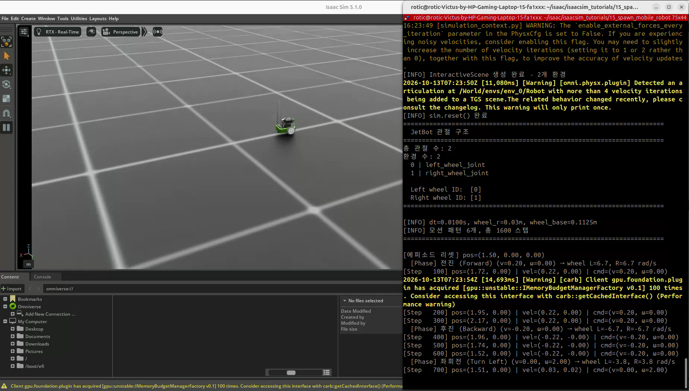
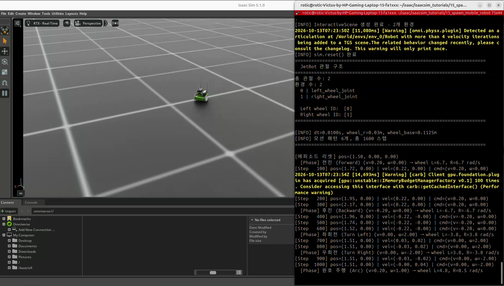
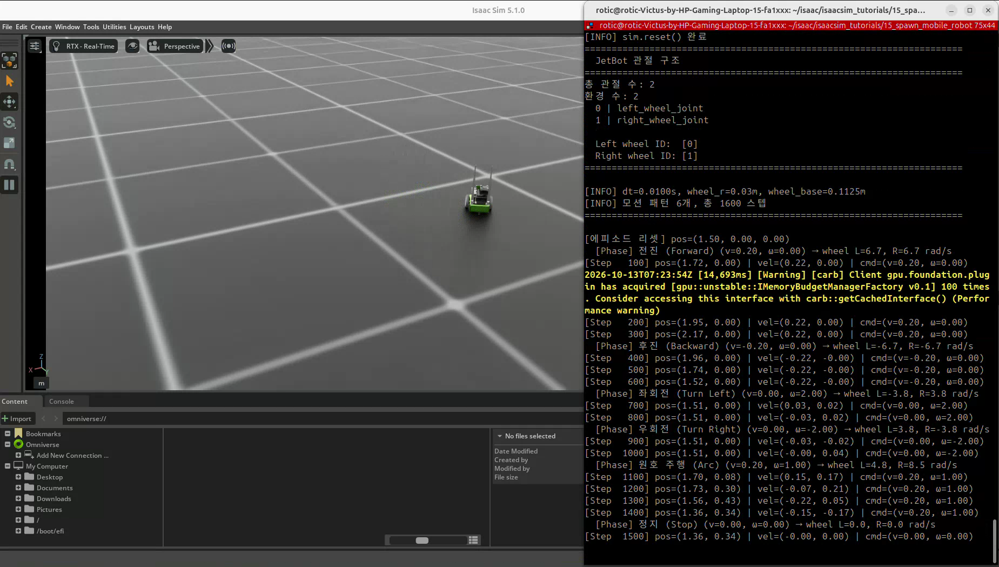

# 15. JetBot 배치와 차동 구동 제어

실습일: 2026-10-13

## 이번 실습의 핵심

**차동 구동은 좌우 바퀴의 속도 차이로 이동 방향을 제어하는 방식이다.**
JetBot을 배치하고 로봇의 선속도 v와 회전 각속도 ω를 좌우 바퀴 각속도로 변환해,
전진·후진·제자리 회전·원호 주행·정지를 반복한다.

로봇의 루트 위치를 매 step 바꾸는 이동 방식이 아니라,
실제 바퀴 관절을 구동하고 바퀴와 지면의 접촉·마찰로 이동시키는 실습이다.

## 코드와 실행 방법

- [실습 코드](15_spawn_mobile_robot.py): 사용자가 제공한 실행 코드를 그대로 포함했다.
- 출처: PinkLAB 「강좌 15 - 15_spawn_mobile_robot」
- [원본 튜토리얼](https://github.com/PinkWink/isaacsim_tutorials/blob/14f85fc6edece7cbb1faa50aa9fe3adef205e87a/15_spawn_mobile_robot/15_spawn_mobile_robot.py)
- 제공된 코드는 위 원본 버전과 일치한다.

```bash
cd <physical-ai-training 저장소 경로>/15-spawn-mobile-robot
python 15_spawn_mobile_robot.py                 # 기본: 환경 2개
python 15_spawn_mobile_robot.py --num_envs 4
python 15_spawn_mobile_robot.py --headless
```

JetBot USD는 `ISAAC_NUCLEUS_DIR/Robots/NVIDIA/Jetbot/jetbot.usd`에서 불러온다.
이 저장소에 로봇 USD 전체를 포함한 것은 아니다.
카메라 센서를 사용하지 않으므로 `--enable_cameras`는 필요하지 않다.

## 실습 구성

| 항목 | 설정 |
|---|---|
| 로봇 | NVIDIA JetBot |
| 구동 관절 | `left_wheel_joint`, `right_wheel_joint` |
| 바퀴 반지름 R | 0.03 m |
| 좌우 바퀴 간격 L | 0.1125 m |
| 기본 환경 수 | 2개 |
| 환경 원점 간격 | 3.0 m |
| 물리 시간 간격 | 0.01초 |
| actuator 설정 | `stiffness=0`, `damping=10` |
| 구동 명령 | 바퀴 관절의 각속도 목표 · rad/s |
| 상태 로그 | 100 step마다 환경 0의 월드 위치·선속도 출력 |

여기서 `damping`은 속도 오차에 반응하는 구동 게인이다.
단순히 움직임을 멈추는 저항이라는 의미로만 해석하지 않는다.

## 차동 구동의 변환식

로봇 중심의 명령을 다음과 같이 정의한다.

- v: 전진·후진 선속도 · m/s.
- ω: 로봇의 회전 각속도 · rad/s. 코드의 운동학 규약에서 양수는 좌회전이다.
- R: 바퀴 반지름 · m.
- L: 좌우 바퀴 간격 · m.

$$
\dot\phi_L=\frac{v-\omega L/2}{R},\qquad
\dot\phi_R=\frac{v+\omega L/2}{R}
$$

`φ̇L`, `φ̇R`은 바퀴의 각속도이며 단위는 rad/s다.
바퀴 접선 선속도는 각각 `R × 바퀴 각속도`다.

```python
def unicycle_to_wheel_vel(v, omega):
    wl = (v - omega * WHEEL_BASE / 2.0) / WHEEL_RADIUS
    wr = (v + omega * WHEEL_BASE / 2.0) / WHEEL_RADIUS
    return wl, wr
```

이 식은 바퀴가 미끄러지지 않는 이상적인 차동 구동 운동학을 기준으로 한다.
실제 시뮬레이션의 속도는 접촉·마찰·구동 응답 등에 따라 명령과 달라질 수 있다.

## 여섯 가지 모션 패턴

| 패턴 | v · m/s | ω · rad/s | 좌/우 바퀴 목표 · rad/s | 시간 |
|---|---|---|---|---|
| 전진 | 0.2 | 0 | 6.67 / 6.67 | 300 step · 3초 |
| 후진 | -0.2 | 0 | -6.67 / -6.67 | 300 step · 3초 |
| 좌회전 | 0 | 2 | -3.75 / 3.75 | 200 step · 2초 |
| 우회전 | 0 | -2 | 3.75 / -3.75 | 200 step · 2초 |
| 원호 주행 | 0.2 | 1 | 4.79 / 8.54 | 400 step · 4초 |
| 정지 | 0 | 0 | 0 / 0 | 200 step · 2초 |

패턴 합계는 1600 step, 시뮬레이션 시간 16초다.
그 뒤 명령이 0인 추가 200 step을 유지하므로 **리셋까지 한 순환은 1800 step · 18초**다.
영상 녹화 시간과 시뮬레이션 시간은 구분한다.

## 실습 결과

### JetBot 배치와 바퀴 관절 확인



터미널에서 총 관절 수 2개, 왼쪽 관절 ID 0과 오른쪽 관절 ID 1을 확인할 수 있다.
환경은 두 개 생성되며, 녹화 시점의 뷰포트에는 그중 한 로봇이 주로 보인다.

### 속도 패턴 전환



좌우 속도가 같으면 직진하고, 서로 반대면 제자리 회전한다.
원호 구간은 오른쪽 바퀴를 더 빠르게 구동해 이동과 회전을 함께 만든다.

### 원호 주행과 정지 결과



영상 로그에서 전진 구간의 환경 0 위치는 x≈1.72 → 1.95 → 2.17 m로 증가하고,
후진 구간에서는 x≈1.96 → 1.74 → 1.52 m로 감소한다.
원호 구간에서는 x와 y가 함께 변하고, 정지 구간에는 출력 선속도가 약 0으로 내려간다.

전진 명령 v=0.20 m/s에 실제 출력 x 속도는 약 0.22 m/s로 나타난다.
목표 속도와 실제 상태가 완전히 일치한다고 가정하지 않는다.
위치는 월드 기준이므로 초기 x≈1.5 m는 환경 배치 오프셋을 포함한 값이다.

[원본 녹화 영상 보기 / 다운로드 — 약 26.0초](videos/jetbot-differential-drive.webm)

원본 파일명: `15.webm`. 위 세 이미지는 제공된 영상에서 추출했다.

## 핵심 코드: 바퀴 속도 목표 전달

```python
left_ids, _ = robot.find_joints("left_wheel_joint")
right_ids, _ = robot.find_joints("right_wheel_joint")
wheel_ids = left_ids + right_ids

wl, wr = unicycle_to_wheel_vel(v, omega)
wheel_vel = torch.zeros(robot.num_instances, 2, device=robot.device)
wheel_vel[:, 0] = wl
wheel_vel[:, 1] = wr
robot.set_joint_velocity_target(wheel_vel, joint_ids=wheel_ids)

scene.write_data_to_sim()
sim.step()
scene.update(sim_dt)
```

좌우 관절을 이름으로 찾고, 명령 배열과 관절 ID의 좌우 순서를 맞춘다.
모든 환경에 같은 명령을 적용한다.

## リセットと制御方式

순환 시작 때 로봇의 루트 자세·속도와 관절 위치·속도를 기본 상태로 복원한다.
루트 위치에 `scene.env_origins`를 더해 각 환경의 원점에 맞춘다.
리셋 이후 이동은 바퀴 속도 목표를 통해 이루어진다.

바퀴 actuator는 속도 오차를 따라가도록 구동하지만,
상위 주행 명령은 정해진 시간에 따라 바뀌는 패턴이다.
현재 로봇 위치를 목표 위치와 비교해 보정하는 위치·경로 추종 제어는 아직 포함하지 않는다.
강화학습이나 자동 장애물 회피도 이 코드에는 없다.

## 배운 점

- 로봇의 선속도·각속도 명령을 바퀴 관절 각속도로 변환할 수 있다.
- 바퀴 속도 차이로 직진·제자리 회전·원호 주행을 구성한다.
- 운동학적 명령과 접촉·마찰을 포함한 실제 주행 결과를 구분한다.
- 관절 이름으로 제어 대상을 찾으면 바퀴 명령 순서를 명확하게 관리할 수 있다.
- 모바일 로봇의 위치 추종·경로 주행을 배우기 위한 구동 기초다.

[공통 개념 — 차동 구동과 유니사이클 모델](../learning-notes/differential-drive/README.md)
