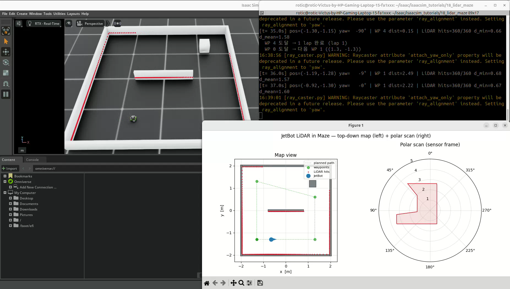
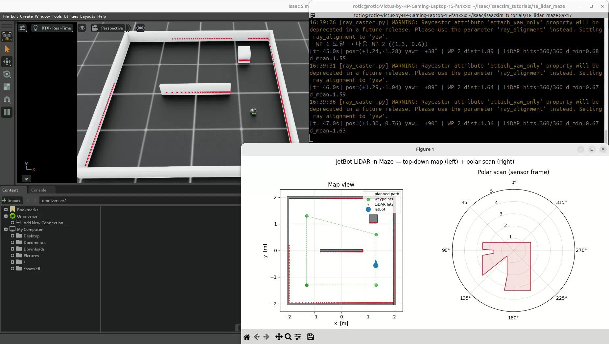
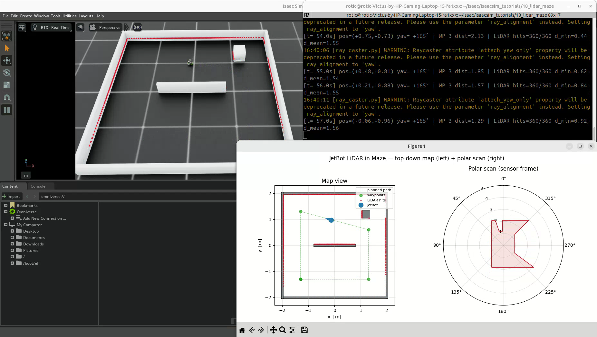
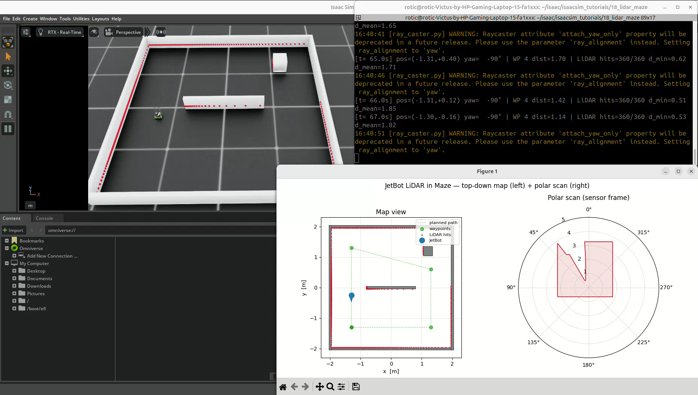

# 18. JetBot LiDAR 미로 스캔과 실시간 시각화

## 이번 실습의 핵심

**로봇에 부착한 2D LiDAR 형태의 RayCaster로 주변 벽까지의 거리를 읽고, 이동에 따라 달라지는 스캔을 표시한다.**
4×4 m 미로를 Waypoint P 제어로 주행하며,
월드 기준 교차점과 센서 기준 각도·거리의 차이를 두 그래프로 비교한다.

## 코드와 실행 방법

- [실습 코드](18_lidar_maze.py): 제공된 실행 코드를 그대로 포함했다.
- 출처: PinkLAB 「강좌 18 - 18_lidar_maze」
- [원본 튜토리얼](https://github.com/PinkWink/isaacsim_tutorials/blob/14f85fc6edece7cbb1faa50aa9fe3adef205e87a/18_lidar_maze/18_lidar_maze.py)
- 제공된 코드는 위 원본 버전과 일치한다.

```bash
cd <physical-ai-training 저장소 경로>/18-lidar-maze
python 18_lidar_maze.py

# Isaac Sim 뷰포트 없이 실행 — 그래프 창은 별도 표시
python 18_lidar_maze.py --headless
```

로봇은 NVIDIA 자산 경로의 JetBot USD에서 불러오고 미로 메시를 코드로 생성한다.
환경 수는 1개로 고정하며 `--num_envs` 옵션은 없다.
RayCaster 예제이므로 `--enable_cameras`는 필요하지 않다.
2 lap을 마치면 그래프를 `18_lidar_maze_result.png`로 저장하고 종료하도록 구성돼 있다.

## 실습 구성

| 항목 | 설정 |
|---|---|
| 미로 | 외벽 중심선 기준 4×4 m |
| 벽 구성 | 외벽 4개 + 중앙 가로 막대 + 우측 상단 기둥 |
| 벽 높이·외벽 두께 | 0.30 m · 0.08 m |
| 메시 | 6개 박스 · 48 정점 · 72 삼각형을 하나의 Mesh로 구성 |
| 로봇·환경 | JetBot 1대 · 환경 1개 |
| 초기 위치 | (-1.3, -1.3, 0) m |
| LiDAR 부착 | `Robot/chassis` · 프레임에서 z 방향 0.06 m 오프셋 |
| 광선 패턴 | 수평 채널 1개 · 수직각 0° |
| 수평 시야각·간격 | -180°~180° · 1° |
| 광선 수 | 360개 |
| 물리 시간 간격 | 0.01초 |
| 스캔 갱신 | `update_period=0.0` · 씬 갱신 시 |
| 그래프 갱신 | 5 step마다 · 시뮬레이션 시간 기준 약 20 Hz |

`attach_yaw_only=True`로 로봇의 yaw를 따라 회전하며 roll·pitch는 스캔 방향에 반영하지 않도록 설정한다.
0.06 m는 chassis 프레임 기준 오프셋이며 지면에서 센서까지의 절대 높이와 구분한다.

## 주행 경로와 제어

Waypoint 순서는 다음과 같다.

```text
(-1.3, -1.3) → (1.3, -1.3) → (1.3, 0.6)
→ (-1.3, 1.3) → (-1.3, -1.3) → 반복
```

선속도 게인 1.2, 각속도 게인 4.0, 최대 선속도 0.25 m/s,
최대 각속도 크기 2.5 rad/s와 도달 반경 0.10 m를 사용한다.
17번처럼 시뮬레이터의 실제 위치·방향으로 목표 거리와 방향 오차를 계산한다.

LiDAR 거리로 속도를 줄이거나 경로를 수정하는 코드는 없다.
벽을 피하도록 사람이 정한 Waypoint를 사용하며, 자동 장애물 회피·미로 탐색 알고리즘은 아니다.

## 실습 결과

### 미로와 360° 스캔



뷰포트의 붉은 점들은 광선 교차 위치의 디버그 표시다.
로봇이 이동하면서 닿는 벽과 거리가 달라진다.

### 내부 장애물의 거리 변화



외벽뿐 아니라 중앙 막대와 우측 상단 기둥이 광선의 교차 대상이다.
가까운 장애물 방향에서 측정 거리가 짧아지는 모습이 나타난다.

### 월드 지도와 센서 기준 표시



| 왼쪽 지도 | 오른쪽 극좌표 그래프 |
|---|---|
| 알려진 벽 윤곽과 Waypoint | 센서 기준 각도와 측정 거리 |
| 파란 점·화살표: 로봇 위치·방향 | 0°는 로봇 전방, 그래프 위쪽 |
| 빨간 점: 월드 기준 유효 교차점 | +90°는 센서 왼쪽, 반시계 방향 |
| 초록 점선: 설정한 경로 | 로봇 회전 시 주변 벽의 상대 방향이 바뀜 |

### 주행 중 측정 로그



영상에는 `LiDAR hits=360/360`과 최소·평균 거리가 반복 출력된다.
예를 들어 t=54.0초 로그의 로봇 위치는 약 (0.75, 0.73) m,
유효 광선은 360개이며 `d_min≈0.44 m`, `d_mean≈1.55 m`로 나타난다.

`t`는 시뮬레이션 시간이다. `WP dist`는 목표점까지의 거리,
`d_min`은 유효 광선 거리 중 최솟값, `d_mean`은 그 거리의 평균이며 서로 다른 지표다.
최소 거리는 센서에서 표면까지의 거리로, 로봇 외형 전체의 충돌 여유를 직접 의미하지 않는다.

[원본 영상 보기 / 다운로드 — 약 127.5초](videos/jetbot-lidar-maze.webm)

원본 파일명: `18.webm`. 위 네 이미지는 제공된 영상에서 추출했다.

## 핵심 개념 1. LiDAR 패턴과 교차 대상

```python
lidar = RayCasterCfg(
    prim_path="{ENV_REGEX_NS}/Robot/chassis",
    offset=RayCasterCfg.OffsetCfg(pos=(0.0, 0.0, 0.06)),
    attach_yaw_only=True,
    pattern_cfg=patterns.LidarPatternCfg(
        channels=1,
        vertical_fov_range=(0.0, 0.0),
        horizontal_fov_range=(-180.0, 180.0),
        horizontal_res=1.0,
    ),
    mesh_prim_paths=["/World/Maze"],
    update_period=0.0,
    debug_vis=True,
)
```

10번의 아래쪽 격자 광선과 달리, 이번 패턴은 수평면에 360° 방향의 광선을 배치한다.
RayCaster는 지정한 정적 미로 메시와 광선의 교차를 계산한다.
뷰포트에 보이는 모든 물체가 자동으로 측정 대상이 되는 것은 아니다.

미로는 씬과 센서 초기화 전에 생성한다.
센서가 읽는 메시와 물리 충돌 형상은 역할이 다르다.
원본 `spawn_maze_mesh()`는 메시 형상·색상을 만들지만 별도의 PhysX Collision API를 적용하지 않는다.
따라서 스캔되는 벽이라는 사실만으로 로봇과의 물리 충돌도 설정됐다고 가정하지 않는다.

## 핵심 개념 2. 교차점에서 거리 계산

```python
hits_w = lidar.data.ray_hits_w[0]       # (360, 3) · 월드 좌표
sensor_pos_w = lidar.data.pos_w[0]     # (3,) · 월드 좌표

dist = torch.norm(hits_w - sensor_pos_w, dim=1)
finite_mask = torch.isfinite(dist)
```

`ray_hits_w`는 거리 배열이 아니라 교차점 좌표다.
거리 배열은 각 교차점과 센서 위치의 차이 벡터 크기로 구한다.

$$
r_i=\sqrt{(x_i-x_s)^2+(y_i-y_s)^2+(z_i-z_s)^2}
$$

미교차 광선의 무한대 값은 지도 점과 최소·평균 거리 계산에서 제외한다.
극좌표 표시에서는 미교차 값만 8 m로 대체한다.
이 `R_MAX=8.0`은 표시용 대체값이며, 센서 설정에 최대 사거리 8 m를 지정한 것은 아니다.

## 핵심 개념 3. 알려진 지도와 SLAM의 차이

왼쪽 벽 윤곽은 스캔으로 발견한 지도가 아니라 코드의 `WALLS` 정보를 그대로 그린 것이다.
로봇 위치·방향도 시뮬레이터 내부 상태에서 읽는다.
따라서 이 예제는 실시간 스캔 시각화이며 지도 생성·자기 위치 추정인 SLAM을 구현하지 않는다.

원본 지도 표시는 월드 교차점과 환경 기준 로봇·Waypoint 위치를 함께 사용한다.
현재 단일 환경 원점이 0이라 맞지만, 여러 환경이나 위치 오프셋으로 확장할 때는 모든 표시의 좌표 기준을 맞춰야 한다.

## 배운 점

- 센서의 위치·방향을 따라 바뀌는 360° 거리 스캔을 읽을 수 있다.
- 월드 교차점, 센서 기준 방향, 거리의 의미를 구분해야 한다.
- 미교차 값의 처리 방식과 그래프 표시 범위를 확인해야 한다.
- 센서로 장애물을 보는 것과 장애물을 회피하는 제어는 별도의 기능이다.
- 알려진 지도에 스캔을 표시하는 것과 SLAM으로 지도를 만드는 것은 다르다.

[공통 개념 — 2D LiDAR·좌표계·스캔 해석](../learning-notes/lidar-scanning/README.md) ·
[17번 Waypoint 제어](../17-mobile-navigation/README.md)
