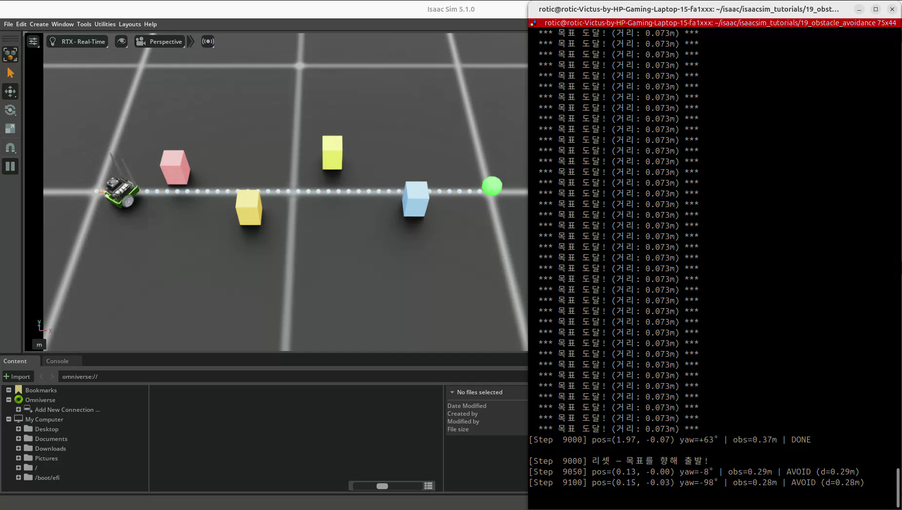
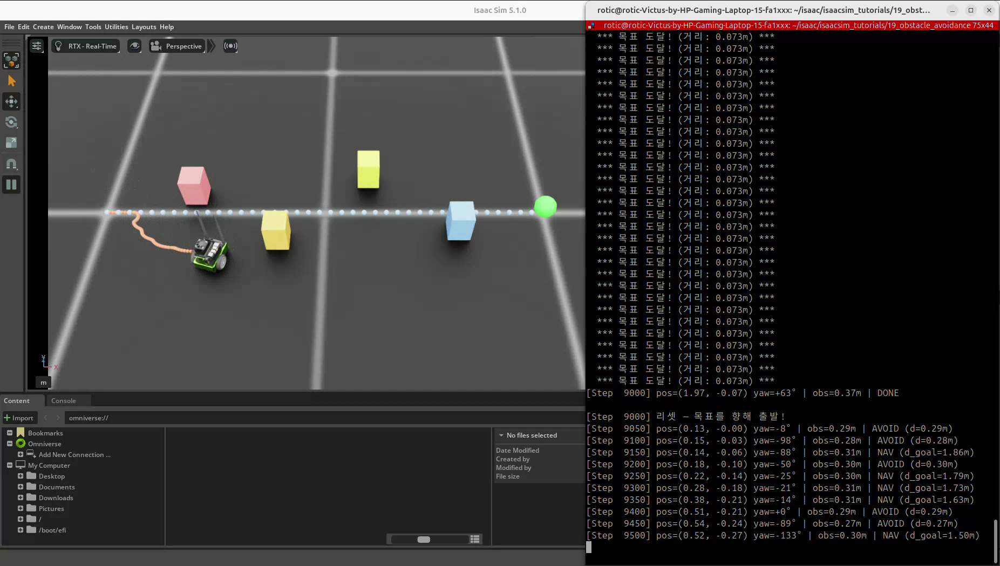
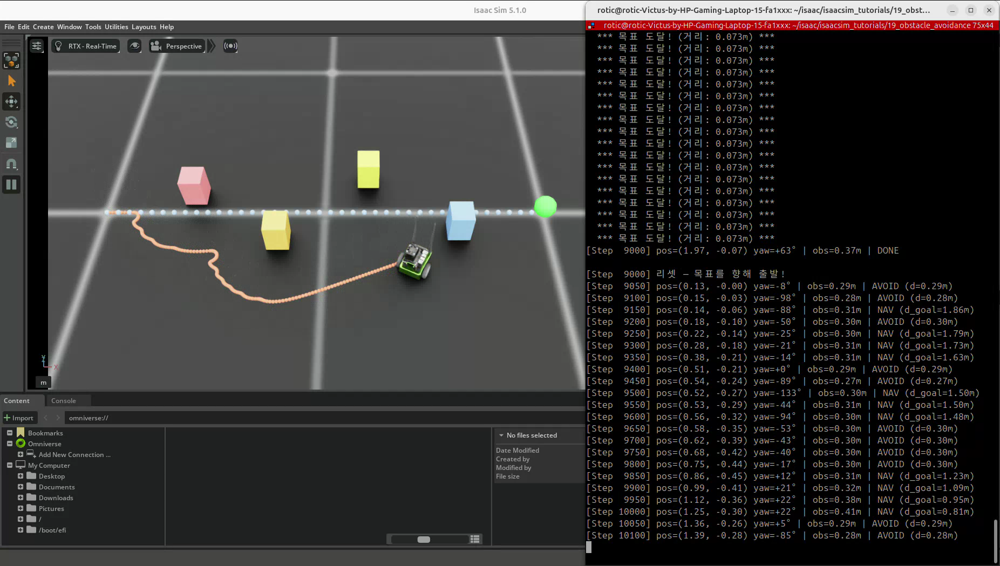
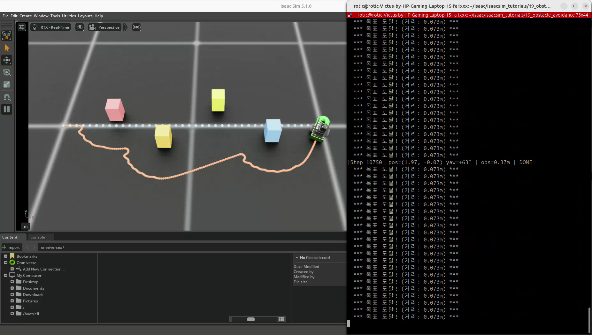

# 19. JetBot 거리 기반 장애물 회피

## 이번 실습의 핵심

**목표 추적과 장애물 회피를 조건에 따라 전환해, 장애물을 우회하며 목표점으로 이동한다.**
JetBot 한 대와 네 박스 장애물을 배치하고, 가장 가까운 장애물 중심까지의 거리로 NAV·AVOID 모드를 선택한다.
목표에 도달하면 DONE으로 정지하고 이후 초기 상태로 돌아가 다시 주행한다.

## 코드와 실행 방법

- [실습 코드](19_obstacle_avoidance.py): 제공된 실행 코드를 그대로 포함했다.
- 출처: PinkLAB 「강좌 19 - 19_obstacle_avoidance」
- [원본 튜토리얼](https://github.com/PinkWink/isaacsim_tutorials/blob/14f85fc6edece7cbb1faa50aa9fe3adef205e87a/19_obstacle_avoidance/19_obstacle_avoidance.py)
- 제공된 코드는 위 원본 버전과 일치한다.

```bash
cd <physical-ai-training 저장소 경로>/19-obstacle-avoidance
python 19_obstacle_avoidance.py
python 19_obstacle_avoidance.py --headless
```

JetBot은 NVIDIA 자산 경로에서 불러오며 박스 장애물은 코드에서 생성한다.
환경은 1개로 고정하고 `--num_envs` 옵션은 없다.
LiDAR·카메라 센서를 사용하지 않으므로 `--enable_cameras`는 필요하지 않다.

## 실습 구성

| 항목 | 설정 |
|---|---|
| 로봇·환경 수 | JetBot 1대 · 환경 1개 |
| 바퀴 반지름·간격 | 0.03 m · 0.1125 m |
| 물리 시간 간격 | 0.01초 |
| 장애물 | kinematic 강체 박스 4개 · 충돌 속성 적용 |
| 박스 크기 | 0.1 × 0.1 × 0.15 m |
| 장애물 중심 (x, y) | (0.4, 0.1), (0.8, -0.15), (1.2, 0.2), (1.6, -0.1) m |
| 목표 | 환경 기준 (2.0, 0.0) m |
| 회피 진입 조건 | 가장 가까운 장애물 중심까지 거리 < 0.30 m |
| 목표 도달 조건 | 목표까지 거리 < 0.08 m |
| 목표 추적 속도 상한 | 0.25 m/s |
| 회피 속도 기준 | 0.08 m/s · 거리 비율로 추가 감속 |
| 각속도 크기 상한 | 3.0 rad/s |
| 방향 게인 | NAV 4.0 · AVOID 5.0 |

kinematic 장애물은 물리 접촉으로 밀려 이동하는 동적 물체와 구분한다.
코드에서 움직이지 않으므로 고정 장애물처럼 사용한다.

## 실습 결과

### 장애물과 목표 배치



| 표시 | 의미 |
|---|---|
| 색이 다른 박스 4개 | 장애물 |
| 녹색 구체 | 목표점 |
| 파란 점선 | 출발점과 목표를 연결한 직선 기준 경로 |
| 빨간 계열 점 | 로봇이 실제로 지나간 위치 기록 |

조명에 따라 실제 궤적이 주황색에 가깝게 보일 수 있다.
파란 선은 원본에서 ‘계획 경로’라고 부르지만 장애물 회피 경로를 계산한 결과는 아니다.

### 회피 모드 전환



영상 로그에서 `Step 9050`은 `obs=0.29m | AVOID`,
`Step 9150`은 `obs=0.31m | NAV`로 나타난다.
거리 조건에 따라 회피와 목표 추적이 바뀌는 것을 확인할 수 있다.

### 실제 우회 궤적



실제 궤적은 파란 직선에서 벗어나 장애물 주변을 돌아간다.
영상에서 0.30 m 부근의 NAV·AVOID 전환이 반복되는 구간도 보인다.

### 목표 접근과 반복 주행



영상 초반에는 이전 주행의 `목표 도달! (거리: 0.073m)`와 DONE 로그가 남아 있고,
`Step 9000`에서 리셋한 뒤 새 주행 궤적이 만들어진다.
0.073 m는 도달 반경 0.08 m 안이므로 코드의 목표 도달 조건을 만족한다.

[원본 영상 보기 / 다운로드 — 약 42.6초](videos/jetbot-obstacle-avoidance.webm)

원본 파일명: `19.webm`. 위 네 이미지는 제공된 영상에서 추출했다.

## 핵심 개념 1. 센서 측정과 알려진 좌표의 차이

```python
obs_local = torch.tensor(OBSTACLE_POSITIONS, device=sim.device)
obs_diffs = obs_local - pos_local.unsqueeze(0)
obs_dists = torch.norm(obs_diffs, dim=1)
min_dist, min_idx = obs_dists.min(dim=0)
```

회피에 사용하는 정보는 저장된 장애물 좌표와 시뮬레이터의 로봇 위치다.
18번의 LiDAR 스캔을 읽어 장애물을 인식하는 코드가 아니다.

`min_dist`는 로봇 루트 위치와 박스 중심 사이의 평면 거리이며,
박스 표면까지의 센서 거리나 로봇 몸체와의 최소 충돌 여유가 아니다.
회피 대상도 전체 장애물 중 가장 가까운 하나로 선택한다.
앞쪽 시야각 필터 없이 뒤쪽 장애물도 거리 조건에 포함될 수 있다.

## 핵심 개념 2. NAV·AVOID·DONE

| 모드 | 조건 | 명령 |
|---|---|---|
| DONE | 목표 도달 상태 | v=0, ω=0 |
| AVOID | 미도달, 가까운 장애물 중심까지 거리 < 0.30 m | 장애물 반대 방향으로 회전·감속 |
| NAV | 나머지 | 목표 방향으로 회전·전진 |

NAV의 각속도는 목표 방향 오차에 P 게인 4.0을 적용한다.
선속도는 거리 비례식이 아니라 `0.25 × max(cos(방향 오차), 0.1)`이다.
따라서 17번처럼 목표 거리에 비례해 감속하는 방식과 다르다.

회피 방향은 가장 가까운 장애물에서 멀어지는 방향으로 계산한다.

```python
closest_dir = obs_diffs[min_idx]
avoid_angle = torch.atan2(-closest_dir[1], -closest_dir[0])
angle_err = normalize_angle(avoid_angle - current_yaw)
omega_cmd = torch.clamp(Kp_AVOID * angle_err, -3.0, 3.0).item()
v_cmd = 0.08 * max(min_dist.item() / 0.30, 0.1)
```

가까워질수록 속도를 줄이지만, 회피 중에도 전진 명령을 완전히 0으로 만들지는 않는다.
계산된 v·ω는 차동 구동 변환으로 좌우 바퀴 각속도 목표에 전달한다.

## 핵심 개념 3. 반응형 회피와 한계

이 방식은 현재 상황에 즉시 반응하는 규칙 기반 회피다.
전체 장애물 배치를 고려해 우회 경로를 찾는 전역 경로 계획이나 강화학습 정책은 아니다.

단순 임계값 하나로 모드를 바꾸므로 경계에서 NAV·AVOID가 반복 전환될 수 있다.
복잡한 배치나 좁은 통로에서는 목표 접근과 회피가 서로 충돌해 진동·정체가 생길 수도 있다.
이 예제의 주행 결과만으로 모든 장애물 배치에서 도달이나 무충돌을 보장한다고 해석하지 않는다.

확장할 때는 로봇·장애물 외형을 반영한 여유 거리, 실제 센서 입력,
진입·해제 임계값을 다르게 하는 히스테리시스나 별도 경로 계획을 고려할 수 있다.
이는 개선 방향이며 현재 코드에 구현된 기능은 아니다.

## 핵심 개념 4. 궤적 기록과 리셋

`TrailVisualizer`는 물리 진행 후의 실제 월드 위치를 5 step마다 기록한다.
최대 500점까지 저장하며, 물리 dt=0.01초에서 기록 상한은 약 25초에 해당한다.
상한 이후에는 오래된 점을 지우는 대신 기록을 멈춘다.

목표 도달 후 다음 전역 `step_count`의 200 배수 시점에 리셋한다.
항상 도달 후 정확히 200 step을 기다리는 설정은 아니다.
리셋 때 로봇 자세·속도·관절 상태와 궤적 기록을 초기화하고 다시 출발한다.

## 배운 점

- 목표 추적과 회피를 조건에 따라 전환하는 주행 제어를 구성할 수 있다.
- 알려진 장애물 좌표와 실제 센서 감지는 서로 다른 입력 방식이다.
- 장애물 중심 거리와 충돌 여유 거리를 구분해야 한다.
- 직선 기준 경로와 실제 주행 궤적을 비교하면 회피 동작을 이해하기 쉽다.
- 단순 반응형 규칙의 한계와 센서·경로 계획을 결합할 필요성을 알 수 있다.

[공통 개념 — 반응형 장애물 회피](../learning-notes/reactive-obstacle-avoidance/README.md) ·
[18번 LiDAR 스캔](../18-lidar-maze/README.md) · [17번 목표 추적](../17-mobile-navigation/README.md)
