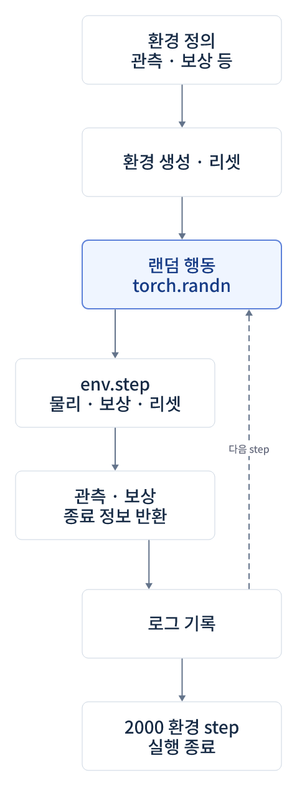
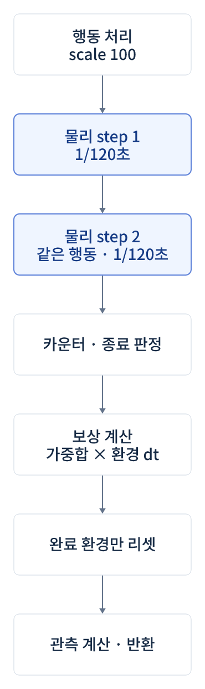
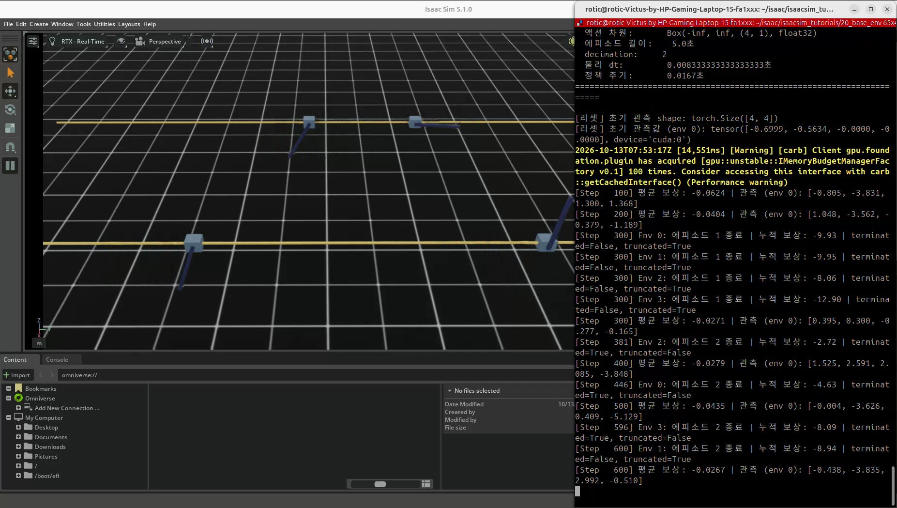
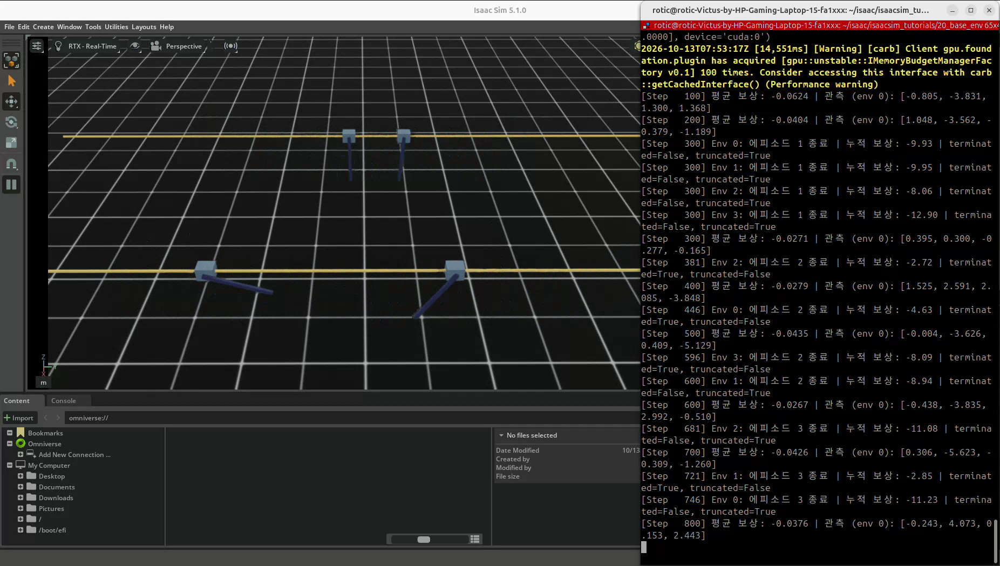
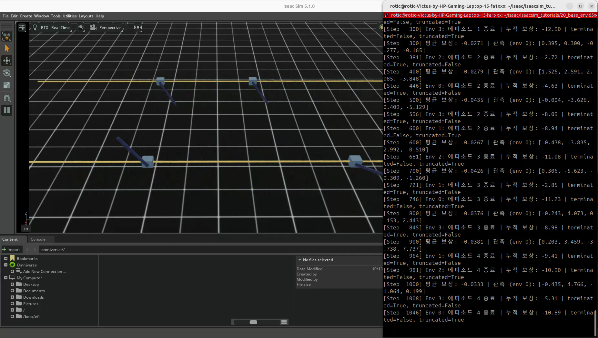
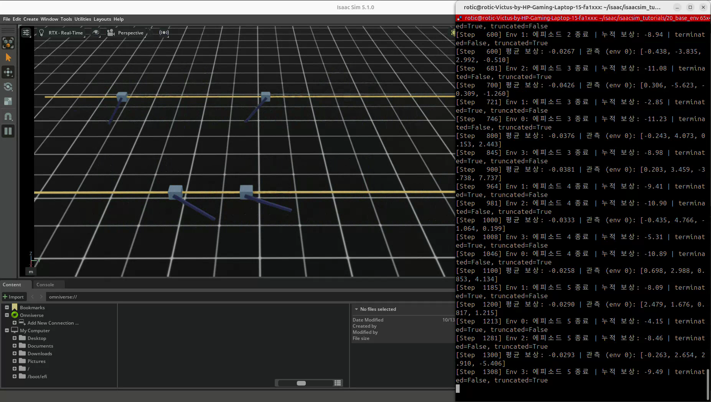

# 20. 강화학습 환경의 기초 — ManagerBasedRLEnv

## 이번 실습의 핵심

**강화학습을 시작하려면 먼저 ‘무엇을 보고, 무엇을 할 수 있고, 무엇을 잘했다고 평가할지’를 환경에 정의해야 한다.**
이번 실습은 Cartpole의 환경을 구성하고 랜덤 행동으로 관측·보상·종료·리셋이 동작하는지 확인한다.

보상을 출력하지만 신경망 가중치를 업데이트하지는 않는다.
Policy·Critic·PPO를 학습시키는 단계는 이후 24번 등의 학습 실행기에 해당한다.

## D2로 보는 코드 구성과 실행 순서





환경 step 한 번은 같은 행동으로 물리 step을 두 번 진행한 뒤 결과를 반환한다.
신경망을 업데이트하는 학습 iteration과 다르다.
[전체 학습·모델 구성도](../learning-notes/reinforcement-learning/diagrams/README.md)에서 이후 PPO 학습과 비교할 수 있다.

## 먼저 읽을 개념과 코드 리뷰

- [강화학습 개념 정리](../learning-notes/reinforcement-learning/README.md): Policy·Actor·Critic·PPO, 종료 구분과 보상 설계.
- [20번 코드 리뷰](code-review.md): 코드 흐름, 주석과 실제 동작의 차이, 학습 전 확인할 설계 사항.

## 코드와 실행 방법

- [제공된 실행 코드](20_base_env.py)
- 출처: PinkLAB 「강좌 20 - 20_base_env」
- [기준 튜토리얼](https://github.com/PinkWink/isaacsim_tutorials/blob/14f85fc6edece7cbb1faa50aa9fe3adef205e87a/20_base_env/20_base_env.py)
- 제공 코드는 위 버전의 실행 종료 기준을 300 → **2000 환경 step**으로 변경했다.
- 제공된 코드 자체는 수정 없이 보존하고, 리뷰와 개선 예시는 별도 문서에 기록했다.

```bash
cd <physical-ai-training 저장소 경로>/20-base-env
python 20_base_env.py                 # 기본: 환경 4개
python 20_base_env.py --num_envs 16
python 20_base_env.py --headless
```

Cartpole은 Isaac Lab의 `CARTPOLE_CFG`에서 불러온다.
이번 스크립트는 학습된 가중치 파일을 읽거나 저장하지 않는다.

## 환경을 구성하는 여섯 가지 요소

| 요소 | 묻는 질문 | 이번 설정 |
|---|---|---|
| Scene | 어디서 어떤 기구가 움직이는가? | Cartpole·바닥·조명 |
| Observation | 행동 결정에 어떤 정보를 주는가? | 관절 위치 2개·관절 속도 2개 |
| Action | 무엇을 조절할 수 있는가? | 카트 직선 관절에 가할 힘 |
| Reward | 무엇을 좋은 상태·행동으로 볼 것인가? | 생존, 막대 각도·속도와 카트 속도 |
| Termination | 언제 한 시도를 끝낼 것인가? | 카트 경계 이탈 또는 시간 제한 |
| Event | 새 시도를 어떻게 시작할 것인가? | 초기 관절 위치·속도 무작위 설정 |

`ManagerBasedRLEnv`는 이 설정을 묶어 행동 적용, 물리 진행, 보상·종료 계산과 완료 환경 리셋을 관리한다.

## 관측과 행동

| 항목 | 내용 |
|---|---|
| 관측 그룹 | `obs["policy"]` |
| 그룹 크기 | `(환경 수, 4)` |
| 관측 구성 | 관절별 기본 위치 대비 위치 2개 + 기본 속도 대비 속도 2개 |
| 관절 종류 | 카트: 직선 이동 · m, 막대: 회전 · rad |
| 행동 크기 | `(환경 수, 1)` |
| 행동 적용 | 카트 effort 목표에 `scale=100.0` 적용 |

`policy`는 이 코드에서 관측 딕셔너리의 이름이다. 이 이름이나 `PolicyCfg` 클래스가 정책 신경망을 만드는 것은 아니다.
관측 배열의 카트·막대 순서는 실제 모델의 관절 순서와 함께 확인해야 한다.

## 리셋 조건과 실행 시간

| 항목 | 설정 |
|---|---|
| 기본 환경 수·간격 | 4개 · 환경 원점 간격 4 m |
| 물리 dt | 1/120초 |
| decimation | 행동 한 번에 물리 스텝 2회 |
| 행동 주기 | 1/60초 · 약 60 Hz |
| 에피소드 시간 상한 | 5초 · 약 300 환경 step |
| task termination | 카트 위치가 -3 m보다 작거나 +3 m보다 큼 |
| truncation | 5초 시간 상한 |
| 전체 데모 실행 상한 | 2000 환경 step · 약 33.33초의 시뮬레이션 시간 |

여기서 환경 step은 학습 업데이트 횟수나 에피소드 개수가 아니다.
환경 4개가 같은 step에 함께 움직이면 step당 4개의 전이를 만들 수 있지만,
이 코드는 그 경험을 학습용 버퍼에 모아 신경망을 업데이트하지 않는다.

초기 카트 위치는 기본값에서 ±1 m, 속도는 ±0.5 m/s 범위로 바꾼다.
막대 각도와 각속도는 각각 ±π/4 rad, ±π/4 rad/s 범위로 바꾼다.

## 보상 설계의 의도

| 보상 항 | 가중치 | 의도 |
|---|---|---|
| `is_alive` | +1.0 | task termination 없이 계속 진행하도록 유도 |
| `is_terminated` | -2.0 | task termination에 감점 |
| 막대의 기본 각도 대비 절댓값 편차 | -1.0 | 막대를 직립 상태에 가깝게 유지 |
| 카트 속도 절댓값 | -0.01 | 과도한 이동 억제 |
| 막대 각속도 절댓값 | -0.005 | 과도한 흔들림 억제 |

보상 함수는 행동을 가르치는 평가 기준이며, 현재 행동을 실제로 바꾸는 학습 과정은 별도로 필요하다.
시간 제한만 발생한 경우는 `is_terminated` 감점 대상이 아니다.
Isaac Lab 보상 매니저는 각 항의 값·가중치에 **환경 시간 간격도 곱한다**.
따라서 `weight=1`이 반환 보상에 매번 +1을 더한다는 뜻은 아니다. 자세한 계산은 [코드 리뷰](code-review.md)에 설명했다.

막대가 기울었을 때는 감점하지만, 이 코드에는 막대 각도에 따른 종료 조건이 없다.
그래서 Cartpole이 쓰러진 듯 보여도 카트 경계 이탈이나 시간 제한까지 계속 진행할 수 있다.

## 실습 결과

### 병렬 Cartpole 환경



영상에서 환경 4개와 초기 관측 크기 `(4, 4)`를 확인할 수 있다.
각 환경에 서로 다른 초기 상태와 랜덤 힘을 적용한다.

### 두 종류의 종료



영상의 Step 300에서는 환경들이 `terminated=False, truncated=True`로 종료한다.
이후에는 예를 들어 Step 381의 환경 2에서 `terminated=True, truncated=False`가 나타난다.
각 환경이 개별 조건에 따라 종료·리셋되는 것을 확인할 수 있다.

### 랜덤 행동 결과



막대가 크게 흔들리거나 기울며 보상이 음수로 출력되기도 한다.
이는 환경 테스트 결과이며, 정책이 학습해 균형을 잡는 성능을 보여주는 영상은 아니다.

### 보상과 에피소드 로그



로그의 ‘평균 보상’은 그 step의 환경 간 평균이고, ‘누적 보상’은 완료한 개별 에피소드의 합계다.
둘을 같은 지표로 비교하지 않는다.

[원본 영상 보기 / 다운로드 — 약 28.1초](videos/cartpole-random-environment.webm)

원본 파일명: `20.webm`. 위 네 이미지는 제공된 영상에서 추출했다.

## 19번까지와 무엇이 달라졌나?

19번까지는 사람이 만든 규칙으로 행동을 정하고 직접 씬·물리를 진행했다.
20번은 이후 학습 알고리즘이 사용할 수 있도록 관측·행동·보상·종료 인터페이스를 갖춘 환경을 만든다.
다음 단계에서 랜덤 행동 생성을 정책으로 바꾸고, 경험을 이용하는 PPO 학습기를 연결하면 실제 가중치 학습으로 이어진다.
