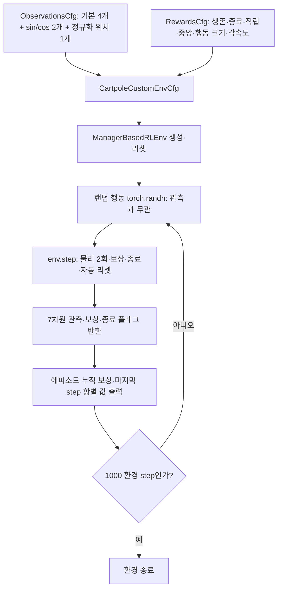
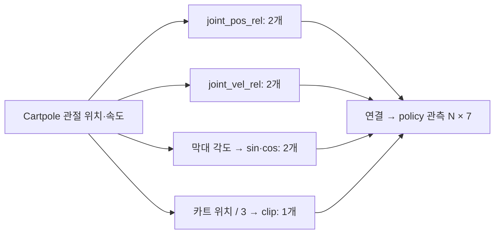
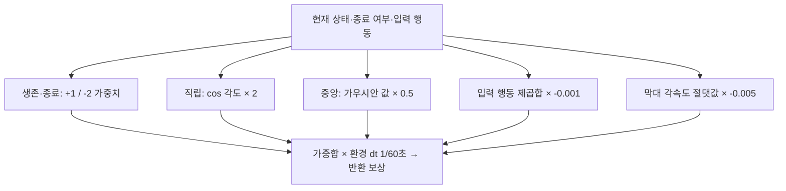
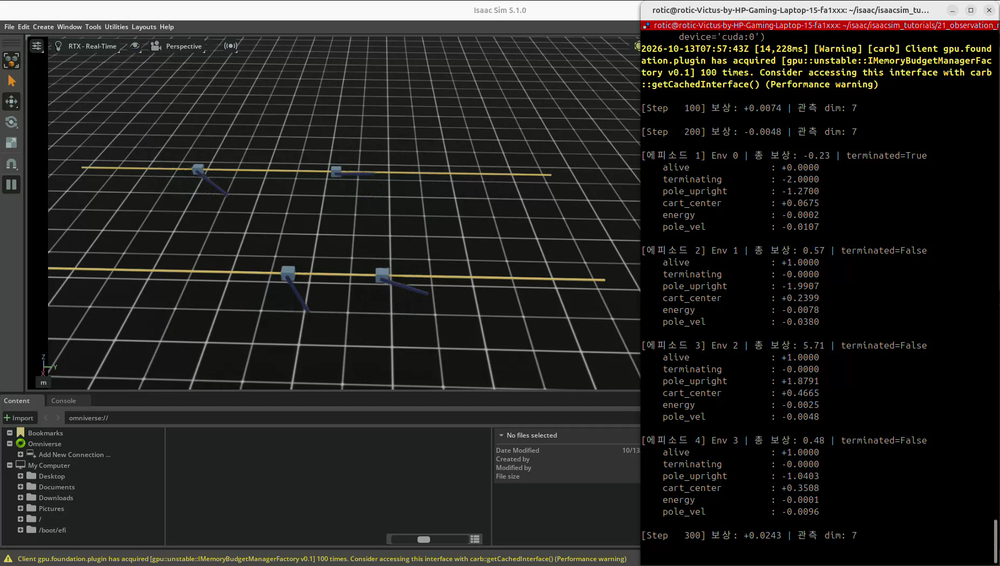
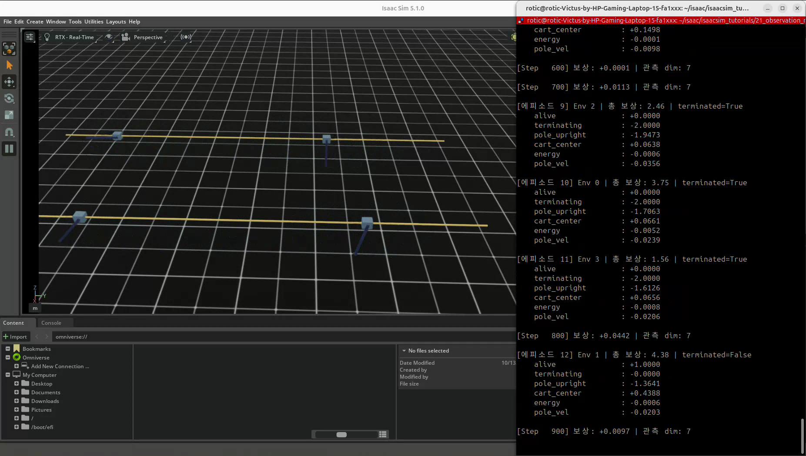

# 21. 커스텀 관측과 보상 설계

## 이번 실습의 핵심

**관측은 행동 결정에 주는 정보의 표현이고, 보상은 어떤 행동·상태가 좋은지를 평가하는 기준이다.**
Cartpole에 각도의 sin·cos와 정규화 위치를 추가해 관측을 4차원에서 7차원으로 늘린다.
보상에는 직립 정도, 중앙 위치와 큰 행동 억제 항을 구성한다.

이번 파일도 랜덤 행동으로 환경을 테스트하며 Policy·Critic·PPO를 학습하지 않는다.
관측·보상 변경이 실제 학습 성능을 높였는지는 이후 같은 조건의 정책 학습·평가로 비교해야 한다.

[21번 코드 리뷰](code-review.md) · [강화학습 개념](../learning-notes/reinforcement-learning/README.md)

## 코드와 실행 방법

- [제공된 코드](21_observation_reward.py)
- 출처: PinkLAB 「강좌 21 - 21_observation_reward」
- [기준 튜토리얼](https://github.com/PinkWink/isaacsim_tutorials/blob/14f85fc6edece7cbb1faa50aa9fe3adef205e87a/21_observation_reward/21_observation_reward.py)
- 제공 버전은 실행 상한을 300 → **1000 환경 step**으로 변경했다.
- 제공 코드는 그대로 보존하고, 설명 차이·개선 제안은 리뷰에 기록한다.

```bash
cd <physical-ai-training 저장소 경로>/21-observation-reward
python 21_observation_reward.py                 # 기본: 환경 4개
python 21_observation_reward.py --num_envs 8
python 21_observation_reward.py --headless
```

## Mermaid로 보는 코드 구조



## 관측 구성 — 정보와 표현을 구분하기



| 항목 | 크기 | 의미 |
|---|---|---|
| `joint_pos_rel` | 2 | 기본 위치 대비 카트·막대 관절 위치 |
| `joint_vel_rel` | 2 | 기본 속도 대비 두 관절 속도 |
| `pole_sin_cos` | 2 | 막대 각도의 주기적인 표현 |
| `cart_pos_norm` | 1 | 카트 위치를 3으로 나누고 ±1로 제한 |

각도를 직접 비교하면 +179°와 -179°가 멀게 보이지만 sin·cos는 가까운 방향으로 표현한다.
다만 원본의 raw 각도 관측도 남아 있으므로 전체 관측에서 각도 경계 표현이 완전히 사라진 것은 아니다.
카트 위치·각도 정보를 다른 형태로 추가한 것이며 새 센서로 독립적인 정보를 얻은 것은 아니다.

정규화는 값의 크기를 바꾸고, clip은 범위를 넘은 값을 경계로 자른다.
이번 코드는 노이즈를 비활성화하며 `ObsTerm.scale` 옵션도 직접 지정하지 않는다.
강의에서 다루는 noise·scale 옵션과 실제 적용 설정은 구분한다.

## 보상 구성 — 학습 목표의 표현



| 항 | 의미 | 해석할 점 |
|---|---|---|
| 생존 | task termination 없이 진행 | 시간 제한만 발생한 경우와 구분 |
| 종료 | task termination 감점 | 막대 각도 실패 종료는 아직 없음 |
| 직립 | `cos(막대 각도)` | 직립 +1, 수평 0, 거꾸로 -1 |
| 중앙 | 위치에 대한 가우시안 보상 | 중심 1, 멀어질수록 작아짐 · sigma=1.5 |
| 행동 크기 | 입력 행동 제곱합 감점 | 이름은 energy지만 실제 에너지 측정이 아님 |
| 각속도 | 빠른 막대 회전 감점 | 균형 회복에 필요한 움직임과 균형 조절 필요 |

가우시안 폭 sigma가 작으면 중앙에서 벗어날 때 점수가 빠르게 줄어든다.
설명용으로 카트가 sigma만큼 떨어지면 원시 보상은 약 0.607이며, 여기서는 가중치 0.5와 시간 간격을 추가 적용한다.

직립 함수 주석의 ‘0~1’과 달리 `cos()`는 [-1, 1]이다.
보상 항이 음수로 출력되는 것은 이 구현에서 정상적인 결과일 수 있다.

## 환경과 실행 길이

| 항목 | 설정 |
|---|---|
| 기본 환경 수·간격 | 4개 · 4 m |
| 행동 | 카트 effort · 입력 scale=100 |
| 물리 dt·decimation | 1/120초 · 2 |
| 환경 step 시간 | 1/60초 |
| 에피소드 상한 | 5초 · 약 300 환경 step |
| task termination | 카트 위치가 ±3 m 범위 밖 |
| 실행 상한 | 1000 환경 step · 시뮬레이션 시간 약 16.67초 |

막대가 크게 기울어도 각도 조건으로 즉시 종료하지 않는다.
자동 리셋과 반환 관측의 의미는 [20번 코드 리뷰](../20-base-env/code-review.md)와 동일하다.

## 실습 결과






영상에서 `관측 dim: 7`과 여섯 보상 항을 확인할 수 있다.
환경 0의 첫 완료 에피소드는 총 보상 약 -0.23, `terminated=True`로 나타난다.
다른 환경에는 `terminated=False`로 끝나는 로그도 있는데, 현재 종료 정의에서는 시간 제한에 해당한다.
원본 로그는 `truncated`를 직접 출력하지 않아 두 플래그를 모두 보여주는 20번보다 종료 이유를 읽기 불편하다.

환경 0의 종료 항은 -2.0000, 직립 항은 -1.2700으로 표시된다.
이 값은 **마지막 step의 가중치 적용 값이며 시간 간격 적용 전**이다.
위 값을 그대로 더해서 에피소드 총 보상 -0.23과 비교하면 안 된다.
[코드 리뷰](code-review.md)에서 로그의 세 가지 단위를 설명한다.

[원본 영상 보기 / 다운로드 — 약 22.2초](videos/cartpole-custom-observation-reward.webm)

원본 파일명: `21.webm`. 위 세 이미지는 제공된 영상에서 추출했다.

## 배운 점

- 관측은 값을 많이 넣는 것뿐 아니라 목적에 맞는 표현·크기·단위가 중요하다.
- 각도의 주기성을 sin·cos로 표현할 수 있다.
- 함수 반환 크기를 맞춰 ObsTerm·RewardTerm에 등록한다.
- 보상 항의 의도, 실제 값 범위, 가중치·시간 간격을 함께 확인해야 한다.
- 총점과 항별 로그를 함께 보되, 마지막 step과 에피소드 전체를 구분한다.
