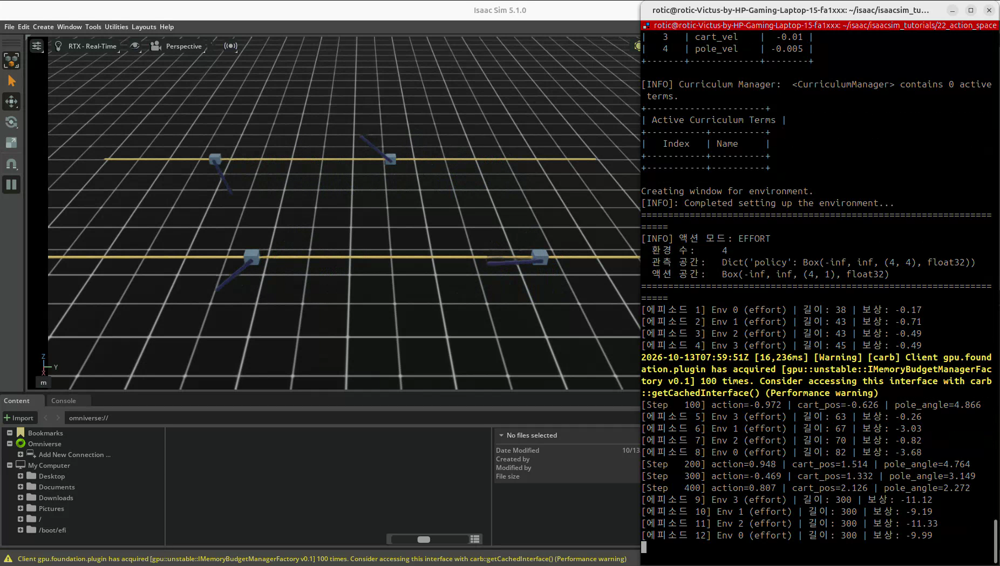
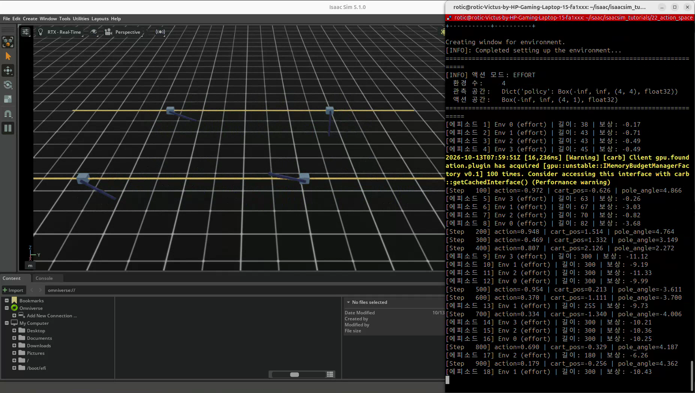
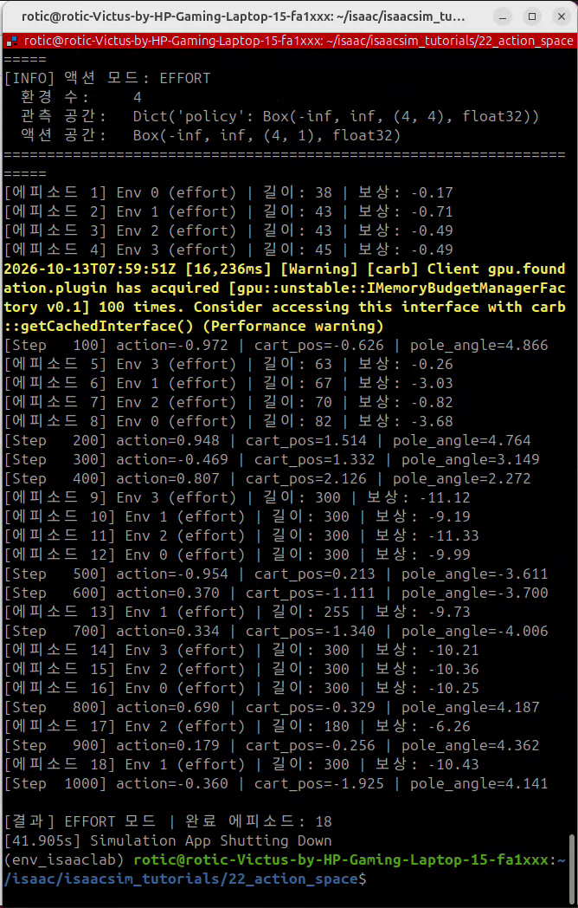

# 22. 액션 공간 — 힘·위치·속도 제어 비교

## 이번 실습의 핵심

**액션은 로봇에 내리는 명령의 의미를 정하는 것이다.** 같은 숫자 0.5라도 힘 제어에서는 50 N, 위치 제어에서는 목표 위치 1 m, 속도 제어에서는 목표 속도 2.5 m/s가 된다.
정책은 이 명령을 선택하고, Action Manager는 로봇에 맞는 단위·관절 명령으로 변환한다.

22번은 앞 150 환경 step에서 사인파, 이후 균등 랜덤 행동으로 환경을 테스트한다. Policy·Critic·PPO의 가중치 학습은 아직 없다.

[코드 리뷰](code-review.md) · [강화학습 개념](../learning-notes/reinforcement-learning/README.md#11-액션-공간--정책-출력을-로봇-명령으로-해석하기)

## 코드와 실행 방법

- [제공된 코드](22_action_space.py)
- 출처: PinkLAB 「강좌 22 - 22_action_space」
- [기준 튜토리얼](https://github.com/PinkWink/isaacsim_tutorials/blob/14f85fc6edece7cbb1faa50aa9fe3adef205e87a/22_action_space/22_action_space.py)
- 제공 버전은 실행 상한을 300 → **1000 환경 step**으로 변경했다. 소스는 그대로 보존한다.

```bash
cd <physical-ai-training 저장소 경로>/22-action-space
python 22_action_space.py                         # 기본: effort · 환경 4개
python 22_action_space.py --action_mode effort
python 22_action_space.py --action_mode position
python 22_action_space.py --action_mode velocity
python 22_action_space.py --action_mode effort --num_envs 8
```

## 세 모드의 의미

| 모드 | ActionTermCfg | 이번 카트에 전달하는 명령 | 입력 0.5의 예 |
|---|---|---|---|
| effort | `JointEffortActionCfg` | 힘 · 입력 × 100 | 50 N |
| position | `JointPositionActionCfg` | 목표 위치 · 입력 × 2 + 기본 위치 | 1 m |
| velocity | `JointVelocityActionCfg` | 목표 속도 · 입력 × 5 + 기본 속도 | 2.5 m/s |

카트의 `slider_to_cart`는 직선 관절이므로 단위는 N·m·m/s이다. 회전 관절이면 각각 N·m(토크)·rad·rad/s로 달라진다.
세 모드 모두 카트 관절 하나만 제어한다. 막대 관절은 관측·보상에 포함되지만 직접 명령하지 않는다.
기본 환경 4개에서 행동 텐서는 `(4, 1)`, 관측은 `(4, 4)`이다.

**목표값 설정은 상태를 순간 이동시키는 명령이 아니다.** position·velocity는 목표를 전달하고 실제 움직임은 actuator 게인·힘 제한·질량·접촉 등에 의해 결정된다.
`use_default_offset=True`는 모델의 기본 관절 상태를 기준으로 한다. 매 step 현재 위치에 더하거나 에피소드의 무작위 초기 위치에 더하는 설정이 아니다.

## D2로 보는 액션 처리 구조

<p align="center">
  
</p>
<p align="center"><sub>그림 10. 액션 변환과 세 제어 명령</sub></p>

`env.step(action)`은 행동을 처리한 뒤 두 물리 step 동안 적용한다. 물리 dt는 1/120초, 환경 step은 1/60초다.
힘을 전달하는 것과 위치·속도 목표를 전달하는 것의 차이는 [PD 제어 개념](../learning-notes/pd-pid-gravity-compensation/README.md)과 연결된다.

## 강의 설명과 실제 코드에서 구분할 점

Isaac Lab v2.3.2의 기본 `CARTPOLE_CFG`는 카트 actuator에 `stiffness=0`, `damping=10`을 설정한다. 이번 코드는 모드 전환 시 이 게인을 바꾸지 않는다.
따라서 position 모드의 목표 위치를 바꿔도 **위치 오차로 복원하는 힘은 생기지 않는다**. 카트가 중앙 근처에 머무는 결과만으로 목표 추종을 입증할 수 없다.
velocity에는 속도 오차에 반응하는 damping이 있으며, effort에도 기존 감쇠 효과가 함께 작용할 수 있다.

강의의 ‘position은 PD로 안정적’, ‘effort는 게인 무시’는 제어기를 맞게 구성한 경우의 설명으로 읽어야 한다. 게인을 포함한 실제 설정과 개선 예시는 [리뷰](code-review.md#2-가장-중요한-사항-액션-설정과-actuator-설정은-별개)에 정리했다.

## 행동 생성과 에피소드

| 구간·조건 | 동작 |
|---|---|
| 최초 150 환경 step | 모든 환경에 같은 사인파 값 적용 |
| 이후 | 환경별 독립 균등 랜덤 값 · [-1, 1) |
| 카트 위치 ±3 m 이탈 | task termination |
| 에피소드 5초 · 약 300 step | truncation |
| 완료 환경 | 환경 내부 자동 리셋 · 누적 보상/길이 버퍼도 해당 환경만 초기화 |
| 전체 실행 상한 | 1000 환경 step · 시뮬레이션 시간 약 16.67초 |

사인파 구간은 전체 실행의 처음에 한 번만 적용된다. 에피소드가 리셋돼도 다시 사인파 구간으로 돌아가지 않는다.
`total_steps * 0.05`는 사인파 위상을 정하는 값이며 실제 물리 dt가 아니다. 주기는 약 126 환경 step, 시뮬레이션 시간 약 2.09초다.
막대 각도 실패 종료는 없다. 오래 살아남거나 보상이 높다는 것만으로 막대를 직립 유지했다고 볼 수 없다.

## 실습 결과

<p align="center">
  
</p>

영상은 **EFFORT 모드 · 환경 4개** 실행이다. 로그에서 처음 완료한 환경 0은 길이 38 step·보상 약 -0.17이며 이후 길이 300 step의 에피소드도 나타난다.
관측 공간 `(4, 4)`와 행동 공간 `(4, 1)`을 확인할 수 있다.

<p align="center">
  
</p>

사인파 이후 랜덤 구간의 카트 이동·막대 흔들림과 개별 환경의 반복 리셋을 기록했다.
제공 영상으로 position·velocity 모드의 성능 비교까지 판단하지 않는다.

<p align="center">
  
</p>

최종 로그는 `Step 1000`, `EFFORT 모드`, `완료 에피소드: 18`이다. 완료 수는 네 환경의 합계이며, 학습 업데이트 횟수가 아니다.

[원본 영상 보기 / 다운로드 — 약 23.46초](videos/22.webm)

원본 파일명: `22.webm`. 위 이미지는 제공 영상에서 추출했으며 최종 로그는 터미널 영역만 표시했다.

## 배운 점

관측은 정책이 보는 정보, 보상은 평가 기준, 액션 공간은 정책이 내리는 명령의 의미다.
액션 종류·단위·scale뿐 아니라 actuator 게인과 제한까지 함께 설계해야 의도한 제어가 된다.
이후 학습 비교에서는 모드별 추종 오차·작업 성공률·안전성도 확인한다.
