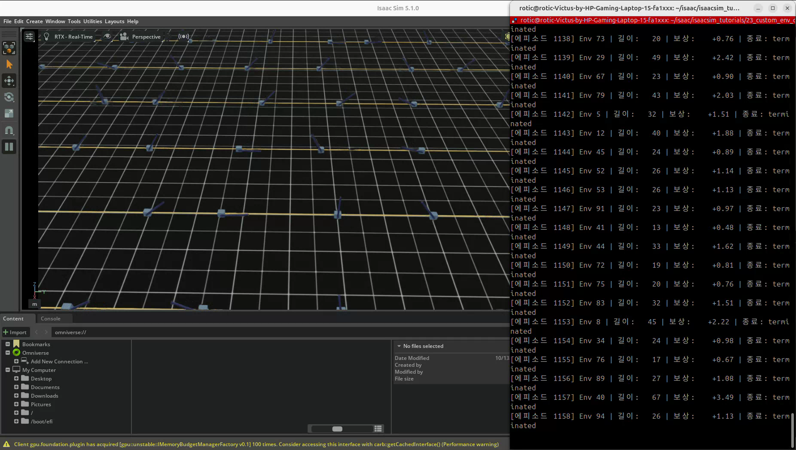
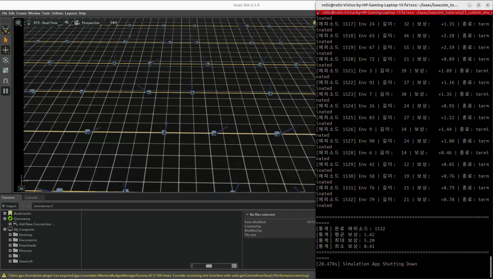

# 23. 커스텀 강화학습 환경 완성

## 이번 실습의 핵심

**강화학습 환경은 목표 작업을 관측·행동·보상·종료·초기화 규칙으로 구체화한 것이다.**
이번 목표는 ‘막대를 세우고 카트를 중앙에 유지하기’다. 20~22장에서 배운 구성 요소를 `MyCartpoleEnvCfg`로 조립한다.

23번은 **학습 전 환경 테스트와 baseline 측정**이다. 랜덤 행동을 실행하고 점수를 기록하지만 Policy·Critic·PPO 가중치를 업데이트하지 않는다. 다음 24번에서 학습 실행기를 연결한다.

[코드 리뷰](code-review.md) · [강화학습 공용 개념](../learning-notes/reinforcement-learning/README.md)

## 코드와 실행 방법

- [제공된 코드](23_custom_env_complete.py)
- 출처: PinkLAB 「강좌 23 - 23_custom_env_complete」
- [기준 튜토리얼](https://github.com/PinkWink/isaacsim_tutorials/blob/14f85fc6edece7cbb1faa50aa9fe3adef205e87a/23_custom_env_complete/23_custom_env_complete.py)
- 제공 버전은 CLI 기본 환경 수를 **4 → 100개**로 변경했다. 실행 상한은 500 환경 step이며 원본 코드를 그대로 보존했다.

```bash
cd <physical-ai-training 저장소 경로>/23-custom-env-complete
python 23_custom_env_complete.py                  # 제공 코드 기본: 환경 100개
python 23_custom_env_complete.py --num_envs 4      # 소수 환경 관찰
python 23_custom_env_complete.py --num_envs 16
python 23_custom_env_complete.py --headless --num_envs 100
```

클래스의 `scene.num_envs=4`는 main에서 CLI 값으로 덮어쓴다. 제공 코드를 인자 없이 실행하면 환경 100개다.

## 환경을 구성하는 여섯 요소

| 요소 | 이번 코드 | 사람이 정하는 질문 |
|---|---|---|
| Scene | `MyCartpoleSceneCfg` | 어떤 로봇·바닥·조명에서 움직일까? |
| Action | `MyActionsCfg` | 로봇에 무엇을 명령할까? |
| Observation | `MyObservationsCfg` | 행동을 결정할 때 어떤 정보를 볼까? |
| Reward | `MyRewardsCfg` | 어떤 상태·행동에 점수를 줄까? |
| Termination | `MyTerminationsCfg` | 언제 작업 실패 또는 시간 제한일까? |
| Event | `MyEventCfg` | 새 에피소드를 어떤 상태에서 시작할까? |

`@configclass`로 설정을 선언하고 `ManagerBasedRLEnv`가 각 manager를 구성한다. 함수 이름을 `obs_*`로 붙이는 것만으로 실행되지는 않는다. ObsTerm·RewTerm·DoneTerm에 등록해야 해당 manager가 호출한다.

## D2로 보는 코드 실행 구조


행동 한 번마다 환경은 명령 적용 → 물리 진행 → 종료 판단 → 보상 계산 → 완료 환경 리셋 → 관측 반환을 수행한다.
실행 루프는 반환 보상과 길이를 누적하고, 완료한 환경의 에피소드 점수를 저장한다.

## 관측·행동·보상

| 구분 | 설정·의미 |
|---|---|
| 관측 7차원 | 관절 위치 2 + 관절 속도 2 + 막대 sin/cos 2 + 정규화 카트 위치 1 |
| 행동 1차원 | 카트 직선 관절에 effort · raw action × 100 N |
| 입력 생성 | 정규분포 난수 후 ±1로 clamp · 균등 분포와 다름 |
| 생존 | task termination 없을 때 +1 가중치 |
| 실패 | task termination일 때 -2 가중치 |
| 직립 | cos(각도) · +2 가중치 |
| 중앙 | 가우시안 위치 보상 · +0.5 · sigma=1.5 |
| 행동 크기 | raw action 제곱합 · -0.001 · 실제 에너지 측정 아님 |
| 막대 속도 | 각속도 절댓값 · -0.005 |

관측의 카트 위치는 3으로 나눈 뒤 ObsTerm에서 ±1로 clip한다. sin/cos를 추가해도 raw 각도 관측은 남아 있다.
100개 환경에서 관측은 `(100, 7)`, 행동은 `(100, 1)`이다. 반환 보상과 종료 플래그는 환경당 하나다.
기본 Cartpole의 카트 감쇠 설정을 유지하므로 명령 힘과 실제 순 구동력을 동일시하지 않는다.

보상 항은 가중치와 환경 step dt를 곱해 합산한다. 이상적으로 중앙·직립·정지·행동 0을 유지하면 초당 3.5점, 5초에 약 **17.5점**이다.
이 값은 해당 보상 설계에서의 이상적 기준이다. 제공 영상의 랜덤 결과나 학습 완료를 뜻하지 않는다.

## 21번과 달라진 핵심: 막대 실패 종료 추가

| 종료 조건 | 판정 | 반환 |
|---|---|---|
| 에피소드 5초 도달 | 약 300 환경 step | `truncated=True` |
| 카트 경계 이탈 | 위치가 [-3, 3] m 밖 | `terminated=True` |
| 막대 기울기 초과 | `abs(angle) > π/2` | `terminated=True` |

정확히 90°일 때가 아니라 **90°를 초과**할 때 코드 조건이 참이다.
실패는 이 balancing 태스크의 규칙이며 로봇이 물리적으로 복구 불가능하다는 뜻은 아니다.
시간 제한도 자동으로 성공을 의미하지 않는다. 성공을 평가하려면 직립 오차·중앙 위치·유지 시간 등의 기준을 따로 정해야 한다.

## 초기화와 시간 단위

리셋 시 카트 위치는 ±1 m·속도는 ±0.5 m/s, 막대 각도·각속도는 각각 ±π/4 rad·rad/s 범위에서 샘플링한다. 모델의 기본 관절 상태에 더하는 offset이다.
환경 간 간격은 4 m다. 완료 환경만 자동 리셋하므로 모든 환경의 에피소드 길이가 같을 필요는 없다.

| 단위 | 설정 |
|---|---|
| 물리 dt | 1/120초 |
| decimation | 환경 step당 물리 step 2회 |
| 환경 step | 1/60초 |
| 에피소드 상한 | 5초 · 약 300 환경 step |
| 전체 실행 | 500 환경 step · 시뮬레이션 시간 약 8.33초 |
| 환경 100개 총 전이 | 모두 진행하면 100 × 500 = 50,000개 |

환경 수를 늘리면 경험 수는 늘지만 이것만으로 학습이 시작되지는 않는다.

## 실습 결과 — 학습 전 baseline



영상에는 Env 94 등 환경별 종료 로그와 여러 Cartpole이 함께 보인다. 막대가 흔들리고 실패한 환경이 개별 리셋되는 랜덤 실행 결과다.



| 제공 영상 최종 로그 | 값 |
|---|---|
| 완료 에피소드 | 1532회 |
| 평균 보상 | 1.42 |
| 최대 보상 | 5.20 |
| 최소 보상 | 0.41 |

통계는 **모든 환경에서 완료한 에피소드의 합계**다. 실행 종료 시 아직 진행 중인 에피소드는 포함하지 않는다.
자료에 나온 평균 1.50은 별도 4환경 실험 예시이며 이번 영상의 수치와 구분한다.
점수 차이만으로 보상 설계가 올바르다고 입증할 수는 없다. 이후 동일한 환경·평가 조건의 정책과 비교한다.

[원본 영상 보기 / 다운로드 — 약 6.68초](videos/23.webm)

원본 파일명: `23.webm`. 위 이미지는 제공 영상에서 추출했다. 영상 길이와 코드의 전체 시뮬레이션 시간은 다른 값이다.

## 다음 학습으로 연결하기

24번은 같은 7차원 관측·1차원 행동·보상·종료 설계에 RSL-RL 래퍼와 `OnPolicyRunner.learn()`을 연결한다.
기준 튜토리얼에서는 환경 설정을 24번 파일에 다시 정의하므로 23번 파일을 직접 import해서 학습하는 구조는 아니다.
이번 단계의 성과는 ‘학습된 모델’이 아니라 **학습에 사용할 환경과 비교 기준을 준비한 것**이다.
