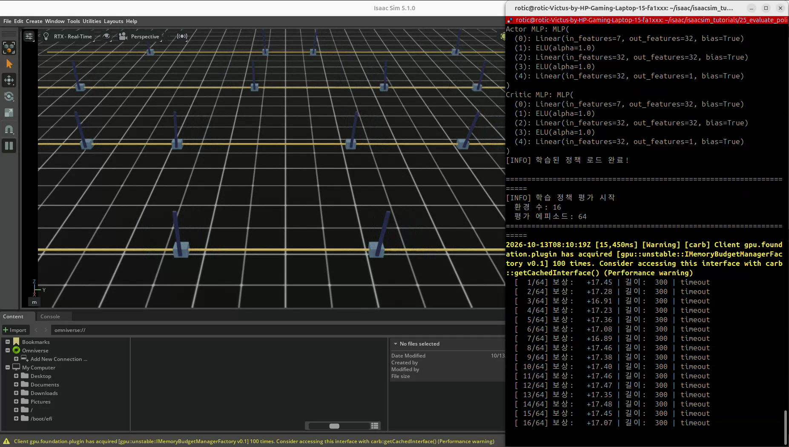
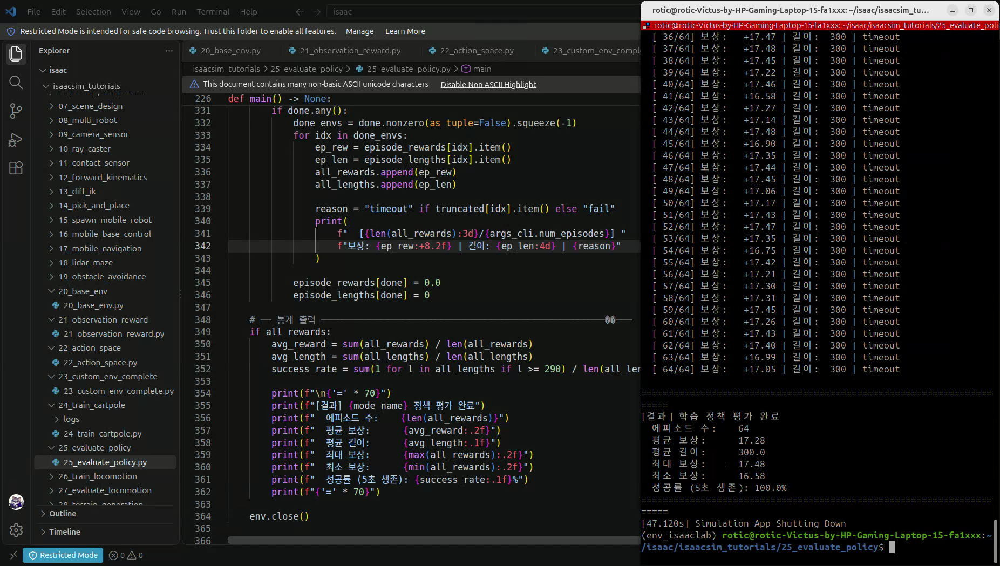
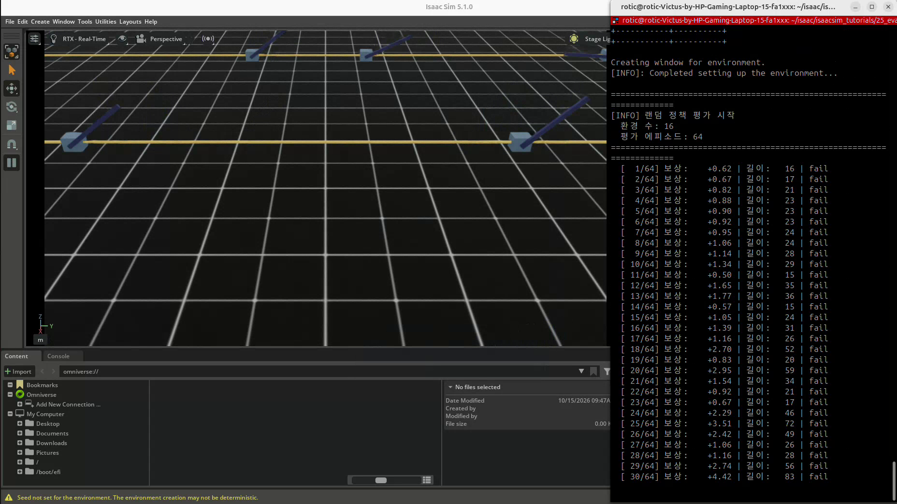
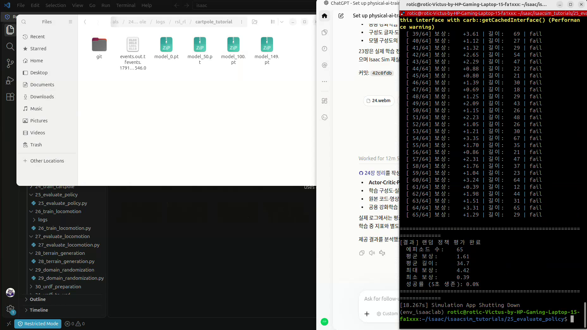

# 25. 학습 정책 평가 — 랜덤 정책과 비교

## 이번 실습의 핵심

**24번에서 저장한 정책을 고정한 채 실행하고, 랜덤 행동과 비교해 실제 작업 성능을 확인한다.**
이번에는 PPO 업데이트를 하지 않는다. 체크포인트를 불러온 Actor가 관측마다 행동을 계산하며, 에피소드 보상·길이·길이 기준 달성률을 기록한다.

[코드 리뷰](code-review.md) · [학습·추론·평가 공용 개념](../learning-notes/reinforcement-learning/README.md#policy-evaluation) · [24번 학습 모델·로그](../24-train-cartpole/README.md)

## 느낀 점 검토 — 탐색과 추론을 이렇게 구분하기

| 느낀 점 | 검토와 더 정확한 표현 |
|---|---|
| ‘학습은 무작위로 여러 길을 탐색한다’ | 방향은 맞다. 이 PPO는 **현재 정책의 행동 분포에서 샘플링**해 탐색한다. 처음부터 끝까지 완전 랜덤으로 움직이는 것은 아니다. 보상·가치 정보를 이용해 분포와 가중치를 바꾼다. |
| ‘추론은 무작위 행동을 하지 않는다’ | **이번 예제에서는 맞다.** 추론 함수가 Gaussian 분포의 평균 μ를 사용해 탐색 샘플링을 제거한다. 다만 확률적 정책을 샘플링하는 추론·평가도 가능하다. |
| ‘제일 좋았던 정책을 따라야 한다’ | 평가로 고른 체크포인트를 사용한다는 뜻이면 맞다. **좋았던 경로를 그대로 재생하는 것은 아니다.** 현재 관측을 입력해 매번 행동을 계산한다. 최신 체크포인트가 항상 최고인 것도 아니다. |

예를 들어 막대가 오른쪽으로 기울어도 위치·각속도에 따라 필요한 힘이 달라진다. 학습된 정책은 저장한 행동 순서를 반복하지 않고 관측에 반응한다.
같은 관측에서 같은 평균 행동을 내더라도 초기화·센서·물리 조건까지 같아진다는 뜻은 아니다.

## 코드와 실행 방법

- [제공된 코드](25_evaluate_policy.py)
- 출처: PinkLAB 「강좌 25 - 25_evaluate_policy」
- [기준 튜토리얼](https://github.com/PinkWink/isaacsim_tutorials/blob/14f85fc6edece7cbb1faa50aa9fe3adef205e87a/25_evaluate_policy/25_evaluate_policy.py)
- 제공 버전은 CLI 기본 환경 수 **4 → 16**, 평가 목표 **20 → 64 에피소드**로 변경했다. 코드는 그대로 보존했다.

```bash
cd <physical-ai-training 저장소 경로>/25-evaluate-policy
# 이 저장소에 보존한 24번 최종 모델을 명시해 평가
python 25_evaluate_policy.py --num_envs 16 --num_episodes 64   --checkpoint ../24-train-cartpole/logs/rsl_rl/cartpole_tutorial/model_149.pt
# 랜덤 정책 비교
python 25_evaluate_policy.py --random --num_envs 16 --num_episodes 64
```

원본 자동 탐색은 `24_train_cartpole`이라는 튜토리얼 폴더명을 사용한다. 이 저장소는 `24-train-cartpole`이므로 위처럼 체크포인트 경로를 명시한다.
찾지 못하면 코드가 **랜덤 평가로 전환**하므로 출력의 `학습 정책 평가 시작`과 로드 경로를 확인한다.

## D2로 보는 25번 실행 구조


학습 모드는 24번과 같은 Actor·Critic 구조를 만든 뒤 가중치를 한 번 로드하고 `get_inference_policy()`를 얻는다. 목표 에피소드 수에 도달하기 전에는 다음 관측으로 행동 선택을 반복한다.

```python
runner.load(checkpoint_path, load_optimizer=False)
policy = runner.get_inference_policy(device=str(env.device))
with torch.no_grad():
    action = policy(obs)
```

`load_optimizer=False`는 평가에 필요 없는 optimizer 상태 복원을 생략한다.
`get_inference_policy()`의 Actor 평균 출력이 deterministic 동작을 만든다. **no_grad 자체가 무작위성을 제거하는 것은 아니다.**
가중치가 바뀌지 않는 이유는 학습 업데이트를 호출하지 않기 때문이다.

## 학습·추론·평가의 차이

| 구분 | 24번 학습 | 25번 학습 정책 평가 | 25번 랜덤 비교 |
|---|---|---|---|
| 행동 | Actor 분포에서 샘플링 | Actor 평균 μ | 정규 난수 후 ±1 clamp |
| 가중치 업데이트 | PPO·역전파·optimizer | 없음 | 신경망 사용 안 함 |
| Critic | 가치·Advantage 학습에 사용 | 모델 로드 구조에 포함되지만 행동 계산에는 불필요 | 없음 |
| 환경 수 | 제공 학습 1024 | 제공 평가 16 | 제공 평가 16 |
| 결과 | 학습 곡선·체크포인트 | 고정 정책의 에피소드 통계 | baseline 통계 |

추론은 모델로 행동을 계산하는 한 과정이고, 평가는 그 추론을 여러 에피소드 실행해 성능을 재는 절차다.
headless/GUI와 환경 수는 실행 선택이며 학습·평가를 정의하는 조건이 아니다.

## 실제 영상 비교

| 제공 영상의 최종 로그 | 학습 정책 · 25.webm | 랜덤 정책 · 25-2.webm |
|---|---:|---:|
| 환경 수 | 16 | 16 |
| 목표 / 완료 에피소드 | 64 / 64 | 64 / **65** |
| 평균 보상 | **17.28** | **1.61** |
| 평균 길이 | **300.0 step · 5초** | **34.7 step · 약 0.58초** |
| 최대 / 최소 보상 | 17.48 / 16.58 | 4.42 / 0.39 |
| 코드의 길이 기준 달성률 | **100.0%** | **0.0%** |

[비교 CSV](analysis/evaluation-comparison.csv) · [출처·기준을 포함한 JSON](analysis/evaluation-summary.json)

수치는 제공 영상의 반올림된 최종 콘솔 값을 옮긴 것이다. 원시 에피소드 로그나 표준편차를 새로 계산한 자료는 아니다.
자료의 별도 20에피소드 예시 대신 이번 16환경 실행 결과를 기록했다.

### 학습 정책 — 직립 유지와 timeout





학습 정책은 64회 모두 길이 300 step을 기록했다. 카트를 조절하며 막대를 유지한 결과이며 평균 보상도 이상적 약 17.5점에 가깝다.
이는 이번 평가 조건의 결과다. 모든 초기 상태·외란·실제 로봇에서 성공한다는 보장은 아니다.

[학습 정책 원본 영상 — 약 30.77초](videos/25.webm)

### 랜덤 정책 — 짧은 유지와 반복 실패





랜덤 입력은 관측을 이용하지 않아 대부분 짧게 실패한다. 마지막 step에 여러 환경이 동시에 완료되면 내부 for 루프가 모두 추가해 목표 64회를 넘을 수 있다. 이번에는 실제 65회가 기록됐다.

[랜덤 정책 원본 영상 — 약 8.45초](videos/25-2.webm)

위 캡처는 각 원본 영상에서 추출했다. 영상 길이는 전체 시뮬레이션 시간·성능 지표와 구분한다.

## ‘성공률 5초 생존’의 정확한 의미

코드는 `length >= 290`을 성공으로 센다. 환경 step은 1/60초이므로 **290 step은 약 4.83초**다.
따라서 출력 이름의 ‘5초 생존’은 엄밀한 설명이 아니다. 290 step 이후 task 실패도 성공으로 셀 수 있다.
이번 학습 영상은 실제로 모두 300 step이므로 이 차이가 관측 결과를 바꾸지는 않지만, 일반 평가에서는 실패 없이 timeout까지 갔는지 따로 확인하는 편이 정확하다.

직립 각도 오차·중앙 위치 오차 기준은 성공 계산에 없다. 작업 품질을 평가하려면 길이·실패 사유와 함께 추가해야 한다.
최대·최소 점수는 범위를 보여주며 분산·표준편차를 계산한 것과는 다르다.

## 왜 평가가 별도 단계인가

학습 중에는 탐색 샘플링과 가중치 변경이 함께 일어나며 지표도 최근 완료 버퍼의 평균이다.
평가에서는 고정한 모델과 정해진 행동 모드로 여러 초기 상태를 실행해 성능을 확인한다. 학습 중 보상도 유효한 지표지만 배포할 행동 방식의 성능과 동일하지 않을 수 있다.

deterministic 배포를 할 예정이면 평균 행동을 평가하고, 확률적 정책을 배포할 예정이면 그 샘플링 방식도 평가한다.
여러 체크포인트를 같은 조건에서 비교해 선택하되, 최종 보고는 별도 평가 조건·seed로 확인한다.
이번 자동 탐색은 후보 경로에서 iteration 숫자가 큰 파일을 고르며 ‘가장 성능 좋은 모델’을 찾는 기능은 아니다.

## 강좌 20~25 — 기초 RL 워크플로우 마무리


| 강좌 | 준비·실행한 것 |
|---|---|
| 20 | 관측·행동·보상·종료를 가진 환경과 step 이해 |
| 21 | 커스텀 관측·보상 설계 |
| 22 | 액션의 힘·위치·속도 의미와 구동 연결 |
| 23 | 완전한 환경 조립·랜덤 baseline |
| 24 | PPO로 경험 수집·Actor/Critic 가중치 학습·저장 |
| 25 | 모델 로드·고정 정책 실행·랜덤 정책과 평가 비교 |

**환경 설계 → 학습 → 저장 → 평가라는 기초 흐름을 끝까지 경험했다.**
다음은 26 보행 학습, 27 보행 정책 평가, 28 지형 생성·일반화 관찰, **29 도메인 랜덤화**로 확장된다. 자료의 ‘26~28에 도메인 랜덤화 포함’은 저장소의 실제 강좌 번호와 구분한다.
