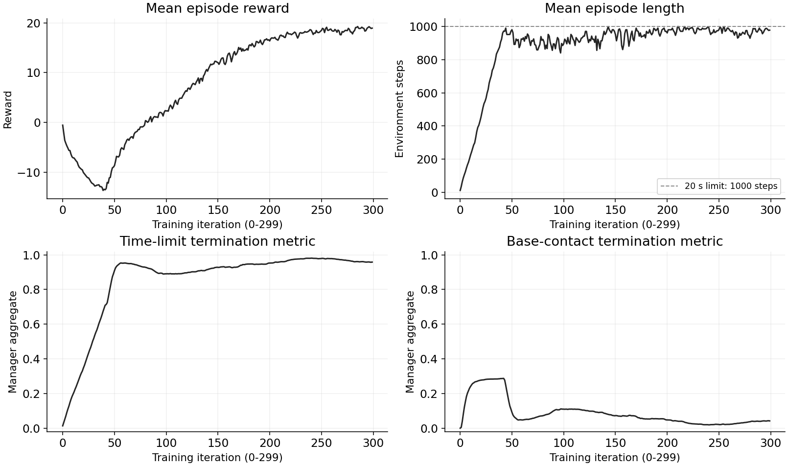
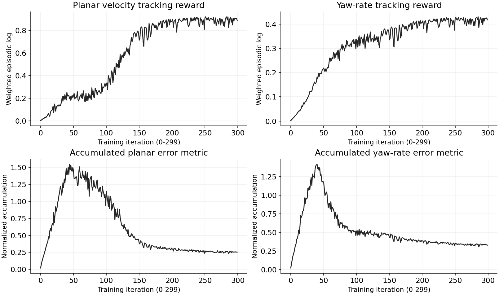
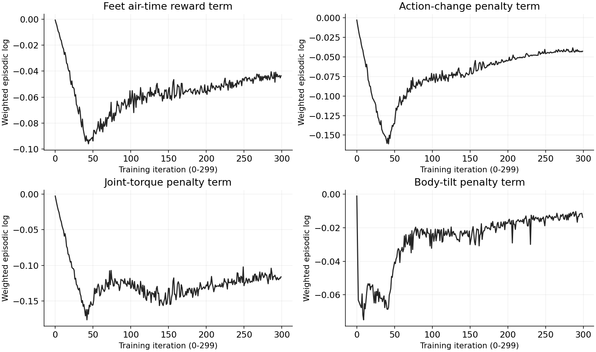
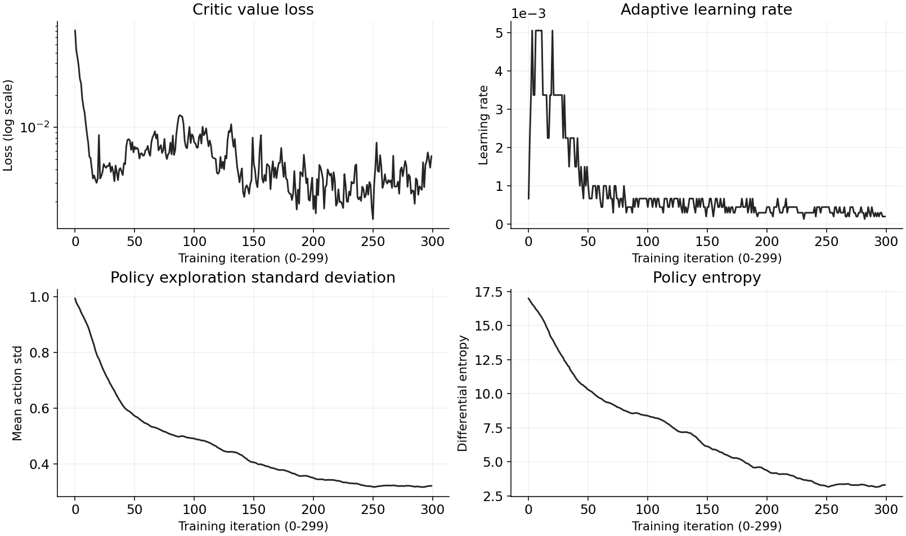

# 26. ANYmal 4족 보행 PPO 학습

## 이번 실습의 핵심

**보행은 목표 속도를 따라가면서, 지면을 지지하는 발과 앞으로 옮기는 발을 조절해 몸을 안정적으로 이동시키는 제어 문제다.**
이번에는 Cartpole 환경을 직접 작성하는 대신 등록된 `Isaac-Velocity-Flat-Anymal-B-v0`를 불러와 PPO를 학습한다.
학습기는 목표 속도와 현재 몸·관절 상태를 보고 12개 관절의 위치 목표를 함께 결정한다.

[보행 개념 집중 정리](../learning-notes/legged-locomotion/README.md) · [코드 리뷰](code-review.md) · [공용 강화학습 개념](../learning-notes/reinforcement-learning/README.md#locomotion)

## 코드와 실행

- [제공된 코드](26_train_locomotion.py): [기준 튜토리얼](https://github.com/PinkWink/isaacsim_tutorials/blob/14f85fc6edece7cbb1faa50aa9fe3adef205e87a/26_train_locomotion/26_train_locomotion.py)과 동일하다.
- 출처: PinkLAB 「강좌 26 - 26_train_locomotion」
- [원본 로그 zip](artifacts/logs.zip) · [TensorBoard 이벤트·체크포인트](logs/rsl_rl/anymal_locomotion_tutorial) · [최종 model_299.pt](logs/rsl_rl/anymal_locomotion_tutorial/model_299.pt)
- [300 iteration 전체 지표 CSV](analysis/training-metrics.csv) · [요약 JSON](analysis/training-summary.json) · [파일 크기·SHA256](analysis/log-manifest.json)

```bash
cd <physical-ai-training 저장소 경로>/26-train-locomotion
python 26_train_locomotion.py --headless --num_envs 2048 --max_iterations 300
# GUI로 학습 상태 관찰 · 환경 수를 바꾸면 총 경험 수도 달라짐
python 26_train_locomotion.py --num_envs 64 --max_iterations 300
# 저장된 로그를 볼 때
tensorboard --logdir logs/rsl_rl/anymal_locomotion_tutorial
```

환경·보상은 Isaac Lab의 등록 Cfg에서 읽고, PPO 설정은 이 파일의 `AnymalLocoPPORunnerCfg`를 사용한다.
학습 결과 경로는 실행 폴더 기준 `logs/rsl_rl/anymal_locomotion_tutorial`이다.

## 코드 실행 구조

<p align="center">
  
</p>
<p align="center"><sub>그림 19. 등록 환경을 불러와 보행 PPO를 학습하는 흐름</sub></p>

`import isaaclab_tasks`로 태스크가 등록되고 `load_cfg_from_registry()`가 환경 Cfg를 가져온다. 병렬 수를 변경한 뒤 `gym.make()`로 환경을 만든다.
wrapper와 Runner에 연결한 이후 rollout·GAE·PPO 업데이트는 24번과 같은 원리다. 보행 자체를 구현하는 관측·행동·접촉·보상 함수는 등록 환경 안에 있다.

## 보행을 어떻게 배우는가

### 1. 명령 속도와 관절 행동은 다르다

명령은 기체 기준 전후 속도 `vx`, 좌우 속도 `vy`, 회전 속도 `ωz`다. ‘앞으로 0.5 m/s’는 어디로 얼마나 빠르게 이동할지 지시하며 어느 발을 언제 드는지는 알려주지 않는다.
정책이 관측을 이용해 네 다리의 관절 목표를 만든다. **차체 속도 명령을 관절 각속도에 그대로 넣는 구조가 아니다.**

참조 환경은 명령을 약 10초 간격으로 재설정하며 일부 환경은 정지 명령을 받는다. heading_command도 활성화되어 목표 방향 오차에서 yaw 속도 명령을 만든다.
영상의 초록 화살표는 목표 평면 속도, 파란 화살표는 현재 평면 속도다. 방향·길이의 차이는 추적 상태를 보여주며 발의 다음 착지점 표시는 아니다.

### 2. 지지기와 유각기의 협응

- **지지기(stance):** 발이 지면과 접촉해 지면 반력을 받는다. 다리가 몸을 지탱하고 추진·자세 조절에 기여한다.
- **유각기(swing):** 발이 지면에서 떨어져 다음 지점으로 이동한다. 발을 들고 앞으로 보내고 다시 착지하는 동작이다.

몸통에는 바닥에 고정된 기반이 없으므로 다리 토크만으로 몸을 원하는 곳으로 순간 이동시킬 수 없다. 발 접촉·마찰·중력이 몸의 운동을 결정한다.
한 다리를 들 때 다른 발의 지지와 몸의 기울기를 함께 맞춰야 한다. 정지 시 균형과 움직이는 중의 동적 균형은 같지 않다.

이 환경에는 대각선 다리를 번갈아 움직이라는 고정 trot 스케줄이나 명시적 위상 입력이 없다. **어떤 협응 동작이 유리한지 보상과 물리를 통해 학습한다.** 영상만으로 특정 보행 유형을 확정하지 않는다.

### 3. 정책은 무엇을 보고 무엇을 출력하나

<p align="center">
  
</p>
<p align="center"><sub>그림 20. 몸 상태·명령에서 관절 목표와 접촉 운동으로 이어지는 구조</sub></p>

| 관측 · Flat 참조 설정 | 차원 | 역할 |
|---|---:|---|
| 기체 선속도 | 3 | 현재 전후·좌우·수직 이동 |
| 기체 각속도 | 3 | 각 축 주위 회전 속도 · 자세 각도 자체가 아님 |
| projected gravity | 3 | 기체 좌표계에서 본 중력 방향 · 기울기 파악 |
| 속도 명령 | 3 | 목표 `vx, vy, ωz` |
| 기본 자세 대비 관절 위치 | 12 | 네 다리의 현재 구성 |
| 관절 속도 | 12 | 각 관절의 운동 상태 |
| 직전 행동 | 12 | 이전 명령과의 연속성 정보 |
| 합계 | **48** | Flat 정책 입력 · 학습 시 관측 노이즈 활성화 |

중력 투영만으로 yaw 방향을 모두 알 수는 없다. 관측의 몸 속도·관절 상태 등은 시뮬레이터에서 읽으며, 실제 로봇에서는 센서·상태 추정으로 같은 의미의 입력을 확보해야 한다.

행동은 **12개 관절 위치 목표**다. 참조 설정에서 `q_target = q_default + 0.5 × action`으로 변환한다.
현재 관절 각도에 계속 0.5씩 더하는 누적 명령이 아니다. 각 다리는 HAA·HFE·KFE 세 관절을 갖는다.
ANYmal-B는 하위 구동에 사전 학습된 LSTM actuator-net을 사용한다. 이번 PPO의 Actor·Critic MLP와는 별도 모델이며 ‘이번 정책도 LSTM’이라는 뜻이 아니다.

### 4. 보상이 움직임의 성격을 정한다

| 목표 | 대표 항 | 해석 |
|---|---|---|
| 명령 속도 따라가기 | 평면 선속도·yaw 각속도 추적 | 빠르게 달리기 자체가 아니라 명령과 오차를 줄이기 |
| 몸 안정화 | 수직 속도·roll/pitch 각속도·기울기 벌점 | 과도한 들썩임·흔들림·기울기 억제 |
| 구동 부담 줄이기 | 토크 제곱·관절 가속도·행동 변화 벌점 | 실제 소비 전력과 동일한 측정은 아님 |
| 발 이동 유도 | feet_air_time | 발이 공중에 있다 착지한 시점의 공중 시간 평가 |
| 비정상 접촉 억제 | 허벅지 접촉 벌점 | 발 이외 접촉과 지지 동작을 구분 |
| 에피소드 실패 | 몸통 접촉 종료 | 일정 접촉 힘을 넘으면 task 종료 |

접촉 센서는 공중 시간·비정상 접촉 보상과 종료 판정에 쓰인다. **발 접촉 힘 자체는 위 48차원 Actor 입력에 직접 포함되지 않는다.**
발 공중 시간 보상은 단순히 ‘오래 띄울수록 매 step 가점’이 아니다. 첫 착지 시 `(공중 시간 - 0.5초)`를 평가하고, 평면 이동 명령이 작으면 이 항은 비활성화된다. 짧은 스텝에서는 음수도 가능하다.
명령을 잘 따라도 토크·동작 변화가 크면 감점될 수 있다. 보행은 이 목표들을 함께 만족시키는 문제다.

## Cartpole에서 달라진 점

| 구분 | 24번 Cartpole | 26번 Flat ANYmal-B · 참조 설정 |
|---|---|---|
| 관측 / 행동 | 7 / 1 | 48 / 12 |
| 행동 의미 | 카트 힘 | 기본 자세 기준 관절 위치 목표 |
| Actor·Critic 은닉층 | 각각 [32, 32] | 각각 [128, 128, 128] |
| 환경 step | 1/60초 | 0.02초 · 50 Hz |
| 물리 step / decimation | 1/120초 / 2 | 0.005초 / 4 |
| 에피소드 상한 | 5초 · 300 step | 20초 · 1000 step |
| rollout | 16 step | 24 step · **0.48초** |
| 기본 환경 수 / iteration | 1024 / 150 | 2048 / 300 |

24 step이 보행 주기 0.5초를 ‘여러 번’ 포함한다는 설명은 이 설정과 맞지 않는다. rollout은 약 0.48초이며 에피소드가 끝나지 않아도 Critic으로 이후 가치를 연결한다.

2048 × 24 = 49,152개 전이를 iteration마다 수집한다. 4 mini-batch·5 epoch라 각 batch는 12,288개, 기본 optimizer 업데이트는 iteration당 20회다.
300 iteration의 총 전이는 **14,745,600개**다. 환경 수를 줄이면 같은 iteration이라도 학습 경험 수가 줄어든다.

<a id="training-curves"></a>

## 24 step·미니배치·epoch·iteration을 연결해 이해하기

2048개 환경을 정해진 초기화 범위에서 시작하고, 각 환경의 관측으로 행동을 고른다. 환경당 24 step 동안 현재 정책을 고정해 49,152개 전이를 모은다.
관측·행동·보상·종료·가치·행동 확률 정보로 GAE/return을 계산한 뒤 학습한다.

| 과정 | 이번 설정 |
|---|---|
| 경험 수집 | 2048 × 24 = 49,152 전이 |
| 미니배치 분할 | 4개 · 각 12,288 전이 |
| 1 epoch | 네 미니배치를 각각 학습 · 가중치 4회 수정 |
| 5 epoch | 같은 rollout 재사용 · 기본 optimizer 20회 |
| 1 iteration | 수집 + 목표 계산 + 5 epoch 학습 + 기록 |
| 다음 iteration | 업데이트된 정책으로 새 24 step 수집 |
| 전체 | 300 iteration · 새 전이 14,745,600개 |

5 epoch가 끝난 뒤에만 가중치를 한 번 바꾸는 것이 아니라 **각 미니배치마다 업데이트**한다.
에피소드 완료는 학습 시작 조건이 아니다. rollout 중 넘어진 환경만 리셋되며 최대 1000 step 에피소드의 일부 구간만으로도 학습할 수 있다.

**통배치로 5번 업데이트하는 방식도 가능하다.** 현재의 미니배치 20회는 메모리·gradient 변동·수정 빈도를 조절하는 선택이며 무조건 더 좋은 성능을 보장하지 않는다.
둘 다 같은 49,152개 경험을 5 epoch 사용하지만 미니배치는 이미 수정한 가중치에서 다음 gradient를 계산해 학습 경로가 달라진다.

[초기화부터 300 iteration까지 상세 시나리오](../learning-notes/reinforcement-learning/README.md#ppo-training-cycle) ·
[미니배치 20회와 통배치 5회 비교](../learning-notes/reinforcement-learning/README.md#minibatch-vs-fullbatch)

## 실제 학습 로그와 결과 그래프

추가 제공된 zip에서 **TensorBoard 이벤트 1개·0~299의 300 iteration·체크포인트 7개**를 확인했다.
아래 네 그림은 이벤트의 실제 scalar를 그대로 그린 것으로 smoothing은 적용하지 않았다. 가로축은 환경 step이나 에피소드 수가 아닌 **학습 iteration**이다.
[곡선·CSV 생성 코드](analysis/render_training_curves.py)는 `tensorboard`, `matplotlib`로 다시 실행할 수 있다.

```bash
# 이 실습 폴더에서 실행 · 재학습 없이 그래프 생성
python analysis/render_training_curves.py
```

### 1. 오래 버티는 것과 명령대로 걷는 것은 다르다

<p align="center">
  
</p>
<p align="center"><sub>그림 26-1. 보상·유지 길이와 종료 집계. 파선은 20초·1000 step 상한이다.</sub></p>

초반 약 40~50 iteration까지 유지 길이는 빠르게 늘지만 총 보상은 한동안 더 낮아진다. 그 뒤 보상이 올라가며 후반에는 약 19점에 접근한다.
**길이가 길어졌다고 바로 좋은 보행을 배웠다고 볼 수 없다.** 몸을 유지하는 능력, 명령 추적, 구동 부담을 함께 봐야 한다.
정확한 단계·원인은 한 곡선으로 단정하지 않고 다음 보상 항·접촉 지표와 대조한다.

timeout 지표가 높아지고 몸통 접촉 종료 지표가 낮아진 것은 유지 능력 향상을 뒷받침한다. 다만 이 값은 환경별 마지막 종료 집계를 바탕으로 하며 별도 평가 성공률이 아니다.
학습 초반에는 아직 완료하지 않은 환경의 초기 기록과 무작위 episode 시간 카운터의 영향도 있다.

### 2. 속도 명령을 실제로 따라가는지 확인하기

<p align="center">
  
</p>
<p align="center"><sub>그림 26-2. 명령 추적 보상과 누적 오차. 아래 패널은 순간 오차·RMSE가 아니다.</sub></p>

평면·yaw 추적 보상 항은 후반에 각각 약 0.888·0.417이다. 약 100 iteration 이후 평면 속도 추적 보상이 더 크게 개선되는 모습이 보인다.
유지 길이가 먼저 길어지고 추적 성능이 뒤따라 개선되는 경향을 다른 패널과 함께 읽을 수 있다.

아래 error metric은 command 구현에서 step별 오차를 **최대 명령 시간 10초에 해당하는 step 수로 나눠 누적**한다. reset 시 집계되므로 에피소드 길이의 영향도 받는다.
처음 아주 작은 값은 금방 끝난 episode·초기 집계 때문일 수 있어 ‘초반이 최종보다 정확했다’고 해석하면 안 된다.
길이가 어느 정도 유지되는 중반 이후에는 이 누적 오차가 감소하고 추적 보상이 높아지는지를 함께 본다. 별도 평가에서는 동일 시간 구간의 평균 오차·RMSE 등을 추가하는 편이 명확하다.

### 3. 발 타이밍·동작 변화·토크·몸 자세

<p align="center">
  
</p>
<p align="center"><sub>그림 26-3. 발 공중 시간 보상과 구동·자세 비용. 세로축은 가중치가 반영된 episodic 로그다.</sub></p>

| 항 | 이 실행에서 읽을 점 |
|---|---|
| 발 공중 시간 | 중반까지 음수가 커졌다가 후반 -0.0436 부근으로 회복한다. 첫 착지에서 기준 시간과의 차이를 계산하므로 음수도 가능하다. |
| 행동 변화 | 초기·중반의 큰 감점에서 후반 -0.0426 부근으로 완화된다. 목표 관절 입력의 급격한 변화를 억제하는 항이다. |
| 관절 토크 | 움직임을 만드는 동안 구동 비용이 계속 든다. 최종 -0.1160이며 이 값 하나로 전력 소비량을 계산하지 않는다. |
| 몸 기울기 | 초반 큰 감점이 줄고 최종 -0.0138 부근이다. 자세 안정화의 보조 근거로 읽는다. |

`Episode_Reward/*`는 완료 episode의 항별 누적을 최대 episode 시간 **20초**로 나눈 값이다. raw 함수값·매 step 보상·전체 episode 총점과 다르다.
서로 다른 항은 단위·가중치가 달라 곡선 높이만 비교해 중요도를 정하지 않는다. 초반 짧은 episode와 후반 긴 episode의 값을 동일한 순간 비용처럼 비교하지도 않는다.
발 공중 시간 보상만으로 trot·특정 발 순서나 최적 보행이 검증된 것은 아니다.

### 4. PPO가 안정적으로 가중치를 바꾸는지 확인하기

<p align="center">
  
</p>
<p align="center"><sub>그림 26-4. 학습기 내부 지표. value loss는 로그 축이며 나머지는 선형 축이다.</sub></p>

탐색 표준편차는 약 0.994→0.322, entropy는 약 16.98→3.31로 감소한다. 행동 분포가 덜 퍼지는 방향으로 학습된 것이며 deterministic 평가로 바뀐 것은 아니다.
learning rate는 시작 설정 0.001에 고정되지 않고 adaptive 규칙으로 조정된다. iteration 0 로그는 이미 업데이트 후 값이라 약 0.000667이며 마지막은 약 0.000198이다.
Critic loss는 처음보다 낮아졌지만 중간에 오르내린다. loss가 단조 감소하지 않아도 보상·추적·유지 성능과 함께 판단해야 한다.
PPO surrogate 값과 나머지 항도 [전체 CSV](analysis/training-metrics.csv)에 보존했다.

### 로그로 확인한 요약

| 지표 | iteration 0 | iteration 299 |
|---|---:|---:|
| 평균 episode 보상 | -0.5638 | 18.9307 |
| 평균 episode 길이 | 10.7826 | 978.2200 |
| 평면 속도 추적 보상 항 | 0.0021 | 0.8878 |
| yaw 속도 추적 보상 항 | 0.0019 | 0.4171 |
| timeout 집계 | 0.0133 | 0.9581 |
| 몸통 접촉 종료 집계 | 0.0000 | 0.0419 |

처음의 매우 낮은 접촉 종료 값도 아직 완료하지 않은 환경의 초기 집계 영향을 받으므로 ‘초기 정책이 더 안정적’이라는 뜻은 아니다.
마지막 20개 iteration의 로그 평균은 보상 약 **18.8110**, 길이 약 **973.8570 step**이다. 이는 시간상 로그 평균이며 새로운 20개 평가 에피소드의 평균이 아니다.
영상의 iteration 2(-3.61·63.02)와 마지막 반올림 수치가 이벤트와 일치한다. 이벤트 기록 시간 범위는 약 481.58초로 영상의 8분 2초 표시와도 부합한다.

### 보존한 체크포인트

제공 파일은 `model_0`, `50`, `100`, `150`, `200`, `250`, `299.pt`다. 최종 파일 메타데이터의 저장 iteration 299, Actor 입력 가중치 `(128, 48)`·출력 가중치 `(12, 128)`를 확인했다.
`model_0`도 첫 PPO 업데이트 후 모델이며 학습 전 초기 가중치와는 다르다. 최신 모델이 항상 최고라는 뜻은 아니므로 27번에서는 여러 checkpoint를 같은 명령·초기화 조건에서 비교할 수 있다.
모델·이벤트는 실제 첨부 파일이며 학습을 다시 실행해 만든 것이 아니다. 환경 Cfg export·설치 버전 기록은 zip에 없어 학습 재현에 필요한 정보 전체가 들어있다고 단정하지 않는다.

## 실제 영상 결과

### 26-1 — 학습 초반

<p align="center">
  
</p>

<p align="center">
  
</p>

영상 초반 iteration 2에서 평균 보상 -3.61, 평균 에피소드 길이 63.02 step을 확인했다. 제자리 흔들림·짧은 이동·개별 리셋이 섞인 학습 중 장면이다.

[첫 번째 영상 — 약 40.35초](videos/26-1.webm)

### 26-2 — 학습 후반과 완료

<p align="center">
  
</p>

<p align="center">
  
</p>

| 제공 영상의 최종 로그 · iteration 299 | 값 |
|---|---:|
| Mean reward | 18.93 |
| Mean episode length | 978.22 step · 환산 약 19.56초 |
| 총 전이 | 14,745,600 |
| 학습 시간 표시 | 00:08:02 |
| 평면 / yaw 속도 추적 보상 항 | 0.8878 / 0.4171 |
| feet_air_time 보상 항 | -0.0436 |
| timeout / 몸통 접촉 종료 지표 | 0.9581 / 0.0419 |

[영상 로그 전사 JSON](analysis/video-observations.json)

유지 길이와 보상은 향상됐다. 다만 위 값은 학습 중 집계이며 timeout 0.9581을 독립 평가 성공률 95.81%로 바꾸지 않는다. 발 공중 시간 항의 음수도 해당 함수·threshold·가중치로 해석해야 한다.
Cartpole과 보상 항·에피소드 시간이 달라 18.93 대 17.28 같은 숫자만으로 태스크 성능을 비교하지 않는다.
추가 첨부된 이벤트·모델은 위 학습 곡선과 체크포인트 항목에 반영했다. 27번에서는 고정 정책의 실제 명령 추적·생존·외란 대응을 평가한다.

[두 번째 영상 — 터미널 전용 게시본 · 약 14.21초](videos/26-2-terminal.webm)

두 번째 원본에는 마지막에 브라우저가 보여 **영상 전체에서 터미널 영역만 추출한 게시본**을 사용했다. 원본 전체 화면은 저장소에 게시하지 않았다. 장면 캡처는 브라우저가 나타나기 전 Isaac Sim viewport에서 추출했다.

## 강의 설명에서 구분할 점

- 기본 Flat 태스크는 height scan과 지형 커리큘럼을 끈다. Rough 환경 기능이 Flat에도 자동 적용되는 것은 아니다.
- 등록 환경을 쓴다고 이미 학습된 보행 정책을 받은 것은 아니다. 환경과 하위 actuator 모델은 제공되지만 이번 PPO 보행 정책은 새로 학습한다.
- 300 iteration은 실행 예산이며 모든 조건에서 안정 보행 완성을 보장하지 않는다.
- `--task ...Rough...`만 바꾸는 것은 Flat 체크포인트를 불러온 fine-tuning이 아니다. 원본 코드에는 체크포인트 load가 없다.

수치·시간·모델 의미와 설정 상속 관계는 [코드 리뷰](code-review.md)에 자세히 정리했다.
