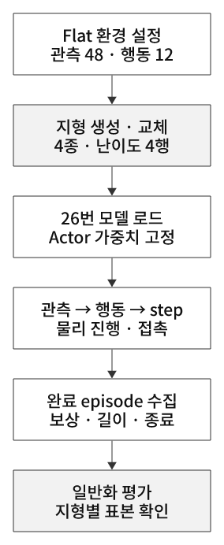
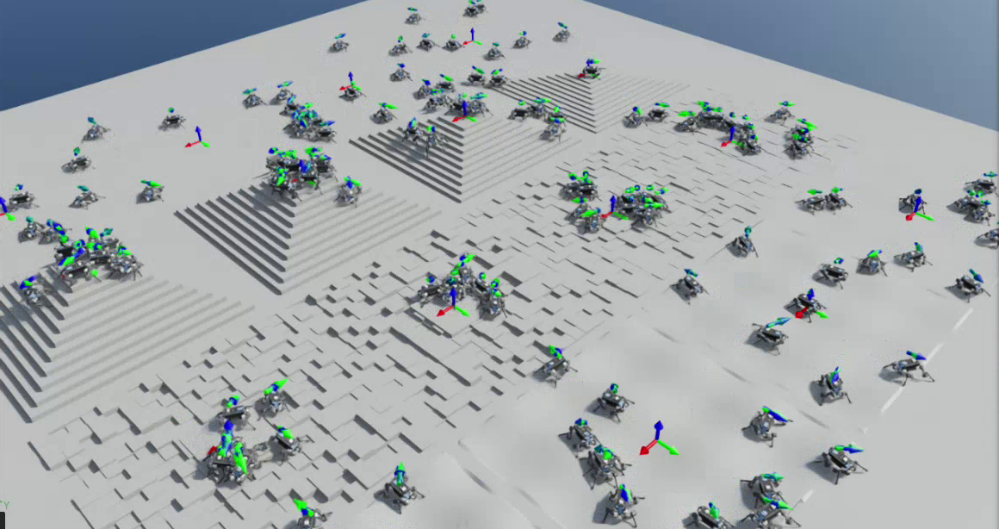
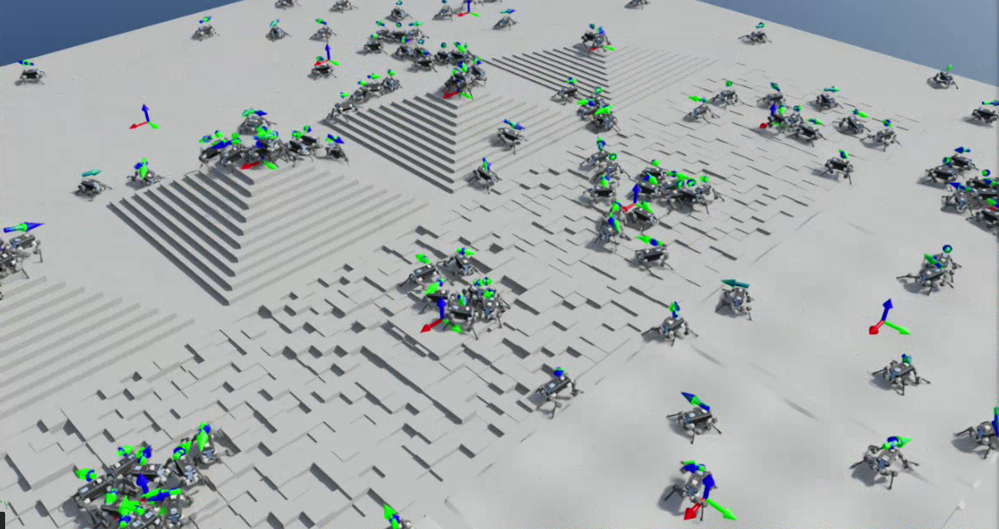
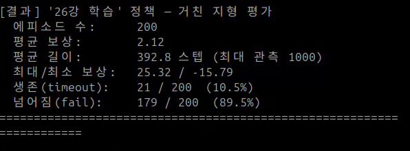
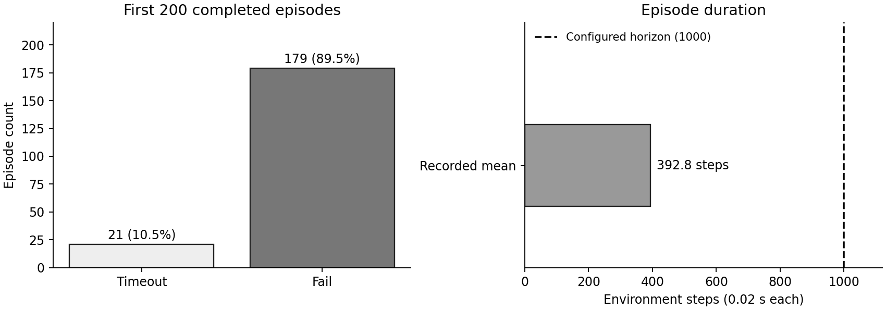

# 28. 지형 생성과 Domain Shift

## 이번 실습의 핵심

**평지에서 학습한 보행 정책을 그대로 불러와 계단·불규칙 지면·파도 지형에서 평가한다. 입력 크기가 같아 모델을 로드할 수 있어도, 잘 걷는다는 보장은 없다.**
28번은 추가 PPO 학습 없이 일반화 성능을 관찰하는 실험이다. 지형 때문에 발 접촉과 몸의 운동이 바뀌고, 그 결과 다음 관측·행동·보상·종료가 달라진다.

[Domain Shift 상세 개념](../learning-notes/domain-shift/README.md) · [강화학습과의 연결](../learning-notes/reinforcement-learning/README.md#domain-shift) · [코드 리뷰](code-review.md) · [26번 학습](../26-train-locomotion/README.md) · [27번 평지 평가](../27-evaluate-locomotion/README.md)

## 코드와 실행

[사용자 제공 코드](28_terrain_generation.py)는 원문 그대로 보관했다. [기준 튜토리얼](https://github.com/PinkWink/isaacsim_tutorials/blob/14f85fc6edece7cbb1faa50aa9fe3adef205e87a/28_terrain_generation/28_terrain_generation.py) 대비 기본 환경 수가 `16→160`, 목표 에피소드 수가 `20→200`으로 바뀌었다. 나머지 내용은 동일하다.
출처는 PinkLAB 「강좌 28 - 28_terrain_generation」이며 강의 PDF는 개념 확인에 사용했다.

```bash
cd <physical-ai-training 저장소 경로>/28-terrain-generation
# 저장소의 26번 모델로 실행 · 개인 PC에서는 작은 환경 수로 먼저 관찰 가능
python 28_terrain_generation.py --num_envs 16 --num_episodes 20 --checkpoint ../26-train-locomotion/logs/rsl_rl/anymal_locomotion_tutorial/model_299.pt
# 제공 코드의 기본 규모로 평가
python 28_terrain_generation.py --num_envs 160 --num_episodes 200 --checkpoint ../26-train-locomotion/logs/rsl_rl/anymal_locomotion_tutorial/model_299.pt
# 화면 없이 실행
python 28_terrain_generation.py --headless --num_envs 64 --num_episodes 200 --checkpoint ../26-train-locomotion/logs/rsl_rl/anymal_locomotion_tutorial/model_299.pt
# 랜덤 행동 대조 실행 · 첨부된 영상은 학습 정책 실행 결과
python 28_terrain_generation.py --random --num_envs 16 --num_episodes 20
```

자동 탐색은 원본의 `26_train_locomotion` 경로를 사용하므로 이 저장소에서는 체크포인트를 명시한다.
파일을 못 찾으면 코드가 랜덤 행동으로 전환한다. `학습 정책 로드 완료`와 결과의 정책 모드를 확인한다.

## 4종 지형은 어떻게 만들어지나

| 설정 | 의미 |
|---|---|
| `size=(8,8)` | 지형 타일 하나가 8×8m |
| `num_rows=4`, `num_cols=4` | 16개 타일, 내부 영역 32×32m · 바깥 border 폭 5m |
| `sub_terrains` | 아래 네 종류를 각각 25% 비율로 구성 |
| `curriculum=True` | 행에 따라 난이도 구간이 높아지도록 **지형을 생성** |
| `max_init_terrain_level=None` | 환경 시작 위치를 모든 난이도 행에서 선택 가능 |
| `num_envs=160` | 병렬 로봇 환경 수. 지형 타일 수 16과 다른 값 |

| 지형 | 설정 | 보행에서 달라지는 점 |
|---|---|---|
| flat | `MeshPlaneTerrainCfg` | 평탄한 접촉면 · 혼합 지형 내부의 대조 타일 |
| pyramid_stairs | 계단 높이 범위 5~20cm, 폭 30cm, 중앙 플랫폼 2m | 발을 올릴 높이·몸의 상승·모서리 충돌 |
| random_grid | 격자 폭 45cm, 높이 변동 규모 2~15cm | 울퉁불퉁한 접촉면·발 지지 높이 차이 |
| wave | amplitude 범위 2~15cm, `num_waves=3` | 연속 경사에 따른 몸 기울기·접촉 방향 |

숫자 범위는 지형 생성 파라미터의 범위이며 모든 타일이 정확히 최솟값·최댓값을 쓰는 것은 아니다. Isaac Lab v2.3.2에서 행 r의 난이도는 `(r + U[0,1))/4`다.
따라서 네 행은 대략 `[0,.25)`, `[.25,.5)`, `[.5,.75)`, `[.75,1)` 구간이다. 이번 4열·동일 비율에서는 종류가 열마다 하나씩 배치된다.
160환경이면 한 지형 종류에 40환경을 배정하고 난이도 행은 초기 무작위 선택한다. 타일별 정확히 10환경을 보장하지는 않는다.

**난이도별 지형 생성과 학습 커리큘럼은 구분한다.** Flat Cfg에서 `curriculum.terrain_levels=None`을 유지하므로 성공할 때마다 더 어려운 행으로 자동 승급하는 학습은 없다. 지형을 생성한 뒤 매 episode 지형 자체를 다시 만드는 코드도 없다.

## 실행 구조와 물리 step

<p align="center">
  
</p>
<p align="center"><sub>그림 22. 지형 교체 후 고정된 정책으로 실행한다. 관측-행동-step은 반복하며 PPO 업데이트는 없다.</sub></p>

1. Flat 환경 Cfg를 로드하고 `scene.terrain`을 생성 지형으로 교체한다.
2. Flat과 같은 관측 48차원·행동 12차원과 Actor/Critic `[128,128,128]` 구조로 모델을 로드한다.
3. 매 환경 step에서 관측을 Actor에 넣고 평균 행동을 얻는다. 관절 목표는 `기본 관절 자세 + 0.5×action`이다.
4. 하위 actuator-net과 접촉 물리로 운동을 진행한다. 환경 step 0.02초마다 물리 step 0.005초를 4번 진행한다.
5. 새 관측·보상·종료를 받고 반복한다. 끝난 환경은 자동 reset하고 episode 보상·길이를 집계한다.

`runner.learn()`을 호출하지 않으므로 24 step rollout·5 epoch·20회 optimizer 업데이트는 이번 평가에 일어나지 않는다.
`num_steps_per_env=24`와 PPO 설정은 Runner 구성에 들어 있지만, 실제 학습 루프 호출과는 별개다.
정책은 높이 스캔을 새로 받지 않는다. 관측에 들어오는 몸 속도·기울기·관절 상태를 통해 이미 생긴 접촉 결과에 반응한다.

## 영상에서 확인한 결과

<p align="center">
  
</p>
<p align="center">
  
</p>
<p align="center">
  
</p>

아래 값은 **제공 영상 약 47초의 최종 출력**에서 확인했다. PDF의 예시 값이 아니다.

| 항목 | 영상 최종 로그 |
|---|---:|
| 완료 에피소드 | 200 |
| 평균 누적 보상 | 2.12 |
| 평균 길이 | 392.8 환경 step · 약 7.86초 |
| 최대 관측 길이 | 1000 step · 20초 |
| 최대 / 최소 보상 | 25.32 / -15.79 |
| timeout | 21/200 · 10.5% |
| fail | 179/200 · 89.5% |

[표시값·출처 JSON](analysis/evaluation-summary.json) · [결과 그래프 생성 코드](analysis/render_results.py)

<p align="center">
  
</p>
<p align="center"><sub>그림 28-1. 영상 최종 집계의 재표현. 에피소드별 원시 로그·지형별 결과·학습 곡선은 제공되지 않았다.</sub></p>

[게시 영상 — 원본의 0~46초](videos/28-terrain-evaluation.webm)

원본 `28.webm`은 약 49.52초이며 끝부분에 파일 관리자·개인 작업 화면이 나타난다. 원본 전체 대신 안전한 앞부분만 게시했다.
최종 결과는 약 47초에서 터미널만 추출했고, 장면 캡처는 Isaac Sim viewport만 사용했다. 원본은 로컬 첨부 자료로 유지한다.
영상에는 `26강 학습` 모드가 표시되지만 로드한 체크포인트 파일 전체 경로·해시는 최종 화면만으로 확정하지 않았다.

## 결과를 어디까지 해석할 수 있나

27번 영상에서는 완료 20회 모두 1000 step·timeout, 평균 보상 23.99였다. 이번에는 짧은 실패 episode가 많이 관찰됐다.
이는 **이 실행에서 평지 성능이 혼합 지형으로 충분히 이어지지 않았다는 증거**다. 모든 정책의 필연적 실패나 지형별 실패율을 증명한 것은 아니다.

- 이번 평균은 평면 타일까지 포함한 **혼합 지형** 통계다. 계단·격자·파도 각자의 성공률은 기록하지 않는다.
- 먼저 완료된 200회를 모으므로 짧은 실패 episode가 더 자주 포함되고, 잘 버티는 환경의 진행 중 episode는 누락될 수 있다. 따라서 10.5%는 균등한 시작 조건의 생존 확률 추정치라고 단정하지 않는다.
- fail은 기본 Cfg의 몸통 비정상 접촉 종료를 코드가 부르는 이름이다. timeout은 시간 상한 도달이며 목표 속도 추종·계단 완주와 같지 않다.
- 지형과 초기 배치, 재질 설정이 함께 바뀐다. 노이즈·명령 재샘플링·외란도 남아 있으므로 엄격한 단일 변수 실험은 추가 통제가 필요하다.
- 보상은 속도 추종·기울기·토크·접촉 등의 합을 episode 동안 누적한 값이다. 짧은 episode의 보상 합이 낮은 것은 품질과 길이의 영향을 함께 받는다.

실패를 줄이려면 다양한 지형에서 학습하고, 적절한 난이도 커리큘럼·물리 랜덤화·지형 관측을 검토한다.
**Rough task로 이름만 바꾸는 것은 fine-tuning이 아니다.** 기본 Rough의 height scan은 관측 크기를 바꾸므로 기존 Actor 입력층과 호환되지 않을 수 있다.
같은 관측을 유지한 추가 학습과 입력층 확장·부분 가중치 이식을 구분해야 한다. 상세한 원리와 실험 설계는 [Domain Shift 개념](../learning-notes/domain-shift/README.md)에 정리했다.
