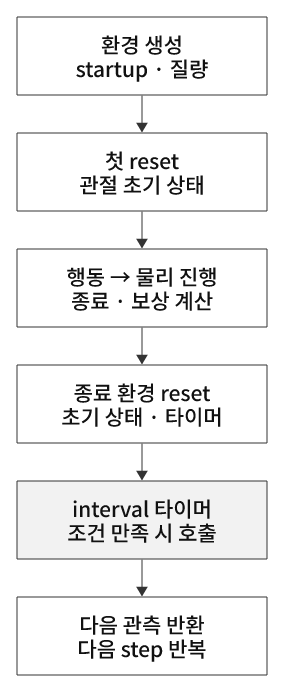
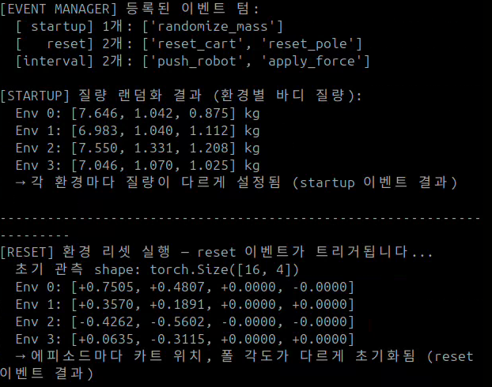
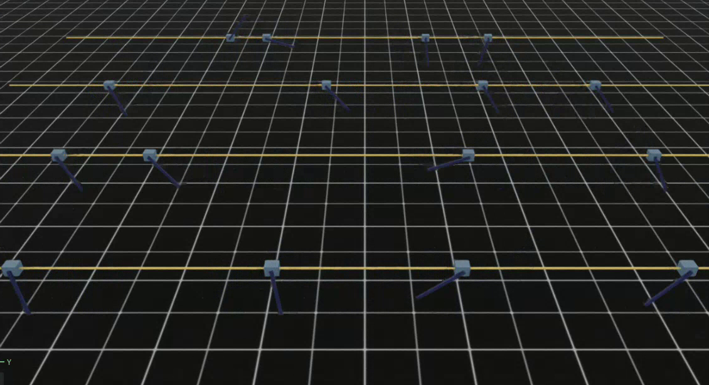
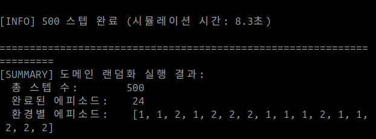

# 29. Domain Randomization — 환경의 불확실성에 대비하기

## 이번 실습의 핵심

**질량·초기 자세·외란 등의 조건을 다양하게 바꿔, 정책이 한 가지 시뮬레이션 조건에만 의존하지 않도록 학습 경험을 설계하는 기법이다.**
28번의 Domain Shift는 ‘학습과 실행 조건이 달라지는 현상’이고, 29번의 Domain Randomization은 그 차이에 대비하기 위한 학습 환경 설계 방법 중 하나다.

다만 **이번 파일 자체는 PPO 학습이 아니다.** Cartpole에 이벤트를 등록하고 랜덤 행동으로 500 step 실행하는 데모다. 질량·초기 상태 변화는 관찰할 수 있지만, 강건한 정책이 학습됐거나 실제 로봇 전이에 성공했다는 결과는 아니다.

[상세 개념·강화학습 연결](../learning-notes/domain-randomization/README.md) · [28번 Domain Shift](../learning-notes/domain-shift/README.md) · [코드 리뷰](code-review.md)

## 코드와 실행

[사용자 제공 코드](29_domain_randomization.py)를 원문 그대로 보관했다. [기준 튜토리얼](https://github.com/PinkWink/isaacsim_tutorials/blob/14f85fc6edece7cbb1faa50aa9fe3adef205e87a/29_domain_randomization/29_domain_randomization.py)과 바이트가 동일하다.
출처는 PinkLAB 「강좌 29 - 29_domain_randomization」이며 PDF는 개념·설정 확인에 사용했다.

```bash
cd <physical-ai-training 저장소 경로>/29-domain-randomization
python 29_domain_randomization.py                 # 기본 환경 4개
python 29_domain_randomization.py --num_envs 16   # 첨부 영상의 환경 수
python 29_domain_randomization.py --headless --num_envs 16
```

체크포인트를 로드하거나 새 모델을 저장하는 기능은 없다. `--num_envs`는 병렬 환경 수이며 학습 iteration 수가 아니다.

## startup / reset / interval은 언제 실행되나

| 모드 | 실행 시점 | 이번 이벤트 | 지속되는 것 |
|---|---|---|---|
| `startup` | 환경 생성 후 초기화 단계에서 한 번 | `randomize_mass` | 환경별 질량은 이후 episode reset에서도 유지 |
| `reset` | 첫 `env.reset()` 및 종료 환경 자동 reset | `reset_cart`, `reset_pole` | 새 episode의 초기 관절 상태 |
| `interval` | 환경 step에서 타이머 조건을 만족할 때 | `push_robot`, `apply_force` | 이벤트 함수에 따라 속도 변화 또는 외력 버퍼 |

이번에 등록된 term은 **startup 1개 + reset 2개 + interval 2개 = 총 5개**다.
`startup`은 학습 epoch마다 실행한다는 뜻이 아니며, 학습하지 않는 환경에서도 실행된다.
`interval`의 기본 타이머는 환경별로 독립적이고 episode reset 때 새 간격을 샘플링한다. 정확히 모든 환경에서 5초·10초에 동시에 실행하는 방식이 아니다.

<p align="center">
  
</p>
<p align="center"><sub>그림 24. 이벤트 실행 순서의 요약. step은 반복하고 종료 환경만 reset한다. interval은 타이머 조건을 만족할 때만 실행된다.</sub></p>

## 무엇을 얼마나 바꾸나

| term | 대상과 설정 | 이해할 점 |
|---|---|---|
| `randomize_mass` | 모든 body, 기본 질량에 균등분포 `[-0.5,+0.5]kg`를 더함 | 모든 body가 0.5~1.5kg이 되는 것은 아님. 원래 질량에 따라 결과가 다름 |
| `reset_cart` | 카트 위치 ±1m, 속도 ±0.5m/s 오프셋 | 기본 관절 상태를 기준으로 샘플링하고 joint limit으로 제한 |
| `reset_pole` | 막대 각도 ±π/4 rad, 각속도 ±π/4 rad/s 오프셋 | 각각 약 ±45°, ±45°/s |
| `push_robot` | root x속도에 ±0.5m/s 변화, 10~15초 간격 | 힘 N을 직접 적용하는 것과 다름 |
| `apply_force` | pole body의 각 힘 성분 ±1N, 토크 성분 ±0.1N·m, 5~10초 간격 | 발생 시 외력 버퍼를 설정하고 이후 물리 step에서 적용 |

질량 랜덤화는 v2.3.2 기본값에서 관성도 질량비에 따라 재계산한다. 물성을 바꾸는 것과 초기 위치·속도를 바꾸는 것은 서로 다른 변화다.
`reset`을 한다고 `startup` 질량이 다시 샘플링되는 것은 아니다.

## 중요한 코드 확인: 등록한 interval 이벤트가 실제로 발동하나

**현재 기본 설정에서는 두 interval 이벤트가 발동하지 않는다.** Isaac Lab v2.3.2 구현과 코드 설정을 함께 보면 다음과 같다.

- 물리 dt는 1/120초, decimation은 2 → 환경 step은 1/60초다.
- episode 상한은 5초 → 최대 300 환경 step에서 reset한다. 카트가 ±3m를 벗어나면 더 빨리 끝난다.
- `is_global_time=False`가 기본이므로 reset 때 interval 타이머도 다시 샘플링한다.
- `env.step()`은 종료 판정·자동 reset 후 interval을 처리한다. 5초 상한에 도달하면 기존 타이머가 실행되기 전에 reset된다.
- 외력 대기 5~10초와 push 대기 10~15초를 채울 수 없다. 전체 500 step이 약 8.33초라고 해서 episode 타이머가 8.33초 누적되는 것은 아니다.

로그의 ‘적용된 도메인 랜덤화’ 목록은 고정 출력 문자열이며 실제 호출 횟수 기록이 아니다.
이 데모에서 두 외란도 관찰하려면 예를 들어 간격을 더 짧게 바꾸는 별도 실험이 필요하다. 아래는 **제안이며 보관한 원문에는 반영하지 않았다.**

```python
# CartpoleDomainRandEnvCfg.__post_init__() 안에 추가하는 관찰용 설정 예
self.events.push_robot.interval_range_s = (1.0, 2.0)
self.events.apply_force.interval_range_s = (0.5, 1.0)
```

간격을 바꿔도 이벤트별 호출 카운터·시각·env ID와 속도/외력 버퍼를 기록해 실제 발동을 확인해야 한다. 아주 짧은 실패 episode에서는 그 간격도 채우지 못할 수 있다.
고정 베이스 Cartpole의 root 속도 교란이 의도한 관절 운동을 만드는지도 별도 확인한다. 이벤트의 실행 여부와 물리 효과는 다른 검증이다.

## 첨부 영상에서 확인한 결과

<p align="center">
  
</p>

| 환경 | body index 0 | body index 1 | body index 2 |
|---|---:|---:|---:|
| Env 0 | 7.646 kg | 1.042 kg | 0.875 kg |
| Env 1 | 6.983 kg | 1.040 kg | 1.112 kg |
| Env 2 | 7.550 kg | 1.331 kg | 1.208 kg |
| Env 3 | 7.046 kg | 1.070 kg | 1.025 kg |

영상 약 3초의 소수 셋째 자리 표시값이다. 16개 중 코드가 출력한 첫 4환경만 보여주며, body 이름은 로그에 없으므로 index로 표기했다.
초기 관측은 `(16,4)`이고 앞의 관절 위치 두 값은 서로 다르다. 직후 출력의 속도 두 값은 모두 0으로 표시되므로 그 화면만으로 속도 랜덤화 결과까지 입증하지 않는다.

<p align="center">
  
</p>
<p align="center">
  
</p>

최종 출력은 **16환경, 500 환경 step, 시뮬레이션 시간 약 8.3초, 완료 episode 24회**다. 총 병렬 전이는 `16×500=8,000`개지만 학습에 저장·사용하지는 않는다.
500 step 출력의 `평균 보상 -0.0358`은 **그 step의 환경 평균**이며 완료 episode 평균 누적 보상이나 학습 곡선이 아니다.
막대가 기울거나 아래로 돌아가도 바로 실패 종료하지 않는다. 이 코드의 종료 조건은 카트 범위 이탈과 timeout이다.

[표시값·미디어 출처 JSON](analysis/demo-summary.json) · [게시 영상 — 앞 0~15초](videos/29-randomization-demo.webm)

원본 `29.webm`은 약 17.92초다. 끝의 파일 관리자·개인 작업 화면을 제외한 앞부분만 공개했다. 최종 로그는 약 17초에서 터미널만 추출했으며 원본 전체는 공개하지 않는다.
이 영상은 이벤트 데모이므로 학습 성능·일반화 개선률·sim-to-real 성공률을 만들어 제시하지 않는다.

## 이것을 실제 강화학습에 연결하려면

29번의 이벤트 Cfg를 학습할 환경에 통합한 뒤, 정책으로 행동을 생성하고 **다양한 조건에서 모은 rollout을 PPO로 학습**한다.
26번의 rollout→GAE→미니배치→optimizer 구조는 유지할 수 있지만, 경험이 생성되는 질량·초기 상태·외란 조건이 달라진다.
29번의 관측 4차원은 24번의 7차원 관측과 다르므로 Cartpole이라는 이름만 보고 기존 checkpoint를 그대로 사용할 수 있다고 가정하지 않는다.

[Domain Randomization 상세 개념](../learning-notes/domain-randomization/README.md)에는 랜덤 행동과의 차이, 숨은 물성·부분 관측, PPO와의 연결, 랜덤화 범위 선택, 공정한 성능 비교를 정리했다.
