# 36. G1 보행 모션 모방과 쿵푸 적용의 한계

## 이번 실습의 핵심

**사람 모션을 G1 관절로 변환한 레퍼런스를 관측·보상·초기화에 사용하고, PPO로 물리 안에서 그 동작을 따라 하도록 학습한다.**
35번은 기본 자세의 서기였다면, 36번은 시간에 따라 바뀌는 관절 자세·속도·높이를 추종한다. 레퍼런스를 그대로 화면에 재생하는 것과 로봇이 중력·접촉 안에서 균형을 잡으며 따라 하는 것은 다르다.

마지막 쿵푸 실험은 중요한 확장이다. **모션 데이터만 바꿔도 학습 목적에 맞는 환경이 되는 것은 아니다.** 보행용 규칙과 쿵푸의 낮은 자세·후진·회전·빠른 움직임이 충돌할 수 있다. 강의 후반은 이 충돌을 수정한 전용 환경까지 설명한다.

[모션 모방·RSI·PPO 개념](../learning-notes/motion-imitation/README.md) · [코드 리뷰](code-review.md) · [35번 서기](../35-g1-standing/README.md)

## 자료와 코드의 범위

- 사용자 제공 강의 PDF 「강좌36 - 36_g1_walking_v2」38쪽, 영상5개와 추가 사진2개를 확인했다.
- **첨부 `36_g1_walking.zip`은 32MiB 전송 제한으로 열지 못했다.** 사용자 수정 코드·모션 원본·학습 event 파일·모델은 확인하거나 이 폴더에 복사하지 못했다.
- 대신 [PinkWink 기준 commit](https://github.com/PinkWink/isaacsim_tutorials/tree/14f85fc6edece7cbb1faa50aa9fe3adef205e87a/36_g1_walking)의 Python7개를 그대로 보관했다. **사용자 ZIP에서 추출한 코드라는 뜻은 아니다.** [출처·해시 manifest](analysis/source-manifest.json)에 구분했다.
- 원시 TensorBoard 로그를 읽지 못했으므로 학습 곡선을 새로 만들지 않았다. 사진의 마지막 학습 지표와 영상의 최종 평가를 기록하고 표시값의 비교 그래프만 작성했다.

## 파일별 역할

| 코드 | 역할 |
|---|---|
| [g1_walking_env.py](g1_walking_env.py) | 모션 로더·관절 매핑·관측·보상·RSI·종료·PPO 설정 |
| [36_1_motion_playback.py](36_1_motion_playback.py) | 물리 정책 env0와 상태 덮어쓰기 레퍼런스 env1의 비교 |
| [36_2_train_motion.py](36_2_train_motion.py) | 기본 보행 환경에서 PPO 학습 · 모션 파일 선택 가능 |
| [36_3_play_motion.py](36_3_play_motion.py) | 학습/랜덤 정책 평가·RMS·속도·토크 |
| [g1_brucelee_env.py](g1_brucelee_env.py) | 쿵푸용 높이·속도·yaw·RSI·패널티 수정 |
| [36_4_train_bruce_lee.py](36_4_train_bruce_lee.py) | 쿵푸 전용107관측 환경 학습 |
| [36_5_play_bruce_lee.py](36_5_play_bruce_lee.py) | 쿵푸 전용 모델 평가 · yaw RMS 포함 |

## 이번 영상의 순서

| 첨부 영상 | 확인한 내용 | 게시 영상 |
|---|---|---|
| 36-2 | 보행 PPO 학습 초반 · 아직 짧은 episode | [영상](videos/36-2.webm) |
| 36-3 | 랜덤 정책 평가 · 실패·토크 변화 | [영상](videos/36-3.webm) |
| 36-4 | 학습한 보행 정책 · 이동·평가·토크 | [영상](videos/36-4.webm) |
| 36-5 | 쿵푸 레퍼런스와 물리 정책의 비교 재생 · 반복 넘어짐 | [영상](videos/36-5.webm) |
| 36-6 | 사용자 설명상 쿵푸 재학습 후 평가 · 짧은 실패 | [영상](videos/36-6.webm) |

영상5개는 시뮬레이터·터미널·그래프 화면만 확인되어 원본 바이트를 보존했다. 본문의 결과 캡처는 필요한 창 영역만 추출했다. `36-1` 영상은 이번 첨부에 없다.

## 모션 데이터는 어디에 쓰이나

보행 레퍼런스는 사람 모션을 G1의 몸체23관절로 리타게팅한 `.pkl`이다. 기본 클립은 `B3_-_walk1_stageii.pkl`이며 코드·강의 기준 전체229프레임@30fps에서 `[42:155]`의113프레임(약3.77초)을 순환한다.
다른 파일은 전체 구간을 사용하므로 쿵푸330프레임(11초)에는 별도의 연결부 검토가 필요하다. 이 프레임 수는 강의·코드 설명과 영상 재생 로그에 근거하며 이번 ZIP의 데이터 파일을 직접 검사한 값은 아니다.

<p align="center">
  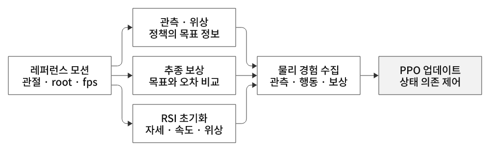
</p>
<p align="center"><sub>그림 28. 레퍼런스는 행동 정답을 그대로 대입하는 대신 목표 정보·점수·시작 상태를 제공한다. PPO는 물리 경험으로 정책을 업데이트한다.</sub></p>

| 사용처 | 내용 |
|---|---|
| 관측 | 지금 따라갈 관절 자세23개와 phase sin/cos2개 |
| 보상 | 관절·팔·속도·높이가 현재 레퍼런스와 가까운지 |
| RSI reset | 무작위 모션 프레임의 관절 위치·속도·root 높이·속도로 시작 |

이는 전문가 행동을 정답으로 직접 회귀하는 Behavior Cloning과 다르다. 이번 정책은 **레퍼런스 기반 보상을 사용하는 강화학습**이다.

## 103관측·23행동과 시간 구조

관측은 몸 선속도3+각속도3+중력방향3+관절위치23+속도23+지난행동23+레퍼런스관절23+위상2 = **103**이다.
G1 자산에서 손가락14개를 행동·관절 관측 선택에서 제외했다. 자산 자체에 손가락 관절이 없어졌다는 뜻은 아니다.
행동은 `q_target=q_default+0.25×action`인23개 위치 목표이고, 하위 implicit PD가 물리 구동을 맡는다. `scale`은 hard clip이 아니다.

Actor는 정규화된103입력→256→128→64→23평균 행동, Critic은 같은103입력→256→128→64→1이다.
물리200Hz, 정책50Hz, rollout24step은 환경당0.48초다. 기본2048환경이면49,152전이를 모아4미니배치(각12,288개)×5epoch, iteration당20optimizer step을 진행한다.
2000iteration의 총 전이는 **98,304,000개**로 추가 사진과 일치한다. episode 최대10초·500step과 rollout24step은 다른 단위다.

## RSI와 위상이 왜 중요한가

RSI는 ‘클립의 무작위 프레임에서 이미 움직이던 상태’를 만들어 주기 뒷부분까지 경험하게 한다. 관절 위치뿐 아니라 관절 속도·root 상태와 `phase0`도 맞춘다.
기본판의 위상은 `(phase0 + floor(episode_length_buf×dt×fps)) % T`다. 따라서 35번처럼 `init_at_random_ep_len=True`로 카운터만 바꾸면 **실제 자세는 A프레임인데 목표는 B프레임**이 될 수 있다.
36번 학습은 `False`를 사용하고 시작 모션 위상은 RSI가 분산한다. 이것이 timeout 시점까지 별도로 무작위 분산한다는 뜻은 아니다.
sin/cos 위상은 주기 시작·끝의 숫자 표현을 연속적으로 만들지만, 원본 모션의 자세·속도 연결부가 실제로 연속인지까지 보장하지 않는다.

## 보상과 종료

양의 항은 관절추종+5·팔추종+2·전진속도추종+2·높이추종+2·생존+1이다. 음의 항은 기울기-2·발미끄러짐-.1·관절속도-.01·행동변화-.05·soft limit-1이다.
관절추종은 `exp(-sum((q-q_ref)^2))`이므로 가중 로그4.45/5를 관절각 정확도89%라고 읽으면 안 된다.
발 접촉 센서는 접촉 중 발의 평면 속도 패널티에 사용한다. 접촉력은 이번 Actor 입력에 직접 포함되지 않는다.
실패는 기울기0.8rad 초과 또는 root 높이.35m 미만, 시간 종료는10초다.

## 사진의 보행 학습 결과

추가 사진은 보행 학습 최종 **1999/2000**을 보여준다. 아래 값은 화면 표시값이며 원시 event 파일에서 다시 추출한 값은 아니다.

| 최종 학습 출력 | 값 |
|---|---:|
| 평균 보상 | **97.11** |
| 평균 episode 길이 | **500.00 step · 10초** |
| 총 전이 | **98,304,000** |
| 관절 / 팔 추종 term | 4.4464 / 1.9789 |
| 속도 / 높이 추종 term | 1.9532 / 1.4183 |
| 관절 한계 패널티 term | -0.5678 |
| timeout / 기울기 / 높이 종료 지표 | 1.0000 / 0 / 0 |
| 평균 탐색 std / entropy | 0.11 / -20.3587 |
| 처리량 / iteration 시간 | 42,690 transitions/s / 1.15초 |
| 표시 학습 시간 | 39분9초 |

원시 로그가 없어 초기~최종의 연속 학습 곡선을 재구성하지 않았다. 초반 사진의 iteration65·보상3.20과 최종97.11은 서로 다른 시점의 표시값이다.
높이 term이 최대2보다 낮고 soft-limit 패널티가 남아 있으므로 ‘생존했다’와 ‘모든 관절·높이를 완벽히 재현했다’를 구분한다.
GPU 사진은 순간 사용률62%·메모리3395MiB 등의 참고값이며 전체 실행 평균이나 성능 한계가 아니다. 고정 사양·드라이버 정보는 공용 README에만 반영했다.

## 보행 평가 — 랜덤 vs 학습 정책

<p align="center">
  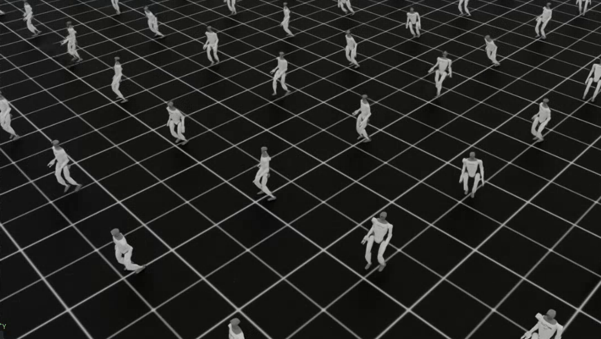
</p>
<p align="center">
  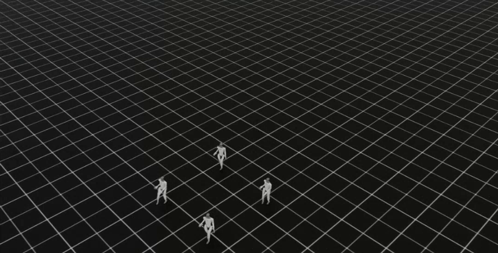
</p>
<p align="center">
  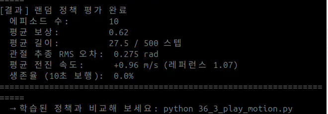
</p>
<p align="center">
  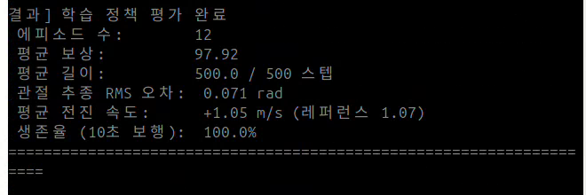
</p>

| 영상 최종 집계 | 랜덤36-3 | 학습 보행36-4 |
|---|---:|---:|
| 실제 완료 episode | 10 | **12** |
| 평균 누적 보상 | 0.62 | **97.92** |
| 평균 길이 | 27.5step · 0.55초 | **500step · 10초** |
| 관절추종 RMS | 0.275rad | **0.071rad** |
| 평균 몸 기준 전진 속도 | +0.96m/s | **+1.05m/s** |
| 표시 레퍼런스 속도 | 1.07m/s | 1.07m/s |
| 코드의 생존율 | 0% | 100% |

초기 root 전진 속도를 RSI가 넣으므로 **랜덤 정책도 짧은 시간에는 목표 근처 속도**를 보일 수 있다. 속도만으로 안정 보행을 판정하지 않는다.
10회 요청을 동시 종료된 환경4개씩 집계해 학습 정책은12회가 됐다. 코드 생존율은475step(9.5초) 이상 비율이며 정확한 timeout 비율과 다르다. 이번 학습 표본은12회 모두500step 생존 표시를 별도로 확인했다.
관절 RMS는 종료 뒤 자동 reset된 상태가 한 표본 섞일 수 있는 교육용 통계다. 이를 정밀한 terminal 상태 오차로 취급하지 않는다.

<p align="center">
  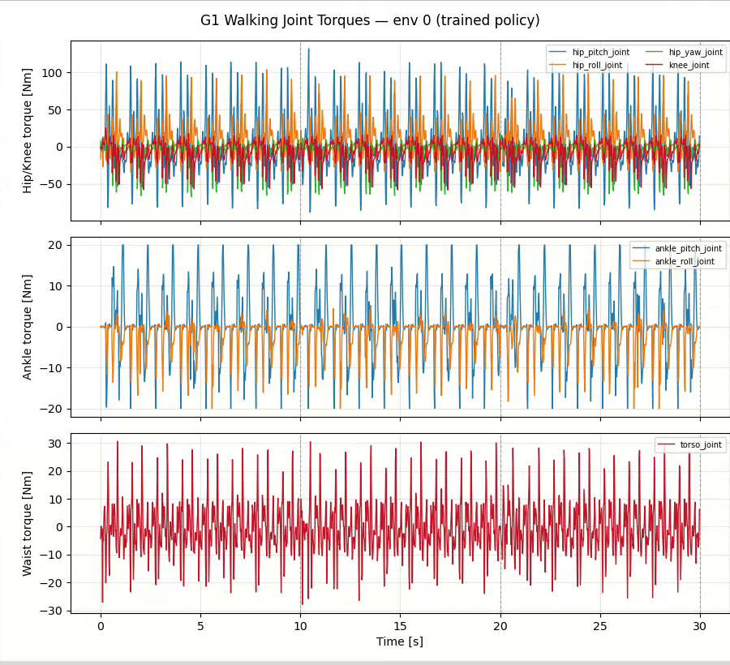
</p>
<p align="center"><sub>그림 36-1. 영상36-4의 env0 토크. 주기적 변화와10초 reset 경계를 구분한다. implicit PD 근사값이며 실제 힘 센서 측정이 아니다.</sub></p>

## 쿵푸 단계1 — 재생 로봇은 멀쩡한데 정책 로봇은 왜 넘어지나

<p align="center">
  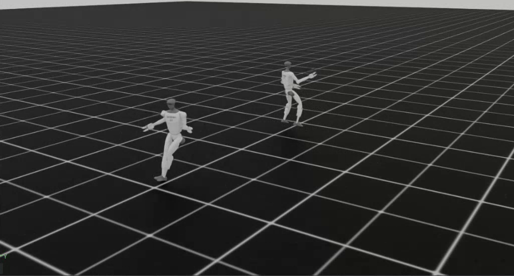
</p>
<p align="center">
  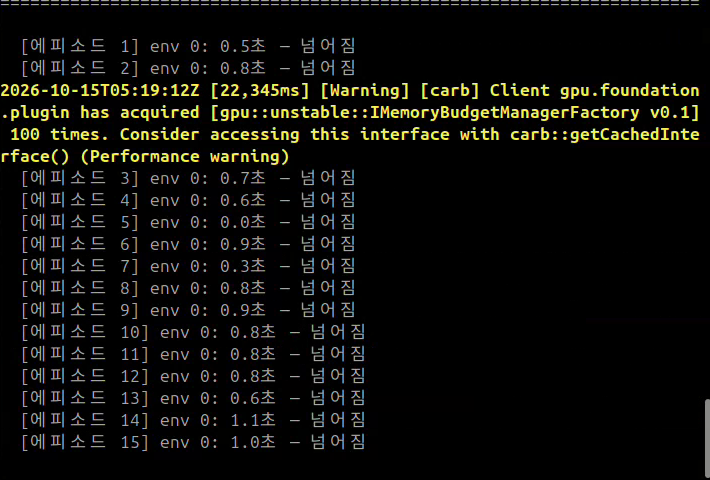
</p>

36-5 영상의 env1은 중력을 끄고 PD 게인을0으로 한 뒤 root·관절 상태를 계속 덮어쓰는 재생 로봇이다. **보여줄 수 있는 자세라는 사실이 물리적으로 제어 가능한 자세라는 증거는 아니다.**
env0는 정책이 목표 각도를 내고 중력·접촉을 견뎌야 한다. 강의28쪽은 보행 모델에 새 쿵푸 레퍼런스를 줬을 때 학습 분포 밖의 목표를 제대로 따라가지 못하는 현상을 설명한다.
재생 시계는 env0 reset과 독립적이므로 넘어져 reset한 뒤 두 로봇이 계속 같은 위상이라는 보장도 없다.

## 쿵푸 단계2 — 같은 보행 환경에서 재학습해도 규칙이 충돌할 수 있다

강의31~33쪽은 쿵푸로2000iteration 학습했어도 넘어지는 원인을 다음처럼 분석한다.

| 보행판 가정 | 쿵푸와의 충돌 | 전용 환경 수정 방향 |
|---|---|---|
| root z<.35m이면 실패 | 정당한 낮은 자세 자체가 실패가 될 수 있음 | 절대 높이 대신 레퍼런스와의 높이 편차 |
| 몸 기준 vx를 양수 평면 속도 크기와 비교 | 후진·횡이동의 방향을 잃음 | 같은 월드 좌표계의 속도 벡터 추종 |
| RSI의 root yaw=0, 목표 yaw 관측·보상 없음 | 회전 모션의 root 자세·회전 목표가 충분히 반영되지 않음 | 레퍼런스 회전·속도로 reset, yaw 오차 관측·보상 |
| 기울기·빠른 관절 움직임 감점 | 의도된 기울기·빠른 발차기와 상충 가능 | 필요한 동작을 허용하도록 감점 강도 조절 |

**강의의 클립 분석 수치**는 최저 root 높이.306m, .35m 미만 프레임7.9%, 전후 속도 약-.85~+.90m/s, yaw 변화 약100도·최대247도/s다. 이번 ZIP 모션 데이터를 직접 읽어 재측정한 값은 아니다.
패널티가 모방과 경쟁할 수 있다는 것이며, 각 프레임에서 실제로 ‘패널티가 보상보다 크다’는 결론은 원시 term 기록으로 검증해야 한다.
2000번을 더 돌리는 것만으로 상충하는 목적이 사라지지는 않는다. 정책은 사람이 의도한 동작 대신 정의된 보상·종료 조건 안에서 유리한 행동을 학습한다.

## 마지막36-6 영상의 실패와 확인할 점

<p align="center">
  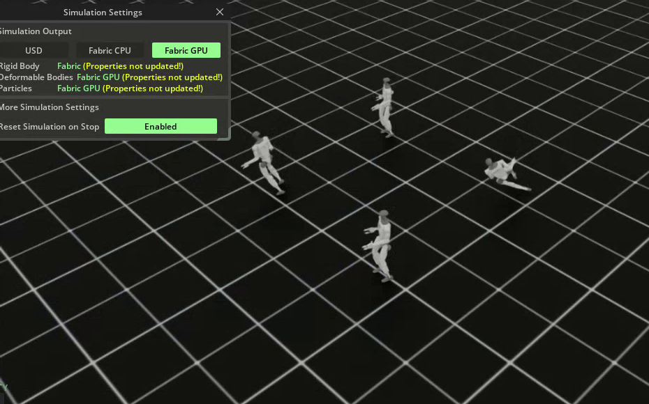
</p>
<p align="center">
  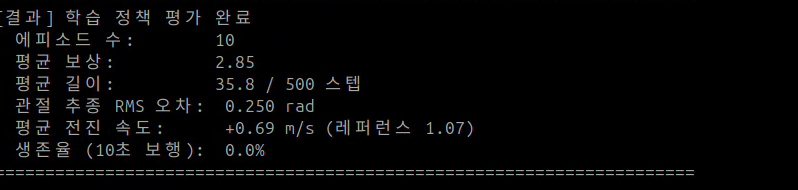
</p>

최종 로그는 **10회·평균 보상2.85·길이35.8step(0.716초)·RMS.250rad·속도+.69m/s·생존율0%**다.
사용자는 쿵푸 재학습 후 실행이라고 설명했다. 다만 이 화면에는 레퍼런스가 **1.07m/s**로 표시되어 기본 보행 평가와 같은 값이다. 모션 파일명·checkpoint 전체 경로를 확인하지 못했으므로 **이 결과가 정확히 어떤 모델/모션 조합인지는 확정하지 않는다.**

기본 `36_3_play_motion.py`는 `--motion_pkl`을 생략하면 **보행 모션을 다시 로드한다**. 쿵푸 가중치와 보행 레퍼런스는 둘 다103관측이라 shape 오류 없이 잘못 조합될 수 있다.
따라서 강의가 지적한 환경 모순과 별개로, 평가에서도 모션·모델을 명시해야 한다.

```bash
# 보행판 환경에서 쿵푸로 학습한 모델을 평가하는 경우
python 36_3_play_motion.py --motion_pkl Bruce_Lee_pose --checkpoint /path/to/kungfu-in-walking-env/model_1999.pt
```

<p align="center">
  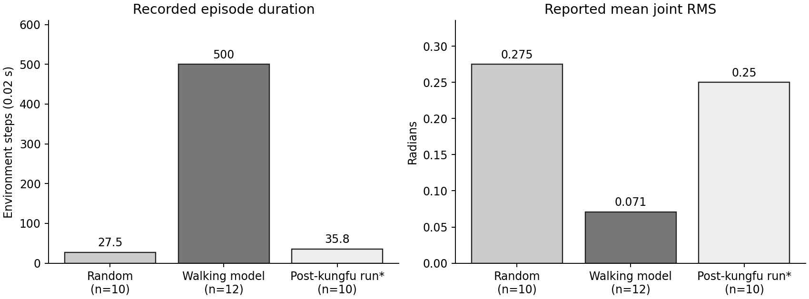
</p>
<p align="center"><sub>그림 36-2. 서로 다른 실행의 표시값이다. 마지막 실행(*)은 모델·레퍼런스 조합이 미확정이므로 통제된 쿵푸 성능 비교로 해석하지 않는다.</sub></p>

[평가 표시값·사진 전사 JSON](analysis/results-summary.json) · [그래프 생성 코드](analysis/render_evaluation_summary.py) · [출처·미디어 해시](analysis/media-manifest.json)

## 강의의 다음 해법 — 쿵푸 전용 환경36_4·36_5

강의35~37쪽과 기준 코드의 수정은 다음과 같다.

- 높이 실패: `abs(z-ref_z)>.3m`.
- 속도: 월드 평면 속도 벡터 추종. yaw 추종 보상 추가.
- 관측: yaw 오차 sin/cos2개+목표 속도2개 → **103→107개**.
- RSI: root quaternion·월드 속도·수직 속도·yaw 각속도를 레퍼런스로 초기화.
- 기울기 패널티 -2→-.2, 관절속도 패널티 -.01→-.005.
- 실험 경로 `g1_brucelee_tutorial`, episode12초, 기본3000iteration.

따라서 **103입력 보행 모델은107입력 전용 환경에 그대로 load할 수 없다.** 기준36_4는 새 Runner로 학습하며 이전모델 load를 호출하지 않는다.
강의37쪽은 수정 후 쿵푸를 재현하는 예시를 제시하지만, 이번 첨부 영상에는107관측 전용 환경의 성공 평가를 확인할 자료가 없다. 강의 결과를 사용자 결과로 대신 보고하지 않는다.

## 실행 예시와 데이터 준비

```bash
cd <physical-ai-training 저장소 경로>/36-g1-motion-imitation
python 36_1_motion_playback.py --motion_list
# 저장된 보행 모델 평가 · 모델은 이번 ZIP을 열지 못해 저장소에 추가하지 못함
python 36_3_play_motion.py --motion_pkl B3_-_walk1_stageii --checkpoint /path/to/walking/model_1999.pt
# 쿵푸 비교 재생: 모션 변경만으로 새로 학습되는 것은 아님
python 36_1_motion_playback.py --motion_pkl Bruce_Lee_pose --checkpoint /path/to/walking/model_1999.pt
```

새 학습은 모션별 별도 작업 폴더에서 실행해 원본의 고정 로그 경로가 섞이지 않게 한다.

```bash
# 36-g1-motion-imitation에서 실행
mkdir -p runs/walk runs/kungfu-walking-rules runs/kungfu-adapted
cd runs/walk
python ../../36_2_train_motion.py --headless --num_envs 2048 --max_iterations 2000
cd ../kungfu-walking-rules
python ../../36_2_train_motion.py --headless --motion_pkl Bruce_Lee_pose --num_envs 2048 --max_iterations 2000
cd ../kungfu-adapted
python ../../36_4_train_bruce_lee.py --headless --motion_pkl Bruce_Lee_pose
# 학습 완료 후 전용 모델 경로를 명시
python ../../36_5_play_bruce_lee.py --motion_pkl Bruce_Lee_pose --checkpoint logs/rsl_rl/g1_brucelee_tutorial/model_2999.pt
```

모션 데이터는 코드 폴더의 `g1_retargeted_motions/`에 별도 준비한다. HuggingFace `openhe/g1-retargeted-motions`의 실제 LFS 데이터를 받아야 하며 작은 `version https://git-lfs...` 텍스트 파일은 모션이 아니다.
이전 `invalid load key 'v'`·`KeyError118`의 원인이 바로 그 포인터였다. 자세한 코드·데이터 계약 검토는 [코드 리뷰](code-review.md)에 정리했다.
