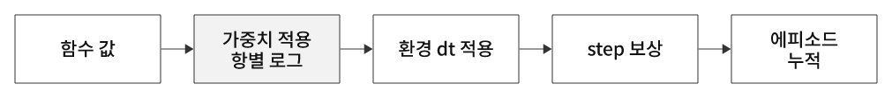
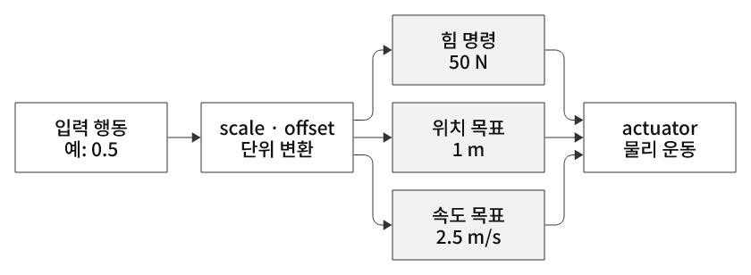
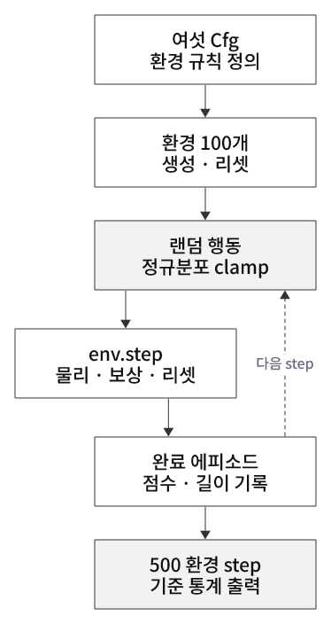

# 관측·보상·행동과 환경 설계

[강화학습 목차](README.md) · [개념 학습 전체](../../README.md)

## 이 문서에서 다루는 내용

- [5. Termination과 Truncation](#5-termination과-truncation)
- [6. 보상 설계 — 무엇을 배우게 할까?](#6-보상-설계--무엇을-배우게-할까)
- [9. 관측 설계 — 정보의 표현도 학습에 영향을 준다](#9-관측-설계--정보의-표현도-학습에-영향을-준다)
- [10. 보상 항 해석 — 점수 이름보다 실제 함수를 확인한다](#10-보상-항-해석--점수-이름보다-실제-함수를-확인한다)
- [11. 액션 공간 — 정책 출력을 로봇 명령으로 해석하기](#11-액션-공간--정책-출력을-로봇-명령으로-해석하기)
- [12. 태스크를 환경 규칙으로 바꾸고 baseline 측정하기](#12-태스크를-환경-규칙으로-바꾸고-baseline-측정하기)

## 5. Termination과 Truncation

둘 다 현재 에피소드의 수집을 끝낼 수 있지만 **끝난 이유와 학습에서의 해석이 다르다.**

| 구분 | 의미 | 예시 |
|---|---|---|
| Termination | 정의한 작업 자체가 종결 상태에 도달 | 실패 조건, 성공 조건 |
| Truncation | 작업의 종결과 별개로 수집을 중단 | 외부 시간 상한 |

Termination은 실패만 뜻하지 않는다. 목표 달성을 종결로 설계하면 성공도 termination이다.
20번은 카트 경계 이탈을 termination으로, 5초 제한을 truncation으로 설정했다.
두 조건이 같은 step에 만족되면 두 플래그가 함께 참일 수도 있다.
작업 자체에 제한 시간이 포함된 유한 시간 문제라면 시간 종료를 어떻게 정의할지 별도로 설계해야 한다.

### Critic 학습에 왜 중요한가?

- **진짜 종결:** 그 에피소드에서 앞으로 이어지는 보상은 없다. 마지막 보상은 사용하되 종결 이후의 가치 기여를 0으로 본다.
- **단순 시간 중단:** 계속 진행할 수 있는 작업을 잘라 기록했으므로, 남은 가치를 Critic으로 추정해 보충할 수 있다.

이처럼 추정 가치를 이용해 학습 목표를 만드는 것을 **Bootstrapping**이라고 한다.
마지막 보상만으로 이후 가능성을 모두 0으로 처리하면 시간 제한 부근의 가치를 잘못 배울 수 있다.

두 플래그를 반환한다고 보정이 저절로 완성되는 것은 아니다.
학습기·래퍼가 종료 이유와 끝나기 직전 상태를 올바르게 처리해야 한다.
자동 리셋 환경에서 반환된 새 에피소드의 관측을 이전 에피소드의 마지막 상태로 잘못 사용하지 않도록 주의한다.

## 6. 보상 설계 — 무엇을 배우게 할까?

**정책은 사용자의 의도가 아니라 코드로 정의된 보상을 높이도록 학습한다.**
따라서 원하는 동작과 보상 기준이 맞는지 확인해야 한다.

| 목적 | 보상 설계 예시 | 함께 생각할 점 |
|---|---|---|
| 균형 유지 | 직립 편차에 감점 | 어느 각도부터 실패로 볼 것인가? |
| 오래 유지 | 진행 중 보상 | 나쁜 자세로 버티기만 해도 보상을 받는가? |
| 부드러운 동작 | 속도·행동 변화에 감점 | 균형 회복에 필요한 움직임까지 억제하지 않는가? |
| 목표 도달 | 도달 보상·거리 감소 신호 | 멈추거나 쉬운 조건만 이용하는 행동이 유리해지지 않는가? |
| 실패 방지 | 실패 감점·종료 | 감점 크기와 다른 항의 상대 크기가 적절한가? |

### 자주 구분할 개념

- **Dense reward:** 각도·거리처럼 자주 계산되는 학습 신호.
- **Sparse reward:** 성공했을 때만 주는 점수처럼 드문 신호.
- **Reward shaping:** 목표 행동을 배우기 쉽게 중간 평가 항을 더하는 것. 최적 행동을 바꿀 수 있으므로 의도와 맞는지 확인한다.
- **Reward hacking:** 정의한 점수는 잘 얻지만 실제 목적과 어긋난 행동을 하는 현상.

20번의 각도·속도 감점은 자주 계산되는 신호다.
막대가 기울었다고 종료되는 것은 아니므로 ‘막대를 세우기’와 ‘카트가 경계 안에 있기’ 조건을 혼동하면 안 된다.
행동·관측·보상·종료·초기화는 서로 연결해서 설계한다.

### 가중치·시간 간격·평가 지표

가중치만 비교하지 말고 각 항의 실제 값과 단위·규모도 함께 본다.
Isaac Lab v2.3.2 보상 매니저는 가중합에 환경 시간 간격을 곱한다.
따라서 반환 보상과 주석의 +1·-2가 숫자 그대로 같지 않을 수 있다.

정책 평가에서는 총 보상뿐 아니라 성공률, 유지 시간, 자세 오차, 힘·동작의 크기와 영상도 확인한다.
환경·시간 간격·보상 정의가 다르면 점수 크기를 바로 비교하기 어렵다.

## 9. 관측 설계 — 정보의 표현도 학습에 영향을 준다

정책에 필요한 정보인지, 센서로 얻을 수 있는지와 표현·단위·순서를 함께 확인한다.
관측을 늘린다고 반드시 더 잘 배우는 것은 아니다.
21번은 기존 상태를 sin·cos와 정규화 값으로 추가 표현한다.

| 처리 | 목적 | 주의할 점 |
|---|---|---|
| sin·cos 각도 표현 | ±π 경계의 주기성을 표현 | raw 각도도 남아 있으면 그 표현 역시 입력됨 |
| 정규화·scale | 값의 크기를 맞추기 | 모든 관측에 자동 적용되는 것은 아님 |
| clip | 범위를 제한 | 범위 밖 정보를 구분하지 못할 수 있음 |
| noise | 센서 오차 등의 변동을 모사 | 설정과 활성화 여부를 함께 확인 |

21번 관측은 4 → 7차원으로 바뀐다.
입력 크기·순서·전처리가 달라지면 기존 체크포인트의 입력 계약도 달라진다.
정보의 의미와 신경망 입력 형상을 함께 관리해야 한다.

## 10. 보상 항 해석 — 점수 이름보다 실제 함수를 확인한다

직립 보상 `cos(각도)`는 직립 +1, 수평 0, 거꾸로 -1로 평가한다.
음수도 가능한 함수이며 0~1 보너스와 다르다.
가우시안 중앙 보상은 중심에서 최대이며 sigma가 허용 위치 범위의 넓이를 조절한다.
‘energy’라는 이름을 붙여도 raw action 제곱합이면 실제 에너지 측정이 아닌 행동 크기 억제 항이다.

  

그림 5. 보상 로그와 누적값의 관계

총점만 보면 어떤 항이 영향을 줬는지 알기 어렵다.
항별 값을 보되 원시 값, 가중 값, step 기여와 에피소드 누적을 구분한다.
Isaac Lab v2.3.2의 `_step_reward`는 이름과 달리 dt 적용 전 가중 값이며, 에피소드 누적 값도 아니다.

보상 변경 효과를 확인하려면 랜덤 데모뿐 아니라 정책 학습·평가를 같은 조건에서 비교해야 한다.
학습 보상 자체가 달라진 실험에서는 총점 크기만으로 우열을 판단하지 않는다.

## 11. 액션 공간 — 정책 출력을 로봇 명령으로 해석하기

정책은 숫자를 출력하지만 그 숫자가 무엇을 뜻하는지는 환경의 액션 설계가 정한다.
‘0.5만큼 행동한다’ 대신 ‘50 N으로 민다’, ‘1 m를 목표로 한다’, ‘2.5 m/s를 목표로 한다’처럼 해석해야 한다.

  

그림 10. 정책 출력에서 실제 구동까지

| 단계 | 역할 | 이번 22장 예 |
|---|---|---|
| 정책 또는 테스트 입력 | 행동 값 선택 | 사인파·균등 난수 · 신경망 없음 |
| ActionTerm | 대상 관절·명령 종류·scale/offset 지정 | 카트 하나에 힘/위치/속도 명령 |
| actuator | 목표와 현재 상태로 구동 힘 결정 | 위치 stiffness·속도 damping·힘 제한 |
| 물리 엔진 | 힘과 중력·접촉으로 다음 상태 계산 | 두 물리 step 후 새 관측·보상 반환 |

위치·속도 제어는 로봇을 목표값으로 순간 이동시키지 않는다. 추종은 게인·질량·힘 제한 등에 달려 있다.
위치 제어를 선택해도 stiffness=0이면 위치 오차에 반응하지 않는다. 기본 Cartpole을 그대로 사용한 22번이 이 경우다.
힘 명령도 actuator의 감쇠와 함께 작용할 수 있으므로 ‘effort면 게인 무시’를 보편 법칙으로 해석하지 않는다.

`scale`은 값의 크기를 바꾸고 `offset`은 기준을 옮긴다. 둘 다 범위 제한 장치는 아니다.
입력 제한, 처리된 명령의 clip, actuator의 힘 제한, 관절 위치 제한을 구분한다.
회전 관절과 직선 관절은 동일한 ActionCfg를 쓰더라도 명령 단위가 다르다.

**어떤 액션 방식이 좋은지는 작업과 실제 구동 인터페이스에 달려 있다.**
위치 명령을 받는 로봇에 정책을 배포하려면 학습 당시 위치 제어기의 응답도 맞춰야 한다.
관측·액션 차원이 같더라도 모드·scale·offset·관절 순서를 바꾸면 기존 가중치가 의도한 동작과 달라질 수 있다.
정책 체크포인트와 환경 설정을 함께 보관한다.

22번은 액션 인터페이스 테스트이고 PPO 학습이 아니다. 무작위 행동의 점수는 학습 성능과 구분한다.

## 12. 태스크를 환경 규칙으로 바꾸고 baseline 측정하기

‘막대를 세운다’는 목표만으로는 학습을 실행할 수 없다. 어떤 상태를 보고, 어떤 명령을 내리고, 얼마나 잘했는지 평가하며, 언제 다시 시작할지를 정해야 한다.
23번은 Scene·Action·Observation·Reward·Termination·Event를 하나의 Cfg로 조립한다.

  

그림 11. 커스텀 환경 구성과 학습 전 기준 측정

보상은 좋은 상태·행동을 선호하게 만들고, task 종료 조건은 이번 작업에서 실패로 취급할 경계를 정한다.
둘은 같은 기능이 아니다. 막대가 기울면 감점하면서도 계속할 수 있고, 90°를 넘으면 이번 balancing 에피소드를 끝낼 수 있다.
이 경계가 물리적 복구 불가능성을 뜻하는 것은 아니다. swing-up처럼 목표가 다르면 실패 규칙도 달라진다.

**시간 제한(truncation)은 성공 판정이 아니다.** 5초를 채웠는지와 직립·중앙 유지에 성공했는지는 각각 평가한다.
순수 시간 제한과 task 실패가 동시에 일어날 수도 있으므로 두 종료 플래그를 모두 기록한다.
23번에는 신경망·가치 학습이 없고, timeout 설정은 이후 학습기가 처리할 정보를 제공한다.

Baseline은 학습 전 행동 규칙의 성능을 재어 이후 비교할 기준을 만드는 것이다.
23번의 랜덤 행동은 정규분포를 ±1로 clamp하며 22번 균등 난수와 다르다.
완료 에피소드만 평균 내면 아직 끝나지 않은 긴 에피소드가 빠지고 짧게 실패한 환경의 기록이 더 많이 포함될 수 있다.
같은 환경·초기화·seed·평가 예산에서 완결 에피소드의 보상, 유지 시간, 실패/timeout 수와 실제 작업 오차를 비교한다.

병렬 환경 100개 × 500 환경 step이면 50,000개 전이를 만들 수 있지만, 학습 실행기가 없으면 가중치는 갱신되지 않는다.
24번의 실제 연결은 7차원 관측과 1차원 행동을 가진 같은 핵심 환경 설계에 RSL-RL과 PPO 실행기를 붙이는 것이다.
정책 입력·행동 단위·보상·종료 규칙을 학습과 평가에서 맞춰야 점수 차이를 해석할 수 있다.
