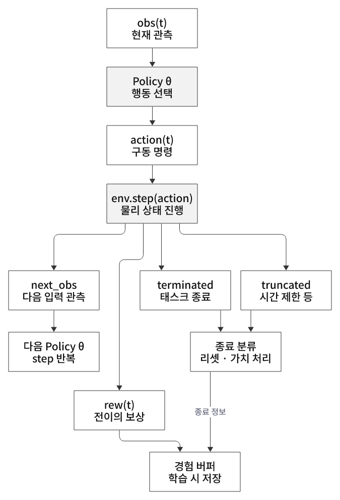

# 환경 step과 피드백 루프

[강화학습 목차](README.md) · [개념 학습 전체](../../README.md)

## 이 문서에서 다루는 내용

- [7. 에피소드·step·iteration·병렬 환경](#7-에피소드stepiteration병렬-환경)
- [16. obs·action·rew·종료 신호의 피드백 루프](#16-obsactionrew종료-신호의-피드백-루프)

## 7. 에피소드·step·iteration·병렬 환경

| 용어 | 뜻 |
|---|---|
| 물리 step | 물리 엔진을 한 번 진행 |
| 환경 step | 행동 적용 후 물리를 진행하고 관측·보상 반환 |
| 에피소드 | 시작부터 종료까지의 시도 |
| 학습 iteration | 경험 수집·모델 업데이트 단위 · 실행기 정의에 따름 |
| 병렬 환경 수 | 함께 실행해 경험을 수집하는 환경 개수 |

20번은 환경 step 한 번에 물리 step 두 번을 진행한다.
환경 4개를 100번 step하면 최대 400개의 전이를 만들지만, 서로 이어진 경험은 독립적인 시도 400개와 같지 않다.
학습 시간을 판단할 때 에피소드·step·업데이트 횟수를 서로 바꿔 읽지 않는다.

<a id="step-feedback"></a>

## 16. obs·action·rew·종료 신호의 피드백 루프

맞다. **관측으로 행동을 정하고 환경을 한 step 진행한 뒤, 반환된 새 관측으로 다음 행동을 정하는 과정이 반복된다.**
동시에 보상·종료 정보는 학습 경험과 에피소드 관리에 전달된다. 모든 반환값이 Actor 입력으로 그대로 들어가는 것은 아니다.

<p align="center">
  
</p>
<p align="center"><sub>그림 16. 관측·행동·보상·종료 신호의 시간 전개 구조</sub></p>

그림은 같은 루프의 현재 step과 다음 정책 호출을 시간 순서대로 펼쳤다. θ는 정책 가중치다. r(t)는 action(t)로 만든 전이의 보상을 뜻한다.
`info`는 그림에서 생략한 부가 정보 딕셔너리이며 timeout 정보·로그 등이 들어갈 수 있다. 경험 버퍼에는 그림에 표시한 보상·종료 정보 외에 관측·행동·가치·행동 확률 정보도 함께 저장한다.

### 반환값의 역할을 나눠 읽기

| 값 | 이번 step에서의 의미 | 다음에 쓰이는 곳 |
|---|---|---|
| `obs` | 행동을 고르기 전 현재 관측 | Actor 입력 · 학습 시 Critic 입력 |
| `action` | 정책 또는 테스트 규칙이 고른 명령 | ActionManager → actuator → 물리 진행 |
| `next_obs` | step 후 반환한 관측 | 다음 Actor 호출 · 가치 추정/학습의 상태 정보 |
| `rew` | 이번 전이에 대한 환경 점수 | 누적 평가 점수 · return/Advantage 계산 |
| `terminated` | 태스크 정의상 종료 상태 도달 | 에피소드 구분 · 가치 연결 처리 |
| `truncated` | 시간 제한 등 외부 기준으로 중단 | 에피소드 구분 · timeout bootstrap 처리 |
| `info` | 보조 정보 | 종료 원인·로그·wrapper의 timeout 정보 등 |

**제어 피드백**은 `obs → policy → action → 물리 → next_obs`다.
**학습 피드백**은 여러 step의 경험과 보상·가치·종료 정보 → PPO 업데이트 → 바뀐 θ로 다음 rollout을 수집하는 경로다.
PPO는 보통 reward 하나를 받자마자 가중치를 한 번 바꾸지 않는다. 24번은 환경당 16 step을 모은 뒤 여러 mini-batch 업데이트를 한다.

### 한 step을 시간 순서대로 보기

1. 정책은 현재 `obs(t)`에서 `action(t)`를 계산한다.
2. Isaac Lab은 명령을 변환하고, 24번 설정에서는 같은 행동으로 물리 step 두 번을 진행한다.
3. 환경은 새 상태에서 종료 조건과 보상을 계산한다.
4. 완료한 환경만 자동 리셋하고 새 입력 관측을 반환한다.
5. 실행기는 점수·완료 정보를 기록하고, 반환 관측으로 다음 행동을 계산한다.

```python
# ManagerBasedRLEnv의 제어 흐름 설명용 · PPO 전체 구현은 아님
obs, info = env.reset()
while running:
    action = policy(obs)
    next_obs, rew, terminated, truncated, info = env.step(action)
    done = terminated | truncated
    # 평가: rew를 누적하고 done인 환경의 결과 기록
    # 학습: 현재 obs·행동·보상·가치·종료 정보를 rollout에 저장
    obs = next_obs
    # PPO는 정해진 rollout을 모은 뒤 별도 단계에서 가중치 업데이트
```

`env.step()` 호출마다 물리 상태는 바뀌지만 정책 가중치가 매번 바뀌는 것은 아니다.
또한 PPO의 역전파는 정책/가치 신경망의 손실에 적용하며 PhysX의 모든 물리 step을 통째로 미분해 경로를 찾는 방식이 아니다.

### 자동 리셋에서 특히 주의할 점

일반적인 단일 Gymnasium 환경은 완료 후 호출자가 reset해야 할 수 있다. 여기서는 Isaac Lab의 병렬 환경 내부에서 완료 환경만 자동 리셋한다.
따라서 완료 step의 `rew`·종료 플래그는 **끝난 에피소드** 결과이고 `next_obs`는 **새 에피소드 초기 관측**일 수 있다.
그 관측을 무조건 ‘실패 직전 상태’로 저장해 terminal value를 계산하면 잘못된 학습 목표를 만들 수 있다. timeout 처리는 wrapper·학습기 버전의 구현을 확인한다.

`done = terminated | truncated`는 둘 중 하나라도 발생하면 해당 에피소드가 끝났다는 뜻이다. task 종료와 시간 제한은 동시에 참일 수도 있다.
태스크 종료는 일반적으로 미래 가치 연결을 끊고, 순수 외부 시간 제한은 필요한 가치 bootstrap을 구분한다. 이번 RSL-RL 구현의 구체적 보정은 [24번 리뷰](../../../practice/04-reinforcement-learning/24-train-cartpole/code-review.md#6-timeout-처리와-시작-카운터)에 정리했다.

평가·추론에서도 관측-행동 루프는 똑같이 반복되지만 보상은 성능 집계에 쓰고 θ는 고정한다. 20~23의 랜덤 데모는 새 관측을 받더라도 행동 생성에 사용하지 않는다는 차이가 있다.
