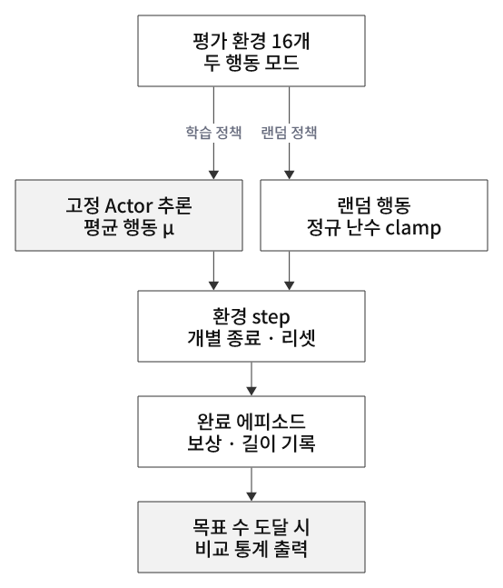
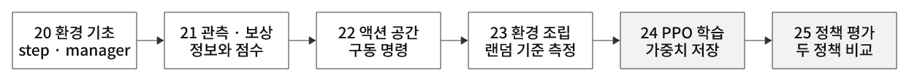

# 학습·추론·평가와 전체 워크플로우

[강화학습 목차](README.md) · [개념 학습 전체](../../README.md)

## 이 문서에서 다루는 내용

- [8. 20~29장의 연결](#8-2029장의-연결)
- [14. 학습·추론·평가 — 학습한 것은 경로가 아니라 정책이다](#14-학습추론평가--학습한-것은-경로가-아니라-정책이다)
- [15. 20~25에서 완성한 기초 RL 흐름](#15-2025에서-완성한-기초-rl-흐름)

## 8. 20~29장의 연결

| 강좌 | 역할 |
|---|---|
| 20~23 | 환경·관측·보상·행동 구성 |
| 24 | Cartpole PPO 학습 |
| 25 | 저장한 정책 평가 |
| 26 | ANYmal 보행 PPO 학습 |
| 27 | 보행 정책 평가 |
| 28 | 환경 변화에 대한 기존 정책 평가 · 도메인 시프트 |
| 29 | 물리·초기 상태·교란 랜덤화 구성 · 원본 파일은 랜덤 행동 데모 |

학습 분포와 실행 조건이 달라지는 것이 도메인 시프트다.
도메인 랜덤화는 여러 조건에서 정책을 학습시키도록 환경을 다양하게 만드는 방법이다.
랜덤화 설정만 실행해도 정책이 학습되는 것은 아니며, 학습 실행기에 연결해야 한다.

## 14. 학습·추론·평가 — 학습한 것은 경로가 아니라 정책이다

학습 중 PPO는 현재 정책의 분포에서 행동을 샘플링하고, 경험으로 정책 가중치를 바꾼다. 처음부터 끝까지 관측과 무관한 완전 랜덤 탐색을 하는 것은 아니다.
추론은 저장된 정책이 현재 관측을 행동으로 바꾸는 계산이다. 성공한 과거 경로를 그대로 재생하는 것이 아니다.
평가는 고정한 정책의 추론을 여러 에피소드 실행하고 보상·유지 시간·실패 사유·작업 오차를 측정하는 절차다.

  

그림 14. 학습 정책과 랜덤 baseline을 분리해 평가

이번 `get_inference_policy()`는 Actor 평균 μ를 사용해 탐색 샘플링을 제거한다.
`torch.no_grad()`는 gradient 기록을 끄며, 그것 자체가 deterministic 행동을 만드는 것은 아니다. 모델 eval 모드와 가중치 업데이트 여부도 각각 구분한다.
확률적 정책을 배포하려면 그 샘플링 방식도 평가할 수 있으며 모든 추론이 deterministic이어야 하는 것은 아니다.

### 최신 모델과 최선 모델은 다르다

자동 탐색은 후보 폴더에서 iteration 숫자가 큰 체크포인트를 찾을 뿐 성능을 비교하지 않는다.
선택용 평가로 모델을 비교하고 최종 보고는 별도 초기 상태·seed에서 확인한다.
모델 구조뿐 아니라 관측 순서·단위·정규화·액션 scale도 학습 때의 계약과 맞춰야 한다.

### 성공률은 정의와 분모를 함께 읽는다

25번의 성공률은 실제로 **길이 ≥290 step** 비율이다. 환경 dt=1/60초에서 약 4.83초이므로 실패 없이 5초 전체를 채웠다는 판정과 다르다.
엄밀한 balancing 성공은 task 실패 없이 timeout 도달 여부와 직립·중앙 오차 등을 함께 정해 측정한다.
최대·최소는 범위이며 분산·표준편차는 별도로 계산해야 한다.

제공 영상의 학습 정책은 64회·평균 보상 17.28·길이 300, 랜덤은 65회·평균 보상 1.61·길이 34.7이었다.
랜덤의 65회는 동시 완료를 모두 추가한 결과이며 목표 64회와 구분한다. 코드는 실제 완료 수를 분모로 사용한다.
같은 seed·초기 상태·표본 수·종료 규칙과 배포 행동 모드를 기록해 비교하고, 이 결과를 모든 조건의 성공률로 일반화하지 않는다.

## 15. 20~25에서 완성한 기초 RL 흐름

  

그림 15. 환경 설계에서 학습·저장·평가까지

20 환경 기초 → 21 관측/보상 → 22 액션 → 23 완전한 환경·baseline → 24 PPO 학습·체크포인트 → 25 고정 정책 평가까지 연결했다.
이후 26 보행 학습·27 평가·28 지형 생성·일반화 관찰·29 도메인 랜덤화에서 같은 흐름을 더 복잡한 조건으로 확장한다.
이번 완성은 기초 end-to-end 학습·평가 실습이며 실제 로봇 배포 성능을 보장하는 단계는 아니다.
