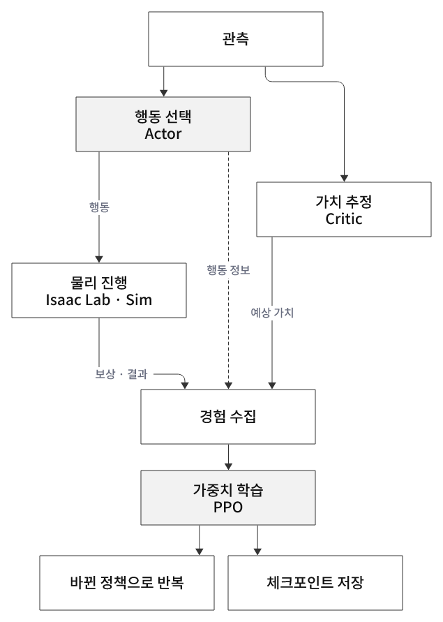

# 강화학습 개념 — 환경·Policy·Critic·보상·종료

**강화학습은 행동의 결과를 경험하고, 앞으로 얻을 누적 보상이 커지도록 행동 선택 방식을 개선하는 과정이다.**
보상 숫자를 계산하는 것만으로 학습이 일어나지는 않는다. 경험으로 정책을 바꾸는 학습 알고리즘이 필요하다.

## D2로 전체 구조 보기

[전체 강화학습·모델·20장 실행·물리 step 구성도](diagrams/README.md)를 함께 볼 수 있다.

  

그림 1. 강화학습 전체 흐름

  

그림 2. Actor·Critic 모델 구조

위 신경망 구조는 24장 예시다. 20·21장은 아직 랜덤 행동 환경 테스트이며 PPO가 연결되지 않았다.

## 주제별 읽기

긴 설명을 아래 주제별 문서로 나누었습니다. 처음에는 01 → 02 → 03 → 04 순서로 읽고, 학습 단위·평가·보행으로 확장합니다.

| 문서 | 핵심 항목 |
|---|---|
| [강화학습 기초와 모델 역할](01-foundations.md) | Environment·Policy·Actor·Critic / 라이브러리와 신경망 |
| [관측·보상·행동과 환경 설계](02-environment-design.md) | 관측·보상·행동 / termination·truncation / 태스크·baseline |
| [환경 step과 피드백 루프](03-step-feedback.md) | obs → action → step → rew·종료 / 자동 리셋·시간 단위 |
| [PPO 학습과 가중치 업데이트](04-ppo-training.md) | rollout·GAE·Advantage / PPO clip / 체크포인트 |
| [Rollout·미니배치·epoch·iteration](05-rollout-and-minibatch.md) | 2048환경 × 24step / 4미니배치 × 5epoch / 통배치 비교 |
| [학습·추론·평가와 전체 워크플로우](06-policy-evaluation.md) | 탐색과 추론 / 모델 선택·성공률 / 20~25 흐름 |
| [보행과 일반화](07-locomotion-and-generalization.md) | 보행 제어·평가 / Domain Shift·Randomization |
| [휴머노이드와 모션 모방](08-humanoid-and-imitation.md) | G1 서기 / PD·접촉 / 모션 추종·RSI |

[구성도 모음](diagrams/README.md) · [강화학습 실습 20~29](../../../practice/04-reinforcement-learning/README.md)

[관련 실습·공식 참고 자료](resources.md)
