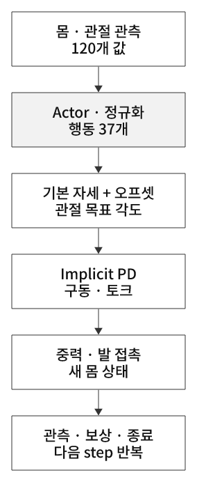

# 휴머노이드 서기 — 균형·관절 제어·강화학습의 연결

## 1. 로봇 모델을 세워 놓는 것과 균형을 유지하는 것은 다르다

**휴머노이드는 떠 있는 몸통을 발 접촉으로 지지하며, 관절을 움직여 중력 아래의 자세를 유지해야 한다.**
모델을 기본 자세로 배치했다고 움직이지 않도록 고정되는 것은 아니다. 중력·발 접촉·관절 구동의 결과로 자세가 바뀌므로 현재 상태를 보고 계속 보정해야 한다.
35번은 G1의 몸 속도·중력 방향·관절 상태·지난 행동으로 관절 위치 목표를 내고, 그 결과의 높이·기울기·움직임에 점수를 주는 학습이다.

[35번 전체 실습·결과](../../../practice/05-humanoid-rl/35-g1-standing/README.md) · [코드 리뷰](../../../practice/05-humanoid-rl/35-g1-standing/code-review.md) · [PPO 기본 구조](../../04-reinforcement-learning/reinforcement-learning/README.md)

## 2. 4족 보행에서 2족 휴머노이드로 무엇이 달라졌나

| 항목 | 26번 ANYmal 보행 | 35번 G1 서기 |
|---|---|---|
| 목표 | 명령 선속도·yaw rate 추종 | 기본 자세에서 root 높이·기울기 유지 |
| 로봇 | 4개 다리·12관절 행동 | 다리·허리·팔·손가락 포함37관절 행동 |
| 관측 | 48개, 속도 명령 포함 | 120개, 목표 속도 명령 없음 |
| 행동 | 관절 위치 오프셋 scale.5 | 관절 위치 오프셋 scale.25 |
| 하위 구동 | ANYdrive actuator-net | PhysX implicit PD |
| 주요 보상 | 속도 추종·발 접촉·자세·구동 비용 | 높이·생존·기울기·관절 움직임·한계 |
| episode | 최대20초 | 최대5초 |
| 학습 | PPO | PPO |

휴머노이드는 상체·팔·허리도 질량과 관성을 갖고 있어 전체 몸의 균형에 영향을 준다. 다만 2족이 모든 상황에서 반드시 더 어렵거나 4족이 항상 안정하다는 뜻은 아니다. 지지 상태·지형·과제와 제어기 설계에 따라 달라진다.

## 3. 균형을 이해하는 기초 — 지지 영역과 질량 중심

두 발이 바닥에 붙어 있을 때 접촉 영역으로 만들 수 있는 지지 영역을 생각할 수 있다. 평탄한 바닥의 준정적 상황에서는 전체 질량 중심의 수직 투영이 지지 영역 안에 있는지가 안정성을 이해하는 유용한 기준이다.
하지만 몸이 빠르게 움직이거나 외력이 가해질 때는 가속도·각운동량·마찰·접촉력·구동 한계도 봐야 한다. 이 기준 하나가 모든 동적 안정성의 충분조건은 아니다.

발목을 조정하면 지면과 상호작용하는 힘·모멘트가 달라질 수 있고, 엉덩이·허리·팔 움직임은 몸의 질량 분포와 운동에 영향을 준다.
정책은 이런 효과를 보상을 통해 익힐 수 있다. 코드가 ‘발목 전략’, ‘엉덩이 전략’을 규칙으로 직접 지정하는 것은 아니다.

**35번은 CoM·지지 다각형·ZMP를 직접 계산하거나 보상에 넣지 않는다.** 물리 엔진의 접촉 결과와 관측·보상으로 균형을 배우는 예제다.
root frame 높이·몸 기울기는 전체 균형을 유도하기 위한 대리 지표이며, 실제 CoM이나 접촉 안정성 검증과 같지 않다.

## 4. 관측에서 무엇을 알 수 있나

120관측은 몸 기준 선속도3·각속도3·projected gravity3·상대 관절 위치37·속도37·지난 action37이다.
projected gravity는 중력이 몸 좌표계에서 어느 방향인지 나타내므로 기울기 정보를 준다. 관절 위치는 기본 자세와의 차이고, 속도는 현재 움직임을 알려준다.
지난 행동을 함께 보면 현재 상태와 직전 명령의 관계를 활용할 수 있다. 단, 한 step의 이전 행동만 넣었다고 긴 시간 이력·기억 모델이 생기는 것은 아니다.

목표 root 높이는 보상에서 쓰지만 obs에 직접 넣지 않는다. 정책이 보는 정보와 reward를 계산하는 정보가 반드시 같아야 하는 것은 아니다.
직접적인 발 접촉력이나 카메라·height scan은 없으므로 거친 지형이나 다른 센서 조건에서 같은 능력이 유지되는지는 별도 과제다.

## 5. Policy와 PD 제어는 서로 다른 층이다

  

그림 27. 정책은 목표 각도를 선택하고 하위 구동과 물리가 운동을 만든다. 새 상태로 같은 제어를 반복한다.

정책의37개 행동으로 `q_target=q_default+.25×action`을 만든다. PD는 이 목표와 실제 각도·속도의 차이를 이용해 토크를 만든다.
정책이 매번 중력 법칙을 호출하거나 발의 지지력을 직접 지정하지 않아도, 목표 관절을 바꾼 결과가 접촉 운동으로 이어진다.
관절 목표는50Hz로 바뀌고 물리·implicit 구동은200Hz로 진행된다.

이전에 배운 중력 보상과도 연결된다. **35번은 별도의 g(q) 계산·중력 feedforward를 추가하는 코드가 아니다.**
학습한 목표 각도와 실제 관절 각도 사이의 오차가 PD 유지 토크를 만들 수 있다. 안정적으로 서 있다고 반드시 관절 토크가0이어야 하는 것은 아니다.
명시적인 중력 보상, PhysX drive, PPO 정책은 역할이 다르다.

[PD·PID·중력 보상](../../02-robot-control-and-sensors/pd-pid-gravity-compensation/README.md)

## 6. ‘서 있기’를 보상과 실패 기준으로 번역한다

높이 `exp(-(z-.74)^2/.01)`은 root를0.74m 부근에 유지하도록 유도하고, 기울기·관절 속도·행동 변화·soft limit 패널티는 바람직하지 않은 해를 줄인다.
가중치가 크다는 것만으로 유일한 목표가 되는 것은 아니다. 각 항이 실제 어느 정도 점수로 나타나는지 로그로 확인해야 한다.
살아 있는 시간이 길어도 낮게 웅크리면 높이 보상이 감소하고, 높이를 유지해도 심하게 흔들거나 한계에 몰리면 패널티가 생길 수 있다.

높이0.74m는 G1 전체 신장이 아니라 root frame의 z다. 지면이 다른 높이로 옮겨지면 상대 높이 기준을 다시 설계해야 한다.
35번은 기본 서기 자세에서 시작하고 기울기45도·높이.35m 아래를 실패로 끊으므로, 쓰러진 상태에서 스스로 일어나는 학습은 아니다.
같은 위치 유지·yaw 유지·수평 속도0을 직접 보상하지 않으므로 ‘서기’라는 이름보다 코드의 목표와 판정식을 기준으로 이해한다.

## 7. PPO가 균형을 배우는 과정

처음에는 Gaussian 탐색이 포함된 관절 목표를 내고 물리 결과를 경험한다. 보상과 Critic의 가치 예측으로 advantage를 계산해, 장기적으로 높이·자세를 유지하는 행동의 가능성을 높인다.
넘어질 때마다 ‘정답 각도’를 사람이 알려주는 지도학습이나, 사람 모션을 직접 모방하는 학습은 이번35번에 없다.

512환경에서24step을 모으면12,288개 전이가 된다. 이를8미니배치(각1536개)로 나누어5epoch 학습하므로40회 optimizer step이 일어난다.
한 번의 episode가 끝날 때까지 기다리지 않고 경험을 모아 학습하며, 정책의 출력은 매 관측마다 달라질 수 있다.
Actor와 Critic은 같은120관측에서 각기 MLP를 사용하고 정규화 통계도 함께 학습·보존한다.

## 8. 서기 성공과 강건한 균형 제어는 구분한다

이번 학습 정책 영상은12회 모두5초 유지했고 랜덤 정책은10회 평균0.81초였다. 주어진 기본 조건에서 정책 학습의 효과를 확인한 결과다.
하지만 기본 자세·평면·관측 노이즈 없음·외란 없음 조건의 반복이므로, 다양한 초기 자세·밀기·적재·마찰 변화에도 견딘다는 검증은 아니다.

평가를 확장할 때는 초기 기울기·관절 자세·외력의 방향과 크기·질량·바닥 마찰 등을 정하고, 동일 조건·seed에서 반복한다.
서기 유지 시간뿐 아니라 발 들림·미끄러짐·몸 이동·관절 한계·토크·회복 시간을 함께 볼 수 있다. 현재 코드가 이 항목들을 이미 측정한다는 뜻은 아니다.
목표 유지시간 기준과 실패 없는 timeout, 길이 기반 근사 성공률도 구분한다. 35번의237step 기준은 정확한5초 완료 기준과 다르다.

[Domain Shift](../../04-reinforcement-learning/domain-shift/README.md) · [Domain Randomization](../../04-reinforcement-learning/domain-randomization/README.md)

## 9. 토크 그래프는 이렇게 읽는다

서기 초기 과도 구간은 목표 자세에 정착하는 과정이고, 이후 토크가 일정해지는 구간은 동적 움직임이 줄어든 상태를 보여준다. 일정한 토크가 중력·자세 유지에 필요할 수 있다.
5초마다 반복되는 큰 변화는 episode reset 경계와 함께 읽어야 한다. 전부 같은 연속 자세에서 자발적으로 생긴 진동으로 해석하지 않는다.

G1 `applied_torque`는 implicit PD의 **근사값**이며 실제 토크 센서 기록과 다르다. env0의 왼쪽 다리와 허리만50Hz로 기록한다.
서로 다른 축 범위·기록 길이·관절을 같은 그래프 높이로 비교하지 않는다. 토크만으로 소비 에너지를 알 수 없으며 전력 추정에는 적어도 각속도와 구동 모델 등이 필요하다.

## 10. 걷기로 넘어가려면

서기를 유지하는 능력은 다음 과제의 기초가 될 수 있지만, 걷기는 지지발 교대·발 이동·목표 속도·접촉 전환을 다룬다.
36번의 기준 모션 추종은35번과 다른 목표·보상·초기화·입력 계약을 가진 별도 학습으로 확인한다. 관절 수나 모델 이름만 같다고 서기 가중치를 그대로 쓰면 된다고 가정하지 않는다.

[35번 원문 코드·그래프·실습 영상](../../../practice/05-humanoid-rl/35-g1-standing/README.md) · [G1 자산 정의](https://github.com/isaac-sim/IsaacLab/blob/v2.3.2/source/isaaclab_assets/isaaclab_assets/robots/unitree.py)

[36번 모션 모방·쿵푸 확장 결과](../../../practice/05-humanoid-rl/36-g1-motion-imitation/README.md) · [RSI·위상·태스크 정렬](../motion-imitation/README.md)
