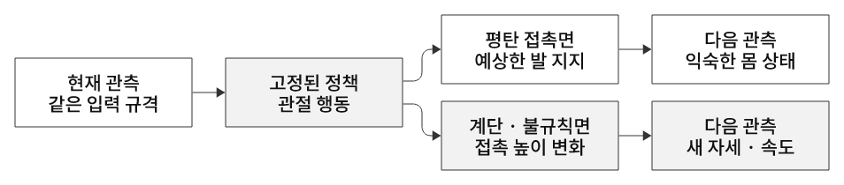

# Domain Shift와 강화학습의 일반화

## 1. 익숙한 상황에서 잘하던 정책이 왜 실패할까

**Domain Shift는 학습 때 경험한 조건과 실제 실행·평가 조건의 분포가 달라지는 현상이다.**
평평한 바닥에서 잘 걷던 로봇이 계단에서 발을 걸리는 상황이 한 예다. 같은 로봇과 같은 신경망이어도 접촉 높이·경사·마찰·센서가 달라지면 이전 경험으로 익힌 행동이 충분하지 않을 수 있다.

`Domain`은 단순히 ‘다른 프로그램’이나 ‘실제 세계’를 뜻하지 않는다. 같은 Isaac Sim 안에서도 평지→계단, 기본 질량→추가 적재, 일정 마찰→미끄러운 바닥처럼 조건이 달라지면 생길 수 있다.
Sim-to-real은 그중 시뮬레이션에서 현실로 옮길 때 나타나는 복합적인 차이다.

[28번 코드·실제 결과](../../28-terrain-generation/README.md) · [28번 코드 리뷰](../../28-terrain-generation/code-review.md) · [보행 개념](../legged-locomotion/README.md)

## 2. 28번에서 유지한 것과 바뀐 것

| 구분 | Flat 학습 | 혼합 지형 평가 |
|---|---|---|
| Actor 가중치 | PPO로 학습 | 로드 후 고정 |
| 입력 형식 | 몸 속도·기울기·명령·관절·지난 행동 48개 | 같은 48개 항목 |
| 출력 형식 | 관절 위치 제어를 위한 행동 12개 | 같은 12개 항목 |
| 지면 | 평면 | 평면·계단·격자·파도 |
| 발 접촉·운동 | 평탄 지면 경험 | 접촉 높이·시점·방향이 바뀜 |
| 실제 관측값 | 평지에서 주로 만난 상태 | 새 자세·속도·관절 반응이 나타날 수 있음 |
| 학습 업데이트 | 수행 | 수행하지 않음 |

**형식·차원이 같다는 것은 숫자를 입력할 수 있다는 뜻이다. 그 숫자가 나타나는 확률과 의미에 맞게 잘 행동한다는 보장은 아니다.**
28번은 지형 교체 데모이지만 시작 위치와 재질 설정도 달라져 엄격하게 지면 형상만 바꾼 대조 실험으로 단정하지 않는다.

## 3. 왜 강화학습에서는 차이가 연쇄적으로 커지나

지도학습에서는 주어진 입력을 보고 예측한다. 강화학습에서는 **내 행동이 다음에 보게 될 입력을 바꾼다.**

평지에서 익힌 발 움직임 → 계단 모서리에 발이 먼저 닿음 → 몸이 예상과 다르게 기울어짐 → 평지에서 드물던 관측이 입력됨 → 그 상태에 익숙하지 않은 행동 → 지지 실패가 더 커짐.
처음의 작은 접촉 차이가 피드백을 통해 큰 상태 차이로 이어질 수 있다.
정책이 과거에 봤던 경로를 통째로 재생하는 것이 아니라, 매 step 현재 관측에 반응한다는 점이 중요하다.

  

그림 23. 지형에 따라 상태 전이가 달라지고 다음 관측도 달라진다. 다음 step에서 같은 정책을 다시 적용한다.

현재 시뮬레이터 상태를 s, 행동을 a, 상태 전이 규칙을 P라 하면 이를 간단히 `P_train(s_next | s,a) ≠ P_test(s_next | s,a)`로 표현할 수 있다.
여기서 ‘규칙이 바뀐다’는 말은 **중력 법칙이나 PhysX 코드를 다시 작성한다는 뜻이 아니다.** 같은 물리 법칙 아래 지형·접촉 경계조건이 달라져 로봇에서 본 전이 분포가 달라진다는 의미다.
전체 상태에 지형까지 포함해 표현하면, 지형 변수·초기 상태 분포 변화로 같은 상황을 기술할 수도 있다. 상태를 어떻게 정의했는지에 따라 수학적 분류가 달라지지만 평가 환경이 달라졌다는 핵심은 같다.

정책은 전체 물리 상태 s를 직접 아는 것이 아니라 관측 obs로 행동한다. 지면의 미래 접촉 높이가 obs에 없으면, 서로 다른 바닥 조건에서도 비슷한 관측을 받을 수 있다.
이런 **부분 관측** 때문에 어떤 경우에는 reactive MLP만으로 적절한 행동을 구분하기 어렵다. height scan·카메라·시간 이력·기억을 추가하면 도움이 될 수 있지만 지연·노이즈·입력 호환성도 고려해야 한다.

## 4. obs·action·rew·종료와의 연결

| 요소 | 환경 변화의 영향 | 해석 |
|---|---|---|
| `obs` | 자세·속도·관절·센서 값이 달라짐 | 입력 크기는 유지돼도 관측 분포는 이동 가능 |
| `action` | 같은 행동이 다른 접촉·운동으로 이어짐 | 28번은 같은 관절 목표 변환 사용 |
| `rew` | 추적 오차·기울기·접촉·토크가 바뀌어 값이 달라짐 | 보상 **함수**가 같아도 보상 **값**은 달라짐 |
| `terminated` | 몸통 접촉 등 실패 종료 증가 가능 | 어떤 실패 조건인지 확인 |
| `truncated` | 시간 상한까지 버틴 표본의 비율 변화 | 보통 시간 제한, 작업 성공과 구분 |
| reset | 실패 환경이 초기화되어 새 episode 진행 | 빠른 실패가 반복되면 완료 표본 구성이 바뀔 수 있음 |

평가 중 rew를 계산해도 가중치가 저절로 바뀌지 않는다. 보상은 환경의 출력이고, 신경망 학습에는 rollout 저장·advantage 계산·loss·optimizer 실행이 별도로 필요하다.
Critic도 평가 때 실패를 즉시 고쳐주는 제어기가 아니다. 학습 때 return을 예측하고 Actor 업데이트를 돕는 역할이다.

## 5. 26번 PPO 학습 반복과 연결하기

26번의 한 iteration은 `2048환경 × 24 step = 49,152개 전이 수집 → 4미니배치 × 5 epoch = 20회 optimizer 업데이트`다.
이를 300 iteration 반복해도 **전부 평지에서 모은 경험이면 거친 지형 경험을 직접 배운 것은 아니다.**
같은 평지를 더 오래 학습하는 것만으로 계단 적응이 자동 보장되지 않는다. 병렬 환경 수를 늘리는 것도 샘플 수를 늘리는 선택이며, 지형·물리·관측 조건을 바꾸지 않으면 경험의 다양성이 같은 만큼 늘어나는 것은 아니다.

28번에서는 수집한 obs→action→step 피드백을 **평가에만** 사용한다. 정책을 고정했으므로 넘어져도 다음 episode에서 그 실패를 학습해 개선하지 않는다.
거친 지형에서 추가 학습하려면 그 환경에서 새 rollout을 모아 return·GAE를 계산하고 PPO로 가중치를 다시 업데이트해야 한다.
PPO의 clip·KL 제어는 같은 rollout로 정책을 너무 크게 바꾸지 않게 돕는 장치다. 새로운 지형에 대한 강건성을 자동 보장하는 기능은 아니다.

[rollout·epoch·iteration 상세](../reinforcement-learning/README.md#ppo-training-cycle) · [step 피드백](../reinforcement-learning/README.md#step-feedback)

## 6. Domain Shift의 여러 종류

| 변화 | 로봇 예시 | 연결되는 문제 |
|---|---|---|
| 지형·접촉 동역학 | 계단·경사·미끄러운 바닥·적재 질량 | 같은 명령의 운동 결과 변화 |
| 관측·센서 | 카메라 조명·노이즈·가림·좌표 변환 오류 | 같은 물리 상태가 다르게 보임 |
| 초기 상태·명령 | 새 자세·더 빠른 속도·새 목표 | 훈련 때 드물던 상태 방문 |
| actuator·제어 주기 | 토크 한계·모터 지연·마찰·주기 차이 | 행동이 실제 힘으로 바뀌는 과정 변화 |
| 목표·보상 | 평지 속도 추종에서 계단 완주로 목표 변경 | 단순 환경 이동과 구분할 task 변경 |

여러 변화가 동시에 나타날 수 있다. OOD(out-of-distribution)는 학습 분포에서 충분히 경험하지 못한 입력·상황을 가리킨다.
모든 Domain Shift가 완전히 분포 밖인 것은 아니며, 분포가 달라도 이미 학습한 강건성으로 잘 버틸 수 있다.
‘학습 분포와의 거리’ 하나만으로 성능 저하 정도를 계산할 수 있다는 뜻도 아니다. 어떤 변수의 변화인지, 해당 태스크에 얼마나 중요한지에 달려 있다.

## 7. 어떻게 대응하나

| 접근 | 하는 일 | 주의할 점 |
|---|---|---|
| 다양한 지형 학습 | 처음부터 평지·계단·경사 등에서 경험 수집 | 훈련에 넣은 범위 밖까지 자동 보장하지 않음 |
| 난이도 커리큘럼 | 성공·진행에 맞춰 쉬운→어려운 조건 조절 | 지형 생성 옵션과 환경 승급 로직은 별개 |
| 도메인 랜덤화 | 질량·마찰·외란·지연·센서 등을 학습 중 변화 | 현실적 범위와 검증 필요 · 무조건 넓히면 학습이 어려울 수 있음 |
| fine-tuning | 기존 가중치에서 목표 환경 데이터로 추가 학습 | 평지 성능 저하·과적합도 평가 |
| 관측 보강 | height scan·영상·이력 등으로 필요한 정보 제공 | Actor 입력 크기·학습·배포 센서 조건 변경 |
| 환경·하드웨어 정합 | 실제 질량·모터·지연·마찰을 측정하고 모델 보정 | 랜덤화와 함께 사용 가능 |

**재학습은 가능한 대응 중 하나다.** 먼저 현재 정책이 요구 성능을 만족하는지 평가하고, 실패 원인이 경험 부족인지·센서 정보 부족인지·물리 모델 불일치인지 구분한다.
단순히 반복 횟수나 hidden 뉴런 수를 키우는 것으로 모든 원인을 해결하지는 못한다.

Rough 기본 task에는 height scan이 추가된다. Flat 48입력 네트워크를 그대로 로드할 수 있다고 가정하면 안 된다.
관측을 유지한 terrain-only 환경에서 fine-tuning하거나, 새 입력층을 설계하고 기존 가중치 일부를 이식하는 등의 선택을 해야 한다. 어느 경우도 28번 평가 파일 자체가 수행하지 않는다.

Domain randomization은 **학습할 경험을 다양화하는 기법**, Domain Shift는 **평가 조건이 달라지는 현상**이다.
Domain adaptation은 목표 domain에 맞추는 접근의 범주이며, 일반화 평가는 학습에 쓰지 않은 조건에서도 버티는지 확인하는 것이다. 이름이 비슷해도 같은 개념은 아니다.

## 8. 무엇을 기록해야 공정한 평가인가

1. 같은 모델 파일·해시와 관측·행동 계약을 고정한다. 이름이 ‘최종 모델’이라는 것만으로 동일성을 보장하지 않는다.
2. 지형 종류·난이도마다 정해진 수의 episode를 평가하고 여러 seed로 반복한다. 지형 seed·환경 seed·명령 조건을 기록한다.
3. 실패 없는 timeout, 고정 시간 유지율, 명령 속도 오차, 접촉·자세·넘어진 원인, 작업 성공을 구분한다.
4. 평균과 변동성·실제 표본 수를 기록한다. 전체 평균과 지형별 결과를 함께 보고 평탄 타일이 어려운 지형의 실패를 가리지 않게 한다.
5. 학습에 쓰지 않은 지형·seed를 평가용으로 보관한다. 시험 결과를 보고 계속 튜닝했다면 별도의 최종 test가 필요하다.

**먼저 끝난 N개만 모으면 짧은 실패가 과대표집될 수 있다.** 예를 들어 금방 넘어지는 환경은 여러 실패를 내는 동안, 잘 걷는 환경의 첫 episode는 아직 진행 중일 수 있다.
환경별·지형별 완료 할당량을 정하고 전부 기다리는 평가가 이런 혼동을 줄인다.

28번 영상은 혼합 지형에서 완료된 200회 기준 평균 보상 2.12, 평균 길이 392.8, timeout 10.5%였다.
실패 증가를 관찰한 자료지만 지형별 통계나 원시 episode 로그는 없고, 먼저 완료한 표본의 편향도 있다. 27번의 별도 평지 영상과 엄격한 대조 실험을 수행한 것으로 해석하지 않는다.
실제 추가 실험에는 **평지 정책/다양 지형 정책 × 익숙한 지형/새로운 지형** 조합을 같은 조건으로 비교하면 일반화 개선을 더 분명히 볼 수 있다.

## 근거와 함께 읽을 자료

- [28번 코드 리뷰·강의 표현 보완](../../28-terrain-generation/code-review.md)
- [Isaac Lab v2.3.2 지형 생성 구현](https://github.com/isaac-sim/IsaacLab/blob/v2.3.2/source/isaaclab/isaaclab/terrains/terrain_generator.py)
- [Isaac Lab 보행 환경 구성](https://github.com/isaac-sim/IsaacLab/blob/v2.3.2/source/isaaclab_tasks/isaaclab_tasks/manager_based/locomotion/velocity/velocity_env_cfg.py)
- [Rudin et al., Learning to Walk in Minutes Using Massively Parallel Deep Reinforcement Learning](https://arxiv.org/abs/2109.11978): 병렬 보행 학습·지형 커리큘럼.
- [Tobin et al., Domain Randomization for Transferring Deep Neural Networks from Simulation to the Real World](https://arxiv.org/abs/1703.06907): 시각 domain randomization의 대표 연구. 보행 물리 랜덤화와 적용 대상은 구분한다.
- [Peng et al., Sim-to-Real Transfer of Robotic Control with Dynamics Randomization](https://arxiv.org/abs/1710.06537): 동역학 랜덤화와 제어 전이.
