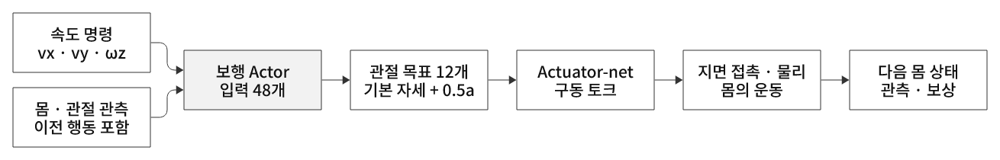

# 다족 보행 — 지면 접촉으로 몸의 이동과 균형을 만들기

## 보행의 목표는 다리를 움직이는 것보다 넓다

속도 추적 보행은 원하는 전후·좌우 이동과 방향 전환을 수행하면서 몸을 유지하는 문제다. 다리를 많이 움직여도 목표 속도와 다르거나 넘어지면 좋은 보행이 아니다.
몸통은 바닥에 고정되지 않은 floating base다. 관절 구동과 발 접촉으로 생기는 지면 반력·마찰이 몸을 지탱하고 이동시킨다.

**지지기(stance)**에는 발이 지면에 닿아 하중을 지탱하고 추진·자세 조절에 기여한다. **유각기(swing)**에는 발이 떨어져 다음 착지 위치로 이동한다.
정지 시 무게중심 투영과 지지 영역은 유용한 기준이지만, 빠른 보행에서는 운동량과 접촉 변화도 고려해야 한다. 정적 지지 다각형 조건만으로 모든 동적 보행을 판정하지 않는다.

## 명령·정책·하위 구동기를 나눠 보기

  

그림 20. 속도 명령·몸 관측·위치 행동·구동·접촉의 연결

| 계층 | 26번 ANYmal-B 예 |
|---|---|
| 목표 | 기체 기준 `vx, vy, ωz` 속도 명령 |
| 정책 입력 | 몸 속도·중력 투영·명령·관절 상태·직전 행동 48개 |
| 정책 출력 | 12개 관절 위치 목표를 만드는 행동 |
| 하위 구동 | 기본 자세 + 0.5×행동을 actuator-net에 전달 |
| 물리 | 토크·지면 반력·마찰·중력으로 몸과 관절 상태 변화 |

이 예제는 사전 학습된 LSTM actuator-net으로 ANYdrive의 구동 반응을 모사한다. 이번 PPO가 학습하는 보행 Actor·Critic은 별도의 MLP다.
사전 등록된 환경과 구동 모델을 사용하더라도 보행 정책이 이미 학습돼 있다는 뜻은 아니다.

## 무엇을 보고 균형을 잡나

기체 선속도·각속도는 현재 운동을, 중력 투영은 몸의 기울기를, 관절 위치·속도는 네 다리 상태를 알려준다. 중력 방향만으로 yaw는 알 수 없다.
목표 속도가 관측에 있어 같은 몸 상태에서도 명령에 따라 다른 행동을 고를 수 있다. 직전 행동은 이전 구동 입력 정보이며, 행동 변화 벌점과 함께 연속적인 제어를 유도한다.
Flat의 Actor 입력에는 별도의 발 접촉 힘이나 보행 위상이 직접 포함되지 않는다. 접촉 센서는 환경 보상·실패 판정에 쓰인다.
시뮬레이션 상태값을 실제 로봇에 옮길 때는 센서와 상태 추정이 같은 의미의 값을 제공해야 한다.

## 발 타이밍은 보상과 물리 속에서 형성된다

네 발의 조합을 맞춰야 하므로 12개 관절을 서로 독립적인 단일 모터 문제로 볼 수 없다. 한 발을 들 때 몸의 운동과 다른 발의 지지가 함께 달라진다.
대각선 두 다리를 짝지어 움직이는 trot 등은 보행 패턴의 예지만, 26번은 특정 패턴·주기를 미리 강제하지 않는다.
발 공중 시간 보상은 첫 착지 때 기준 시간과의 차이를 평가하며, 무조건 더 오래 떠 있으면 좋은 것도 아니다.

속도 추적 보상만 강조하면 급격한 구동·흔들림이 유리해질 수 있어 토크·가속도·행동 변화·기울기·비정상 접촉 목적을 함께 둔다.
토크 제곱이나 행동 변화 벌점은 대리 지표이며 실제 전기 에너지 측정과 같지 않다.

## 잘 걷는지 무엇으로 판단하나

오래 버티는 것 외에 명령 속도 오차, 정지·회전·횡이동 수행, 몸의 기울기, 발 미끄러짐·원치 않는 접촉, 구동 부담을 함께 확인한다.
학습 중 timeout 집계는 독립 평가 성공률이 아니다. 고정 모델을 여러 초기 상태·명령·외란에서 평가해야 한다.
Flat의 추적 결과만으로 계단·거친 지형 성능을 보장하지 않는다. 26번 Flat에는 지형 커리큘럼·height scan이 없으며, Rough 전환 시 관측과 학습 조건도 달라진다.

26번의 실제 곡선에서는 초반에 유지 길이가 먼저 늘어도 총 보상이 낮아지는 구간이 있었다. 이후 속도 추적 보상이 오르고 누적 오차와 일부 구동·자세 비용이 완화된다.
이처럼 생존·명령 추적·동작 비용을 함께 읽어야 하며, 순간 값·episode 누적·시간 정규화 로그를 구분한다.
[26번 전체 학습 곡선과 해석](../../26-train-locomotion/README.md#training-curves)

[26번 결과·실행](../../26-train-locomotion/README.md) · [등록 환경 코드 리뷰](../../26-train-locomotion/code-review.md) · [PPO 공용 개념](../reinforcement-learning/README.md)
