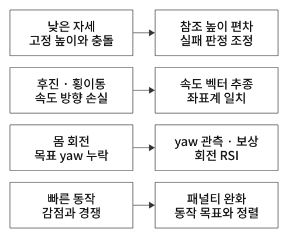

# 레퍼런스 모션으로 배우는 휴머노이드 강화학습

## 1. 모션을 재생하는 것과 따라 하는 것은 다르다

**재생은 기록된 자세를 보여주는 것이고, 모션 모방 강화학습은 물리 안에서 그 자세를 만들 행동을 배우는 것이다.**
36번은 사람 모션을 G1 관절로 리타게팅한 레퍼런스를 사용한다. 목표 각도를 줘도 중력·마찰·접촉·구동 한계 때문에 그대로 움직이지 않을 수 있다. 현재 몸 상태를 보고 계속 보정하는 정책이 필요하다.

[36번 실습·실제 결과](../../36-g1-motion-imitation/README.md) · [기준 코드 리뷰](../../36-g1-motion-imitation/code-review.md)

## 2. Behavior Cloning과 무엇이 다른가

Behavior Cloning은 보통 전문가의 관측→행동 쌍을 학습해 행동을 맞추는 지도학습이다.
이번 36번은 전문가의 action을 정답으로 회귀하지 않는다. 레퍼런스 자세·속도·높이를 따르면 보상을 주고, PPO가 물리 경험으로 정책을 업데이트한다.
‘모방학습’이라는 큰 범주 안에서도 데이터의 역할과 학습 알고리즘을 구분해야 한다. 이번 예제는 ACT나 GR00T 모델을 사용하는 예제가 아니다.

## 3. 레퍼런스는 세 곳에 들어간다

| 사용처 | 역할 |
|---|---|
| 관측 | 지금 어떤 자세를 따라갈지, 어느 위상인지 알려줌 |
| 보상 | 현재 자세·속도·높이가 목표에 얼마나 가까운지 점수화 |
| RSI reset | 모션 중간의 자세·속도에서 시작하게 함 |

관절 순서·좌표계·단위·쿼터니언 순서·fps를 맞춰야 한다. 리타게팅한 동작이 비슷하게 보이더라도 물리적으로 가능한지는 별도로 확인한다. 로봇과 사람의 관절 구조 차이와 변환의 근사도 남을 수 있다.

## 4. RSI — 처음부터 끝까지 배우기 위한 초기화

항상 프레임 0에서 시작해 초반에 넘어지면 뒤쪽 동작을 경험하기 어렵다. RSI는 임의 프레임을 골라 그 자세·속도·위상으로 시작시켜 모션 전체를 경험하게 한다.
그 상태에서 시작해 버티는 것과 실제로 그 상태까지 스스로 이동하는 것은 다른 능력이다. 모션 중간 유지와 정지 상태에서의 동작 시작을 구분해 평가한다.
낮은 자세를 실패로 정한 환경에서 낮은 프레임을 뽑으면 초기화 직후 실패할 수 있다. RSI·보상·종료 규칙은 같은 태스크 가정을 공유해야 한다.

36번 기본판은 관절 위치·속도, root 높이·전진 속도를 맞추지만 원래 root 회전은 복원하지 않는다. 쿵푸 전용판은 회전·월드 속도·yaw 각속도까지 확장한다.

## 5. 위상과 제어 주기

이 예제의 모션은 30fps, 정책은 50Hz, 물리는 200Hz다. 이 세 시간축은 서로 다르다.
기본 정책의 참조 프레임은 `(시작 프레임 + floor(episode 시간 × fps)) % T`다. 위상을 sin/cos로 표현하면 주기 끝과 시작의 숫자가 매끄럽게 연결된다.
원본 자세·속도까지 실제로 연결되는지는 별도 문제다. 비순환 클립을 무조건 반복하면 끝→처음에서 갑자기 다른 목표가 될 수 있다.

`init_at_random_ep_len=True`로 episode 카운터만 바꾸면 RSI가 맞춘 자세와 목표 위상이 어긋날 수 있어 36번은 False를 쓴다. 35번 서기에서 사용한 옵션을 태스크별 검토 없이 복사하면 안 되는 이유다.

## 6. 데이터가 있어도 PPO가 필요한 이유

레퍼런스는 ‘어떤 동작이 좋은지’를 제공하고, PPO는 그 동작을 현재 물성·접촉에서 만드는 상태 의존 행동을 학습한다.
2048환경×24step으로 49,152개 전이를 모아 4미니배치×5epoch 업데이트를 하고, 다시 새 정책으로 수집한다. 모션 프레임 330개와 학습 전이 49,152개는 다른 데이터다.
여러 프레임에서 동일한 레퍼런스를 따라도 로봇 상태·행동·접촉 결과가 달라 각기 다른 경험이 생긴다. 데이터 파일의 재생 횟수를 학습 iteration과 혼동하지 않는다.

## 7. 쿵푸로 바꿨을 때 생기는 두 종류의 실패

첫째는 **보행 정책에 새 레퍼런스를 입력하는 경우**다. 입력 차원 103이 맞아도 학습한 목표 분포와 다르므로 새 동작을 자동 수행하지 못할 수 있다. Domain Shift 또는 분포 밖 목표의 문제다.

둘째는 **그 모션으로 다시 학습해도 환경 규칙이 동작과 충돌하는 경우**다. 낮은 자세에서 실패, 후진인데 양수 전진 보상, 회전 목표 누락, 필요한 빠른 동작 감점이라면 학습 목표 자체를 고쳐야 한다.

평가 모션·모델 불일치, 리타게팅 오차, 접촉·토크 한계, 주기 연결 문제도 가능하다. 영상의 넘어짐 하나만으로 원인을 하나로 확정하지 않는다.
이번 마지막 영상은 평가 참조 속도 1.07로 표시되어 모델·모션 일치부터 확인할 필요가 있다. 학습 명령에서 모션을 지정했다고 평가 명령에도 자동 전달되는 것은 아니다.

## 8. 모방 목표와 환경 규칙을 정렬한다

  

그림 29. 태스크에 맞는 목표와 규칙이 필요하다. 학습 횟수만 늘리는 것과 다르다.

| 충돌 | 수정의 직관 |
|---|---|
| 낮은 참조 자세 vs 고정 높이 실패 | 참조 높이에서 얼마나 벗어났는지 판정 |
| 후진·횡이동 vs 양수 속도 크기 | 같은 좌표계의 속도 벡터 비교 |
| 회전 목표 vs root 회전 누락 | yaw 오차 관측·보상·회전을 포함한 초기화 |
| 빠른 동작 vs 큰 움직임 패널티 | 필요한 움직임을 허용하는 범위로 비용 조절 |

양수 노름 속도는 방향을 잃는다. 레퍼런스가 뒤로 -0.5m/s인데 목표를 크기 +0.5로만 만들면, 잘 따라가는 행동을 벌주게 된다.
관절의 상대 각도와 떠 있는 몸 전체의 yaw도 구분해야 한다. 관절을 맞춰도 세계에서 어느 방향을 향하는지 자동으로 맞는 것은 아니다.
상충 항을 완화한다고 물리적 실패를 모두 허용하지는 않는다. 실제로 넘어진 상태·구동 한계·접촉 조건은 여전히 검증해야 한다.

## 9. 바뀐 관측은 새 모델 계약이다

쿵푸 전용판은 yaw 오차 sin/cos 2개와 목표 속도 2개를 추가해 103→107입력이다. hidden층·PPO가 같아도 입력층이 달라 보행 가중치를 그대로 load할 수 없다.
36_4는 새 학습을 수행하고 실험 폴더도 분리한다. 기존 가중치 일부를 이식하는 fine-tuning을 자동 수행하는 코드는 아니다.
보행 환경에서 `--motion_pkl`만 바꾸는 실험과 107입력 전용 환경 학습을 구분한다. 강의는 후자의 성공 예시를 제시하지만, 이번 첨부 영상에서 그 성공 평가를 확인한 것은 아니다.

## 10. 무엇을 평가해야 하나

생존 시간·timeout과 함께 관절 RMS·몸 회전 오차·속도 벡터·접촉·미끄러짐·토크·전체 클립 완료를 본다. 오래 버티면서 동작을 대충 따르는 정책을 성공으로 보지 않도록 기준을 정한다.
RMS가 작으면 관절 오차가 작다는 뜻이지만 접촉 안정성·물리 실현 가능성·동작 전체 품질을 혼자 보장하지는 않는다. 추종 보상 4.4/5도 ‘정확도 88%’가 아니다.
RSI의 임의 위상과 seed별로 같은 평가 조건을 사용한다. 먼저 끝난 N회 집계 편향, 종료 후 reset 표본 오염, 95% 길이 기준과 full timeout의 차이도 구분한다.
모델 파일·모션 파일·관측 정의·환경 규칙을 함께 기록한다. 같은 103입력이라는 이유만으로 올바른 조합이 보장되지는 않는다.

[36번 실습](../../36-g1-motion-imitation/README.md) · [Domain Shift](../domain-shift/README.md) · [PPO 학습 단위](../reinforcement-learning/README.md#ppo-training-cycle)
