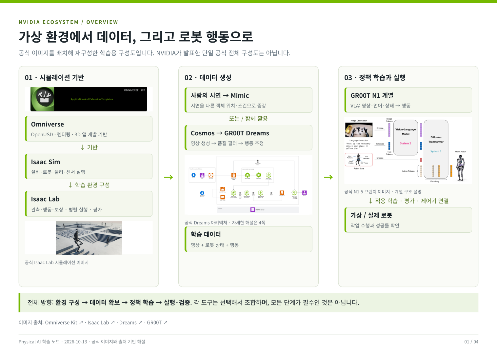
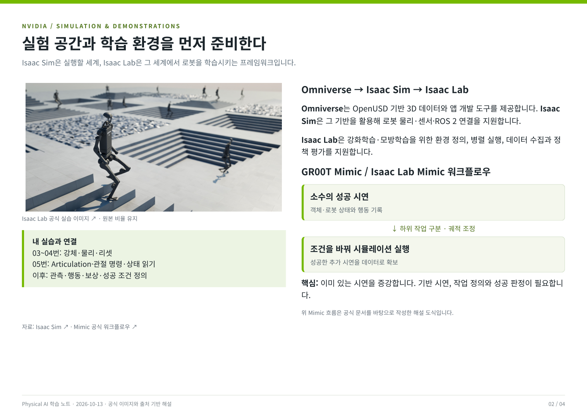
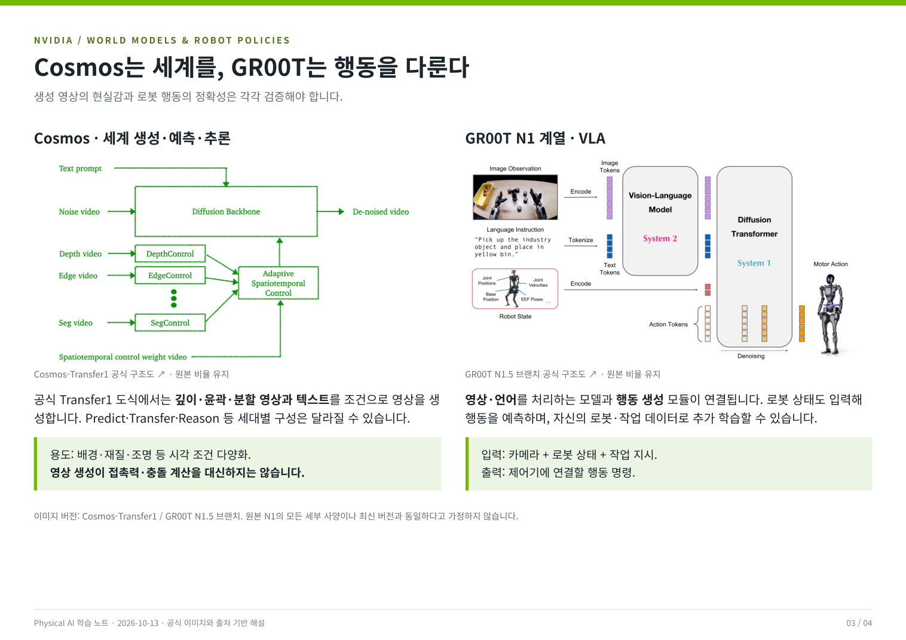
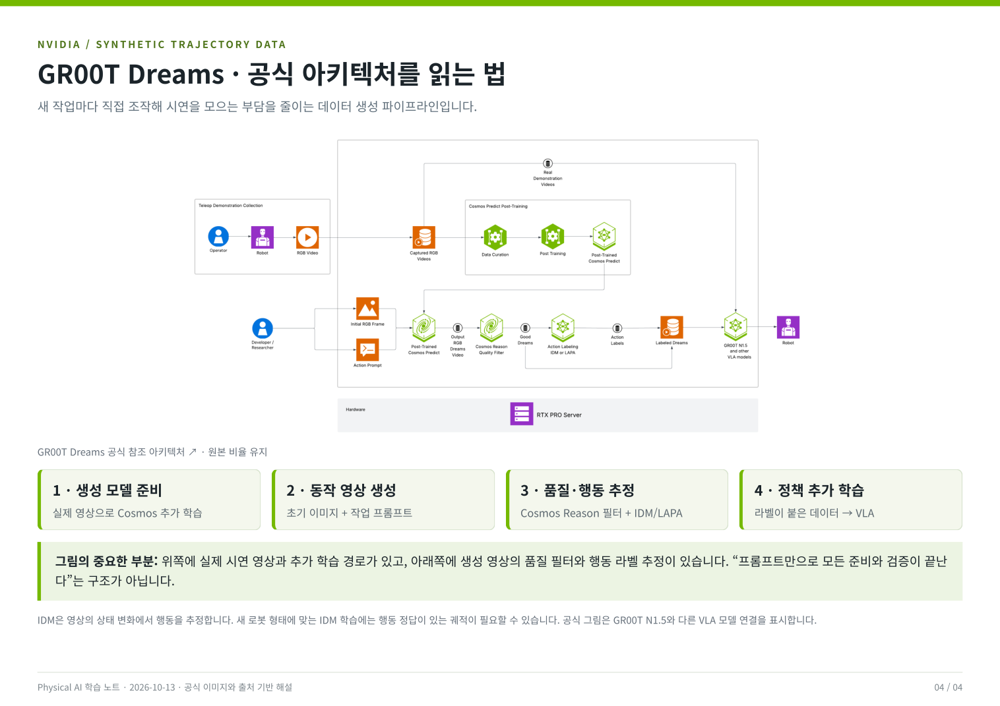

# 공식 이미지로 보는 NVIDIA 생태계

학습일: 2026-10-13

NVIDIA 공식 이미지와 기술 설명을 활용한 4쪽 학습 자료입니다.
**PDF를 다운로드하지 않아도 아래에서 전체 내용을 이미지로 바로 볼 수 있습니다.** 이미지를 클릭하면 크게 볼 수 있습니다.
전체 구성도와 한국어 해설은 학습용으로 재구성했고, 공식 이미지의 출처와 버전을 표시했습니다.

- [PDF 보기 / 다운로드](physical-ai-ecosystem.pdf)
- [공식 이미지 출처 목록](sources.json)

## 1. NVIDIA 생태계 전체 구성도

**Omniverse → Isaac Sim → Isaac Lab**은 시뮬레이션 기반과 학습 환경의 관계입니다.
**Mimic·Cosmos·Dreams**는 학습 데이터 확보에 활용하고, **GR00T N1 계열**은 로봇 행동 정책을 제공합니다.
각 도구를 목적에 맞게 선택해서 조합합니다.

## 2. 시뮬레이션 기반과 Mimic

Isaac Sim은 로봇·설비·물리·센서를 실행하는 환경이고,
Isaac Lab은 학습 환경·병렬 실행·데이터 수집·평가를 구성하는 프레임워크입니다.
Mimic은 소수의 성공 시연을 다른 객체 위치나 조건에 맞게 증강합니다.

## 3. Cosmos와 GR00T

Cosmos는 세계의 영상을 생성·예측·변환·추론하고,
GR00T는 영상·언어·로봇 상태로부터 행동을 예측합니다.
생성 영상의 현실감과 물리 계산의 정확성은 각각 검증해야 합니다.
인용한 구조도는 Cosmos-Transfer1 및 GR00T N1.5 브랜치의 이미지입니다.

## 4. GR00T Dreams

공식 참조 아키텍처에는 실제 영상으로 Cosmos를 추가 학습하는 경로와,
생성 영상의 품질 필터·행동 추정·VLA 추가 학습 경로가 함께 표시되어 있습니다.
특정 새 작업의 직접 시연 부담을 줄일 수 있지만, 로봇에 맞춘 모델 준비와 평가가 필요합니다.

## 주요 출처

- [Omniverse Kit App Template](https://github.com/NVIDIA-Omniverse/kit-app-template)
- [Isaac Sim](https://github.com/isaac-sim/IsaacSim)
- [Isaac Lab](https://github.com/isaac-sim/IsaacLab)
- [Isaac Lab Mimic 공식 워크플로우](https://github.com/isaac-sim/IsaacLab/blob/main/docs/source/overview/imitation-learning/teleop_imitation.rst)
- [Cosmos-Transfer1](https://github.com/nvidia-cosmos/cosmos-transfer1)
- [GR00T N1.5 브랜치](https://github.com/NVIDIA/Isaac-GR00T/tree/n1d5)
- [GR00T Dreams 공식 참조 아키텍처](https://github.com/NVIDIA/GR00T-Dreams/blob/main/reference_architecture/reference_architecture.md)
