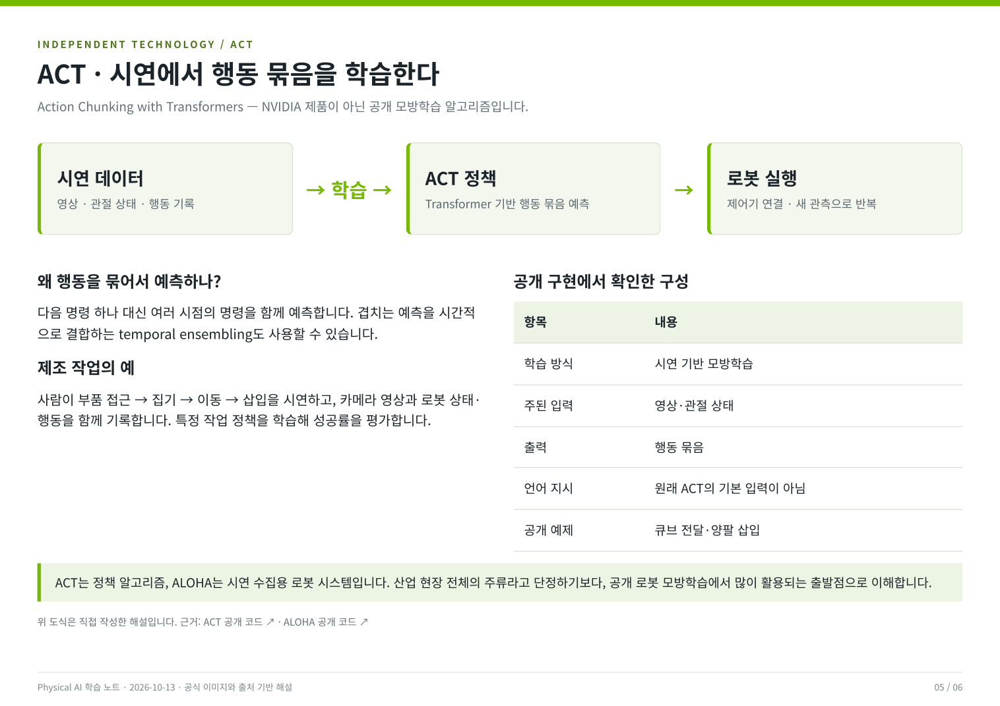
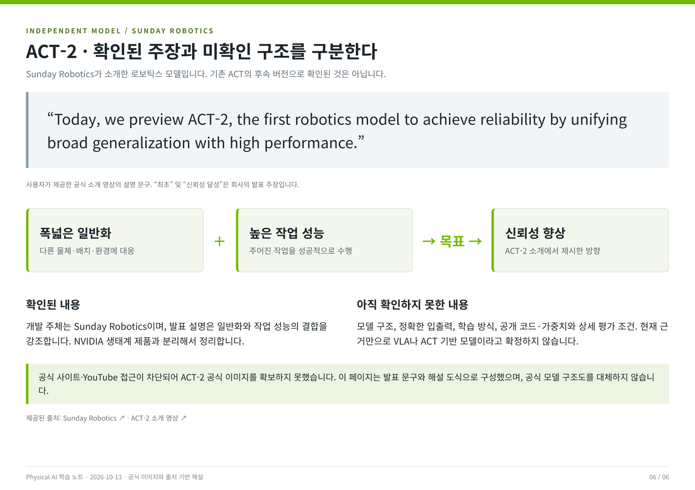

# 공식 이미지로 보는 NVIDIA 생태계 · ACT · ACT-2

학습일: 2026-10-13

NVIDIA 공식 저장소의 이미지와 기술 설명을 활용해 만든 6쪽 학습 자료입니다.
아래 이미지는 GitHub에서 바로 볼 수 있습니다. 클릭하면 크게 볼 수 있습니다.
전체 구성도와 한국어 설명은 학습용으로 재구성했고, 인용한 공식 이미지의 출처와 버전을 각 페이지에 표시했습니다.

## 파일

- [PDF 보기 / 다운로드](physical-ai-ecosystem.pdf)
- [HTML 다운로드](physical-ai-ecosystem.html): GitHub 파일 화면에서는 HTML이 실행되지 않습니다. 파일을 다운로드해 브라우저로 열면 페이지 이동과 원본 자료 링크를 사용할 수 있습니다.
- [공식 이미지 출처 목록](sources.json)

HTML에는 이미지가 포함되어 있어 별도 이미지 폴더 없이도 볼 수 있습니다.
공식 자료 링크로 이동할 때는 인터넷 연결이 필요합니다.

## 1. NVIDIA 전체 구성도

**Omniverse → Isaac Sim → Isaac Lab**은 시뮬레이션과 학습 환경의 기반 관계입니다.
**Mimic·Cosmos·Dreams**는 학습 데이터 확보에 활용하고, **GR00T N1 계열**은 로봇 행동 정책을 제공합니다.
각 도구를 목적에 맞게 조합하며, 모든 단계를 반드시 거쳐야 하는 것은 아닙니다.

## 2. 시뮬레이션 기반과 Mimic

Isaac Sim은 로봇·설비·물리·센서를 실행하는 환경이고, Isaac Lab은 학습 환경·병렬 실행·데이터 수집·평가를 구성하는 프레임워크입니다.
Mimic은 소수의 성공 시연을 다른 객체 위치나 조건으로 증강합니다.

## 3. Cosmos와 GR00T

Cosmos는 세계의 영상을 생성·예측·변환·추론하고, GR00T는 영상·언어·로봇 상태로부터 행동을 예측합니다.
현실적으로 보이는 생성 영상과 정확한 물리 계산은 별도로 검증해야 합니다.
사용한 구조도는 Cosmos-Transfer1 및 GR00T N1.5 브랜치의 이미지입니다.

## 4. GR00T Dreams

공식 참조 아키텍처에는 실제 영상으로 Cosmos를 추가 학습하는 경로와,
생성 영상의 품질 필터·행동 추정·VLA 추가 학습 경로가 함께 표시되어 있습니다.
특정 새 작업의 직접 시연 부담을 줄일 수 있지만, 로봇에 맞춘 모델 준비와 평가가 필요합니다.

## 5. ACT — 독립 기술

ACT는 Action Chunking with Transformers입니다. NVIDIA 제품이 아닌 공개 모방학습 알고리즘으로,
영상·관절 상태를 바탕으로 앞으로 수행할 행동 묶음을 예측합니다.
이 페이지의 흐름도는 공개 코드를 근거로 직접 작성한 해설 도식입니다.

## 6. ACT-2 — Sunday Robotics

ACT-2는 Sunday Robotics가 소개한 로보틱스 모델입니다.
일반화와 작업 수행 성능을 결합해 신뢰성을 높인다는 발표 문구를 기준으로 정리했습니다.
기존 ACT와의 관계, 상세 모델 구조와 학습 방식은 아직 확인하지 못했습니다.
공식 사이트·영상 접근이 제한되어 공식 이미지를 확보하지 못했으며, 제공된 발표 문구와 해설 도식을 사용했습니다.

## 주요 출처

- [NVIDIA Omniverse Kit App Template](https://github.com/NVIDIA-Omniverse/kit-app-template)
- [Isaac Sim](https://github.com/isaac-sim/IsaacSim)
- [Isaac Lab](https://github.com/isaac-sim/IsaacLab)
- [Isaac Lab Mimic 공식 워크플로우](https://github.com/isaac-sim/IsaacLab/blob/main/docs/source/overview/imitation-learning/teleop_imitation.rst)
- [Cosmos-Transfer1](https://github.com/nvidia-cosmos/cosmos-transfer1)
- [GR00T N1.5 브랜치](https://github.com/NVIDIA/Isaac-GR00T/tree/n1d5)
- [GR00T Dreams 공식 참조 아키텍처](https://github.com/NVIDIA/GR00T-Dreams/blob/main/reference_architecture/reference_architecture.md)
- [ACT 공개 구현](https://github.com/tonyzhaozh/act)
- [Sunday Robotics](https://www.sunday.ai/)
- [제공된 ACT-2 소개 영상](https://www.youtube.com/watch?v=d7I1wj0Gkik)
