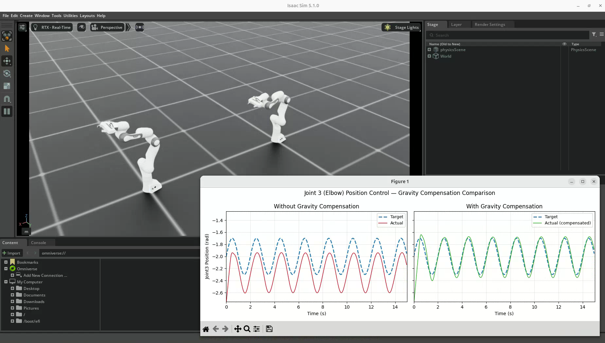

# PD·PID 제어와 중력 보상

학습일: 2026-10-13

## 핵심 요약

**목표 각도를 지정해도 중력 때문에 추종 오차가 생길 수 있다. 중력 보상은 팔의 무게를 버틸 토크를 모델로 계산해 추가하는 방법이다.**

| 항목 | 핵심 역할 |
|---|---|
| P — 비례 | 목표와 실제 각도의 차이에 비례해 토크 생성 |
| D — 미분 | 속도 오차에 반응하며 움직임을 감쇠하고 진동을 줄임 |
| I — 적분 | 지속되는 오차를 누적해 정상상태 오차를 줄임 |
| 중력 보상 | 현재 자세에서 중력을 버틸 토크를 계산해 미리 추가 |

06번 실습은 **PD 위치 제어 + 중력 보상**이다. PID 제어의 I 항을 추가한 실습은 아니다.

## 1. 목표 각도와 실제 토크의 관계

회전 관절의 목표 각도를 $q_d$, 실제 각도를 $q$라고 하면 위치 오차는 다음과 같다.

$$
e = q_d - q
$$

사용자는 목표 각도를 지정하지만, 로봇이 움직이려면 관절에 토크가 필요하다.
제어기는 위치·속도 오차를 보고 토크를 결정한다. 아래에서는 회전 관절을 기준으로 설명한다.

| 기호 | 의미 | 단위 |
|---|---|---|
| $q$, $q_d$ | 실제·목표 각도 | rad |
| $\dot q$, $\dot q_d$ | 실제·목표 각속도 | rad/s |
| $\tau$ | 관절 토크 | N·m |

## 2. P와 D — 스프링과 댐퍼처럼 생각하기

P 제어는 목표에서 멀어질수록 더 큰 토크를 만든다.

$$
\tau_P = K_P(q_d-q)
$$

목표 자세로 되돌리려는 **가상의 스프링**과 비슷하다. 이 예제의 구동기 설정에서는 `stiffness`가 P 게인에 해당한다.
P 게인을 높이면 같은 오차에서 더 큰 토크가 발생하지만, 지나치게 높이면 진동이나 토크 제한 문제가 생길 수 있다.

D 제어는 속도 오차에 반응한다.

$$
\tau_D = K_D(\dot q_d-\dot q)
$$

움직임을 안정화하는 **댐퍼**와 비슷하며, 구동기의 `damping`이 이 역할을 한다.
목표 속도가 0이면 현재 움직임에 반대되는 토크 $-K_D\dot q$를 만든다.

두 항을 합치면 PD 제어다.

$$
\tau_{PD}=K_P(q_d-q)+K_D(\dot q_d-\dot q)
$$

06번 코드는 위치 목표를 갱신하고 목표 속도를 별도로 지정하지 않는다.
일반적인 PD 식의 $\dot q_d$에 사인파 목표의 미분값을 넣는 것과는 구분한다.

## 3. PD 제어인데 왜 팔이 처지나?

로봇팔을 뻗으면 중력이 관절을 회전시키려 한다. 정지 자세를 유지하려면 이를 버틸 토크가 계속 필요하다.
그런데 P 항은 **위치 오차가 있어야** 토크를 만든다.

```text
목표 각도에 도달 → 오차가 0이면 P 토크도 0
중력을 버틸 토크가 부족 → 팔이 처짐
오차가 생겨 P 토크 증가 → 목표에서 벗어난 위치에서 균형
```

이처럼 과도 응답이 끝난 뒤에도 남는 오차를 **정상상태 오차**라고 한다.
관절이 멈추면 속도도 0이므로 D 항만으로 이 정적 오차를 제거할 수 없다.

단순한 한 관절이 정지한 경우를 생각하면:

$$
K_Pe=\tau_{\text{중력을 버티는 데 필요한 토크}}
$$

설명용으로 필요한 토크가 6 N·m이고 P 게인이 100 N·m/rad라면:

$$
e=6/100=0.06\text{ rad}\approx3.4^\circ
$$

약 3.4° 벗어나야 P 항이 필요한 토크를 만든다. 이 숫자는 실습 측정값이 아니라 단일 관절의 설명용 예시다.
실제 다관절 로봇에는 여러 링크와 관절의 영향이 함께 작용한다.

## 4. 중력 보상 — 무게를 지탱할 토크를 따로 추가

링크 질량, 무게중심, 관절 연결 구조, 현재 자세와 중력 벡터를 이용해 관절별 중력 보상 토크를 계산한다.
팔을 수직으로 세웠을 때와 수평으로 뻗었을 때 필요한 토크가 다른 이유도 힘이 작용하는 지점과 관절 사이의 관계 때문이다.

$$
\tau_{\text{명령}}=\tau_{PD}+\tau_{\text{중력 보상}}
$$

**중력을 끄는 것이 아니다.** 중력은 그대로 적용되고, 이를 버틸 입력을 추가한다.
모델로 필요한 입력을 미리 계산하므로 중력 보상은 피드포워드 역할을 한다.
토크의 부호는 각 관절의 좌표계와 API 정의에 따라 정해지며, 모든 관절에 같은 양의 값을 더하는 방식은 아니다.

<p align="center">
  
</p>
<p align="center"><sub>그림 17. PD 제어와 중력 보상의 합산 구조</sub></p>

출력 토크로 다음 관절 상태가 만들어지고, 새 상태를 입력해 같은 계산을 반복한다.

## 5. PID의 I 항과 중력 보상의 차이

PID는 P·I·D를 합친 제어다. I 항은 오차를 시간에 따라 누적한다.

$$
\tau_{PID}=K_Pe+K_I\int e\,dt+K_D\dot e
$$

팔이 계속 목표에서 벗어나 있으면 I 항이 토크를 늘려 지속되는 오차를 줄일 수 있다.

| 비교 | I 제어 | 중력 보상 |
|---|---|---|
| 필요한 정보 | 누적 오차 | 로봇 모델·현재 자세·중력 |
| 대응 방식 | 오차 발생 후 누적하며 보정 | 필요한 중력 대응 토크를 계산 |
| 질량을 직접 알아야 하나? | 직접 몰라도 작동 가능 | 질량·무게중심 등 모델 정보가 중요 |
| 주의점 | 과도한 누적, 오버슈트, 적분 와인드업 | 모델·부하가 다르면 보상 오차 발생 |

**적분 와인드업**은 구동기가 토크 한계에 도달해도 오차 누적이 계속되어, 이후 과도한 응답이 발생할 수 있는 문제다.
적분 제한이나 포화 상태를 고려하는 anti-windup 처리가 필요할 수 있다.

PID와 중력 보상은 함께 사용할 수도 있다. 다만 모든 제어기에 I 항을 추가하는 것이 정답은 아니며,
작업의 안정성·응답 속도·토크 제한 등을 고려해 설계한다.

## 6. 06번 코드와 연결

Robot A는 위치 목표를 주고, Robot B는 같은 목표에 중력 보상 effort를 추가한다.

```python
robot_b.set_joint_position_target(target_pos_b)

gravity_torques = (
    robot_b.root_physx_view.get_gravity_compensation_forces()
)
robot_b.set_joint_effort_target(gravity_torques)
robot_b.write_data_to_sim()
```

위 코드는 핵심 동작 발췌다. 전체 코드에는 API 지원 여부 확인과 다른 중력 API를 사용하는 분기도 있다.
PD 게인은 사전 정의된 로봇의 구동기 설정에 있고, 이 예제에서 사용자가 PD 토크를 매 step 직접 계산하지는 않는다.

| 실습 | 관찰 내용 |
|---|---|
| 1. 기본 위치 제어 | 베이스는 비교적 잘 추종하지만 팔꿈치에는 목표·실제값 차이가 나타남 |
| 2. 중력 보상 | 보상 적용 로봇의 팔꿈치 실제값이 목표값에 더 가까워짐 |
| 3. 손끝 마커 | 보상 적용 로봇의 손끝 위치 오차가 더 작게 나타남 |

<p align="center">
  
</p>

## 7. 보상 후에도 오차가 남는 이유

중력 보상은 가속·감속에 필요한 관성 토크 등 모든 동역학을 보상하는 것은 아니다.
구동기 게인, 관절 간 동역학적 영향, 토크 제한, 계산 시간 간격, 추종 지연과 모델 차이도 결과에 영향을 줄 수 있다.

따라서 이번 영상에서 오차가 감소한 것과 완전히 0이 된 것은 구분한다.
각 원인의 기여도는 별도 측정·실험이 필요하며, 영상만으로 확정하지 않는다.
부품을 집어 부하가 바뀌는 제조 작업에서는 모델에 반영된 질량과 실제 부하가 일치하는지도 확인해야 한다.

## 관련 실습과 코드

- [06번 세 실습의 영상·결과 정리](../../06-robot-joint-control/README.md)
- [기본 위치 제어 코드](../../06-robot-joint-control/06_robot_joint_control.py)
- [중력 보상 코드](../../06-robot-joint-control/06_1_gravity_compensation.py)
- [손끝 마커 코드](../../06-robot-joint-control/06_2_ee_marker_visualization.py)
- [참고한 원본 튜토리얼](https://github.com/PinkWink/isaacsim_tutorials/tree/14f85fc6edece7cbb1faa50aa9fe3adef205e87a/06_robot_joint_control)

강의와 대화에서 다룬 개념을 실습 코드·영상과 연결해 정리했다. 수식의 단일 관절 예시는 개념 설명을 위한 것이다.
