# D2로 보는 강화학습과 20~26장 실행 구조

20장은 환경을 테스트하며, 정책 가중치를 학습하는 코드는 아직 없다.
흰 배경·흑백 선·사각형·번호 캡션을 사용한 D2 구성도로 실제 학습 구조와 현재 실행 구조를 구분한다.
GitHub에서는 이미지를 바로 표시하고, 벡터 SVG와 편집용 D2 소스도 제공한다.

## 1. 전체 강화학습 구조

<p align="center">
  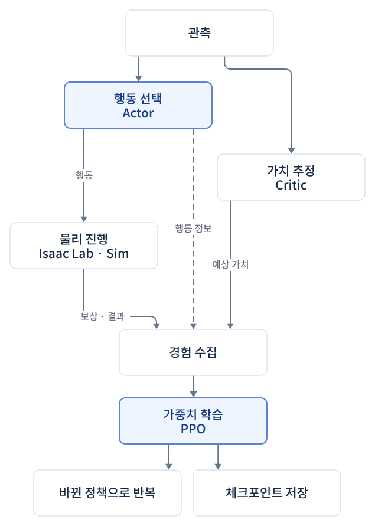
</p>
<p align="center"><sub>그림 1. 강화학습 전체 흐름</sub></p>

경험을 일정량 모은 뒤 PPO가 가중치를 업데이트하고, 바뀐 정책으로 다시 경험을 수집한다.
보상 하나를 받는 것과 모델 업데이트 한 번은 같은 단위가 아니다.

## 2. Actor·Critic 모델 구조

<p align="center">
  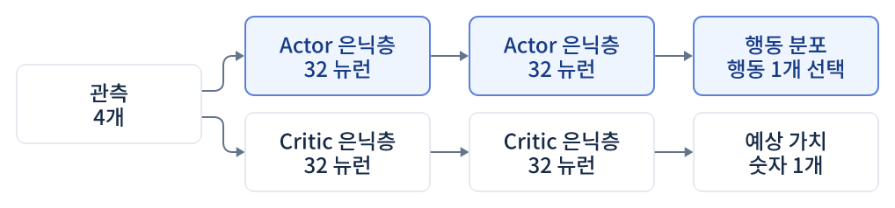
</p>
<p align="center"><sub>그림 2. Actor·Critic 모델 구조</sub></p>

24장의 실제 은닉층 설정 `[32, 32]`를 예시로 사용했다. 행동 분포에는 신경망 평균 출력과 탐색용 표준편차 등이 사용된다.
위 다이어그램은 역할을 묶어 보여주는 구성도다. Critic은 보상 함수를 대신 만들지 않으며, 학습에서는 두 모델의 관련 가중치를 갱신한다.
20~23장은 신경망 학습 없이 환경을 테스트한다. 기준 24장 코드를 확인해 모델 입력 표기를 실제 관측 7개로 수정했다.

## 3. 20번 파일 실행 구조

<p align="center">
  
</p>
<p align="center"><sub>그림 3. 20장 코드 실행 구조</sub></p>

환경이 반환한 관측을 다음 행동 생성에 사용하지 않는다. 결과는 로그로 기록하며 행동은 계속 무작위다.

## 4. 환경 step과 물리 step

<p align="center">
  
</p>
<p align="center"><sub>그림 4. 환경 step과 물리 처리 순서</sub></p>

환경 4개는 같은 환경 step 안에서 함께 진행하고, 완료한 환경만 개별 리셋한다.
완료 환경의 보상·플래그는 끝난 에피소드 결과지만 반환 관측은 새 에피소드 초기 상태일 수 있다.
다이어그램은 주 처리 순서를 나타내며 recorder 등 부가 경로는 생략했다.

| 단위 | 20장 설정 |
|---|---|
| 물리 step | 1/120초 |
| 환경 step | 물리 step 2회 · 1/60초 |
| 에피소드 상한 | 5초 · 약 300 환경 step |
| 데모 상한 | 2000 환경 step |
| 학습 iteration | 20장에는 없음 |

## 실제 학습으로 연결하려면

환경에 정책 신경망·학습 래퍼·PPO 실행기를 연결한다.
24장의 `OnPolicyRunner`와 `runner.learn()`이 경험 수집과 가중치 학습을 수행하는 연결에 해당한다.

[강화학습 개념](../README.md) · [20장 실습](../../../20-base-env/README.md) · [20장 코드 리뷰](../../../20-base-env/code-review.md)

처리 순서는 [Isaac Lab v2.3.2 환경 구현](https://github.com/isaac-sim/IsaacLab/blob/v2.3.2/source/isaaclab/isaaclab/envs/manager_based_rl_env.py)을 기준으로 정리했다.

## 5. 보상 값과 로그의 관계

<p align="center">
  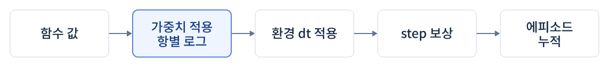
</p>
<p align="center"><sub>그림 5. 보상 처리와 누적 단위</sub></p>

## 6. 21장 코드 실행 구조

<p align="center">
  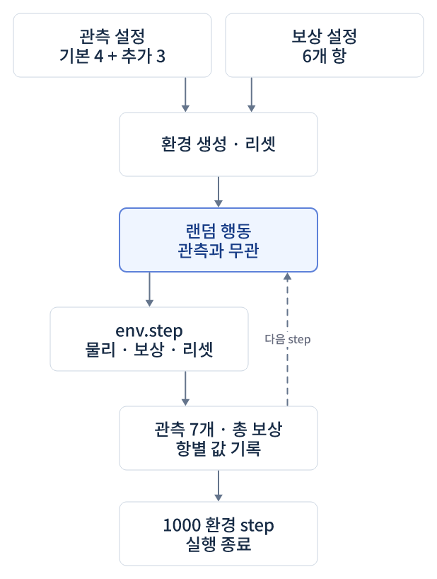
</p>
<p align="center"><sub>그림 6. 21장 환경 구성과 실행</sub></p>

## 7. 21장 관측 구성

<p align="center">
  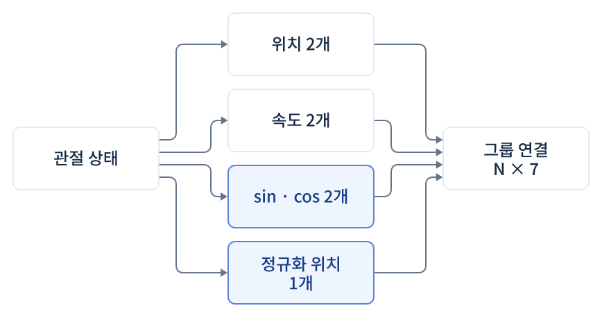
</p>
<p align="center"><sub>그림 7. 관측 항을 합쳐 7차원 입력 구성</sub></p>

## 8. 21장 보상 구성

<p align="center">
  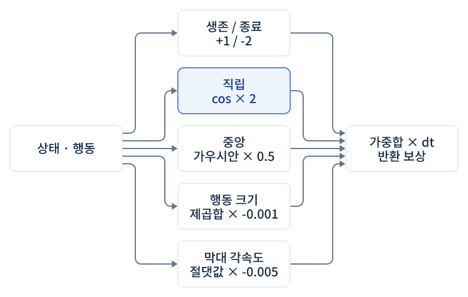
</p>
<p align="center"><sub>그림 8. 각 보상 항과 가중치 합</sub></p>

## 9. 관측 전처리 순서

<p align="center">
  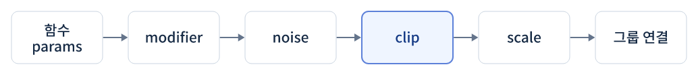
</p>
<p align="center"><sub>그림 9. 함수·modifier·noise·clip·scale·그룹 연결</sub></p>

## 10. 액션 공간과 구동 연결

<p align="center">
  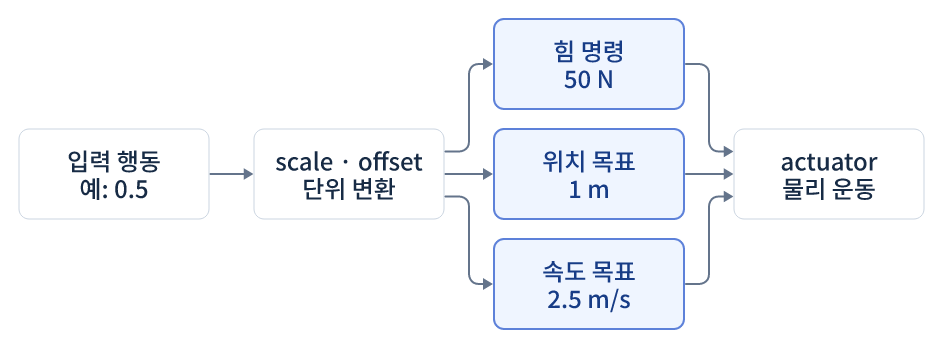
</p>
<p align="center"><sub>그림 10. 입력 행동을 힘·위치·속도 명령으로 변환</sub></p>

세 가지 중 선택한 모드의 명령을 전달한다. 목표값과 실제 상태는 같지 않으며 actuator 게인과 힘 제한을 함께 확인한다.
[22장 실습·영상](../../../22-action-space/README.md) · [22장 코드 리뷰](../../../22-action-space/code-review.md)

## 11. 23장 환경 조립과 baseline

<p align="center">
  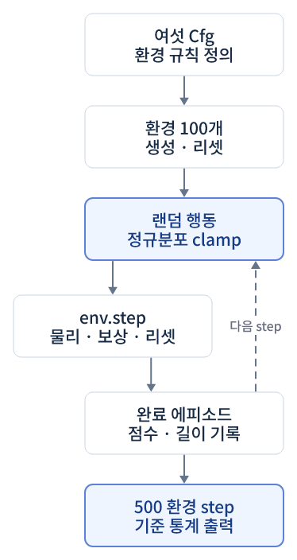
</p>
<p align="center"><sub>그림 11. 여섯 환경 설정과 학습 전 랜덤 테스트</sub></p>

완료 에피소드를 기록하고 실행 종료 시 평균·최대·최소 보상을 출력한다. 아직 학습 가중치는 없다.
[23장 실습·영상](../../../23-custom-env-complete/README.md) · [23장 코드 리뷰](../../../23-custom-env-complete/code-review.md)

## 12. 24장 실제 PPO 학습 반복

<p align="center">
  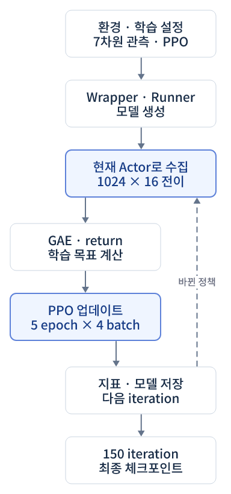
</p>
<p align="center"><sub>그림 12. 환경과 학습기를 연결해 경험 수집·업데이트 반복</sub></p>

[24장 학습 결과·원본 로그·모델](../../../24-train-cartpole/README.md) · [코드 리뷰](../../../24-train-cartpole/code-review.md)

## 13. PPO 목표와 가중치 업데이트

<p align="center">
  
</p>
<p align="center"><sub>그림 13. 경험·GAE·정책/가치 손실·optimizer</sub></p>

## 14. 학습 정책과 랜덤 정책 평가

<p align="center">
  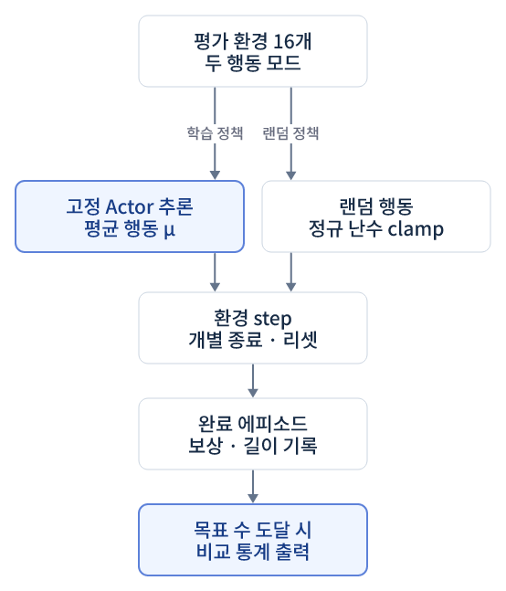
</p>
<p align="center"><sub>그림 14. 고정 Actor 평균 행동과 랜덤 행동 비교</sub></p>

모델 로드는 평가 시작 시 한 번 수행한다. 각 step에서는 같은 고정 Actor에 새 관측을 넣어 행동을 계산한다. 목표 에피소드 수에 도달하기 전에는 다음 관측으로 행동 선택을 반복하며 가중치는 업데이트하지 않는다.
[25장 두 영상·결과](../../../25-evaluate-policy/README.md) · [코드 리뷰](../../../25-evaluate-policy/code-review.md)

## 15. 20~25 기초 강화학습 워크플로우

<p align="center">
  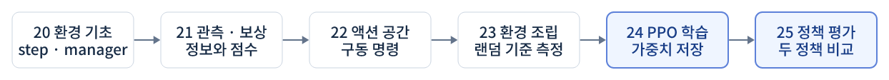
</p>
<p align="center"><sub>그림 15. 환경 기초·설계·학습·저장·평가</sub></p>

## 16. step 반환값과 피드백

<p align="center">
  
</p>
<p align="center"><sub>그림 16. obs·action·rew·terminated·truncated의 역할</sub></p>

제어 경로와 학습용 기록 경로를 구분하고 시간축을 펼쳐 표시했다. 보상과 종료 플래그가 곧바로 Actor 입력으로 들어가는 구조가 아니다.
[피드백 루프 설명](../README.md#step-feedback)

## 보충 제어 구성도

<p align="center">
  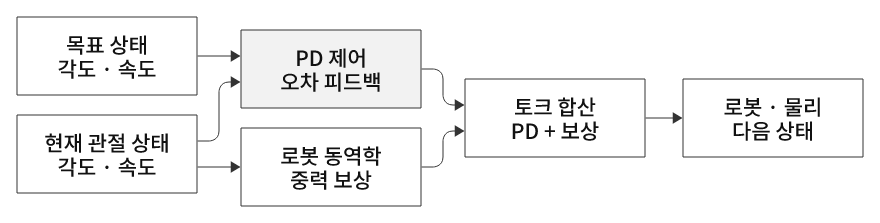
</p>
<p align="center"><sub>그림 17. PD 제어와 중력 보상</sub></p>

<p align="center">
  
</p>
<p align="center"><sub>그림 18. Pick & Place 상태 전이</sub></p>

## 19. 등록 보행 환경과 PPO 학습

<p align="center">
  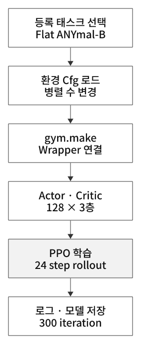
</p>
<p align="center"><sub>그림 19. 등록 환경 로드·관절 제어 정책·학습</sub></p>

[26번 학습 기록](../../../26-train-locomotion/README.md) · [보행 개념](../../legged-locomotion/README.md)

## 20. 보행 명령과 물리 피드백

<p align="center">
  
</p>
<p align="center"><sub>그림 20. 명령·관측·정책·구동·접촉 운동</sub></p>

다음 몸 상태로 같은 계산을 반복한다. 마지막 관측 외에 보상·종료 정보는 환경이 계산해 학습 경험에 기록한다.

## 사용 도구와 편집 가능한 원본

[D2](https://github.com/d2lang/d2)의 ELK 레이아웃으로 생성했다.
도형은 직각 사각형, 선은 단일 굵기, 글자는 흑백으로 통일했다. 연한 회색은 주요 연산을 구분하며 그림마다 번호·설명 캡션을 붙였다. 논문 삽도와 같은 절제된 형식이며 특정 학술지의 투고 규격을 지정한 것은 아니다.
도형 높이·글자·단계 간격을 줄여 전체 크기를 다듬었다. 한글 폰트를 포함한 SVG와 문서 표시용 PNG를 함께 제공한다. D2 소스로 내용과 배치를 수정할 수 있다.

| 구성도 | 확대용 SVG | D2 소스 |
|---|---|---|
| 강화학습 전체 흐름 | [SVG](01-training-overview.svg) | [D2](01-training-overview.d2) |
| Actor·Critic 모델 구조 | [SVG](02-actor-critic-model.svg) | [D2](02-actor-critic-model.d2) |
| 20장 코드 실행 구조 | [SVG](03-lesson20-structure.svg) | [D2](03-lesson20-structure.d2) |
| 환경 step과 물리 처리 순서 | [SVG](04-environment-step.svg) | [D2](04-environment-step.d2) |
| 보상 로그와 누적값의 관계 | [SVG](05-reward-accounting.svg) | [D2](05-reward-accounting.d2) |
| 21장 커스텀 관측·보상 실행 구조 | [SVG](06-lesson21-structure.svg) | [D2](06-lesson21-structure.d2) |
| 21장 관측 7차원 구성 | [SVG](07-observation-schema.svg) | [D2](07-observation-schema.d2) |
| 21장 보상 항과 가중치 | [SVG](08-reward-schema.svg) | [D2](08-reward-schema.d2) |
| 관측 전처리 순서 | [SVG](09-observation-processing.svg) | [D2](09-observation-processing.d2) |
| 액션 공간과 구동 연결 | [SVG](10-action-space.svg) | [D2](10-action-space.d2) |
| 23장 환경 조립과 baseline | [SVG](11-lesson23-structure.svg) | [D2](11-lesson23-structure.d2) |
| 24장 실제 PPO 학습 반복 | [SVG](12-lesson24-training.svg) | [D2](12-lesson24-training.d2) |
| PPO 목표·가중치 업데이트 | [SVG](13-ppo-update.svg) | [D2](13-ppo-update.d2) |
| 25장 고정 정책 평가 | [SVG](14-lesson25-evaluation.svg) | [D2](14-lesson25-evaluation.d2) |
| 20~25 RL 워크플로우 | [SVG](15-rl-workflow.svg) | [D2](15-rl-workflow.d2) |
| step 피드백 | [SVG](16-step-feedback.svg) | [D2](16-step-feedback.d2) |
| PD·중력 보상 | [SVG](17-pd-gravity-control.svg) | [D2](17-pd-gravity-control.d2) |
| Pick & Place 상태 전이 | [SVG](18-pick-place-states.svg) | [D2](18-pick-place-states.d2) |
| 26장 등록 환경·학습 | [SVG](19-lesson26-training.svg) | [D2](19-lesson26-training.d2) |
| 보행 명령과 접촉 제어 | [SVG](20-locomotion-control.svg) | [D2](20-locomotion-control.d2) |

다시 생성하려면 D2 v0.9.0과 Python의 `fonttools`, `resvg-py`가 필요하다.

```bash
python learning-notes/reinforcement-learning/diagrams/render_d2.py
```

폰트는 [Noto Sans KR](https://github.com/google/fonts/tree/main/ofl/notosanskr) 기반의 서브셋이다.
수정본은 Training Diagram Sans 이름으로 제공하며 [SIL Open Font License](fonts/OFL.txt)를 적용한다.

[21장 실습](../../../21-observation-reward/README.md) · [21장 코드 리뷰](../../../21-observation-reward/code-review.md)
