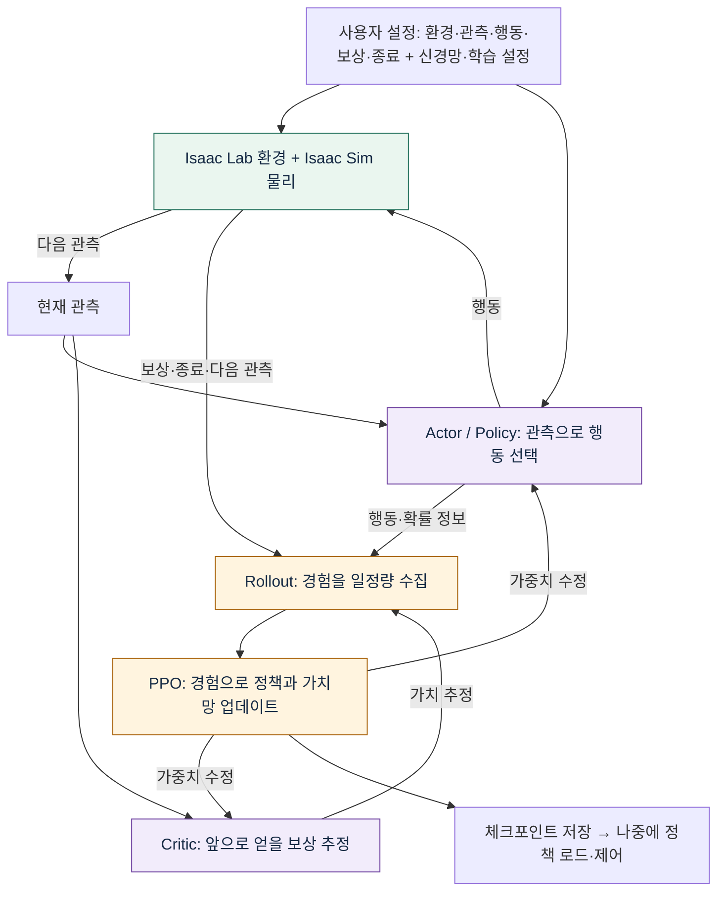
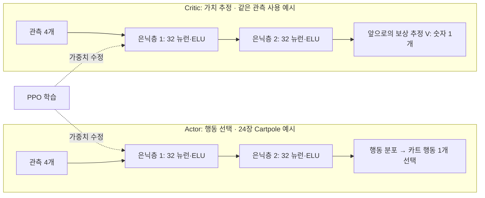
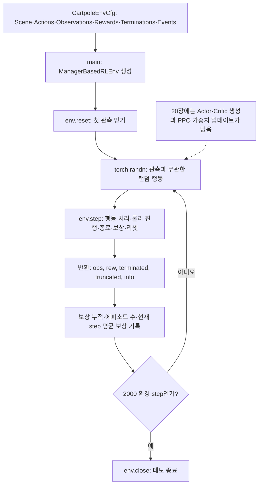
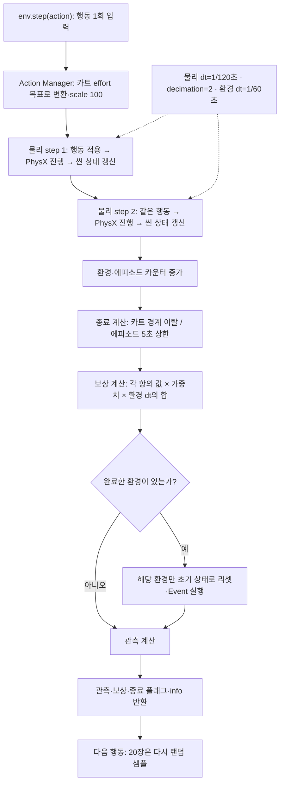

# Mermaid로 보는 강화학습과 20장 실행 구조

20장은 환경을 테스트하며, 정책 가중치를 학습하는 코드는 아직 없다.
아래 네 다이어그램은 실제 학습 구조와 현재 실행 구조를 구분한다.

## 1. 전체 강화학습 구조

경험을 일정량 모은 뒤 PPO가 가중치를 업데이트하고, 바뀐 정책으로 다시 경험을 수집한다.
보상 하나를 받는 것과 모델 업데이트 한 번은 같은 단위가 아니다.

## 2. Actor·Critic 모델 구조

24장의 실제 은닉층 설정 `[32, 32]`를 예시로 사용했다. 행동 분포에는 신경망 평균 출력과 탐색용 표준편차 등이 사용된다.
위 다이어그램은 역할을 묶어 보여주는 구성도다. Critic은 보상 함수를 대신 만들지 않으며, 학습에서는 두 모델의 관련 가중치를 갱신한다.
20장에는 이 신경망이 없고, 21장의 관측 7개와 24장 예시의 관측 4개도 구분한다.

## 3. 20번 파일 실행 구조

환경이 반환한 관측을 다음 행동 생성에 사용하지 않는다. 결과는 로그로 기록하며 행동은 계속 무작위다.

## 4. 환경 step과 물리 step

환경 4개는 같은 환경 step 안에서 함께 진행하고, 완료한 환경만 개별 리셋한다.
완료 환경의 보상·플래그는 끝난 에피소드 결과지만 반환 관측은 새 에피소드 초기 상태일 수 있다.
다이어그램은 주 처리 순서를 나타내며 recorder 등 부가 경로는 생략했다.

| 단위 | 20장 설정 |
|---|---|
| 물리 step | 1/120초 |
| 환경 step | 물리 step 2회 · 1/60초 |
| 에피소드 상한 | 5초 · 약 300 환경 step |
| 데모 상한 | 2000 환경 step |
| 학습 iteration | 20장에는 없음 |

## 실제 학습으로 연결하려면

환경에 정책 신경망·학습 래퍼·PPO 실행기를 연결한다.
24장의 `OnPolicyRunner`와 `runner.learn()`이 경험 수집과 가중치 학습을 수행하는 연결에 해당한다.

[강화학습 개념](../README.md) · [20장 실습](../../../20-base-env/README.md) · [20장 코드 리뷰](../../../20-base-env/code-review.md)

처리 순서는 [Isaac Lab v2.3.2 환경 구현](https://github.com/isaac-sim/IsaacLab/blob/v2.3.2/source/isaaclab/isaaclab/envs/manager_based_rl_env.py)을 기준으로 정리했다.
