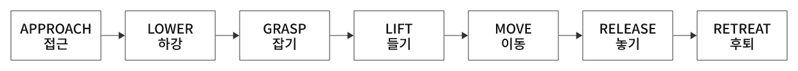

# 상태 머신과 Pick & Place

**상태 머신(State Machine)은 작업을 단계로 나누고, 현재 단계에 맞는 명령을 실행하며 조건에 따라 다음 단계로 전환하는 구조다.**
Pick & Place는 물체를 집어 다른 위치로 옮겨 놓는 작업이며, 팔 이동과 그리퍼 동작의 순서를 함께 관리해야 한다.

## 구성 요소와 역할

| 구성 | 역할 |
|---|---|
| 상태 머신 | 현재 단계·목표·전환 조건 관리 |
| IK | 말단 목표에서 팔 관절 목표 계산 |
| 관절 제어 | 팔과 핑거가 목표를 따라 움직이도록 구동 |
| 물리 엔진 | 중력·충돌·마찰에 따른 실제 상태 계산 |
| 센서·상태 확인 | 도달·접촉·집기·배치 성공 판단에 사용할 정보 |

상태 머신 자체가 기구학을 계산하거나 물체를 붙잡는 것은 아니다.
14번은 학습된 정책 대신 사람이 정한 좌표와 순서를 사용하는 작업 구성이다.

## 상태·행동·전환 조건

예를 들어 GRASP 상태에는 다음 정보가 필요하다.

- 현재 상태: `GRASP`.
- 수행할 행동: 말단 위치 유지, 핑거 닫기 목표 입력.
- 전환 조건: 정해진 시간 경과 또는 집기 조건 만족.
- 다음 상태: `LIFT`.

  

그림 18. Pick & Place의 7단계 상태 전이

## 시간 기준과 조건 기준의 차이

| 방식 | 예시 | 특징 |
|---|---|---|
| 시간 기준 | GRASP에서 0.6초가 지나면 LIFT | 구성은 간단하지만 실패해도 다음 단계로 갈 수 있음 |
| 상태·센서 조건 기준 | 접촉·큐브 높이 등을 확인한 뒤 진행 | 실제 결과를 반영하지만 판정 기준이 필요함 |

14번 원본은 시간 기준으로 7단계를 순환한다.
`완료` 출력은 순서가 끝났다는 뜻이며, 물체가 목표에 안정적으로 놓였는지를 자동 판정하지 않는다.

실제 작업에서는 도달 오차, 접촉, 물체 높이, 최종 위치·속도 등을 확인할 수 있다.
조건이 계속 만족되지 않을 때를 위한 시간 제한과 재시도 상태를 함께 구성할 수도 있다.
이는 예제를 확장할 때의 설계 방향이며 현재 코드에 구현된 동작은 아니다.

## 물리적인 집기

그리퍼 위치 목표를 닫힘으로 바꾸면 핑거가 물체를 향해 움직인다.
물체를 들 수 있는지는 접촉 위치, 충돌 형상, 마찰, 구동 힘과 물체 질량 등에 달려 있다.
위치 목표를 줬다고 원하는 접촉 힘이나 실제 관절 위치가 그대로 보장되는 것은 아니다.

14번은 동적 큐브와 핑거의 접촉을 사용한다.
손에 큐브를 고정하거나 매 step 손 위치에 맞춰 이동시키는 부착 방식은 구현하지 않는다.

## TCP와 집기 높이

IK 대상 링크 프레임과 실제 집기 중심점(TCP)은 다를 수 있다.
TCP의 목표를 손 링크의 목표로 바꾸려면 손→TCP 고정 변환을 고려한다.

$$
{}^B T_{hand,goal} = {}^B T_{TCP,goal}({}^{hand}T_{TCP})^{-1}
$$

물체 중심 좌표를 손 링크 목표로 그대로 사용하면 공구 오프셋만큼 위치가 어긋날 수 있다.
14번의 `GRASP_HEIGHT`는 `panda_hand` 목표이므로 큐브 중심 높이와 구분해 해석한다.

또한 이 코드의 RELEASE는 들어 올린 높이에서 그리퍼를 연다.
접촉면까지 내려놓고 힘을 줄여 놓는 작업을 구현하려면 별도의 하강·지지 확인 단계가 필요하다.

## 다중 환경

각 환경의 현재 단계와 단계 시간을 별도 텐서로 관리하면 환경마다 다른 작업 상태를 표현할 수 있다.
14번은 동일한 시작 시점과 지속 시간을 사용하므로 영상에서는 함께 진행한다.
완료 환경만 물리 상태를 리셋할 때는 관절·물체·컨트롤러·버퍼 초기화의 환경 범위도 맞춰야 한다.

[14번 실습 코드·7단계 목표·영상](../../14-pick-and-place/README.md) ·
[역기구학 개념](../inverse-kinematics/README.md)
