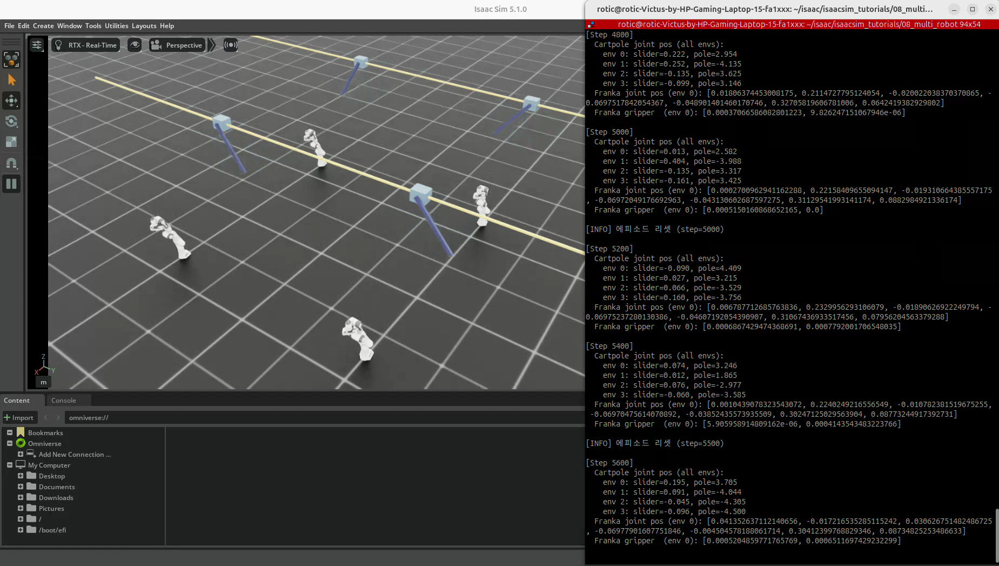
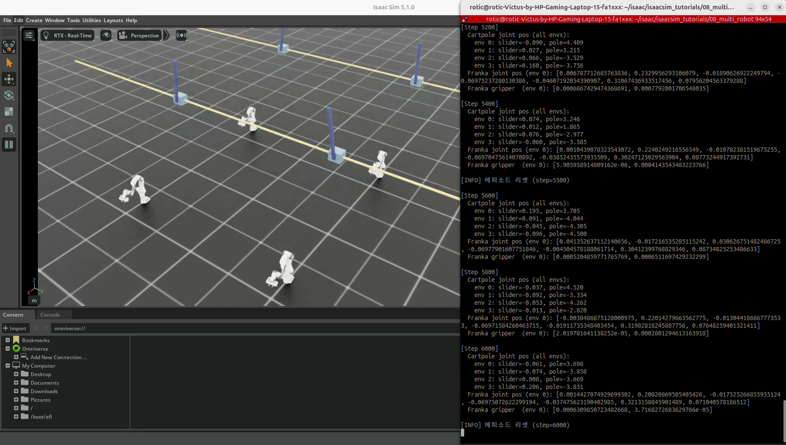

# 08. 다중 로봇과 특정 환경 선택 제어

[이 파트의 실습](../README.md) · [전체 실습](../../README.md) · [저장소 홈](../../../README.md)

실습일: 2026-10-13

## 이번 실습에서 배운 핵심

07번에서는 환경 수를 늘리는 방법을 배웠고, 이번에는 **여러 환경을 함께 실행하면서 특정 환경의 로봇에만 다른 명령을 줄 수 있다**는 것을 알게 되었다.

같은 씬 설정으로 여러 환경을 만들어도, 제어 명령은 환경별로 다르게 지정할 수 있다.
`env_ids`는 명령을 적용할 환경을 선택하는 인자이며, 선택하지 않은 환경을 정지시키는 기능은 아니다.

## 코드와 실행 방법

- [이 저장소에서 코드 보기](08_multi_robot.py)
- 출처: PinkLAB 「강좌 08 - 08_multi_robot」
- [원본 튜토리얼](https://github.com/PinkWink/isaacsim_tutorials/blob/14f85fc6edece7cbb1faa50aa9fe3adef205e87a/08_multi_robot/08_multi_robot.py)
- 위 버전의 코드를 수정 없이 포함했다.

```bash
cd <physical-ai-training 저장소 경로>/practice/02-robot-control-and-sensors/08-multi-robot

# 기본: 4개 환경
python 08_multi_robot.py

# 환경 수를 지정해서 실행
python 08_multi_robot.py --num_envs 4
```

## 실습 구성

| 항목 | 내용 |
|---|---|
| 환경 수 | 기본 4개 |
| 환경 간격 | 환경 원점 기준 4.0 m |
| 환경별 로봇 | Cartpole 1대 + Franka Panda 1대 |
| 기본 4개 환경의 로봇 수 | Cartpole 4대 + Franka 4대 |
| Franka 위치 | 환경 원점에서 x 방향으로 1.5 m 이동 |
| 기본 입력 | 전체 Cartpole: 랜덤 effort 배율 5.0 / 전체 Franka: 배율 2.0 |
| 선택 입력 | env 0의 Franka에 첫 관절 effort 목표 50 N·m |
| 선택 입력 구간 | 100 step 주기 중 앞의 50 step |
| 리셋 | 시작 시와 500 step마다 모든 로봇의 상태 복원 |

회전 관절의 effort는 토크, 직선 관절의 effort는 힘이다.
명령한 effort와 구동기·물리 엔진을 거쳐 실제로 적용되는 총 힘·토크는 구분한다.

## 실습 결과

<p align="center">
  
</p>

<p align="center">
  
</p>

- 네 환경에 Cartpole과 Franka가 함께 배치된다.
- Cartpole은 환경별로 다른 자세로 움직이고, Franka의 자세도 변화한다.
- 터미널에는 Cartpole의 env 0~3 상태와 env 0 Franka의 팔·그리퍼 상태가 출력된다.
- 영상에 반복 리셋 로그가 나타난다.

[원본 녹화 영상 보기 / 다운로드 — 약 14.3초](videos/multi-robot-selective-control.webm)

원본 파일명: `Screencast from 2026-10-13 13-53-33.webm`.
위 이미지는 이 영상에서 추출했다.

## 핵심 개념 1. 하나의 씬에 여러 로봇 추가

`InteractiveSceneCfg`에 로봇별 필드를 선언하면 `InteractiveScene`이 함께 관리한다.

```python
cartpole: ArticulationCfg = CARTPOLE_CFG.replace(
    prim_path="{ENV_REGEX_NS}/Cartpole"
)

franka: ArticulationCfg = FRANKA_PANDA_CFG.replace(
    prim_path="{ENV_REGEX_NS}/Franka",
    # init_state 설정은 전체 코드 참고
)
```

객체에 접근할 때는 선언한 필드 이름을 사용한다.

```python
cartpole = scene["cartpole"]
franka = scene["franka"]
```

`scene["franka"]`는 한 대만 의미하는 것이 아니라, 모든 환경의 Franka 상태·명령을 묶어 관리하는 객체다.

## 핵심 개념 2. init_state로 위치와 자세 설정

Franka는 `init_state`를 바꿔 Cartpole 옆에 배치하고 초기 관절 자세를 지정한다.

```python
init_state=ArticulationCfg.InitialStateCfg(
    pos=(1.5, 0.0, 0.0),
    joint_pos={
        # 팔 관절 설정은 전체 코드 참고
        "panda_finger_joint.*": 0.04,
    },
)
```

위 코드는 설정의 일부를 보여주는 발췌다. 전체 코드에는 팔의 7개 관절 각도도 지정되어 있다.
`pos`는 환경 원점 기준 상대 위치이며, 손가락 관절 이름에는 정규식으로 두 관절을 함께 지정한다.
Franka 손가락은 직선 관절이므로 0.04는 rad가 아니라 m 단위다.

## 핵심 개념 3. env_ids로 특정 환경 선택

먼저 선택할 환경의 인덱스를 만든다. 환경 번호는 0부터 시작한다.

```python
env_0_ids = torch.tensor([0], dtype=torch.long, device=sim.device)
```

전체 Franka에 랜덤 명령을 설정한 다음, 특정 구간에 env 0의 명령을 덮어쓴다.

```python
franka_efforts = torch.randn_like(franka.data.joint_pos) * 2.0
franka.set_joint_effort_target(franka_efforts)

if step_count % 100 < 50:
    strong_effort = torch.zeros(1, franka.num_joints, device=sim.device)
    strong_effort[0, 0] = 50.0
    franka.set_joint_effort_target(strong_effort, env_ids=env_0_ids)

scene.write_data_to_sim()
sim.step()
scene.update(sim_dt)
```

| 구간 | env 0 Franka | 나머지 Franka |
|---|---|---|
| 100 step 중 앞 50 step | 첫 관절 effort 목표 50, 나머지 관절 effort 목표 0 | 각자의 랜덤 effort 목표 |
| 뒤 50 step | 랜덤 effort 목표 | 각자의 랜덤 effort 목표 |

**이 코드는 랜덤 토크에 50을 더하는 것이 아니라, env 0의 effort 목표 행 전체를 덮어쓴다.**
다른 관절의 추가 effort 목표가 0이라고 해서 그 관절이 정지하거나 모든 물리 토크가 0이 되는 것은 아니다.
위치 제어 구동기, 중력과 기존 속도 등은 여전히 영향을 준다.
Cartpole과 다른 환경도 계속 시뮬레이션된다.

### 명령 텐서의 크기

| 명령 대상 | 텐서 형태 |
|---|---|
| 전체 Cartpole | `(num_envs, 2)` |
| 전체 Franka | `(num_envs, 9)` |
| env 0의 Franka 전체 관절 | `(1, 9)` |

선택한 환경이 한 개이면 명령 텐서도 한 행이어야 한다.
여러 환경을 선택할 경우 행 순서는 `env_ids`에 지정한 환경 순서에 대응한다.

### env_ids와 joint_ids의 차이

- `env_ids`: 어느 환경의 로봇에 적용할지 선택한다.
- `joint_ids`: 그 로봇의 어느 관절에 적용할지 선택한다.

env 0의 첫 관절만 바꾸고 다른 관절의 랜덤 목표를 유지하려면 다음처럼 지정할 수 있다.
아래는 기존 선택 입력 블록을 바꾸는 응용 예시다.

```python
strong_effort = torch.tensor([[50.0]], device=sim.device)
franka.set_joint_effort_target(
    strong_effort,
    env_ids=env_0_ids,
    joint_ids=[0],
)
```

이 경우 명령 텐서는 선택 환경 1개 × 선택 관절 1개인 `(1, 1)` 형태다.
저장된 실행 파일은 원본 예제의 `(1, 9)` 방식을 유지한다.

## 배운 점

- 환경 자동 복제와 환경별 선택 제어를 함께 활용할 수 있다.
- 하나의 환경에 서로 다른 로봇을 넣고, 종류별로 다른 입력을 줄 수 있다.
- 선택 제어는 모든 환경을 실행한 상태에서 일부 명령만 다르게 적용하는 방식이다.
- 특정 환경만 리셋할 때도 지원되는 상태 쓰기 API의 `env_ids`를 활용할 수 있지만, 이번 예제의 리셋은 전체 환경을 대상으로 한다.
- 강화학습에서는 종료된 환경만 리셋하거나 환경별 난이도를 바꾸는 데 이러한 인덱스 선택 방식이 활용된다.
- 이번 실습은 랜덤 명령과 선택 제어를 보여주며, 강화학습 정책을 학습하는 예제는 아니다.

다음 09번에서는 씬에 카메라 센서를 추가해 RGB·Depth 데이터를 읽는 방법을 학습한다.
