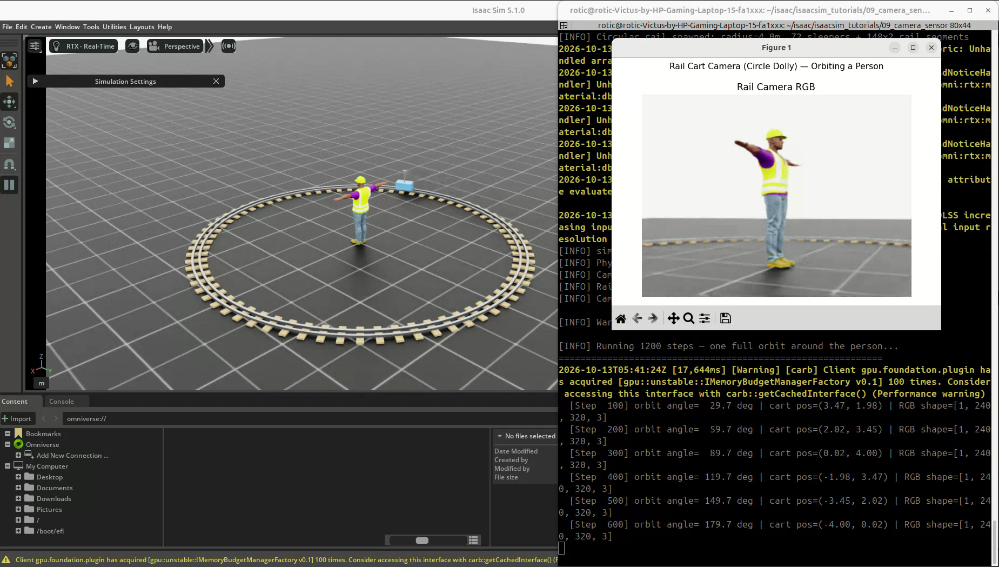
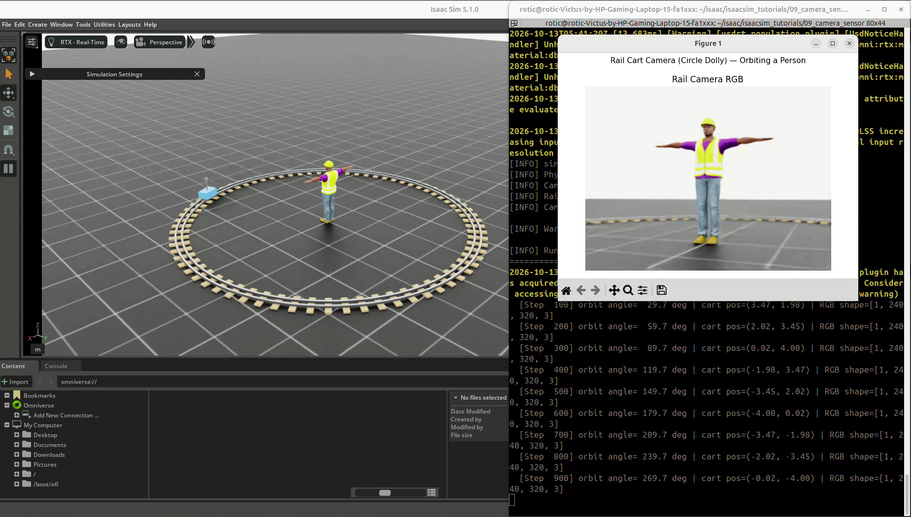
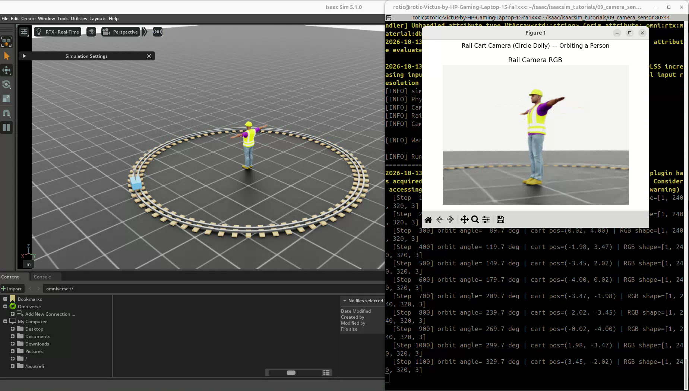

# 09. RGB·Depth 카메라와 레일 카메라 촬영

[이 파트의 실습](../README.md) · [전체 실습](../../README.md) · [저장소 홈](../../../README.md)

실습일: 2026-10-13

## 이번 실습의 핵심

가상 공간에 카메라 센서를 배치하고, 센서가 보는 장면을 데이터로 읽어 화면에 표시한다.
기본 예제에서는 RGB와 Depth를 비교하고, 추가 예제에서는 카메라를 이동시키며 같은 대상을 여러 방향에서 촬영한다.

첨부 사진은 **동일한 원기둥의 RGB·Depth 비교**, 녹화 영상은 **원형 레일 카메라 촬영** 결과다.

## 코드와 실행 방법

- [기본 RGB·Depth 코드](09_camera_sensor.py)
- [레일 카메라 코드](09_2_rail_cart_camera.py)
- 출처: PinkLAB 「강좌 09 - 09_camera_sensor」
- [원본 튜토리얼](https://github.com/PinkWink/isaacsim_tutorials/tree/14f85fc6edece7cbb1faa50aa9fe3adef205e87a/09_camera_sensor)
- 위 버전의 두 코드를 수정 없이 포함했다.

```bash
cd <physical-ai-training 저장소 경로>/practice/02-robot-control-and-sensors/09-camera-sensor

# 기본: RGB와 Depth 표시
python 09_camera_sensor.py --enable_cameras

# 앞선 실행을 종료한 뒤, 레일 카메라 촬영
python 09_2_rail_cart_camera.py --enable_cameras
```

**`--enable_cameras`는 카메라 렌더링 활성화에 필요한 플래그다.**
Isaac Sim의 메인 GUI 없이 실행하려면 각 명령에 `--headless`를 추가한다.
데스크톱에서 matplotlib GUI를 사용할 수 있다면 이 조합에서도 별도의 그래프 창을 표시할 수 있다.

## 실습 1. 동일한 원기둥의 RGB·Depth 비교

### 장면과 카메라 구성

| 항목 | 설정 |
|---|---|
| 물체 | 동일한 파란 원기둥 4개 |
| 원기둥 크기 | 반지름 0.15 m, 높이 0.6 m |
| 원기둥 질량 | 각 1.0 kg |
| 센서 해상도 | 너비 320 × 높이 240 |
| 카메라 위치 | `(3.0, 0.0, 1.5)` m |
| 바라보는 지점 | `(1.0, 0.0, 0.2)` m |
| 출력 종류 | `rgb`, `distance_to_image_plane` |
| 카메라 업데이트 주기 설정 | `update_period=0` |
| matplotlib 갱신 | 10 step마다 |
| 실행 길이 | 300 step |

원기둥을 카메라에서 멀어지는 방향으로 배치하고 y 위치를 조금씩 바꿔 겹침을 줄였다.

| 원기둥 | 위치 — m |
|---|---|
| Near | `(2.0, -0.5, 0.3)` |
| Mid1 | `(1.0, -0.15, 0.3)` |
| Mid2 | `(0.0, 0.2, 0.3)` |
| Far | `(-1.0, 0.55, 0.3)` |

### 첨부 사진에서 관찰한 결과

- 장면에는 크기가 같은 파란 원기둥 네 개가 배치되어 있다.
- RGB 영상에서는 가까운 물체가 크게, 먼 물체가 작게 보인다.
- Depth 영상에서는 물체와 바닥까지의 깊이가 색상으로 표현된다.
- Depth의 색은 물체의 실제 재질 색이 아니라, 깊이값을 표시하기 위한 색상이다.
- 메인 뷰포트와 센서 카메라는 위치와 시선이 다르므로 같은 장면을 서로 다른 모습으로 보여준다.

### RGB와 Depth는 무엇이 다른가?

| 출력 | 담고 있는 정보 | 주로 확인할 내용 |
|---|---|---|
| RGB | 픽셀의 색상 | 외관·색·무늬·윤곽 |
| Depth | 픽셀에 대응하는 표면의 깊이 — m | 위치·거리·형상 |

이 예제의 `distance_to_image_plane`은 카메라 광축 방향의 깊이이다.
카메라 광심에서 표면까지의 직선거리인 `distance_to_camera`와 구분한다.
화면 가장자리의 픽셀에서는 두 값이 달라질 수 있다.

Depth를 표시할 때는 다음처럼 0~5 m 범위의 색상으로 변환한다.

```python
depth_display = np.clip(depth_data, 0, 5.0)
im_depth = ax_depth.imshow(
    depth_display,
    cmap="turbo",
    vmin=0,
    vmax=5.0,
)
```

**0~5 m는 화면 표시 범위이지 센서 측정 범위를 5 m로 제한한 설정은 아니다.**
5 m보다 큰 값은 표시상 같은 최대 색으로 보일 수 있으므로, 실제 깊이를 사용할 때는 센서의 원본 데이터를 읽는다.

## 핵심 코드: 설정 → 생성 → 업데이트 → 표시

### 1. CameraCfg로 센서 선언

```python
camera_cfg = CameraCfg(
    prim_path="/World/CameraSensor",
    update_period=0,
    height=240,
    width=320,
    data_types=["rgb", "distance_to_image_plane"],
    spawn=sim_utils.PinholeCameraCfg(
        focal_length=24.0,
        focus_distance=400.0,
        horizontal_aperture=20.955,
        clipping_range=(0.1, 1.0e5),
    ),
)
camera = Camera(cfg=camera_cfg)
```

센서는 USD 장면의 카메라 Prim과 연결되고, 설정에 따라 렌더링 결과를 데이터로 제공한다.
해상도, 렌즈, 출력 종류와 카메라 위치·방향을 각각 지정한다.

### 2. 물리 진행 후 카메라 갱신

```python
sim.step()
camera.update(dt=sim_dt)
```

시뮬레이션을 진행한 뒤 카메라 데이터를 갱신한다.
추가 예제처럼 `InteractiveScene`에 등록된 카메라는 `scene.update(sim_dt)`로 함께 갱신할 수 있다.
정적인 장면과 고정된 카메라는 데이터가 갱신되더라도 영상이 비슷하게 보일 수 있다.

### 3. 텐서를 화면 표시용 배열로 변환

```python
rgb_np = camera.data.output["rgb"][0, :, :, :3].cpu().numpy()
depth_np = (
    camera.data.output["distance_to_image_plane"][0, :, :, 0]
    .cpu()
    .numpy()
)
```

| 데이터 | 읽을 때의 형태 | 표시용 형태 |
|---|---|---|
| RGB 계열 | `(N, H, W, C)` | `(H, W, 3)` |
| Depth | `(N, H, W, 1)` | `(H, W)` |

`N`은 카메라 수, `H/W`는 높이·너비이고 첫 `[0]`은 첫 카메라를 선택한다.
RGB는 색상 채널을, Depth는 픽셀별 깊이값을 담는다.
강의 슬라이드는 RGBA 4채널을 예로 들지만, 이번 레일 영상의 로그에는 `RGB shape=[1, 240, 320, 3]`가 출력된다.
채널 수는 실제 출력의 `shape`를 확인하고, 이 코드에서는 `:3`으로 색상 세 채널을 표시한다.

### 4. 기존 이미지 핸들 갱신

```python
im_rgb.set_data(rgb_np)
im_depth.set_data(np.clip(depth_np, 0, 5.0))
fig.canvas.draw_idle()
fig.canvas.flush_events()
```

매번 새 그래프를 만드는 대신 기존 이미지의 픽셀 데이터를 바꾼다.
`DISPLAY_INTERVAL=10`은 10 step마다 화면을 갱신한다는 뜻이다.
값을 키우면 표시 갱신 횟수가 줄고, 값을 줄이면 더 자주 갱신한다.
화면 갱신 주기와 카메라 데이터 업데이트 주기는 별개다.

## 실습 2. 원형 레일 카메라 촬영

### 무엇을 했나

사람 캐릭터 주변에 반지름 4 m의 원형 레일을 만들고,
카트가 원 궤도를 돌면서 카메라가 계속 사람의 몸통을 바라보도록 구성했다.

| 항목 | 설정 |
|---|---|
| 레일 반지름 | 4.0 m |
| 카트 중심 높이 | 0.20 m |
| 카메라 높이 | 0.65 m |
| 카메라가 보는 지점 | `(0.0, 0.0, 0.9)` m |
| 한 바퀴 주기 | 시뮬레이션 시간 12초 |
| 물리 시간 간격 | 0.01초 |
| 궤도 실행 | 1200 step |
| 출력 | RGB |

카트의 위치는 원 궤도 식으로 계산한다.

$$
x=R\cos(\omega t),\quad y=R\sin(\omega t),\quad \omega=2\pi/T
$$

카트는 매 step 자세를 직접 쓰고 잔여 속도를 0으로 만든다.
레일은 시각용이며, 바퀴와 레일 사이의 접촉·모터 힘으로 주행하는 모델은 아니다.
카메라도 독립 Prim으로 두고 카트 위 위치와 시선을 매 step 갱신한다.

```python
cart.write_root_pose_to_sim(cart_pose)
cart.write_root_velocity_to_sim(cart_zero_vel)
camera.set_world_poses_from_view(cam_eye, cam_target)
```

### 영상에서 관찰한 결과

<p align="center">
  
</p>

<p align="center">
  
</p>

<p align="center">
  
</p>

- 카트의 원 궤도 위치가 변하고, 사람을 보는 방향도 달라진다.
- 인물이 화면 중앙 부근에 유지되며 정면·측면 등 다양한 방향에서 촬영된다.
- 터미널에 궤도 각도와 카트 위치, RGB 텐서 형태가 출력된다.
- 이 추가 예제는 RGB만 사용하며 기본 예제의 Depth 비교와 구분한다.

[원본 녹화 영상 보기 / 다운로드 — 약 23.0초](videos/rail-cart-camera.webm)

원본 파일명: `Screencast from 2026-10-13 14-41-38.webm`.
위 세 이미지는 이 영상에서 추출했다.

## 배운 점

- 뷰포트로 보는 장면과 센서 카메라가 출력하는 데이터는 구분해야 한다.
- RGB는 외관, Depth는 깊이 정보를 제공한다.
- 카메라 위치와 시선을 제어하면 동일한 대상을 다양한 방향에서 촬영할 수 있다.
- 센서 데이터 업데이트와 화면 표시 주기를 따로 관리할 수 있다.
- 로봇 비전이나 제조 설비의 인식 기능을 시험할 때 카메라 데이터 수집이 출발점이 된다.
- 시뮬레이션 카메라에서 데이터를 얻는 것과 물체 인식·거리 추정 알고리즘을 학습하는 것은 별도 단계다.
