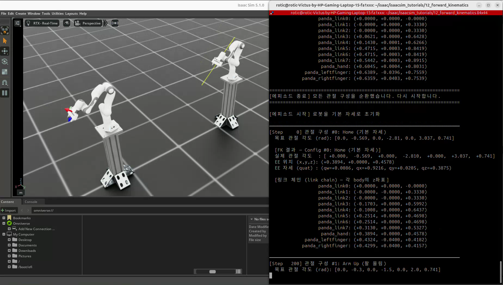
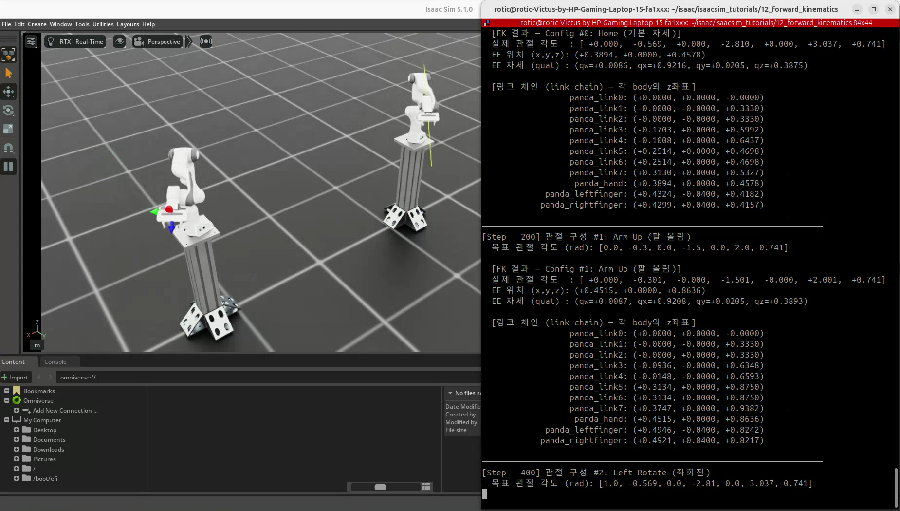
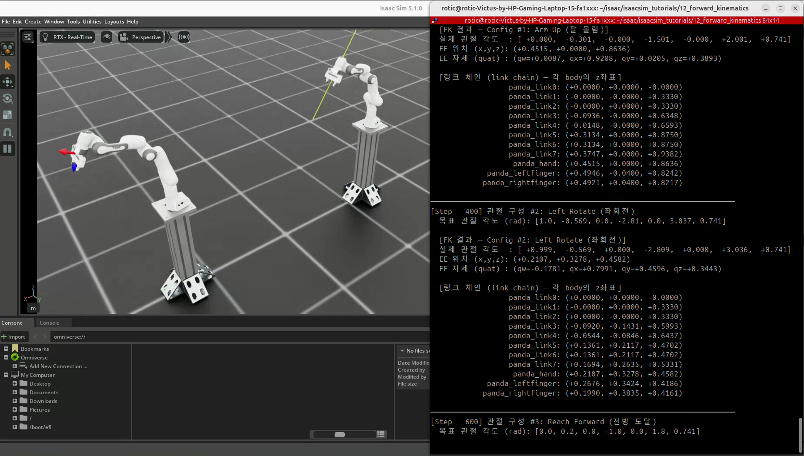
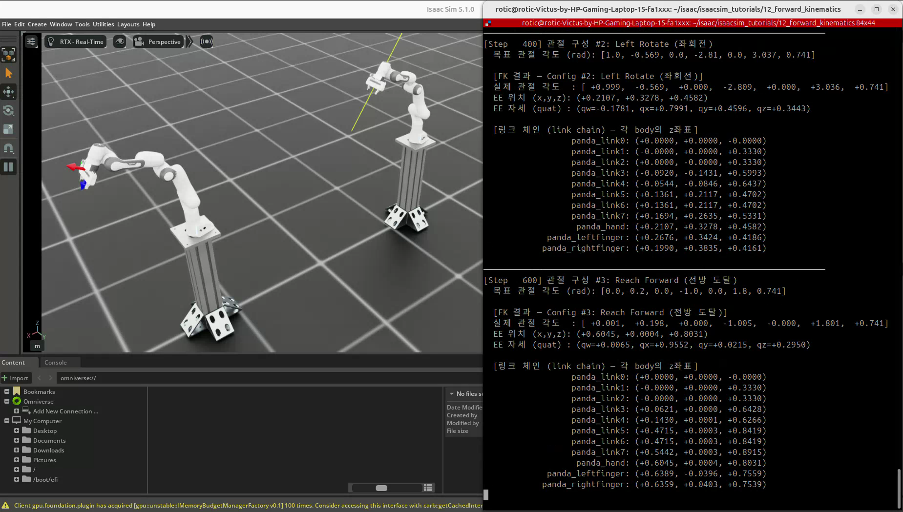

# 12. 정기구학 — 관절 각도에서 손끝 포즈 읽기

[이 파트의 실습](../README.md) · [전체 실습](../../README.md) · [저장소 홈](../../../README.md)

실습일: 2026-10-13

## 이번 실습의 핵심

**정기구학(FK, Forward Kinematics)은 로봇의 관절 각도를 알 때 말단의 위치와 방향을 구하는 것이다.**
순기구학 또는 순운동학이라고도 부른다. 이번 실습은 Franka Panda의 7개 팔 관절에 네 가지 목표 구성을 입력하고,
`panda_hand`의 포즈를 읽어 좌표축 마커와 터미널 로그로 비교한다.

정기구학은 기하학적 관계다. 이 코드는 그 관계를 시뮬레이션에서 관찰하기 위해 PD 위치 제어로 관절을 움직인다.

## 코드와 실행 방법

- [실습 코드](12_forward_kinematics.py)
- 출처: PinkLAB 「강좌 12 - 12_forward_kinematics」
- [원본 튜토리얼](https://github.com/PinkWink/isaacsim_tutorials/blob/14f85fc6edece7cbb1faa50aa9fe3adef205e87a/12_forward_kinematics/12_forward_kinematics.py)
- 위 버전의 코드를 수정 없이 포함했다.

```bash
cd <physical-ai-training 저장소 경로>/practice/02-robot-control-and-sensors/12-forward-kinematics

# 기본: 환경 2개
python 12_forward_kinematics.py

# 환경 4개
python 12_forward_kinematics.py --num_envs 4

# GUI 없이 포즈 로그 확인
python 12_forward_kinematics.py --headless
```

로봇과 스탠드는 Isaac Lab 설정 및 NVIDIA 자산 경로에서 불러온다. 로봇 USD 전체를 이 폴더에 복사한 예제는 아니다.
카메라 센서 예제가 아니므로 `--enable_cameras`는 필요하지 않다.

## 실습 구성

| 항목 | 설정 |
|---|---|
| 로봇 | Franka Panda · 팔 관절 7개 + 핑거 관절 2개 |
| 로봇 설정 | `FRANKA_PANDA_HIGH_PD_CFG` · 중력 비활성, 높은 PD 게인 |
| 읽는 말단 프레임 | `panda_hand` |
| 기본 환경 수 | 2개 |
| 환경 원점 간격 | 2.5 m |
| 물리 시간 간격 | 0.01초 |
| 목표 구성 전환 | 200 step마다 · 시뮬레이션 시간 2초 |
| 결과 로그 출력 | 각 구성의 150 step 시점 · 전환 후 약 1.5초 |
| 한 번의 순환 | 4개 구성 · 800 step · 시뮬레이션 시간 8초 |

네 구성을 모두 실행하면 관절 위치·속도를 기본 상태로 복원하고 다시 시작한다.
영상의 두 환경에는 동일한 관절 목표가 입력된다.

| 구성 | 목표 관절 각도 q₁~q₇ · rad |
|---|---|
| Home · 기본 자세 | `[0, -0.569, 0, -2.810, 0, 3.037, 0.741]` |
| Arm Up · 팔 올림 | `[0, -0.3, 0, -1.5, 0, 2.0, 0.741]` |
| Left Rotate · 좌회전 | `[1.0, -0.569, 0, -2.810, 0, 3.037, 0.741]` |
| Reach Forward · 전방 도달 | `[0, 0.2, 0, -1.0, 0, 1.8, 0.741]` |

## 실습 결과

### 기본 자세

<p align="center">
  
</p>

### 팔 올림

<p align="center">
  
</p>

### 좌회전

<p align="center">
  
</p>

### 전방 도달

<p align="center">
  
</p>

[원본 녹화 영상 보기 / 다운로드 — 약 21.2초](videos/forward-kinematics.webm)

원본 파일명: `Screencast from 2026-10-13 15-57-52.webm`.
위 네 이미지는 제공된 영상에서 추출했다. 터미널에는 이전 구성 로그도 남아 있으므로 결과는 구성 이름과 함께 읽는다.

영상에 표시된 환경 0의 결과 로그를 비교하면 다음과 같다.
위치는 환경 원점을 뺀 값이며 단위는 m다.

| 구성 | x | y | z |
|---|---|---|---|
| Home | 0.3894 | 약 0.0000 | 0.4578 |
| Arm Up | 0.4515 | 약 0.0000 | 0.8636 |
| Left Rotate | 0.2107 | 0.3278 | 0.4582 |
| Reach Forward | 0.6045 | 0.0004 | 0.8031 |

팔을 올리면 z가 커지고, 첫 관절을 회전하면 x·y가 달라지며, 앞으로 뻗으면 x가 커지는 것을 관찰했다.
목표 각도와 실제 각도는 로그에서 약간 다르다. 표는 실제 시뮬레이션 상태에서 읽은 결과이며 이상적인 목표 각도의 계산값과 구분한다.

## 핵심 개념 1. 정기구학의 입력과 출력

```text
로봇 구조 + 실제 관절 상태 q₁ … q₇
             ↓ 정기구학
말단 포즈 = 위치(x, y, z) + 방향(회전)
```

관절 하나를 바꾸면 그 관절 뒤에 연결된 링크들의 위치와 방향이 함께 달라진다.
로봇 구조, 베이스 포즈와 관절 상태가 같으면 말단 포즈가 결정된다.
질량·중력은 이 기하학적 계산식에 직접 들어가지 않지만, 관절이 목표를 따라 움직이는 실제 동작에는 영향을 준다.

정기구학의 기본 계산은 링크 사이의 변환을 순서대로 곱하는 것이다.

$$
{}^W T_E = {}^W T_B\;{}^B T_1(q_1)\;{}^1 T_2(q_2)\;\cdots\;{}^{n-1}T_n(q_n)\;{}^n T_E
$$

`W`는 월드, `B`는 로봇 베이스, `E`는 말단 프레임이다.
각 4×4 동차변환 행렬은 회전과 이동을 함께 담는다. 실제 모델에서는 관절 사이의 고정 오프셋도 포함한다.
이번 Python 코드는 이 행렬을 직접 작성하거나 DH 파라미터로 계산하지 않고,
시뮬레이터가 관리하는 링크 포즈를 읽어 정기구학 결과를 관찰한다.

## 핵심 개념 2. 실제 관절 상태에서 말단 포즈 읽기

`SceneEntityCfg`로 팔 관절과 `panda_hand`의 인덱스를 찾는다.

```python
robot_entity_cfg = SceneEntityCfg(
    "robot",
    joint_names=["panda_joint.*"],
    body_names=["panda_hand"],
)
robot_entity_cfg.resolve(scene)
ee_body_idx = robot_entity_cfg.body_ids[0]
```

목표를 전달한 뒤 물리 스텝과 상태 갱신을 수행하고 결과를 읽는다.

```python
robot.set_joint_position_target(target_pos)
scene.write_data_to_sim()
sim.step()
scene.update(sim_dt)

ee_pose_w = robot.data.body_pose_w[:, ee_body_idx]
ee_pos = ee_pose_w[:, :3]
ee_quat = ee_pose_w[:, 3:7]
```

`body_pose_w`는 `(환경 수, 바디 수, 7)` 형태이며 각 포즈의 순서는 다음과 같다.

```text
[x, y, z, qw, qx, qy, qz]
```

앞의 세 값은 위치, 뒤의 네 값은 쿼터니언으로 표현한 방향이다.
이 API의 쿼터니언은 **w, x, y, z 순서**이며, 오일러 각도 네 개를 의미하지 않는다.
마커는 위치와 쿼터니언을 함께 사용해 말단의 x·y·z 축 방향을 표시한다.

## 핵심 개념 3. 말단 프레임과 좌표계

여기서 말단은 `panda_hand` 링크 프레임이다.
그리퍼 손가락 끝이나 실제 공구 중심점(TCP)과 항상 같은 위치인 것은 아니다.
공구를 장착하면 손 프레임에서 공구 프레임까지의 고정 변환을 추가해야 한다.

```python
ee_pos_local = ee_pos[0] - scene.env_origins[0]
```

위 코드는 환경의 평행이동 오프셋을 제거해 환경 기준 위치를 출력한다.
이 예제는 환경과 로봇 베이스의 축 방향이 같아서 위치 비교에 사용할 수 있다.
일반적으로 베이스가 회전했거나 별도 위치에 배치됐다면, 원점 빼기만으로 베이스 좌표계가 되지 않는다.
베이스 기준 포즈는 회전까지 포함한 역변환으로 계산한다.

$$
{}^B T_E = ({}^W T_B)^{-1}\;{}^W T_E
$$

## 핵심 개념 4. 정기구학과 제어·역기구학의 차이

| 구분 | 입력 → 출력 | 질문 |
|---|---|---|
| 정기구학 · FK | 관절 상태 → 말단 포즈 | 지금 손끝이 어디에 있고 어느 방향을 보는가? |
| 역기구학 · IK | 목표 말단 포즈 → 관절 구성 | 손끝을 그곳에 보내려면 관절을 어떻게 배치해야 하는가? |
| 관절 제어 | 목표·실제 관절 상태 → 구동 입력 | 실제 관절이 목표 각도를 따라가도록 어떻게 움직이는가? |

FK는 구조와 관절 상태를 고정하면 포즈가 정해진다.
IK는 목표에 따라 해가 여러 개이거나, 관절 한계·도달 범위 때문에 해가 없을 수도 있다.
정기구학만으로 경로 계획이나 장애물 회피가 자동으로 수행되는 것은 아니다.

이번 실습은 높은 PD 게인과 중력 비활성 설정을 사용해 관절 목표 추종을 쉽게 관찰한다.
중력을 끄는 것은 중력을 계산해 보상 토크를 더하는 중력 보상과 구분한다.

## 배운 점

- 관절 각도에서 말단의 위치뿐 아니라 방향도 알 수 있다.
- 목표 각도와 실제 관절 상태를 구분해야 포즈 결과를 올바르게 해석할 수 있다.
- 같은 관절 상태여도 베이스 위치가 다르면 월드 좌표의 말단 위치가 달라진다.
- 말단 링크 프레임과 실제 공구 TCP의 차이를 고려해야 한다.
- 제조 설비에서는 손끝 위치 확인, 센서·공구 위치 변환, 도달 범위 검토의 기초가 된다.

[공통 개념 학습 — 정기구학](../../../learning-notes/02-robot-control-and-sensors/forward-kinematics/README.md) ·
[실습 03~12 핵심 개념 모음](../../../learning-notes/00-overview/robotics-core-concepts/README.md)
