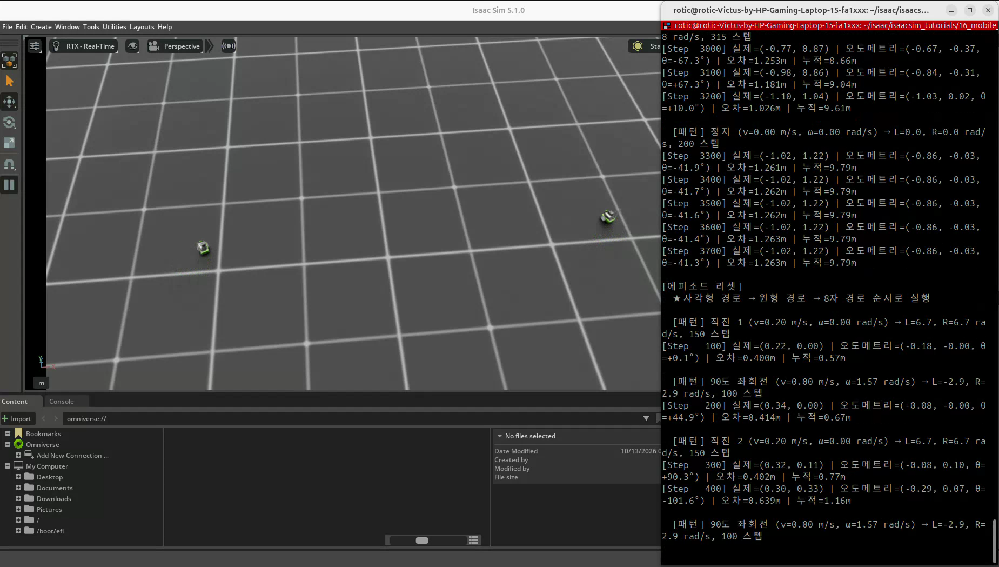
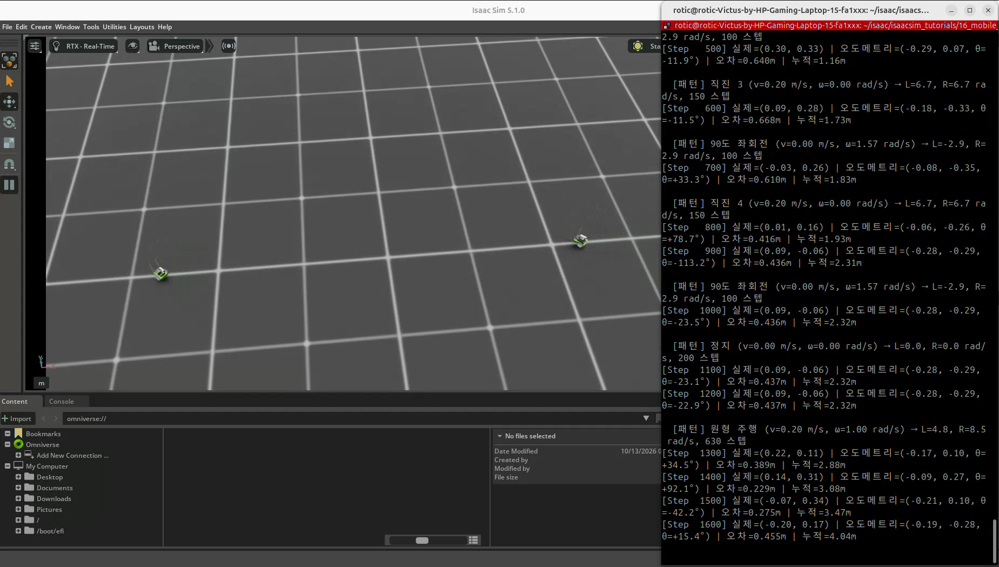
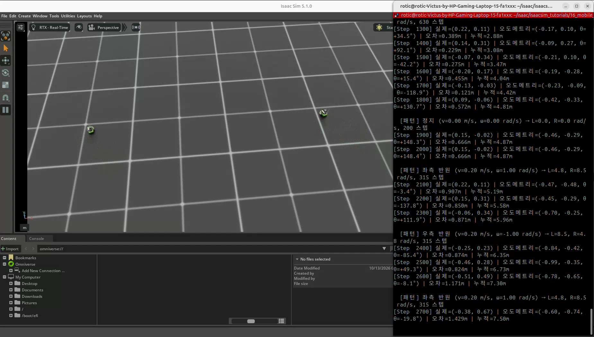
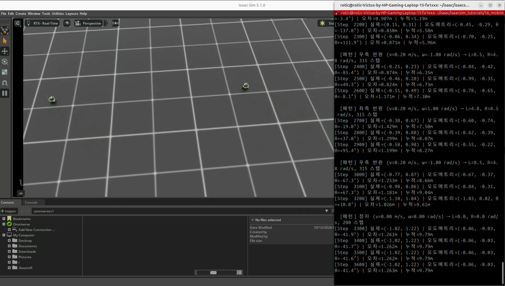

# 16. JetBot 경로 주행과 바퀴 오도메트리

[이 파트의 실습](../README.md) · [전체 실습](../../README.md) · [저장소 홈](../../../README.md)

실습일: 2026-10-13

## 이번 실습의 핵심

**오도메트리는 이동량을 누적해 현재 위치와 방향을 추정하는 방법이다.**
이번 실습은 JetBot의 좌우 바퀴 회전 각도를 읽어 `(x, y, θ)`를 추정하고,
시뮬레이터가 제공하는 실제 위치와 비교한다.
15번의 기본 속도 패턴을 사각형·원형·교대 원호 패턴으로 확장한다.

## 코드와 실행 방법

- [실습 코드](16_mobile_base_control.py): 사용자가 제공한 실행 코드를 그대로 포함했다.
- 출처: PinkLAB 「강좌 16 - 16_mobile_base_control」
- [원본 튜토리얼](https://github.com/PinkWink/isaacsim_tutorials/blob/14f85fc6edece7cbb1faa50aa9fe3adef205e87a/16_mobile_base_control/16_mobile_base_control.py)
- 제공된 코드는 위 원본 버전과 일치한다.

```bash
cd <physical-ai-training 저장소 경로>/practice/03-mobile-robots/16-mobile-base-control
python 16_mobile_base_control.py                 # 기본: 환경 2개
python 16_mobile_base_control.py --num_envs 4
python 16_mobile_base_control.py --headless
```

JetBot USD는 NVIDIA 자산 경로에서 불러온다. 로봇 USD 전체를 이 폴더에 복사한 예제는 아니다.
카메라 센서를 사용하지 않으므로 `--enable_cameras`는 필요하지 않다.

## 실습 구성

| 항목 | 설정 |
|---|---|
| 로봇 | JetBot · 좌우 바퀴 관절 속도 제어 |
| 바퀴 반지름·간격 | R=0.03 m · L=0.1125 m |
| 기본 환경 수·간격 | 2개 · 환경 원점 간격 5.0 m |
| 물리 시간 간격 | 0.01초 |
| actuator | `stiffness=0`, `damping=10` |
| 추정 입력 | 실제 좌우 바퀴 관절 각도 `joint_pos` · rad |
| 추정 상태 | 환경별 x·y·θ와 누적 이동 거리 |
| 비교 로그 | 100 step마다 환경 0의 실제·추정 위치와 오차 |

## 시간 기준 경로 패턴

| 구간 | 명령과 의도 | 길이 |
|---|---|---|
| 사각형 | v=0.2로 1.5초 직진 + ω=π/2로 1초 회전, 4회 반복 | 1000 step · 10초 |
| 정지 | v=ω=0 | 200 step · 2초 |
| 원형 | v=0.2, ω=1 · 이상적인 반지름 0.2 m | 630 step · 6.3초 |
| 정지 | v=ω=0 | 200 step · 2초 |
| 교대 원호 · 원본명 8자 | ω=+1과 -1의 반원 구간을 교대로 4회 실행 | 1260 step · 12.6초 |
| 정지 | v=ω=0 | 200 step · 2초 |

합계는 **3490 step · 34.9초**다. 이후 명령 0으로 300 step을 추가 유지하므로,
리셋까지 한 순환은 **3790 step · 37.9초**다.
패턴 사이에는 로봇을 리셋하지 않고 이전 위치·방향에서 이어서 이동한다.

사각형의 직진 한 변은 이상적인 명령 기준 `0.2 × 1.5 = 0.3 m`다.
회전도 명령 기준으로 90°를 의도한 것이며, 실제로 정확히 90°가 됐는지를 확인하고 보정하는 코드는 아니다.

### 원본의 ‘8자’ 이름과 실제 구성

강의와 코드의 `FIGURE8_PATTERN`은 좌측 반원 → 우측 반원을 반복한다.
그러나 같은 전진 속도로 반원을 번갈아 연결하면 이상적인 운동학에서는
**출발점으로 닫히는 8자보다 S 형태로 이어지는 경로**가 된다.
원본 이름은 유지하되, 코드에 구현된 반원 시퀀스와 완전한 8자 궤적을 구분한다.
실제 궤적에는 구동 응답과 미끄러짐도 영향을 준다.

## 실습 결과

### 사각형 구간과 추정 위치

<p align="center">
  
</p>

### 원형 구간

<p align="center">
  
</p>

### 교대 원호 구간

<p align="center">
  
</p>

### 누적 오차와 정지

<p align="center">
  
</p>

영상에서 두 JetBot의 위치가 변화하고, 터미널에 실제 위치·추정 위치·방향·오차·누적 거리가 출력된다.
반복되는 로그의 예시는 다음과 같다. 위치 단위는 m다.

| step | 실제 위치 | 추정 위치 | 위치 오차 |
|---|---|---|---|
| 100 | (0.22, 0.00) | (-0.18, 0.00) | 약 0.400 m |
| 1200 | (0.09, -0.06) | (-0.28, -0.29) | 약 0.437 m |
| 2000 | (0.15, -0.02) | (-0.46, -0.29) | 약 0.666 m |
| 3400 | (-1.02, 1.22) | (-0.86, 0.03) | 약 1.262 m |

두 위치가 일치하는 결과는 아니다. 특히 첫 직진 구간부터 차이가 있으므로,
오차 전체를 단순히 장시간 주행의 미끄러짐 때문이라고 단정하지 않는다.
바퀴 각도 변화량·관절 축 부호·초기 기준·치수·접촉 조건 등을 함께 확인해야 한다.
이 문서는 제공된 결과와 코드를 기록하며 오도메트리를 보정한 코드로 바꾸지는 않았다.

[원본 녹화 영상 보기 / 다운로드 — 약 80.9초](videos/jetbot-path-odometry.webm)

원본 파일명: `16.webm`. 위 네 이미지는 제공된 영상에서 추출했다.
영상 시간과 로그의 step에 해당하는 시뮬레이션 시간은 구분한다.

## 핵심 개념 1. 바퀴 회전량에서 이동량 구하기

매 step 실제 바퀴 각도를 읽고 이전 값과의 차이를 계산한다.

$$
\Delta s_L=R\Delta\phi_L,\qquad \Delta s_R=R\Delta\phi_R
$$

$$
\Delta s=\frac{\Delta s_R+\Delta s_L}{2},\qquad
\Delta\theta=\frac{\Delta s_R-\Delta s_L}{L}
$$

`Δs`는 로봇 중심의 이동량, `Δθ`는 회전량이다.
명령한 v·ω를 적분하는 것이 아니라 **물리 진행 후 읽은 바퀴 각도 변화**로 추정한다.
바퀴 각도 차이로 이미 이동량을 구했으므로 여기에 `dt`를 다시 곱하지 않는다.

## 핵심 개념 2. 위치·방향 누적

코드는 구간 중간 방향을 사용하는 근사 적분을 적용한다.

$$
x\leftarrow x+\Delta s\cos(\theta+\Delta\theta/2)
$$

$$
y\leftarrow y+\Delta s\sin(\theta+\Delta\theta/2),\qquad
\theta\leftarrow\theta+\Delta\theta
$$

```python
left_pos = robot.data.joint_pos[:, left_ids[0]]
right_pos = robot.data.joint_pos[:, right_ids[0]]
odom.update(left_pos, right_pos)
```

`WheelOdometry`는 이전 바퀴 각도와 환경별 추정값을 저장한다.
`total_dist += abs(ds)`는 로봇 중심 이동량의 절댓값을 누적한 값이며,
출발점에서 현재 위치까지의 직선거리나 바퀴가 굴러간 거리의 합과 다르다.
θ는 정규화하지 않고 누적하므로 출력 각도가 ±180°를 넘을 수 있다.

## 핵심 개념 3. 실제 위치와 비교하는 좌표 기준

```python
pos_local = robot.data.root_pos_w[0] - scene.env_origins[0]
err = math.sqrt(
    (pos_local[0].item() - odom.x[0].item()) ** 2
    + (pos_local[1].item() - odom.y[0].item()) ** 2
)
```

오도메트리는 리셋 시 `(0, 0, 0)`에서 시작한다.
비교 위치에는 환경 원점을 빼서 같은 위치 기준으로 맞춘다.
이는 로봇이 환경 원점에서 기본 방향으로 시작하는 이번 설정에 해당한다.
초기 위치·방향이 다르면 추정값 초기화와 좌표 변환도 함께 맞춰야 한다.

여기서 실제 위치는 시뮬레이터 내부 상태를 읽은 기준값이다.
실제 로봇에서는 이런 절대 위치를 바로 얻을 수 없으므로,
IMU·카메라·LiDAR 등 다른 센서나 외부 위치 측정을 결합해 추정 오차를 줄일 수 있다.
출력 `오차`는 평면 위치 거리이며 방향 오차를 포함하지 않는다.

## 핵심 개념 4. 비홀로노믹 주행과 피드백

JetBot은 방향을 유지한 채 옆으로 바로 이동할 수 없는 비홀로노믹 로봇이다.
목표 방향으로 회전하고 전진하는 동작을 조합해 평면에서 이동한다.
메카넘·옴니 휠 플랫폼은 적절한 구성에서 전후·좌우 이동과 회전을 독립적으로 명령할 수 있다.

이번 경로는 시간 기준 v·ω 패턴이다.
오도메트리 오차를 출력하지만, 그 오차를 이용해 주행 명령을 보정하지는 않는다.
따라서 경로 패턴 실행과 목표 경로에 대한 폐루프 추종 제어를 구분한다.

## 배운 점

- 바퀴 회전량으로 이동량·회전량을 계산해 위치를 추정할 수 있다.
- 시간 기준 경로 명령과 실제 궤적이 일치한다고 가정하면 안 된다.
- 실제·추정 위치를 비교하려면 초기 기준과 좌표계를 맞춰야 한다.
- 오도메트리 오차를 측정하는 것과 그 오차로 주행을 보정하는 것은 다른 단계다.
- 센서 융합과 목표 위치·경로 추종 제어의 필요성을 이해할 수 있다.

[공통 개념 — 오도메트리·비홀로노믹 주행](../../../learning-notes/03-mobile-robots/wheel-odometry/README.md) ·
[차동 구동 기본](../../../learning-notes/03-mobile-robots/differential-drive/README.md)
