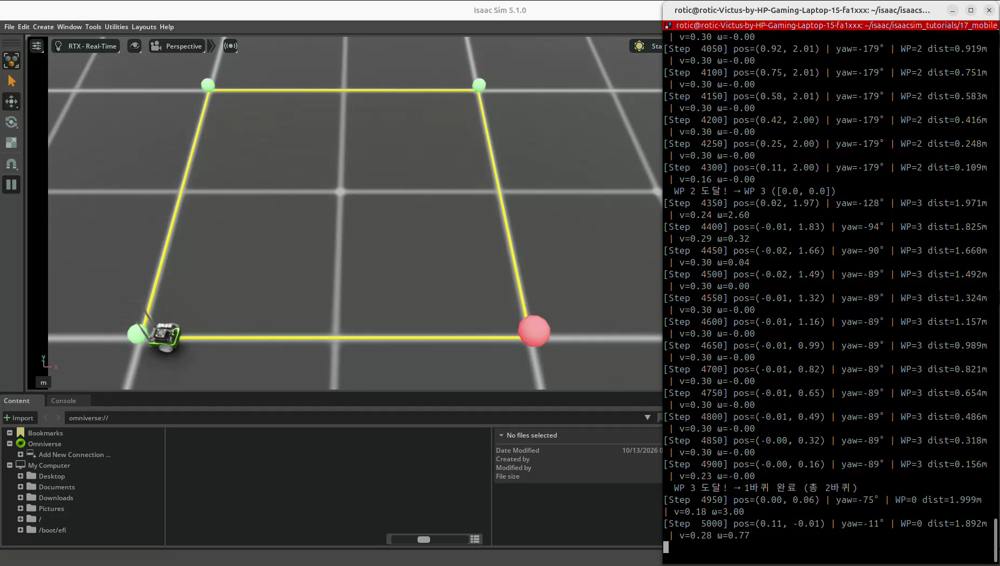
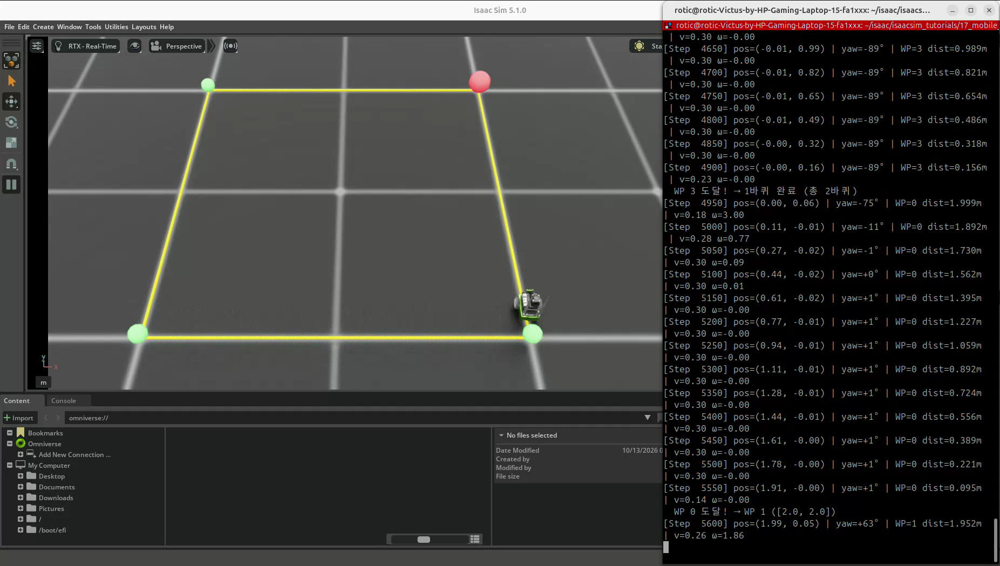
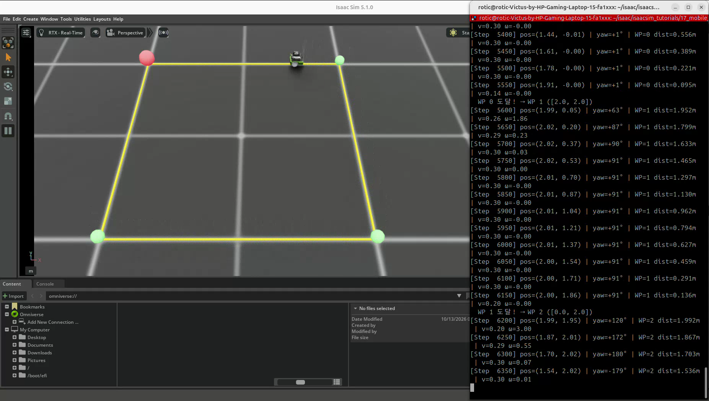
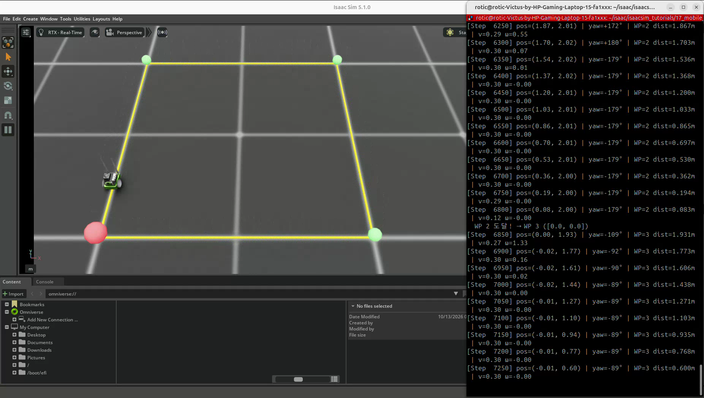

# 17. JetBot P 제어 기반 Waypoint 내비게이션

[이 파트의 실습](../README.md) · [전체 실습](../../README.md) · [저장소 홈](../../../README.md)

## 이번 실습의 핵심

**목표점까지의 거리와 목표 방향의 오차를 읽고, 그 오차에 비례해 전진·회전 속도를 보정한다.**
JetBot 한 대가 2×2 m 사각형의 네 Waypoint를 순서대로 방문하고 반복 순환한다.
16번의 시간 기준 속도 패턴과 달리 현재 위치·방향을 피드백으로 사용하는 폐루프 제어다.

## 코드와 실행 방법

- [실습 코드](17_mobile_navigation.py): 제공된 실행 코드를 그대로 포함했다.
- 출처: PinkLAB 「강좌 17 - 17_mobile_navigation」
- [원본 튜토리얼](https://github.com/PinkWink/isaacsim_tutorials/blob/14f85fc6edece7cbb1faa50aa9fe3adef205e87a/17_mobile_navigation/17_mobile_navigation.py)
- 제공된 코드는 위 원본 버전과 일치한다.

```bash
cd <physical-ai-training 저장소 경로>/practice/03-mobile-robots/17-mobile-navigation
python 17_mobile_navigation.py
python 17_mobile_navigation.py --headless
```

로봇은 NVIDIA 자산 경로의 JetBot USD에서 불러온다.
환경 수는 코드에서 1개로 고정하며, 이 파일에는 `--num_envs` 옵션이 없다.
카메라 센서 예제가 아니므로 `--enable_cameras`는 필요하지 않다.

## 실습 구성

| 항목 | 설정 |
|---|---|
| 로봇·환경 수 | JetBot 1대 · 환경 1개 |
| 바퀴 반지름·간격 | 0.03 m · 0.1125 m |
| 물리 시간 간격 | 0.01초 |
| 선속도 P 게인 | 1.5 |
| 각속도 P 게인 | 4.0 |
| 최대 선속도 | 0.3 m/s · 방향 오차에 따라 추가 감속 |
| 최대 각속도 크기 | 3.0 rad/s |
| 도달 조건 | 목표까지 평면 거리 < 0.08 m |
| 로그 출력 | 50 step마다 위치·yaw·목표·거리·명령 출력 |

Waypoint는 환경 기준으로 `(2, 0) → (2, 2) → (0, 2) → (0, 0)`이다.
시작 시 한 번 로봇 상태를 초기화하며, 한 바퀴를 마칠 때는 위치를 리셋하지 않고 다음 목표로 이어서 주행한다.

## 실습 결과

### 목표점과 경로 표시

<p align="center">
  
</p>

| 표시 | 의미 |
|---|---|
| 녹색 구체 | 네 Waypoint |
| 주황 계열 경로선 | Waypoint를 연결한 시각용 선 |
| 빨간 구체 | 현재 목표 Waypoint |

뷰포트의 조명·재질 표시로 경로선이 노란색에 가깝게 보일 수 있다.
이 선은 명령된 경로의 시각화이며 주행 궤적 기록이나 물리적인 레일이 아니다.

### 목표점 전환

<p align="center">
  
</p>

목표에 가까워지면 속도가 줄고, 도달 조건을 만족하면 다음 목표로 바뀐다.

### 위치·방향 피드백

<p align="center">
  
</p>

목표 변경 직후 방향 오차가 커지면 회전 명령이 커지고 전진 명령은 줄어든다.
정렬된 뒤에는 회전 명령이 작아지고 다음 변을 따라 이동한다.

### 반복 순환

<p align="center">
  
</p>

영상에는 `WP 3 도달! → 1바퀴 완료 (총 2바퀴)` 로그와 이후 목표 전환·주행이 이어진다.
예를 들어 WP 0 접근 로그에서 위치 x가 약 1.44 → 1.61 → 1.78 → 1.91 m로 증가하며,
남은 거리는 0.556 → 0.389 → 0.221 → 0.095 m로 줄어든다.

마지막 0.095 m는 아직 도달 기준 0.08 m 밖이며, 이후 더 가까워졌을 때 WP 1로 전환된다.
로그의 `dist`는 현재 목표까지의 거리로, 주황 경로선에서 벗어난 횡방향 오차와 다르다.

[원본 영상 보기 / 다운로드 — 약 54.4초](videos/jetbot-waypoint-navigation.webm)

원본 파일명: `17.webm`. 위 네 이미지는 제공된 영상에서 추출했다.

## 핵심 개념 1. 거리와 목표 방향 계산

현재 위치 `(x, y)`와 목표 `(xg, yg)`로 다음 값을 구한다.

$$
d=\sqrt{(x_g-x)^2+(y_g-y)^2}
$$

```text
목표 방향 θg = atan2(yg - y, xg - x)
```

`atan2`는 x·y 차이의 부호를 함께 사용해 사분면에 맞는 방향을 계산한다.
현재 yaw는 로봇 루트 쿼터니언에서 읽는다.
위치는 월드 위치에서 `scene.env_origins`를 빼서 Waypoint와 같은 기준으로 맞춘다.

## 핵심 개념 2. 각도 오차 정규화

```python
heading_err = torch.atan2(
    torch.sin(desired_yaw - current_yaw),
    torch.cos(desired_yaw - current_yaw),
)
```

각도 차이를 `[-π, π]` 범위로 나타내면 ±180° 경계에서 불필요하게 긴 방향으로 회전하는 것을 피할 수 있다.
예를 들어 현재 179°, 목표 -179°이면 단순 뺄셈은 -358°지만 짧은 방향 오차는 +2°다.

## 핵심 개념 3. P 제어와 속도 제한

```python
v = torch.clamp(Kp_linear * distance, max=max_linear_vel)
omega = torch.clamp(
    Kp_angular * heading_err, -max_angular_vel, max_angular_vel
)
v = v * torch.clamp(
    1.0 - torch.abs(heading_err) / math.pi, min=0.1
)
```

거리에는 선속도 게인을, 방향 오차에는 각속도 게인을 곱한다.
명령은 각각 0.3 m/s와 ±3.0 rad/s로 제한하고,
방향 오차가 크면 전진 속도에 0.1~1.0의 감속 비율을 적용한다.
따라서 이 코드에서는 방향이 크게 어긋나도 전진 명령을 완전히 0으로 끄지는 않는다.

선속도는 음수가 되지 않아 후진 대신 회전하며 앞으로 접근한다.
P 제어에서 계산한 v·ω는 차동 구동 변환으로 바퀴 각속도 목표에 전달된다.

## 핵심 개념 4. Waypoint 도달과 순환

```python
arrived = distance < arrival_threshold
if arrived.any():
    current_wp[0] = (current_wp[0] + 1) % num_wp
```

정해진 시간이 아닌 거리 조건으로 목표를 전환한다.
허용 반경 안에 들어가면 다음 점으로 이동하므로 각 점을 정확하게 통과하거나,
모서리에서 완전히 정지하는 것이 필수 조건은 아니다.
최종 방향 조건도 별도로 검사하지 않는다.

목표 전환·로그에 사용한 위치와 거리는 해당 루프의 물리 진행 전에 계산한 값이다.
다음 루프에서는 갱신된 상태를 읽어 보정한다.

## 16번과 비교

| 구분 | 16번 | 17번 |
|---|---|---|
| 상위 주행 명령 | 미리 정한 시간별 v·ω | 현재 위치·방향 오차로 계산 |
| 피드백 | 오도메트리를 계산하고 로그로 비교 | 상태를 이용해 명령 보정 |
| 위치 정보 | 바퀴 추정과 시뮬레이터 위치 비교 | 시뮬레이터의 실제 루트 위치 사용 |
| 전환 조건 | 구간 시간 경과 | Waypoint 허용 반경 도달 |

17번은 16번의 바퀴 오도메트리를 피드백으로 연결한 코드가 아니다.
실제 로봇에 적용하려면 센서 기반 위치·방향 추정이 필요하다.
이 예제에는 장애물 회피, 지도 생성, 자동 경로 계획, 강화학습이 포함되지 않는다.
Waypoint를 따라 이동하지만 경로선 자체의 횡방향 오차를 직접 제어하는 알고리즘은 아니다.

## 배운 점

- 현재 상태와 목표의 오차로 주행 명령을 보정하는 폐루프 제어를 구성할 수 있다.
- 각도 경계를 고려해 방향 오차를 정규화해야 한다.
- 속도 제한·방향에 따른 감속·도달 반경이 실제 주행에 영향을 준다.
- 위치 추정, 주행 제어, 경로 계획과 장애물 회피의 역할을 구분해야 한다.

[공통 개념 — P 제어 기반 Waypoint 내비게이션](../../../learning-notes/03-mobile-robots/waypoint-navigation/README.md) ·
[차동 구동](../../../learning-notes/03-mobile-robots/differential-drive/README.md)
