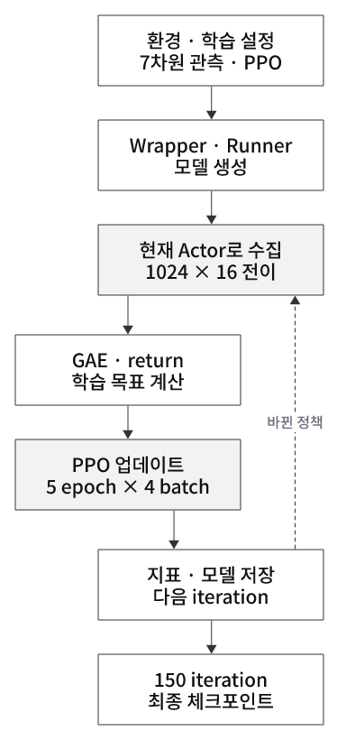
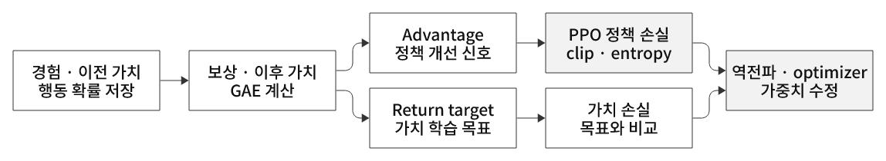
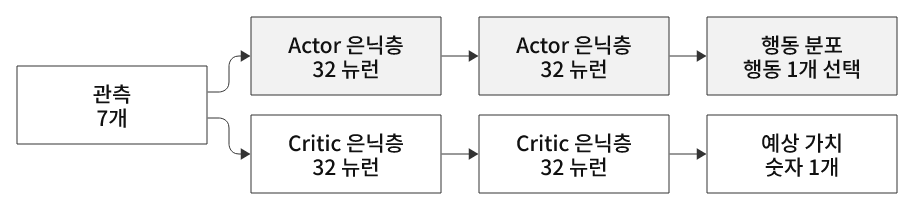
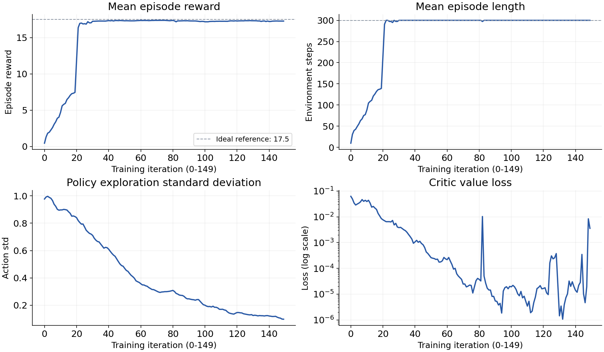
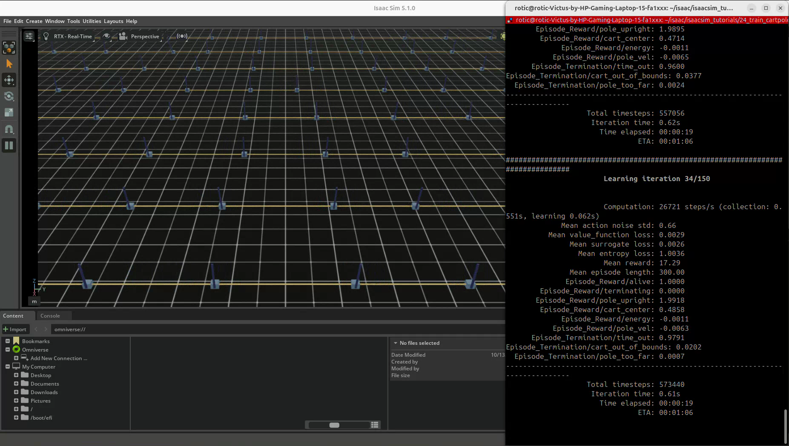
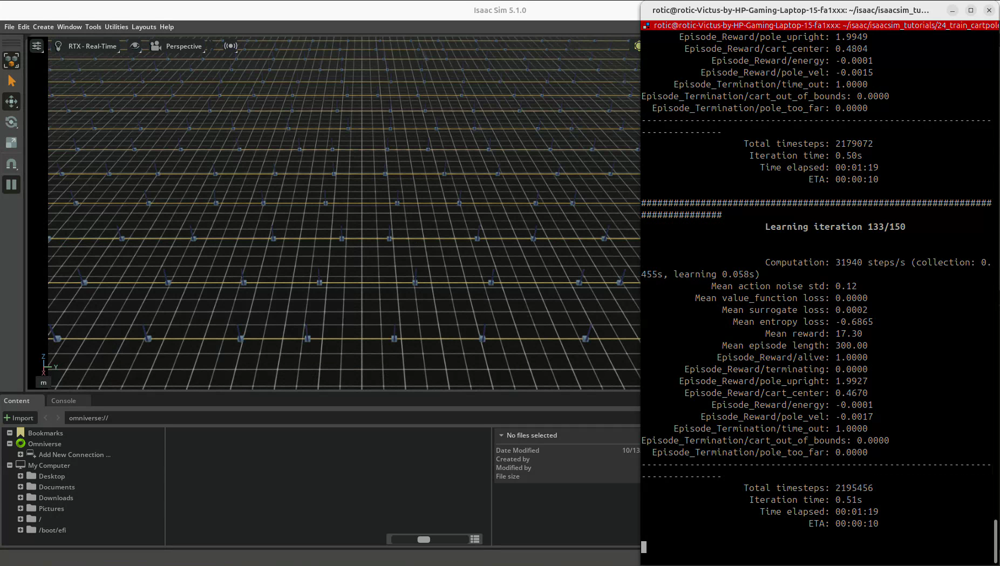
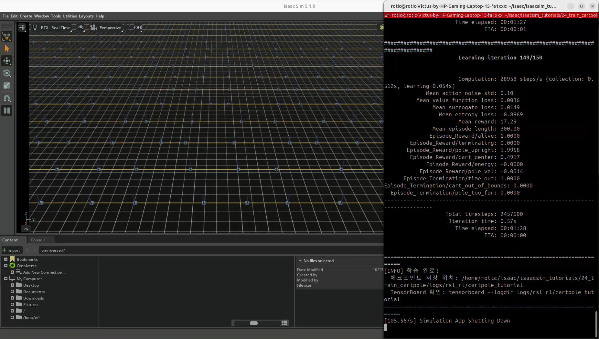

# 24. Cartpole PPO 학습 — 환경에서 실제 정책 학습으로

[이 파트의 실습](../README.md) · [전체 실습](../../README.md) · [저장소 홈](../../../README.md)

## 이번 실습의 핵심

**이번에는 신경망이 관측을 보고 행동을 선택하고, PPO가 경험을 이용해 가중치를 바꾼다.**
20~23번은 랜덤 행동으로 환경을 확인했다. 24번은 같은 핵심 Cartpole 환경에 RSL-RL 학습기를 연결해 막대 직립·카트 중앙 유지 정책을 학습한다.

사용자는 관측·행동·보상·종료와 네트워크 크기·학습 설정을 정한다. 라이브러리는 Actor·Critic을 생성하고 경험 수집·역전파·가중치 저장을 수행한다. 사람이 가중치 숫자를 직접 넣지 않는다.

[코드 리뷰](code-review.md) · [PPO·Actor·Critic 공용 개념](../../../learning-notes/04-reinforcement-learning/reinforcement-learning/04-ppo-training.md#ppo-training)

## 코드·실행·학습 결과 파일

- [제공된 코드](24_train_cartpole.py): 기준 튜토리얼과 동일한 내용
- 출처: PinkLAB 「강좌 24 - 24_train_cartpole」
- [기준 튜토리얼](https://github.com/PinkWink/isaacsim_tutorials/blob/14f85fc6edece7cbb1faa50aa9fe3adef205e87a/24_train_cartpole/24_train_cartpole.py)
- [원본 학습 로그 압축파일](artifacts/logs.zip) · [펼친 TensorBoard 로그와 체크포인트](logs/rsl_rl/cartpole_tutorial)
- [최종 모델 model_149.pt](logs/rsl_rl/cartpole_tutorial/model_149.pt)
- [학습 지표 CSV](analysis/training-metrics.csv) · [통계 JSON](analysis/training-summary.json) · [파일 해시](analysis/log-manifest.json)

```bash
cd <physical-ai-training 저장소 경로>/practice/04-reinforcement-learning/24-train-cartpole
python 24_train_cartpole.py --headless --num_envs 1024 --max_iterations 150
# GUI로 학습 중 상태 관찰
python 24_train_cartpole.py --num_envs 1024 --max_iterations 150
# 저장된 이벤트 확인 · 재학습 없이 가능
tensorboard --logdir logs/rsl_rl/cartpole_tutorial
```

TensorBoard는 `http://localhost:6006`에서 확인한다. 재실행은 현재 폴더의 같은 로그 경로에 새 결과를 기록하므로 실행별 폴더를 분리하는 개선 방법은 [리뷰](code-review.md#7-저장-경로와-재현-정보)에 정리했다. 제공 기록은 원본 zip에도 보존했다.

## 누가 무엇을 하는가

| 구성 | 역할 |
|---|---|
| Isaac Sim | 중력·접촉·구동으로 물리 상태를 진행하고 화면을 렌더링 |
| Isaac Lab 환경 | 관측·행동 변환·보상·종료·개별 리셋 관리 |
| `RslRlVecEnvWrapper` | 환경과 RSL-RL 사이의 데이터 인터페이스 연결 |
| Actor | 관측 7개 → 행동 분포 → 카트 행동 1개 선택 |
| Critic | 같은 관측 → 앞으로의 할인 누적 보상 가치 추정 |
| PPO | 모은 경험으로 행동 선택과 가치 예측 가중치 개선 |
| `OnPolicyRunner` | 수집·학습·로그·체크포인트 저장 반복 |

## D2로 보는 실제 학습 구조

<p align="center">
  
</p>
<p align="center"><sub>그림 12. 24장 환경·학습기 연결과 학습 반복</sub></p>

```python
# 실제 코드의 연결 지점
base_env = ManagerBasedRLEnv(cfg=env_cfg)
env = RslRlVecEnvWrapper(base_env)
runner = OnPolicyRunner(env, agent_cfg.to_dict(), log_dir=log_root_path,
                       device=agent_cfg.device)
runner.learn(num_learning_iterations=agent_cfg.max_iterations,
             init_at_random_ep_len=True)
```

`runner.learn()` 안에 행동 생성·환경 step·가중치 업데이트 반복이 있다. 23번처럼 main에서 `torch.randn()`을 반복하지 않는다.

## 한 iteration에서 하는 일

1. **경험 수집:** 현재 Actor의 분포에서 행동을 샘플링한다. 환경 1024개를 각각 16 환경 step 진행하며 관측·행동·보상·종료·이전 가치·행동 확률 정보를 저장한다.
2. **학습 목표 계산:** Critic의 예측과 이후 보상을 함께 써서 return target과 Advantage를 계산한다. 16 step 안에 에피소드가 끝나지 않아도 마지막 상태의 가치 추정으로 연결한다.
3. **PPO 업데이트:** 수집한 데이터를 4개 mini-batch로 나눠 5 epoch 동안 사용한다. Actor는 기대보다 좋은 행동의 확률을 높이고 Critic은 누적 가치 목표를 더 잘 예측하도록 학습한다.
4. **기록·저장:** 학습 지표를 남기고 저장 주기에 따라 체크포인트를 기록한다. 바뀐 정책으로 다음 경험을 새로 수집한다.

<p align="center">
  
</p>
<p align="center"><sub>그림 13. 경험에서 Advantage·손실·가중치 업데이트까지</sub></p>

PPO는 같은 rollout을 몇 번 재사용한 뒤 다음 정책의 경험으로 바꾸는 on-policy 방식이다. 오래된 경험을 큰 replay buffer에서 계속 꺼내는 방식과 구분한다.

## Actor와 Critic 신경망

<p align="center">
  
</p>
<p align="center"><sub>그림 2. 7차원 입력을 사용하는 Actor·Critic</sub></p>

| 네트워크 | 구성 | 출력 |
|---|---|---|
| Actor | 입력 7 → 은닉 32 → 은닉 32 → 평균 1 · ELU | 행동 분포의 평균 μ |
| Critic | 입력 7 → 은닉 32 → 은닉 32 → 가치 1 · ELU | 미래 할인 누적 보상의 예측 V |

Actor의 평균 외에 탐색용 표준편차 σ가 학습된다. σ 초기값은 1.0이다. 샘플한 행동에 scale=100을 적용해 카트 힘 명령으로 전달한다.
현재 코드의 wrapper에는 `clip_actions`를 지정하지 않아 **행동이 항상 ±1이라는 보장은 없다**. 실제 힘에는 actuator 제한·감쇠도 작용한다.
Critic은 보상 함수를 만드는 모델이 아니며, 일반적인 정책 실행에서는 Actor만으로 행동을 선택할 수 있다.

## Advantage·PPO·손실을 쉽게 이해하기

- **보상:** 환경이 방금 상태·행동에 주는 점수다.
- **Return target:** 지금부터 이후의 할인된 보상을 합친 학습 목표이며 rollout 경계에서는 Critic 추정도 사용한다.
- **Value:** Critic이 미리 예상한 미래 점수다.
- **Advantage:** 예상보다 얼마나 유리했는지를 나타내는 신호다. GAE는 여러 step의 보상·가치 오차를 섞어 계산한다.

예를 들어 같은 상태에서 기대보다 좋은 결과를 만든 행동은 더 자주 선택하도록 배우고, 기대보다 나쁜 행동은 덜 선택하도록 배운다. 한 번 받은 보상만으로 판단하는 것은 아니다.

PPO의 clip=0.2는 이전/새 정책의 **그 행동에 대한 확률비**를 손실에서 다루는 범위다. 액션을 ±0.2로 제한하거나 모든 가중치 변화를 20%로 제한하는 설정이 아니다.

Actor 정책 손실 + Critic 가치 손실 - 탐색 entropy 보너스를 함께 최적화한다. 역전파가 가중치별 수정 방향을 계산하고 optimizer가 수정한다.
실제 목적함수·GAE의 직관과 설정은 [공용 강화학습 개념](../../../learning-notes/04-reinforcement-learning/reinforcement-learning/04-ppo-training.md#ppo-training)에 정리했다.

## 학습 설정과 단위

| 설정 | 값 | 의미 |
|---|---|---|
| 병렬 환경 | 1024 | 함께 진행하는 독립 환경 |
| rollout 길이 | 16 | iteration마다 환경당 수집할 환경 step |
| rollout 전이 | 16,384 | 1024 × 16 |
| mini-batch | 4개 · 각 4096개 전이 | 한 번 optimizer에 넘기는 묶음 |
| epoch | 5 | 같은 rollout을 사용하는 횟수 |
| optimizer step | 기본 구성에서 iteration당 20회 | 5 × 4 |
| iteration | 150 · 로그 0~149 | 수집·학습 반복 수 · 에피소드 수와 다름 |
| 총 전이 | 2,457,600 | 1024 × 16 × 150 |
| 물리 / 환경 dt | 1/120초 / 1/60초 | 행동 하나를 두 물리 step 동안 적용 |
| 에피소드 상한 | 300 환경 step · 5초 | rollout 16 step과 별개 |
| learning rate | 시작 설정 0.001 · adaptive | KL에 따라 조절 |
| gamma / GAE lambda | 0.99 / 0.95 | 미래 할인 / 추정 신호의 균형 |
| clip / entropy 계수 | 0.2 / 0.005 | 정책 개선 제한 목적 / 탐색 장려 |
| desired KL / gradient norm | 0.01 / 1.0 | 적응적 학습률 기준 / gradient 크기 제한 |

`init_at_random_ep_len=True`는 초기 에피소드 **시간 카운터**를 분산한다. 각 환경을 과거부터 미리 시뮬레이션했다는 뜻은 아니다. 최초 에피소드는 timeout까지 실제로 실행한 길이가 짧을 수 있다.

## 실제 학습 곡선 — 제공 TensorBoard 이벤트 분석

<p align="center">
  
</p>

이 그림은 제공 이벤트의 원시 scalar로 생성했다. smoothing은 적용하지 않았다. [곡선·CSV 생성 코드](analysis/render_training_curves.py)는 TensorBoard 이벤트를 다시 읽어 같은 지표를 출력한다.

| 지표 | iteration 0 | iteration 149 |
|---|---:|---:|
| Mean episode reward | 0.4503 | 17.2854 |
| Mean episode length | 9.7353 | 300.0000 |
| 행동 표준편차 | 0.9766 | 0.0980 |
| Value loss | 0.06253 | 0.00358 |
| Task 실패: 카트 / 막대 지표 | 0.0000 / 0.00195 | 0 / 0 |
| Timeout 지표 | 0.02820 | 1.0000 |

보상과 유지 길이가 함께 증가하고, 마지막 기록에서는 직립·중앙 보상이 높으며 task 실패 지표가 0이다. 이번 학습 실행에서 균형 유지 정책을 배웠다는 근거다.
초기 기록은 무작위 에피소드 시간 카운터의 영향도 있어 23번의 평균 1.42와 곧바로 같은 조건으로 비교할 수 없다.
하지만 학습 로그의 최근 완료 에피소드 평균과 종료 집계는 **별도 평가 성공률**이 아니다. 25번에서 저장 모델을 새로운 초기 상태로 평가해야 한다.

영상의 최종 출력은 `Total timesteps: 2457600`, `Time elapsed: 00:01:28`이며 이벤트 기록 시간 범위도 약 88.28초다. 강의의 14초는 다른 PC·실행 조건의 예시다.
평균 보상 17.29는 환경 보상의 이상적 17.5에 가까우며, ‘보상 17점이 작다’고 해석할 필요는 없다. dt가 반영된 5초 누적 점수다.

## 영상 결과

<p align="center">
  
</p>

<p align="center">
  
</p>

<p align="center">
  
</p>

영상은 학습 중 GUI와 로그 기록이다. 독립적인 평가 실행 영상과 구분한다.

[원본 영상 보기 / 다운로드 — 약 83.41초](videos/24.webm)

원본 파일명: `24.webm`. 위 캡처는 제공 영상에서 추출했다.

## 체크포인트와 다음 단계

제공 zip에 `model_0.pt`, `model_50.pt`, `model_100.pt`, `model_149.pt`와 TensorBoard 이벤트가 있다. `model_0`은 첫 iteration 업데이트 후 저장한 모델이며 학습 전 초기 가중치가 아니다.
최종 파일에는 Actor·Critic·탐색 표준편차와 optimizer 상태·iteration 등의 학습 상태가 들어간다. 제공 파일의 Actor 첫 가중치 크기 `(32, 7)`, 출력 가중치 `(1, 32)`와 저장 iteration 149를 메타데이터에서 확인했다. model_0과 model_149의 Actor 첫 층 가중치 224개가 모두 달라 실제 가중치 변경도 확인했다.

25번에서는 최종 체크포인트를 로드해 정책 행동을 실행하고, 학습 중 탐색 샘플링과 평가용 평균 행동을 구분한다. 보상·유지 시간·카트 위치·막대 각도·실패율을 함께 비교한다.
