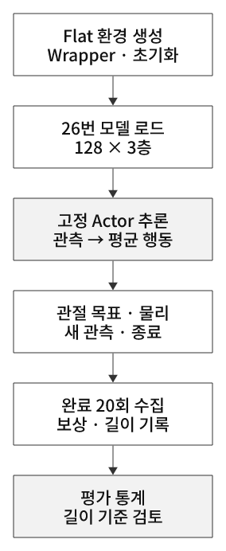
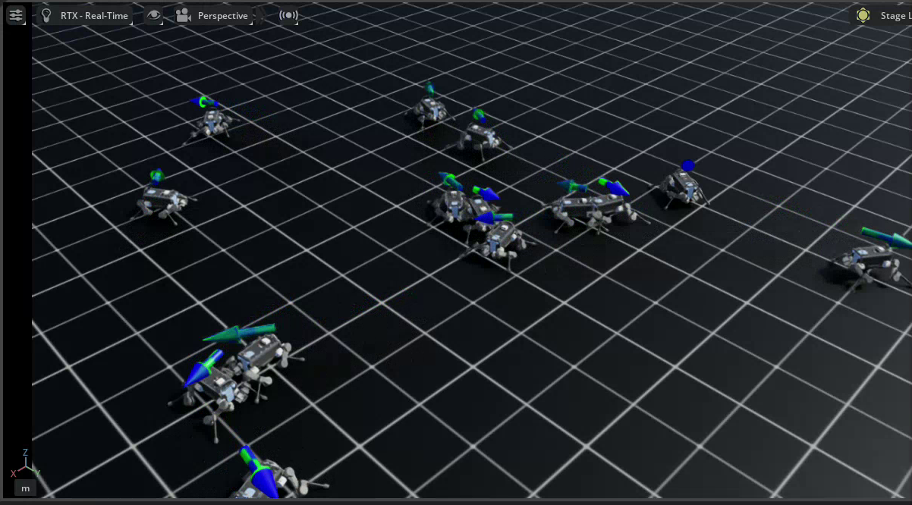
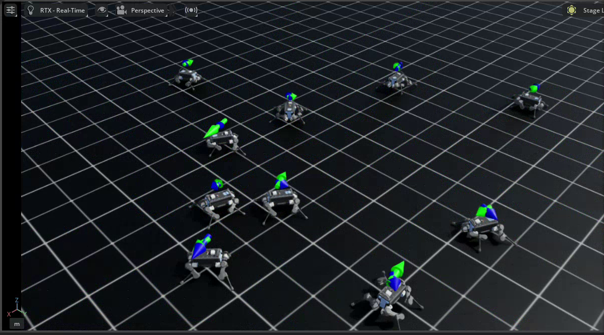
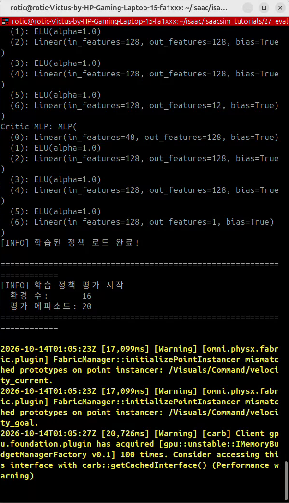
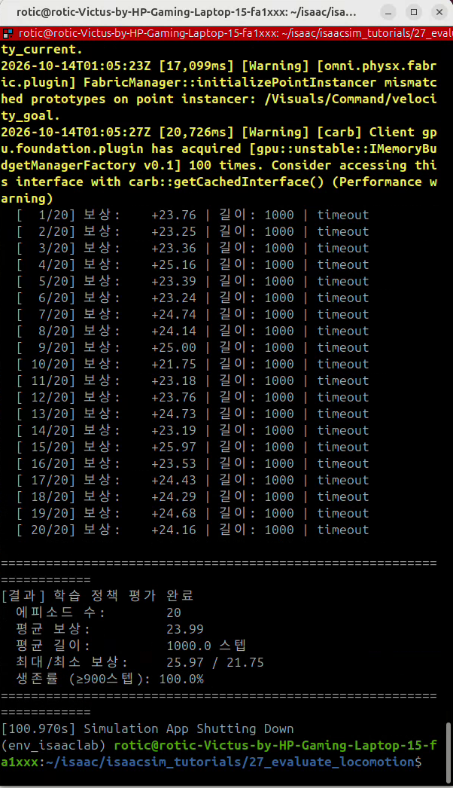
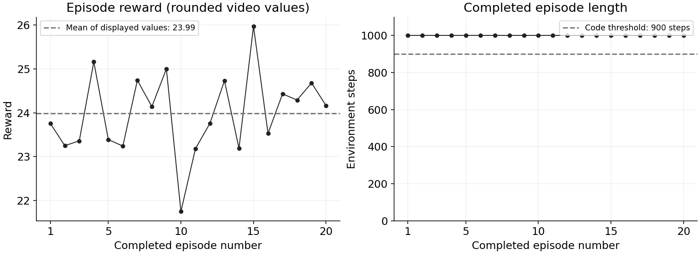

# 27. ANYmal 보행 정책 추론·평가

[이 파트의 실습](../README.md) · [전체 실습](../../README.md) · [저장소 홈](../../../README.md)

## 이번 실습의 핵심

**26번에서 학습한 정책의 가중치를 고정하고, 현재 몸 상태와 속도 명령으로 관절 행동을 계산해 실제 보행 성능을 확인한다.**
새로운 rollout을 PPO로 학습하는 단계가 아니다. 모델을 불러온 뒤 Actor 평균 행동으로 환경을 진행하고 완료 에피소드의 보상·길이를 집계한다.

[코드 리뷰](code-review.md) · [보행 개념](../../../learning-notes/04-reinforcement-learning/legged-locomotion/README.md) · [26번 학습 로그·모델](../26-train-locomotion/README.md) · [학습·추론·평가 개념](../../../learning-notes/04-reinforcement-learning/reinforcement-learning/06-policy-evaluation.md#policy-evaluation)

## 코드와 실행 방법

- [제공된 코드](27_evaluate_locomotion.py): [기준 튜토리얼](https://github.com/PinkWink/isaacsim_tutorials/blob/14f85fc6edece7cbb1faa50aa9fe3adef205e87a/27_evaluate_locomotion/27_evaluate_locomotion.py)과 동일하다.
- 출처: PinkLAB 「강좌 27 - 27_evaluate_locomotion」
- 기본 태스크는 Flat ANYmal-B, 환경 16개, 목표 20에피소드다.

```bash
cd <physical-ai-training 저장소 경로>/practice/04-reinforcement-learning/27-evaluate-locomotion
# 저장소에 보존한 26번 최종 모델을 명시
python 27_evaluate_locomotion.py --num_envs 16 --num_episodes 20 --checkpoint ../26-train-locomotion/logs/rsl_rl/anymal_locomotion_tutorial/model_299.pt
# 랜덤 행동 비교 · 이번 첨부 영상에는 랜덤 실행 결과가 없음
python 27_evaluate_locomotion.py --random --num_envs 16 --num_episodes 20
# 화면 없이 평가할 수도 있음
python 27_evaluate_locomotion.py --headless --num_envs 64 --num_episodes 50 --checkpoint ../26-train-locomotion/logs/rsl_rl/anymal_locomotion_tutorial/model_299.pt
```

원본 자동 탐색은 튜토리얼의 `26_train_locomotion` 폴더명을 사용한다. 이 저장소는 `26-train-locomotion`이므로 체크포인트를 명시했다.
코드는 파일이 없으면 경고 후 랜덤 평가로 전환한다. 로그의 `학습된 정책 로드 완료`·평가 모드를 확인한다.

## 학습에서 평가로 무엇이 바뀌나

| 구분 | 26번 학습 | 27번 학습 정책 평가 |
|---|---|---|
| 행동 선택 | Actor의 분포에서 탐색 샘플 | Actor 평균 μ |
| 정책 가중치 | PPO로 업데이트 | 고정 |
| 관측·행동 | Flat 기준 48 / 12 | 같은 입력·행동 계약 |
| 관절 명령 | 기본 자세 + 0.5×행동 | 동일한 위치 목표 변환 |
| 하위 구동 | ANYdrive actuator-net | 같은 구동 모델 |
| 주요 결과 | 학습 곡선·모델 | 완료 에피소드 통계·보행 관찰 |
| 기본 병렬 수 | 2048 | 16 |

관측을 보고 행동을 내는 제어 루프는 계속 반복된다. 가중치를 업데이트하지 않는다는 것이 로봇이나 actuator 내부 상태까지 정지한다는 뜻은 아니다.
`torch.no_grad()`는 gradient 기록을 끄며, 이번 deterministic 동작은 `get_inference_policy()`의 평균 출력에서 나온다.

## 실행 구조

<p align="center">
  
</p>
<p align="center"><sub>그림 21. 등록 환경·체크포인트·고정 Actor·에피소드 통계 연결</sub></p>

`gym.make()`로 환경을 만들고 wrapper가 초기 reset을 수행한다. 학습 때와 같은 `[128,128,128]` Actor·Critic 구조를 만든 뒤 모델을 로드한다.
`load_optimizer=False`로 optimizer 복원은 생략하고, `get_inference_policy()`를 얻어 매 step 새 관측에 적용한다. `runner.learn()`은 호출하지 않는다.

## deterministic 정책인데 환경도 고정되나

**정책의 탐색 샘플링 제거와 환경의 무작위성 제거는 다르다.**
기본 task ID는 `Isaac-Velocity-Flat-Anymal-B-v0`이며 Play 환경으로 자동 변경하지 않는다.
참조 Isaac Lab v2.3.2 설정에서는 관측 노이즈·랜덤 초기화·명령 재샘플링·물리 변동·주기적 속도 교란 등 학습 Cfg의 요소가 남는다.
따라서 같은 모델이어도 초기 상태와 관측·명령이 달라지면 움직임과 보상이 달라질 수 있다.

보행을 평가할 때는 오래 버티는지뿐 아니라 목표 속도와 실제 속도, 몸의 기울기, 비정상 접촉, 구동 부담도 함께 본다.
초록 화살표는 목표 평면 속도, 파란 화살표는 현재 평면 속도다. 착지점이나 발 접촉력을 뜻하지 않는다.

## 제공 영상 결과

<p align="center">
  
</p>

<p align="center">
  
</p>

<p align="center">
  
</p>

영상에서 학습 정책 로드와 16환경·20에피소드 평가를 확인했다. 아래 값은 강의 예시 대신 **이번 영상의 최종 로그**다.
실행 안내는 저장된 model_299를 명시하지만 첨부 영상에서 로드한 파일의 전체 경로까지 별도 확정한 것은 아니다.

<p align="center">
  
</p>

| 최종 출력 | 값 |
|---|---:|
| 완료 에피소드 | 20 |
| 평균 보상 | 23.99 |
| 평균 길이 | 1000.0 step · 20초 |
| 최대 / 최소 보상 | 25.97 / 21.75 |
| 코드의 생존률 | ≥900 step 기준 · 100.0% |

<p align="center">
  
</p>
<p align="center"><sub>그림 27-1. 영상의 반올림된 episode 결과. 파선은 평균 보상과 코드의 길이 기준이며 원시 scalar 곡선은 아니다.</sub></p>

[그래프 생성 코드](analysis/render_evaluation_results.py) · [에피소드별 표시값 CSV](analysis/episode-results.csv) · [출처·계산 기준 JSON](analysis/evaluation-summary.json)

20개 완료 행 모두 길이 1000·`timeout`으로 출력됐다. 표시된 2자리 보상값을 전사한 CSV이며 원시 부동소수점 로그가 아니다.
최종 평균은 23.99로 표시되며 전사값 평균도 반올림하면 일치한다. 이번 영상은 학습 정책 실행 하나이므로 랜덤 정책의 결과를 임의로 만들어 비교하지 않는다.

[보행 게시 영상 — 원본의 0~70초 구간](videos/27-walking.webm)

업로드 파일명은 `27.webm`, 원본 길이는 약 78.61초다. 끝에 파일 관리자·채팅 화면이 포함되어 원본 전체는 게시하지 않았다.
개인 화면이 나타나기 전 0~70초만 게시하고, 최종 로그는 터미널 영역만 추출했다. 장면 캡처도 Isaac Sim viewport만 사용했다.

## ‘생존률 100%’를 정확히 읽기

코드는 다음 기준을 사용한다.

```python
max_len = max(all_lengths)
success_threshold = int(max_len * 0.9)
success_rate = sum(length >= success_threshold for length in all_lengths) / len(all_lengths) * 100
```

즉 **이번에 관측한 최장 길이의 90% 이상을 달성한 비율**이다. 환경 상한의 90%나 timeout 도달 비율을 직접 계산하지 않는다.
이번에는 max_len=1000이라 기준이 900 step(18초)이 됐지만, 900 step 이후 실패도 성공으로 셀 수 있다.
더 중요한 반례로 모든 에피소드가 40 step에서 실패하면 기준은 36이 되어 이 지표가 100%로 나올 수 있다.

따라서 서로 다른 모델·랜덤 정책을 비교할 때 표본마다 기준을 다시 만들면 공정한 생존률 비교가 아니다.
고정된 시간 기준과 task 실패 없는 timeout 여부, 속도 추적 오차 기준을 함께 정하는 편이 적절하다.
이번 표본은 실제 20회 모두 1000 step을 기록했다는 별도 근거가 있지만, 모든 초기 상태·외란·지형의 성공을 보장하지는 않는다.

## 26번 학습 지표와의 관계

26번 최종 학습 보상은 약 18.93, 이번 평균 평가 보상은 23.99다. **추론 중에 추가 학습해서 점수가 올랐다는 뜻이 아니다.**
탐색 샘플 대신 평균 행동을 사용하고, 완료 표본·초기화·명령·집계 조건도 달라졌으므로 두 숫자를 같은 통계처럼 비교하지 않는다.
정책이 명령을 따라 걷는지 시각화하고 정해진 조건에서 평가했다는 것이 이번 장의 성과다.

## 다음 확장

28번에서는 지형 변화에 대한 일반화를 확인한다. Flat 모델의 보행 결과를 거친 지형·계단 성능으로 일반화하지 않는다.
Rough의 height scan처럼 입력 차원이 달라지면 모델을 그대로 load할 수 없는 경우도 있으므로 환경·관측·구동·모델 계약을 먼저 확인한다.
