# 35. G1 휴머노이드 — 스스로 서 있기 학습

[이 파트의 실습](../README.md) · [전체 실습](../../README.md) · [저장소 홈](../../../README.md)

## 이번 실습의 핵심

**Unitree G1의 현재 몸 상태·관절 상태를 보고 목표 관절 각도를 계속 조정해, 두 발로 균형을 유지하도록 PPO로 학습한다.**
26번의 ANYmal 보행과 학습 알고리즘은 같지만, 로봇·행동 수·관측·보상·종료 조건이 달라진다. 이번 목표는 평지의 기본 자세에서 **서 있기 유지**이며, 누워서 일어나기·걷기·외란 회복까지 검증하는 과제는 아니다.

[휴머노이드 서기 개념](../../../learning-notes/05-humanoid-rl/humanoid-standing/README.md) · [코드 리뷰](code-review.md) · [강화학습 개념](../../../learning-notes/04-reinforcement-learning/reinforcement-learning/08-humanoid-and-imitation.md#humanoid-standing) · [PD·중력 보상](../../../learning-notes/02-robot-control-and-sensors/pd-pid-gravity-compensation/README.md)

## 제공 파일과 네 영상의 역할

| 파일 | 역할 |
|---|---|
| [g1_standing_env.py](g1_standing_env.py) | 씬·행동·관측·보상·종료·PPO 공용 정의 |
| [35_1_random_actions.py](35_1_random_actions.py) | 빈 관측·보상·종료 manager로 랜덤 명령 관찰 |
| [35_2_train_standing.py](35_2_train_standing.py) | PPO 학습과 로그·모델 저장 |
| [35_3_play_standing.py](35_3_play_standing.py) | 학습/랜덤 정책 평가와 토크 모니터링 |
| [첨부 ZIP 원본](artifacts/35_g1_standing.zip) | 제공된 코드·두 event 파일·21개 checkpoint·토크 PNG 원본 보관 |
| [로그·모델](logs/rsl_rl/g1_standing_tutorial) | event 파일과 `model_0`~`model_999` 체크포인트 |

사용자 제공 Python 4개는 수정하지 않았다. [튜토리얼 기준 버전](https://github.com/PinkWink/isaacsim_tutorials/tree/14f85fc6edece7cbb1faa50aa9fe3adef205e87a/35_g1_standing) 대비 `35_1 --num_envs` 기본값만 64→100이며 나머지는 동일하다. 출처는 PinkLAB 「강좌 35-1 - 35_g1_standing」이다.

| 첨부 영상 | 확인한 실행 | 게시본 |
|---|---|---|
| 35-1 | 100개 G1 · bias+noise 랜덤 명령 · 넘어짐 관찰 | [0~24초](videos/35-1-random-actions.webm) |
| 35-2 | 512환경 PPO 학습 초반 장면 | [전체 영상](videos/35-2-training.webm) |
| 35-3 | 학습 정책 · 4환경 평가 · 토크 그래프 | [전체 영상](videos/35-3-trained-evaluation.webm) |
| 35-4 | 랜덤 정책 · 4환경 평가 · 토크 그래프 | [전체 영상](videos/35-4-random-evaluation.webm) |

35-1 원본 약 27.14초의 끝에 개인 작업 화면이 있어 앞 24초만 공개했다. 나머지는 Isaac Sim·터미널·결과 그래프만 나타나는 영상이다. 아래 캡처도 해당 영역만 추출했다.

## 실행 방법

```bash
cd <physical-ai-training 저장소 경로>/practice/05-humanoid-rl/35-g1-standing
# 1. 학습 전 랜덤 관절 명령 관찰
python 35_1_random_actions.py --num_envs 100 --max_steps 500
# 2. 저장된 최종 모델 평가
python 35_3_play_standing.py --num_envs 4 --num_episodes 10 --checkpoint logs/rsl_rl/g1_standing_tutorial/model_999.pt
# 3. 같은 평가 환경에서 랜덤 정책과 비교
python 35_3_play_standing.py --random --num_envs 4 --num_episodes 10
```

새 학습은 기존 checkpoint와 겹치지 않는 별도 작업 디렉터리에서 실행할 수 있다. 학습 스크립트는 **현재 작업 디렉터리**에 `logs/`를 만든다.

```bash
# 35-g1-standing에서 실행 · 이름은 실행마다 구분
mkdir -p runs/new-training
cd runs/new-training
python ../../35_2_train_standing.py --headless --num_envs 512 --max_iterations 1000
```

기본 평가 그래프 파일 `35_3_torque_result.png`도 실행마다 덮어쓴다. 첨부 PNG는 [랜덤 정책 원본](images/random-torque-original.png)으로 별도 보존했다.
기존 ZIP·로그를 펼쳐 두었으므로 별도 튜토리얼 폴더로 이동할 필요는 없다. 실제 실행에는 공용 README의 Isaac 환경과 G1 USD 자산 접근이 필요하다.

## 관측과 행동 — 120개 상태에서 37개 관절 목표로

| 관측 | 차원 | 의미 |
|---|---:|---|
| 몸체 선속도·각속도 | 3+3 | 몸 기준 운동 상태 · Euler 각도가 아님 |
| projected gravity | 3 | 몸 기준 중력 방향으로 기울기 감지 |
| 상대 관절 위치·속도 | 37+37 | 기본 자세·속도 대비 상태 |
| 지난 action | 37 | 직전 제어 명령 |
| 합계 | **120** | Actor와 Critic이 사용하는 같은 policy 관측 그룹 |

`G1_MINIMAL_CFG`의 37개 관절을 모두 선택한다. 관측 corruption은 꺼져 있고, 목표 보행 속도·height scan·직접적인 발 접촉력·절대 root 높이는 이 관측에 없다.
행동은 37개 관절의 위치 목표 오프셋이다.

```text
q_target = q_default + 0.25 × action
```

이는 현재 각도에 매번 더하는 누적 회전 명령이 아니다. `scale=0.25`는 크기 변환이며 학습 정책 출력을 ±1로 제한하지 않는다.
목표 각도를 PhysX의 implicit PD actuator가 추종한다. 정책이 토크 37개를 직접 출력하는 구조가 아니다.

## 서 있기를 어떤 점수로 가르치나

| 보상 항 | weight | 의도 |
|---|---:|---|
| alive_bonus | +1 | 실패하지 않고 유지 |
| height_reward | +15 | root 높이를 0.74m에 가깝게 유지 |
| flat_orientation | -5 | 몸체 기울기 억제 |
| joint_vel | -0.01 | 관절 움직임 억제 |
| action_rate | -0.1 | 연속 행동의 급격한 변화 억제 |
| joint_limits | -1 | soft joint limit 위반 억제 |

높이 보상은 `exp(-(z-0.74)^2 / 0.01)`이다. 목표에서 10cm 벗어나면 약 0.368, 20cm면 약 0.018이 된다.
**0.74m는 로봇의 전체 신장이 아니라 root frame의 목표 월드 z좌표**다. 질량 중심(CoM) 높이를 직접 계산한 것도 아니다.
보상 가중치만으로 실제 항의 중요도를 비교할 수는 없고, 각 함수 값의 범위·단위와 누적 시간도 함께 봐야 한다.

실패는 몸 기울기 약 45도 초과 또는 root 높이 0.35m 미만이고 시간 상한은 5초다. 최대 250 환경 step이다.
`episode_length_s=5`라는 숫자만으로 자동 종료가 생기는 것은 아니다. 35_1은 termination term이 비어 있어 500 step(10초) 동안 넘어져도 자동 리셋하지 않는다.

## 공유 환경·정책·학습의 구성

<p align="center">
  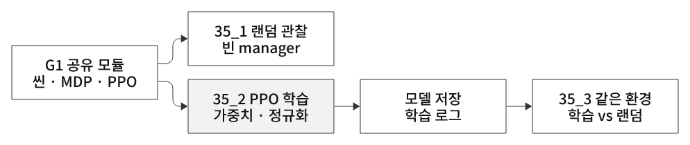
</p>
<p align="center"><sub>그림 26. 공유 모듈은 정의의 일치를 돕는다. 35_1의 빈 manager 관찰과 35_3의 정량적 랜덤 평가는 구분한다.</sub></p>

Actor는 **120→정규화→128→64→32→37**, Critic은 **120→정규화→128→64→32→1**이다. hidden activation은 ELU다.
정책은 Gaussian 탐색을 사용해 학습하고, 평가에서는 평균 행동을 낸다. checkpoint에는 정규화 통계도 포함되므로 가중치뿐 아니라 입력 처리까지 맞춰야 한다.

물리 dt 0.005초(200Hz), decimation=4 → 정책·환경 step은 0.02초(50Hz)다.
이번 한 iteration은 `512×24=12,288` 전이를 수집하고 **8미니배치×5 epoch = 40회 optimizer 업데이트**를 진행한다. 미니배치당 1,536개이며 1000 iteration의 총 전이는 12,288,000개다.
26번은 미니배치가 4개였으므로 iteration당 20회였지만, 이번 코드는 8개라 40회다. episode 완료와 학습 업데이트 시점은 여전히 별개다.

## 35_1 결과 — 랜덤 명령은 균형을 만들지 못함

<p align="center">
  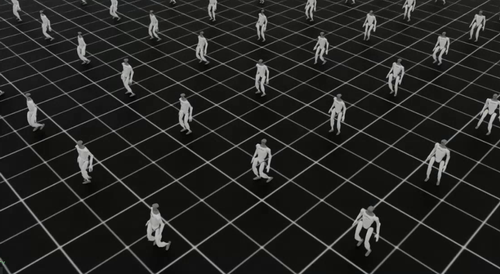
</p>
<p align="center">
  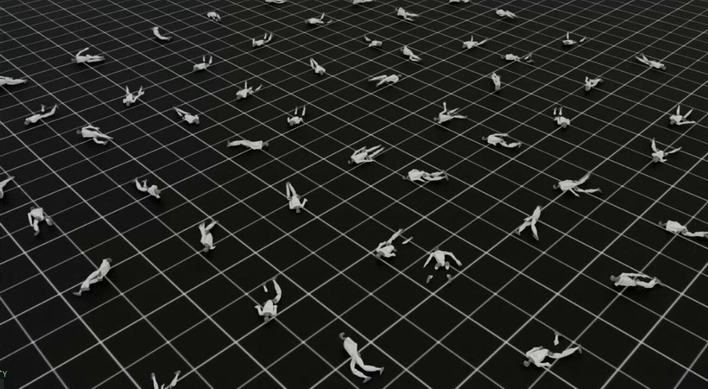
</p>
<p align="center">
  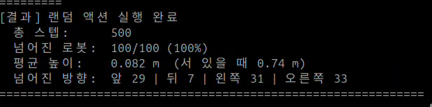
</p>

100환경·500 step 뒤 root 높이 0.35m 미만이 **100/100**, 평균 높이는 **0.082m**다. 로그의 방향은 앞29·뒤7·왼쪽31·오른쪽33이다.
이 방향은 시작점 대비 root의 평면 이동 방향이며 몸이 넘어지는 회전 방향을 센서로 직접 측정한 값은 아니다.
35_1은 관측·보상·종료가 없고 랜덤 bias도 달라, 이것만으로 학습 정책과 동일 조건의 성공률 비교가 되지는 않는다. 정량 비교는 아래 35_3 `--random` 결과를 사용한다.

## 35_2 결과 — 추가 사진과 실제 학습 로그 대조

<p align="center">
  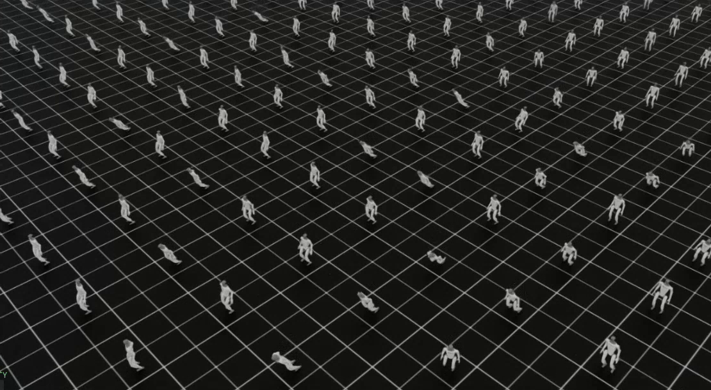
</p>

첨부 event 파일은 두 개다. `.12079.0`은 iteration 0~22의 짧은 실행, `.12469.0`은 **0~999 완주 실행**이다. 아래 곡선은 완주 실행만 사용했으며 두 run을 이어 붙이지 않았다.
35-2 영상은 초반 기록이고, 추가 사진은 최종 학습 로그다. 사진의 수치는 완주 event 파일의 마지막 값과 일치한다.

| 지표 | 시작 iteration 0 | 최종 iteration 999 |
|---|---:|---:|
| 평균 episode 보상 | 2.66 | **77.90** |
| 평균 episode 길이 | 11.55 | **250.00 step · 5초** |
| 높이 보상 log | 0.6547 | **14.9859** |
| timeout manager 지표 | 0.0482 | **1.0000** |
| 평균 탐색 표준편차 | 0.5010 | **0.1488** |
| Critic value loss | 3.6205 | **0.000468** |
| soft-limit 패널티 log | -0.0154 | **-0.2006** |

추가 사진의 최종 처리량 7022 transitions/s, 수집1.625초·학습0.125초도 로그와 일치한다. 표시된 시간 27분45초와 event 첫·마지막 wall time 간격 약27분48초는 측정 구간이 달라 구분한다.
PPO의 1000회 반복으로 서 있기 성능이 향상됐지만, 마지막 평균이 좋다는 사실이 모든 외란·초기 자세의 성공을 보장하지는 않는다.

<p align="center">
  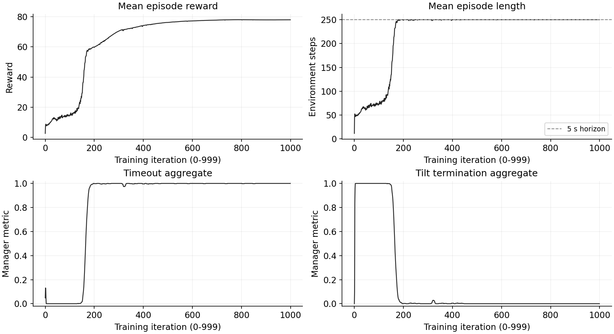
</p>
<p align="center"><sub>그림 35-1. 1000 iteration의 실제 학습 지표. 독립 평가 성공률과는 다르다.</sub></p>

평균 episode 길이는 iteration 177에서 처음 249 이상이 된다. 초반의 짧은 길이에는 실패 외에도 `init_at_random_ep_len=True`가 시작 episode의 timeout 카운터를 분산하는 영향이 있다.
이 옵션은 로봇을 무작위 자세로 시작시키는 설정이 아니다.

<p align="center">
  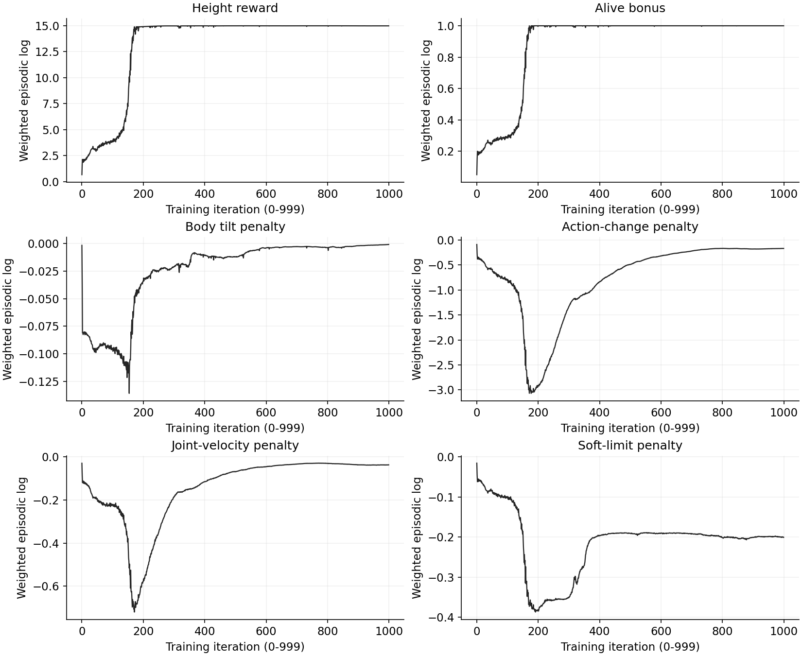
</p>
<p align="center"><sub>그림 35-2. 항별 가중 누적 보상을 최대 episode 시간 5초로 나눈 로그다.</sub></p>

높이 보상은 최대15에 가깝지만 관절 한계 패널티는 **0으로 사라지지 않았다.** PDF 예시의 ‘joint_limits가 0으로 수렴’이라는 설명을 이번 결과에 그대로 적용하지 않는다.
soft limit은 물리 hard limit과 다르므로 -0.2006만으로 하드웨어 한계 위반 크기나 어느 관절이 원인인지 확정할 수 없다.
높이·생존 최대 양의 보상률은 합16이며 5초 누적 상한은 약80이다. 최종77.90은 여기에 패널티가 반영된 값이다. `Episode_Reward/height_reward=14.9859`를 episode 총보상과 혼동하지 않는다.

<p align="center">
  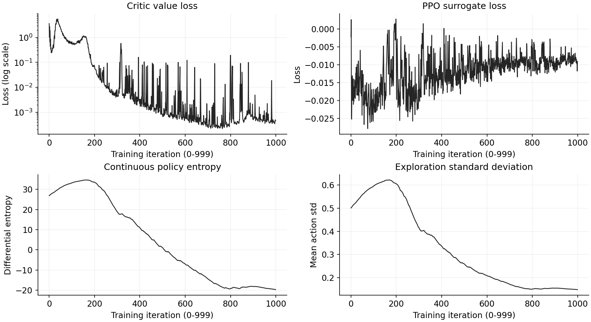
</p>
<p align="center"><sub>그림 35-3. value loss는 로그축이다. 연속 분포의 differential entropy는 음수일 수 있다.</sub></p>

엔트로피 -19.7037은 오류나 음의 확률이 아니다. 엔트로피가 0이 되는 것을 목표로 삼거나 surrogate loss의 부호 하나로 정책 개선을 판정하지 않는다.

<p align="center">
  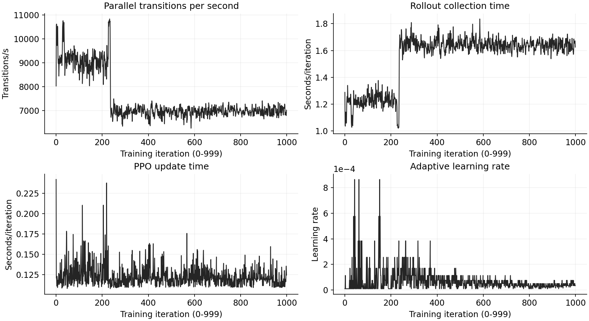
</p>
<p align="center"><sub>그림 35-4. FPS는 렌더링 프레임 수가 아니라 병렬 환경 전이 처리량이다.</sub></p>

[곡선 생성 코드](analysis/render_training_curves.py) · [1000행 CSV](analysis/training-metrics.csv) · [두 run 분리·통계 JSON](analysis/training-summary.json) · [원본 로그·모델 해시](analysis/log-manifest.json)

## 35_3·35_4 결과 — 학습 정책 vs 랜덤 정책

<p align="center">
  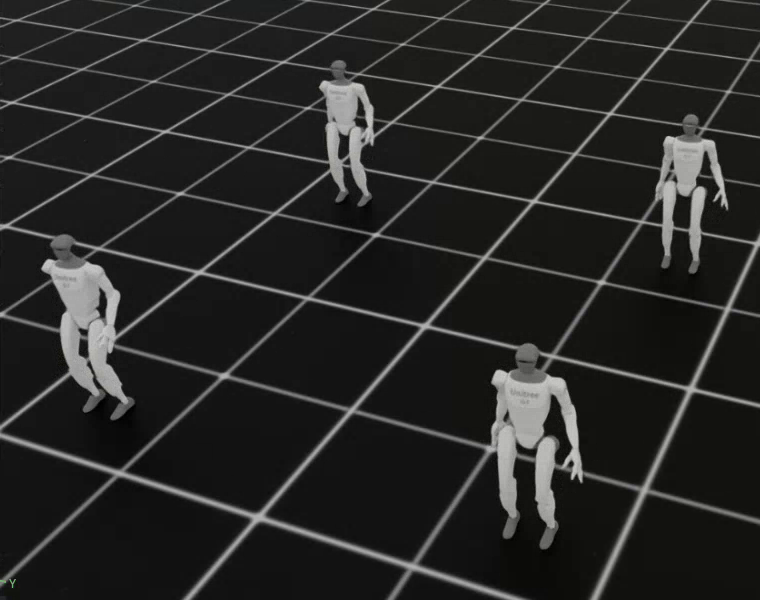
</p>
<p align="center">
  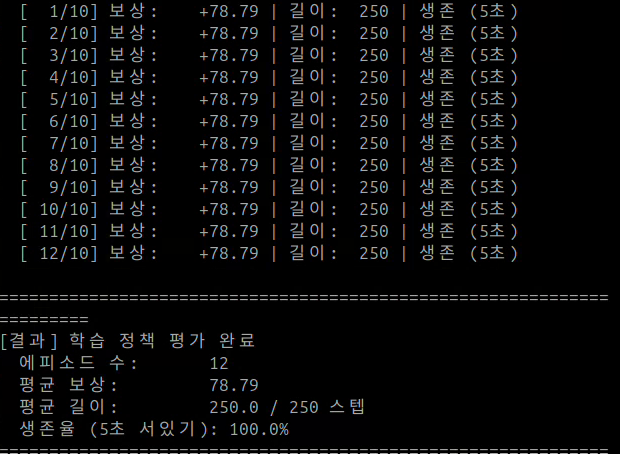
</p>
<p align="center">
  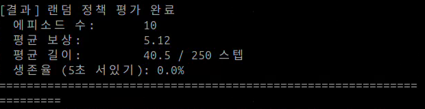
</p>

| 같은 35_3 평가 환경 | 학습 정책 영상35-3 | 랜덤 정책 영상35-4 |
|---|---:|---:|
| 병렬 환경 | 4 | 4 |
| 요청 / 실제 완료 episode | 10 / **12** | 10 / **10** |
| 평균 누적 보상 | **78.79** | **5.12** |
| 평균 길이 | **250 step · 5초** | **40.5 step · 0.81초** |
| 코드의 표시 생존율 | 100.0% | 0.0% |

원문은 같은 step에 끝난 환경을 모두 추가하므로 요청10회를 넘어 학습 정책은 12회가 기록됐다. 이를 10회라고 축소해 적지 않았다.
표시 생존율의 실제 조건은 `length >= int(250×0.95)=237`이며 **정확한 5초 timeout 비율과 다르다**. 이번 학습 정책 표본은 별도로 12회 모두250·생존 로그를 확인했다.
관측 노이즈·reset 자세 랜덤화·외란이 추가된 평가가 아니므로 동일 초기 상태의 반복 성공을 독립적인 다양한 조건의 성공으로 해석하지 않는다.
영상 로그에서 로드한 모델의 전체 경로·해시까지 별도 확정한 것은 아니며, 재현 명령은 ZIP의 최종 `model_999.pt`를 명시한다.

[캡처·영상·추가 사진 수치의 출처](analysis/media-manifest.json) · [episode 표시값 CSV](analysis/evaluation-episodes.csv) · [평가 요약·판정 기준](analysis/evaluation-summary.json)

## 관절 토크로 균형 제어 읽기

<p align="center">
  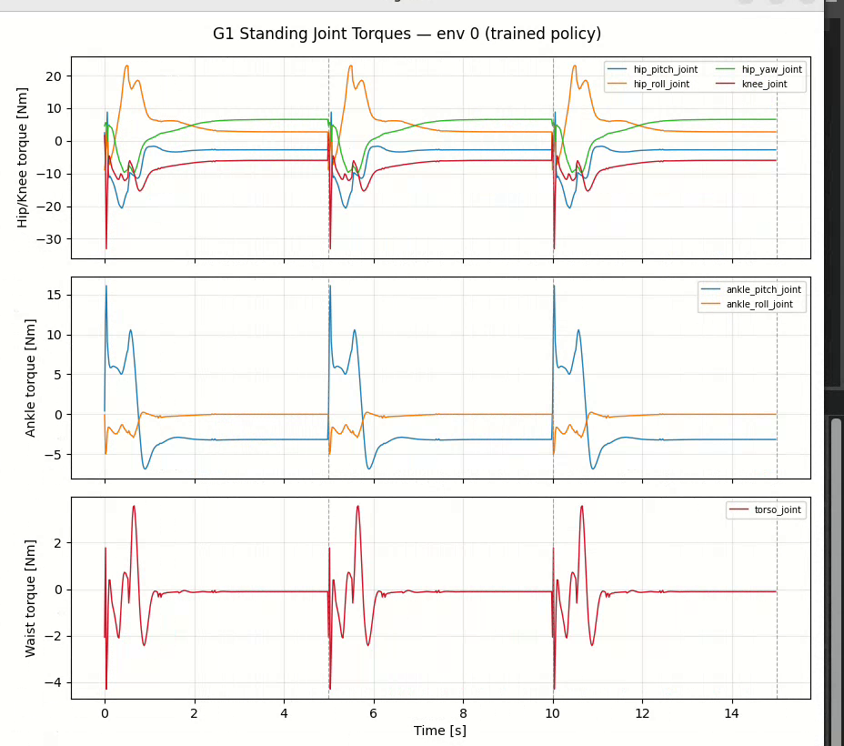
</p>
<p align="center"><sub>그림 35-5. 학습 정책: reset 직후의 과도 응답과 이후의 유지 구간. 점선은 5초 episode 경계다.</sub></p>
<p align="center">
  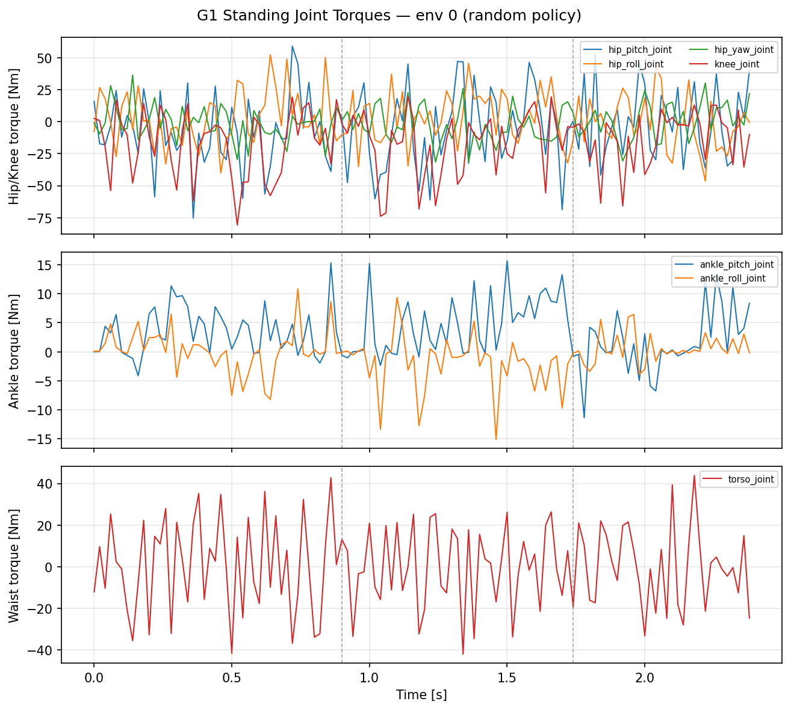
</p>
<p align="center"><sub>그림 35-6. ZIP에 남은 PNG는 random policy 결과다. 같은 출력 경로가 덮어써질 수 있어 학습 결과로 오인하지 않는다.</sub></p>

두 그래프는 **PhysX의 실제 모터 토크를 직접 측정한 값이 아니라 implicit PD 근사 토크**다. env0의 왼쪽 다리6관절+허리1관절만 기록한다.
학습 정책은15초·750개 기록, 랜덤 정책은2.4초·120개 기록이며 시간 구간과 축 범위가 다르다. 그래프 높이를 그대로 비교하거나 에너지 소비량으로 환산하지 않는다.
유지 구간에서 일부 토크가 0이 아니어도 정상이다. 목표 자세를 유지하며 중력에 맞서야 하고, 발목·무릎·엉덩이의 역할이 다르기 때문이다.

[영상 토크 통계 CSV](analysis/torque-statistics.csv)에서 학습/랜덤의 평균|τ|·최대|τ|를 관절별로 볼 수 있다. 예를 들어 왼쪽 무릎 평균|τ|는7.43/20.58N·m, 허리는0.40/16.89N·m로 표시됐다.
표본 길이가 다르고 원시 토크 시계열은 첨부되지 않았으므로 일반적인 에너지·내구성 우열을 입증하는 자료는 아니다.

## 다음 단계

36번의 모션 추종·걷기는 서기와 목표가 다르다. 기준 모션·속도·접촉·초기화·추종 보상을 새로 설계하고 평가해야 한다.
이번 서기 정책을 그대로 불러오는 것만으로 보행 정책이 되는 것은 아니다. [휴머노이드 개념](../../../learning-notes/05-humanoid-rl/humanoid-standing/README.md)에 균형·PD·보상·PPO의 연결과 확장 시 확인할 점을 정리했다.
